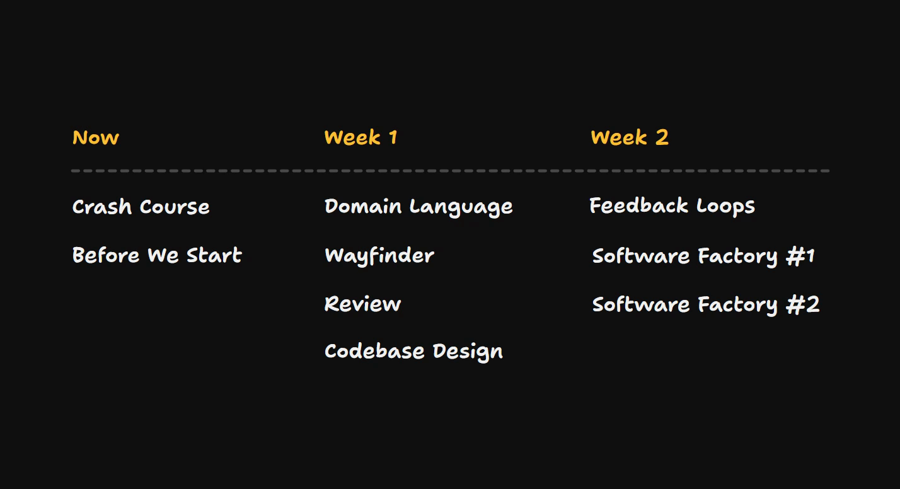
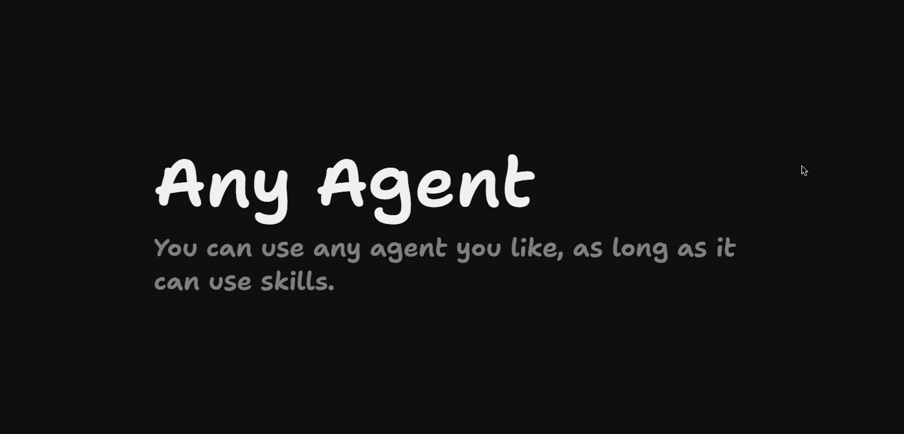
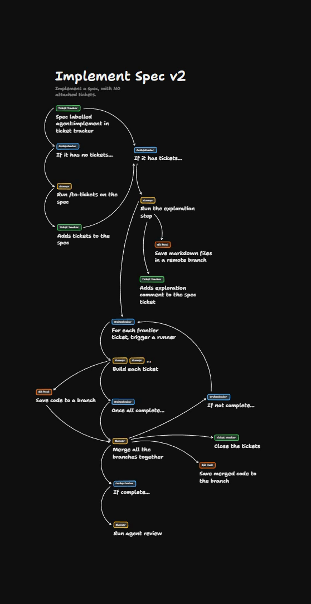
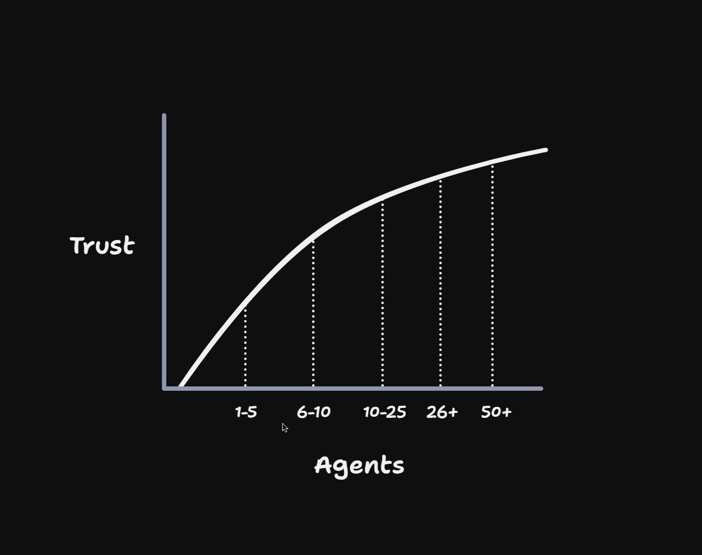

# Where We're Going

<Prerequisites title="Crash Course Prerequisites">
  <Prerequisite href="https://www.aihero.dev/workshops/ai-coding-crash-course/sessions-and-the-context-241f60ee">
    What context and the context window are, the terms used most in this course.
  </Prerequisite>
  <Prerequisite href="https://www.aihero.dev/workshops/ai-coding-crash-course/smart-zone-dumb-zone-d4b92bd0">
    Why an agent gets worse as its context fills, and why you stay in the smart zone.
  </Prerequisite>
  <Prerequisite href="https://www.aihero.dev/workshops/ai-coding-crash-course/the-grill-execute-clear-loop-fac85414">
    How grilling works: the agent interviews you until you both share the same design.
  </Prerequisite>
  <Prerequisite href="https://www.aihero.dev/workshops/ai-coding-crash-course/the-steering-map-c061e049">
    What steering is: giving an agent lasting instructions without bloating its context.
  </Prerequisite>
  <Prerequisite href="https://www.aihero.dev/workshops/ai-coding-crash-course/what-are-agent-skills-20f91a4e">
    What a skill is and how you invoke one, since the whole course runs on them.
  </Prerequisite>
</Prerequisites>

Welcome to Software Factories for Real Engineers. My name is Matt Pocock, and I am delighted that you're here.

## The promise and the problem

The central promise of [agents](https://www.aihero.dev/ai-coding-dictionary/agent) is speed. We're going to be able to ship more code faster than we ever have before. But a lot of teams are finding that this is hard.

Two questions sit at the heart of this course:

- How do you build enough trust in your agent that you can actually trust it to ship?
- Once you have built that trust, how do you jam on the accelerator just enough that you start accelerating yourself without blasting yourself into a wall?

## The shape of the course

This course is built to answer those questions, and it comes in this shape.

We're inside "Before We Start" right now, but you already have access to the crash course.

### The crash course

The crash course is the place to go if you need a grounding in how to get started. You need to understand concepts like:

- The [context window](https://www.aihero.dev/ai-coding-dictionary/context-window)
- The [smart zone](https://www.aihero.dev/ai-coding-dictionary/smart-zone)
- Steering
- The basics of [grilling](https://www.aihero.dev/ai-coding-dictionary/grilling) and using my [skills](https://www.aihero.dev/ai-coding-dictionary/skill)

If you've taken it before, I invite you to go back and review it. If you haven't, definitely go through it.

### Brakes and accelerators

Over the two weeks of the course, we're going to take the concepts we learned in the crash course and build on them in a whole new way.

If we think about the [software factory](https://www.aihero.dev/ai-coding-dictionary/software-factory) as having accelerators, things that speed it up, and brakes, then we focus on the brakes for the first week.

In week one, we're going to look at:

- Review, both automated and human
- Codebase design
- Domain language, to make sure you're aligned with the agent
- Wayfinder, to plan huge chunks of work

The focus on the brakes carries on into week two, where we look at [automated checks](https://www.aihero.dev/ai-coding-dictionary/automated-check), feedback loops and data sources. The aim is to make sure the agent can verify its own mistakes.

Then in week two, we jam on the accelerator.

- **Software Factory part one** shows you a concrete example of a software factory.
- **Software Factory part two** has us provisioning and thinking about your own infrastructure, and how you might design accelerators to push more code through your repository.

## Any agent will do

You can do this with any agent that runs in a terminal and uses skills. Those are the two main requirements. I'm going to be using Claude Code to demonstrate.

## What you'll achieve

By the end of it, we're going to be building huge, beautiful flows designed around your own infrastructure needs, building the stuff that you need built.

You will have scaled up your trust in your agents. You can go from one to five agents that you handle manually to workflows where you can comfortably run 50 agents at the same time.

## Real engineering principles

Crucially, we're going to use the brakes described here, traditional software fundamentals, to make sure that we're not shipping slop.

These are real engineering principles. I'm going to be grabbing actual books off my bookshelf and waving them at you.

My dearest hope is that you will enjoy this process with me, as I've enjoyed learning it and thinking about it.

You don't have to finish every day working with AIs feeling drained, even if you've just been in meetings all day. It can feel joyful. It can feel like flow. It can feel fun.

So let's do it. Let's take the journey together. I'm very, very excited that you're here.

Good luck, and I will see you in the next one.

