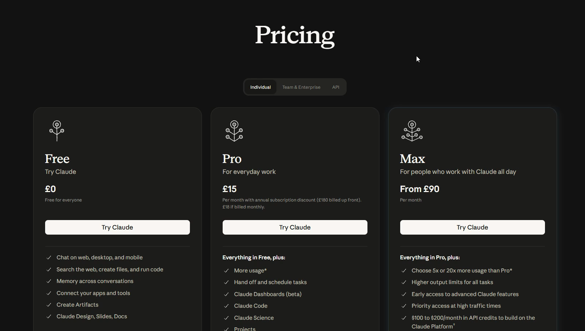
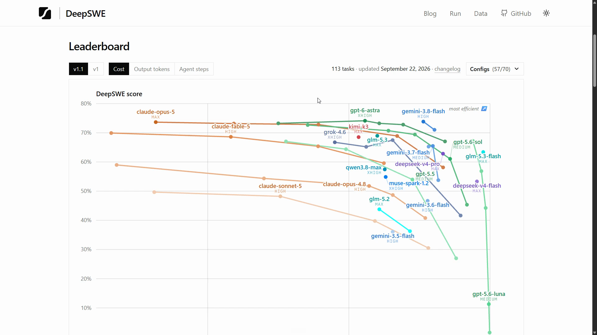

# Which Model Should I Use?

<Prerequisites title="Crash Course Prerequisites">
  <Prerequisite href="https://www.aihero.dev/workshops/ai-coding-crash-course/choosing-your-plan-and-model-24420278">
    Subscription versus pay-per-token API pricing, and why you need a paid plan.
  </Prerequisite>
  <Prerequisite href="https://www.aihero.dev/workshops/ai-coding-crash-course/models-harnesses-agents-environments-2b9a99a1">
    What a model is, and how it differs from the agent and harness wrapped around it.
  </Prerequisite>
  <Prerequisite href="https://www.aihero.dev/workshops/ai-coding-crash-course/how-much-did-it-cost-abb3ab6e">
    How tokens turn into cost, so you can see why several long-running agents burn through a plan.
  </Prerequisite>
  <Prerequisite href="https://www.aihero.dev/workshops/ai-coding-crash-course/choosing-a-model-c28af0b7">
    How to judge a model by cost and quality on your own work, not by how new it is.
  </Prerequisite>
</Prerequisites>

Before you start, let's sort out which [model](https://www.aihero.dev/ai-coding-dictionary/model) you're going to be using and which plan you're going to be using to pay for it.

## Why Your Model Choice Matters Here

Your model choice is going to matter more than it did in the crash course. We're going to have [agents](https://www.aihero.dev/ai-coding-dictionary/agent) running for longer, often several at the same time, and eventually making autonomous decisions that are quite high value and very important.

Because a bunch of agents will be running at the same time, they will burn through a plan that's too cheap.

We looked at this before in the crash course, in the choosing your plan and model lesson. You still definitely need a paid plan.

## Which Subscription Do I Need?

Looking at Claude's pricing page, we will not be able to do this course on the free plan. Pro is tight.

The reason is that we are planning to use Opus-level models for this work. Opus-level models are a bit more expensive, so in my opinion you will probably need the $100 a month plan as a minimum.

| Plan | Verdict |
| --- | --- |
| Free | Not enough |
| Pro | Possible on a Sonnet-level model, but you'll be rationing |
| Max (~$100 a month) | Minimum for Opus-level models |
| Max, upper tier (~$200 a month) | What I use day in, day out |

You can go for Pro and just squeak by on a Sonnet-level model. But then you will be rationing, and you won't get the full sense of what a [software factory](https://www.aihero.dev/ai-coding-dictionary/software-factory) can do.

If you're not sure and don't want to spend the megabucks immediately, start on Pro and upgrade once you run out of usage.

Personally, I'm on the upper version of Max, which I use day in, day out. It's around $200 a month.

### Subscription, Not API

I'm not using the API at all. The API will end up costing vastly more money to do the same amount of work than an individual, team or enterprise subscription.

It doesn't really matter which subscription, agent or model you use. What matters is that you're using an Opus-level model, and that you have enough [tokens](https://www.aihero.dev/ai-coding-dictionary/token) to comfortably complete the course.

## Which Model Should I Use?

You can check which models are currently performing best by looking at DeepSWE. It's a benchmark I sort of vaguely trust, and at the least it gives you a decent idea of which models are in the right ballpark.

The model I used, Opus 5.5, is not actually on this list anywhere. But what we're looking for is any model that ends up in the top right quadrant.

## Summary

Which model should you use? One that's Opus class, on probably at least the $100 plan.

Again, you can start on the cheaper plan and move up if you need to.

If you're not sure which plan fits you, feel free to ask in the [Discord](https://www.aihero.dev/discord), which I'll be introducing in a couple of videos' time.

Nice work, and I will see you in the next one.
