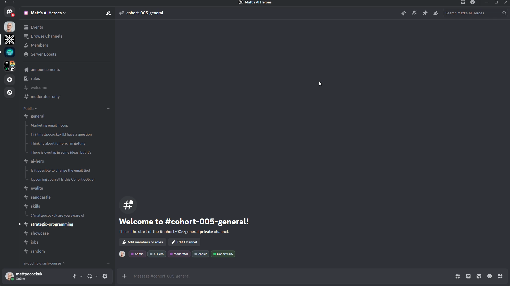
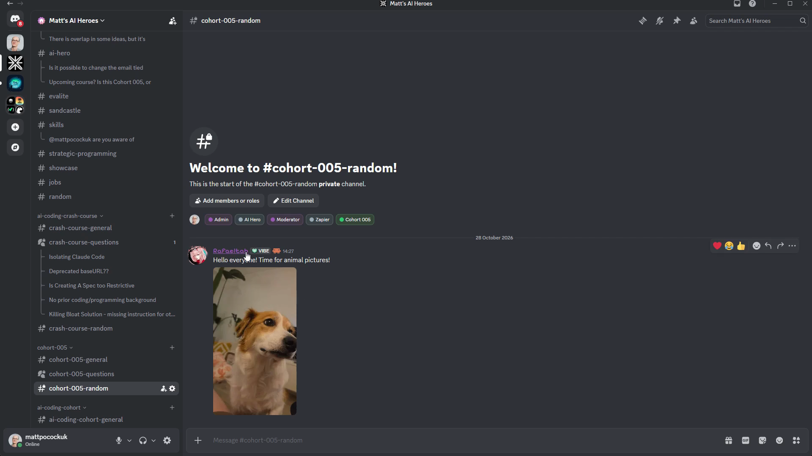
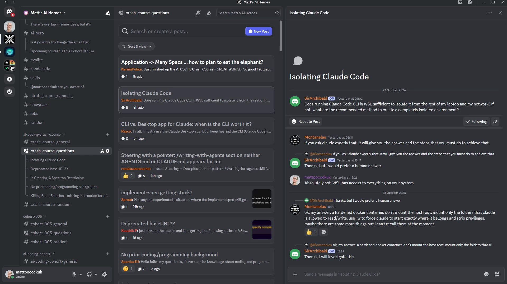

# Navigating The Discord

<Prerequisites title="Crash Course Prerequisites">
  <Prerequisite href="https://www.aihero.dev/workshops/ai-coding-crash-course/navigating-the-discord-9fcb8387">
    The Discord's public channels, roles and where to ask for help.
  </Prerequisite>
</Prerequisites>

One of the coolest things about running this course as a cohort, even though it's mostly self-paced, is the community that comes with it and the ability to ask questions.

At some point, you are going to get stuck. Everybody does. When that happens, the [Discord](https://www.aihero.dev/discord) is the place to ask.

## The public channels

If you've done the crash course, you will know the general channels here, and the AI coding crash course channels too.

The top section is public and open to everyone:

| Channel | Purpose |
| --- | --- |
| general | General stuff |
| AI Hero | AI Hero specific questions |
| Evalite | My Evalite library |
| Sandcastle | My [Sandcastle](https://github.com/mattpocock/sandcastle) library |
| skills | My [skills repo](https://github.com/mattpocock/skills) |

There's also a bunch of other channels at the bottom of that section.

One of them is strategic programming. It's a really nice little community of people interested in software fundamentals.

You also have:

- **showcase**, if you have anything you want to show off
- **jobs**, if you want to post about jobs you are hiring for
- **random**, for all sorts of memes and random stuff

## Crash course and cohort channels

The AI coding crash course channels live in the next section, and the cohort 005 channels live just below it.

Starting with the random channel: Rafael, one of the mods, has already come in and posted a photo of his dog.

## Getting questions answered

Probably the most important channel is the questions channel.

Looking at the crash course questions, people are asking tons of different questions and getting lots of feedback.

If you have a specific question, you can search for existing questions to see if it's already been answered. Or you can post one yourself.

For anything else that's on topic and that you want to chat about, general is the place.

That's the crash course general channel. The cohort 005 general channel has only just been created, so it is quite quiet.

## Accessing the cohort channels

To access cohort 005, you will need the **cohort 005** role.

You should have been assigned this at purchase. There should have been a link you could click on. There's also a [role link](https://aihero.dev/discord/roles) that connects your AI Hero account to [Discord](https://www.aihero.dev/discord).

If that link doesn't work and you still can't see these channels, double and triple check, because sometimes they are hiding in plain sight. If not, email [team@aihero.dev](mailto:team@aihero.dev).

## Moderators and heroes

There are a couple of other roles floating around.

We have moderators, who mostly just ban people selling Mr. Beast merchandise. I am a moderator, and Rafael and ChinStrap are the other moderators.

The little red roles are the **AI Heroes**. They are very friendly, very awesome people in the community. I've given them the role because they're particularly helpful and cool.

If you answer a ton of questions in [Discord](https://www.aihero.dev/discord) like Camille and Jasper have done, I might turn up and give you the hero role.

## Why the community matters

So that's the [Discord](https://www.aihero.dev/discord). It's a really fun place to hang out. We are going to learn a lot from the wisdom of the discussions we have together.

I think it's invaluable to share ideas with people in your position. This cohort is going to be big, and many people here are in exactly the same state as you are right now. They might be:

- an advanced person coming to learn more about AI coding
- a senior dev looking to change careers
- someone with no professional coding experience who wants to catch up and do something awesome with their time

During the cohort, I take two weeks off. You will find me hanging out in the [Discord](https://www.aihero.dev/discord), answering questions and chatting about the material.

Nice work. I will see you in the next one, and also in the [Discord](https://www.aihero.dev/discord).

<Quiz>
  <QuizQuestion data={{
    id: "discord-cohort-channels-missing",
    question: "You've bought the cohort and joined the Discord, but you can't see any cohort 005 channels. What do you do?",
    type: "multiple-choice",
    choices: [
      { answer: "a", label: "Use the role link, double check, then email team@aihero.dev" },
      { answer: "b", label: "Ask for the cohort role in the crash course general channel" },
      { answer: "c", label: "Email team@aihero.dev straight away without checking again" },
      { answer: "d", label: "Wait a few days, since cohort roles are handed out in batches" }
    ],
    correct: "a",
    answer: "The role link connects your AI Hero account to Discord and gives you the cohort 005 role. The channels can also be hiding in plain sight, so check again before emailing. Asking in the crash course channel won't grant a role, emailing first skips the quick fixes, and the role isn't handed out in batches."
  }} />
  <QuizQuestion data={{
    id: "discord-where-to-ask-question",
    question: "You're stuck on a specific problem from the course. Where should you start?",
    type: "multiple-choice",
    choices: [
      { answer: "a", label: "Search the questions channel first, then post if unanswered" },
      { answer: "b", label: "Post it in the general channel so the most people see it" },
      { answer: "c", label: "Message a moderator directly, since they answer questions" },
      { answer: "d", label: "Ask in the random channel, where the most people hang out" }
    ],
    correct: "a",
    answer: "The questions channel is the place for specific questions, and searching it first may show your question has already been answered. General is for other on-topic chat, random is for memes, and moderators mostly deal with bans rather than answering questions."
  }} />
</Quiz>
