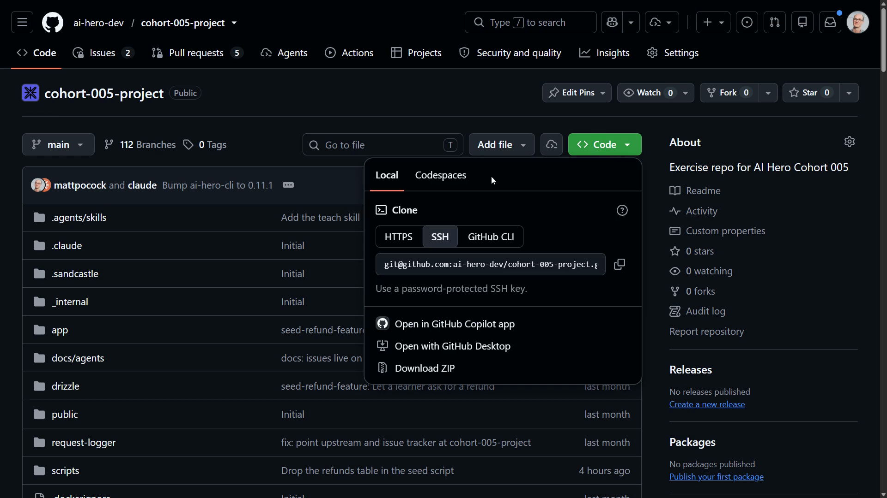
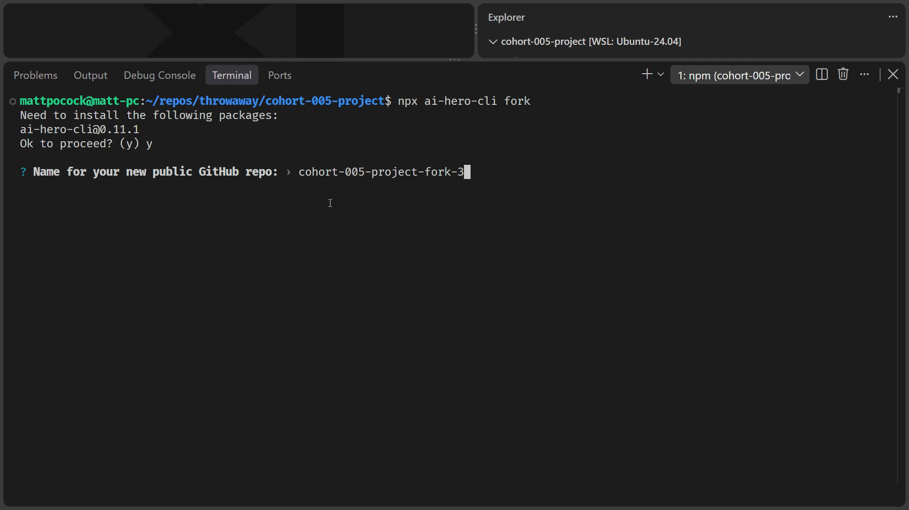
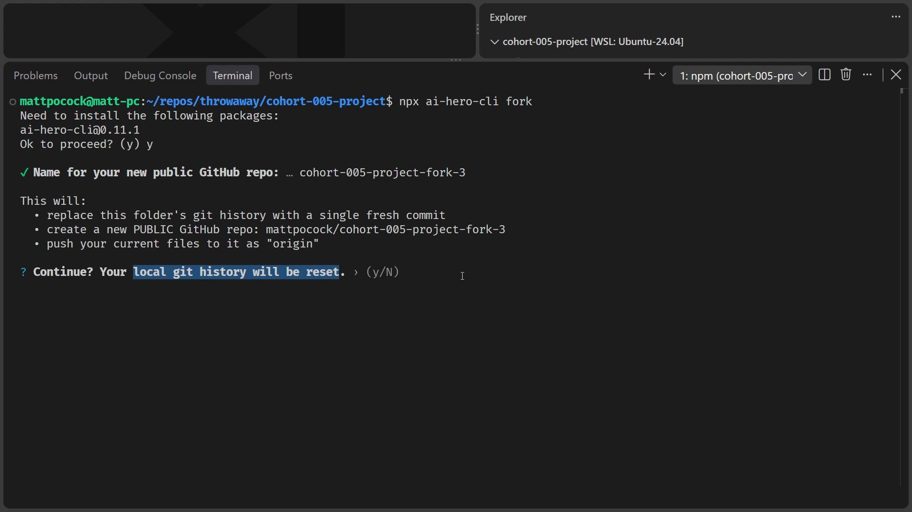
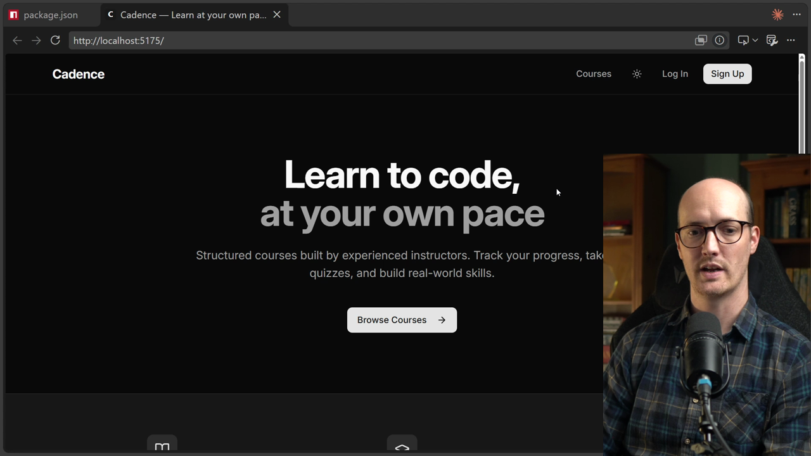

# Repo Setup

<Prerequisites title="Crash Course Prerequisites">
  <Prerequisite href="https://www.aihero.dev/workshops/ai-coding-crash-course/setting-up-the-project-ce72490e">
    How to install Git and Node, clone a repo, seed the database and run Cadence locally.
  </Prerequisite>
  <Prerequisite href="https://www.aihero.dev/workshops/ai-coding-crash-course/installing-claude-code-689b4791">
    How to install a coding agent, log in and pick a model.
  </Prerequisite>
  <Prerequisite href="https://www.aihero.dev/workshops/ai-coding-crash-course/database-migrations-dc4afad1">
    What seeding and migrating the database do, so `npm run db:seed` makes sense.
  </Prerequisite>
  <Prerequisite href="https://www.aihero.dev/workshops/ai-coding-crash-course/set-up-your-issue-tracker-30629075">
    How GitHub Issues and the `gh` CLI hold your specs and tickets, which is why you need your own fork.
  </Prerequisite>
</Prerequisites>

In this lesson, we are going to get the `cohort-005-project` repo onto your machine and turn it into your own repo on GitHub.

This is a different repository from the one we set up in the crash course. Even if you've done all these steps before, don't skip this lesson, because this is a different playground.

## Clone the repository

The first thing to do is clone it. On the GitHub repo page, open the **Code** dropdown and copy the clone URL. You can use SSH, but HTTPS is probably the better choice.



Run `git clone` with the HTTPS URL, in whichever directory you like on your machine.

```bash
git clone https://github.com/ai-hero-dev/cohort-005-project
```

Once that's done, `cd` into the folder.

```bash
cd cohort-005-project
```

Next, open it in VS Code.

```bash
code .
```

You don't have to use VS Code. You can use whichever IDE you like, or just the terminal. VS Code is what I'm going to be using in the course.

## Fork it into your own repo

Next, we're going to do something you'll be familiar with if you did the crash course: create our own version of this repository on GitHub.

The reason is that you don't only need the code. You also need your own set of issues and your own pull requests. I've made this very simple with a single command.

```bash
npx ai-hero-cli fork
```

It asks to install `ai-hero-cli` at a specific version. That's fine by me.

It then asks for a name. I'm going to give it `cohort-005-project-fork-three`, because I've done this a few times by now.



### What the command is about to do

The CLI tells you what it's going to do:

- Remove the course's `origin` remote from this folder.
- Create a new public GitHub repo.
- Push your `main` branch, with the course's history, to it as `origin`.

All of that is fine.

Your git history stays intact. The project has custom commands that link back to the upstream of the original repo, which I'll explain in a minute. Because your `main` still shares its history with the course, those commands keep lining up with it.

If the command stops instead, it tells you why and changes nothing. It wants you on `main`, with no uncommitted changes to tracked files. Fix what it names and run it again.

Press `Y` to say yes.



Once that's done, it says your public repo is ready. Let's have a look at it.

You now have your own repo, with your own issues and your own pull requests. We're going to use these as our [ticket](https://www.aihero.dev/ai-coding-dictionary/ticket) tracker.

### Why the repo is public

We make it public because later in the course we're going to rely on GitHub Actions, and GitHub Actions are free for public repositories.

If you make your repository private, you do get a free allowance, I think. But it's not terribly generous. Keeping it public means it's a great learning tool.

If you can't or don't want a public repo, run `npx ai-hero-cli fork --private` instead. Private repos use your account's Actions minutes, and the factory's draft pull requests on a private repo need a paid GitHub plan.

## Install dependencies and run the app

Now that we're back in the project, let's set up the dev server so we can see what we're building.

What we're building is very similar to the crash course. We're in an alternate universe of the Cadence course platform.

I thought about shipping a different playground inside the cohort. But you've already built up a lot of knowledge about Cadence and you understand how it works. It's better to leverage that, so your new knowledge is applied to something you already understand.

If you did the crash course, this will feel very familiar. First, install the dependencies.

```bash
npm install
```

You'll see a few deprecation warnings and some vulnerabilities. Don't worry about those.

We're not going to start the app yet. First, we seed a local SQLite database.

```bash
npm run db:seed
```

From there, we can start the dev server.

```bash
npm run dev
```

We should now see the app running on localhost, and with any luck, Cadence is connected.



There we go: the familiar Cadence platform you know and love is ready to go. That's pretty much all the setup you need in order to start working on the course.

## Signups you'll need later

I do want to give you a quick note on a couple of signups we're going to make later, if you're following my setup closely.

| Service | When | What you need |
| --- | --- | --- |
| [Knock](https://knock.app) | When we build a notification system | A free developer account. No credit card, but you do have to give them your email. |
| [TLDraw](https://tldraw.com) | Much later, for whiteboarding | We use their canvas, and you can sign in with your Google account. |

[Knock](https://knock.app) won't cost you any money. You only need to give your email to follow what I do in the course.

For whiteboarding, we're going to use my favorite drawing app of all time. You've seen it a thousand times in my videos: [TLDraw](https://tldraw.com). It's freaking great, so it's a great opportunity to try it.

## Troubleshooting and next steps

That's our setup done. If you had any trouble with it whatsoever, head to the [Discord](https://www.aihero.dev/discord) to ask questions. Maybe we can push an update that helps fix things.

If you run into trouble, I'll take your experience and put it inside the troubleshooting section below. So if you hit any issues, check there first.

### Troubleshooting

This section is currently empty. As people report problems with this setup, the fixes will be added here.

Nice work, and I'll see you in the next one.

<Quiz>
  <QuizQuestion data={{
    id: "fork-repo-public-for-actions",
    question: "Your fork is about to be created and you're tempted to make it private to keep it tidy. Later lessons rely on GitHub Actions. What do you do?",
    type: "multiple-choice",
    choices: [
      { answer: "public", label: "Keep it public, because Actions are free on public repos" },
      { answer: "private-blocked", label: "Make it private, because Actions can't run on private repos" },
      { answer: "private-free", label: "Make it private, because Actions are always free for everyone" }
    ],
    correct: "public",
    answer: "GitHub Actions are free for public repositories, which makes a public repo a great learning tool. Private repos can run Actions too, but you only get a free allowance that isn't terribly generous, so they aren't blocked and they aren't unlimited. If you can't use a public repo, `npx ai-hero-cli fork --private` works, using your account's Actions minutes."
  }} />
  <QuizQuestion data={{
    id: "seed-before-dev-server",
    question: "`npm install` has finished. What's the next step to get Cadence running locally?",
    type: "multiple-choice",
    choices: [
      { answer: "seed-then-dev", label: "Run `npm run db:seed` to seed SQLite, then `npm run dev`" },
      { answer: "dev-then-seed", label: "Run `npm run dev` first, then seed the database after" },
      { answer: "reinstall", label: "Run `npm install` again so the database gets created" }
    ],
    correct: "seed-then-dev",
    answer: "The app needs its local SQLite database seeded before you start the dev server, so `npm run db:seed` comes first. Starting the server first means the app has no data to show. Running `npm install` again only reinstalls dependencies and never creates the database."
  }} />
  <QuizQuestion data={{
    id: "fork-keeps-course-history",
    question: "The fork command pushes your `main`, with the course's history, to your new GitHub repo. Why is keeping that history what you want?",
    type: "multiple-choice",
    choices: [
      { answer: "lines-up", label: "Your `main` still shares commits with the course, so `reset` and `pull` keep lining up with it" },
      { answer: "backup-only", label: "It's only a backup; the course commands ignore your history" },
      { answer: "every-branch", label: "It copies every branch and tag of the course into your repo" }
    ],
    correct: "lines-up",
    answer: "The project's custom commands link back to the upstream of the original repo, and because your `main` keeps the course's commits, `reset` and `pull` line up with it instead of reporting that the branches have diverged. Only `main` is pushed: other branches and tags stay on your machine."
  }} />
</Quiz>
