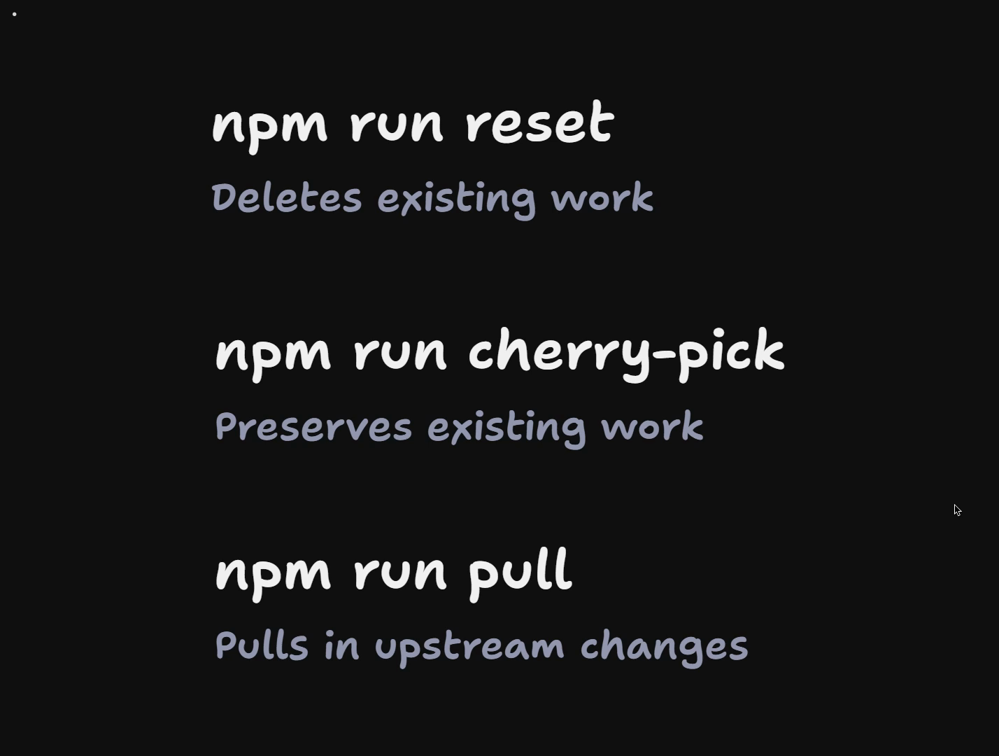
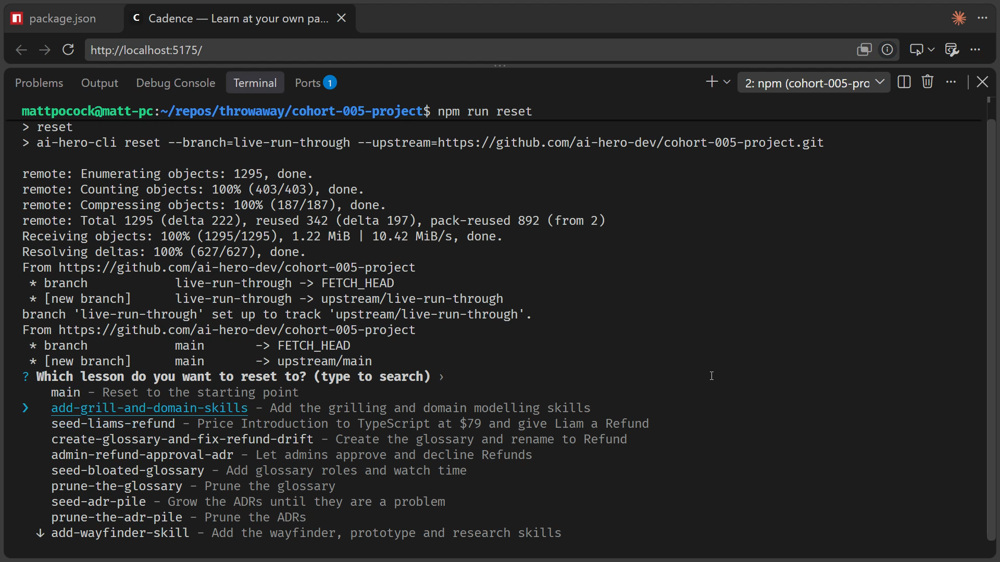
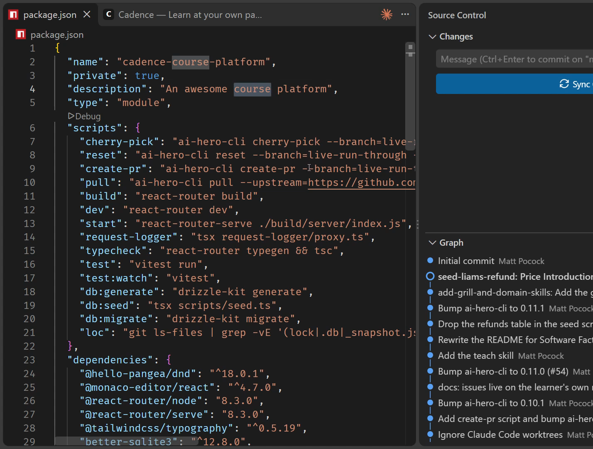

# How To Take This Course

<Prerequisites title="Crash Course Prerequisites">
  <Prerequisite href="https://www.aihero.dev/workshops/ai-coding-crash-course/where-we-re-going-6167bf7e">
    The five-step system (grill, spec, tickets, implement, review) that the cohort builds on.
  </Prerequisite>
  <Prerequisite href="https://www.aihero.dev/workshops/ai-coding-crash-course/how-to-run-the-exercises-a0eb0474">
    How `npm run reset` and cherry-picking move your repo between the lesson's commits.
  </Prerequisite>
  <Prerequisite href="https://www.aihero.dev/workshops/ai-coding-crash-course/database-migrations-dc4afad1">
    Why a reset can need `npm run db:migrate` and `npm run db:seed` to line the database up.
  </Prerequisite>
  <Prerequisite href="https://www.aihero.dev/workshops/ai-coding-crash-course/models-harnesses-agents-environments-2b9a99a1">
    What an agent actually is: a model, a harness and an environment working together.
  </Prerequisite>
  <Prerequisite href="https://www.aihero.dev/workshops/ai-coding-crash-course/non-determinism-c31d9cdd">
    Why the same prompt gives different answers, so drifting from my code drifts your results.
  </Prerequisite>
</Prerequisites>

This course is built around exercises. We're going to plan features, fix bugs and review diffs. We're going to build parts of the [software factory](https://www.aihero.dev/ai-coding-dictionary/software-factory) and plan other parts.

The hard part, and the part I've had to design around as a course creator, is this: how do you keep your code in perfect sync with mine?

We want to avoid drifting apart. If we drift, you'll get different results from your [agent](https://www.aihero.dev/ai-coding-dictionary/agent) than I do.

We're going to use exactly the same system we saw in the crash course for running the exercises. So this is more of a reminder.



There are three commands to know, and each does something slightly different.

| Command | What it does |
| --- | --- |
| `npm run reset` | Replaces your work, deleting existing work |
| `npm run cherry-pick` | Preserves your work and puts the lesson's commit on top |
| `npm run pull` | Pulls in upstream changes |

## Resetting with `npm run reset`

The first command is `npm run reset`, which you can run as soon as you've run `npm install`.

```bash
npm run reset
```

This gives you a list of lessons that you can reset to. For instance, we've got `seed Liam's refund`, `create glossary and fix refund drift`, and so on.



All of these are checkpoints in the course, and there are absolutely tons of them.

I'm going to choose `add grill and domain skills` with Enter. Then I can either reset my current branch, or, if I want to preserve what's on my branch, create a new branch from the commit.

I'm going to reset my current branch. It gives me a warning about the commits that are going to be discarded, so I say yes. Now some code has changed.

## Reset deletes existing work

The thing about `npm run reset` is that it deletes all existing work. It's a bit like `git reset`, if you've ever used that.

If you have work you want to preserve, commit it or put it on a branch somewhere first.

## Preserving work with `npm run cherry-pick`

If you have work you want to preserve, `npm run cherry-pick` is the way to go.

I'm going to run `npm run reset` again and reset back to `main`, the starting point. I'll reset my current branch again, and then run `npm run cherry-pick`.

```bash
npm run cherry-pick
```

I see the same list of commits. But now, when I choose one, it puts that lesson's commit on top of my work instead of replacing it.

For instance, I'll go into `package.json` and call this an "awesome horse platform" instead of an "awesome course platform". I'll commit that with the message "course to horse".

Now when I cherry-pick `add grill and domain skills`, the awesome horse platform is right there. It hasn't been deleted.

If I run `npm run reset` once more, this time to `seed Liam's refund`, and reset the branch, it deletes all the commits. You can see my change from course to horse has been reverted.



## Handling merge conflicts

`npm run cherry-pick` preserves your existing work. The potential cost is a merge conflict between your work and mine.

When we get to building our software factory, we'll use `npm run cherry-pick` quite a lot. It lets you choose the [model](https://www.aihero.dev/ai-coding-dictionary/model) you want to use in your software factory, while still picking up my changes.

## Pulling upstream updates

The last command is `npm run pull`.

```bash
npm run pull
```

This is usually for when I notice something has gone wrong during the course. I'll ship a fix to the course repo while the cohort is still running, and post about it in the [Discord](https://www.aihero.dev/discord). Then you run `npm run pull` to merge it into your repo.

Just like cherry-pick, it attempts to preserve your existing work. You might get some merge conflicts, but it won't delete existing work the way reset does.

To sum up:

- `npm run reset` replaces your work.
- `npm run cherry-pick` cherry-picks on top of your work.
- `npm run pull` pulls in upstream changes.

## After a reset: install, migrate and seed

When you run `npm run reset`, it changes your source code, but it doesn't reinstall your packages.

So if we reset to `admin refund approval ADR` and reset the current branch, you might need to run a few more commands.

First, `npm install`. This pulls in any packages that have been added or updated since those commits.

```bash
npm install
```

Next, `npm run db:migrate`. This adds any data migrations that have been added to the database.

```bash
npm run db:migrate
```

Finally, you may want `npm run db:seed`. This seeds the database exactly how the lesson expects.

```bash
npm run db:seed
```

## Lining up with the lessons

That's how you take the course. In every lesson there are commits you can reset to, so you're lined up exactly with the code I'm showing you.

Nice work, and I'll see you in the next one.

<Quiz>
  <QuizQuestion data={{
    id: "reset-vs-cherry-pick-choice",
    question: "You've committed your own change to `package.json` and want to jump to the next lesson's checkpoint without losing it. What do you run?",
    type: "multiple-choice",
    choices: [
      { answer: "reset", label: "Run `npm run reset` and pick the checkpoint" },
      { answer: "cherry", label: "Run `npm run cherry-pick` and pick the checkpoint" },
      { answer: "pull", label: "Run `npm run pull` to fetch that checkpoint" }
    ],
    correct: "cherry",
    answer: "`npm run cherry-pick` puts the lesson's commit on top of your work, so your change survives, at the possible cost of a merge conflict. `npm run reset` deletes your commits and replaces them with the checkpoint. `npm run pull` doesn't choose a checkpoint: it merges in fixes I ship to the course repo."
  }} />
  <QuizQuestion data={{
    id: "post-reset-install-migrate-seed",
    question: "You've just reset to a later checkpoint, and the app needs new packages, new tables and new seed data. What do you do?",
    type: "multiple-choice",
    choices: [
      { answer: "all", label: "Run `npm install`, then `npm run db:migrate`, then `npm run db:seed`" },
      { answer: "again", label: "Run `npm run reset` again, because it reinstalls all your packages" },
      { answer: "seed", label: "Run only `npm run db:seed`, because reset handles the packages too" }
    ],
    correct: "all",
    answer: "Reset only changes your source code. It doesn't reinstall packages, so you run `npm install`, then `npm run db:migrate` for new migrations, then `npm run db:seed` to seed the data the lesson expects. Resetting again changes nothing about that, and seeding alone leaves missing packages and unmigrated tables."
  }} />
</Quiz>
