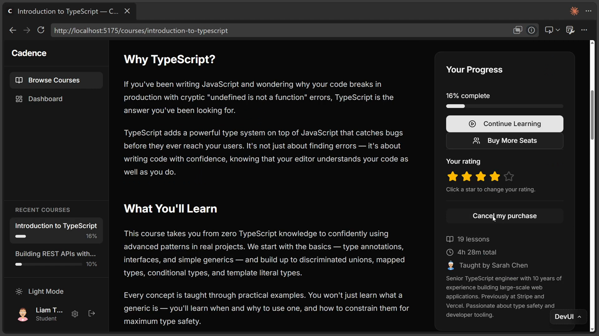
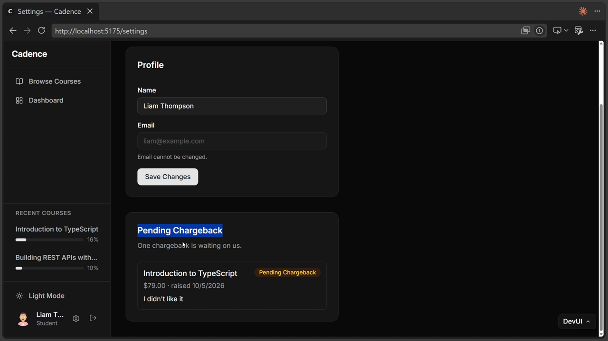
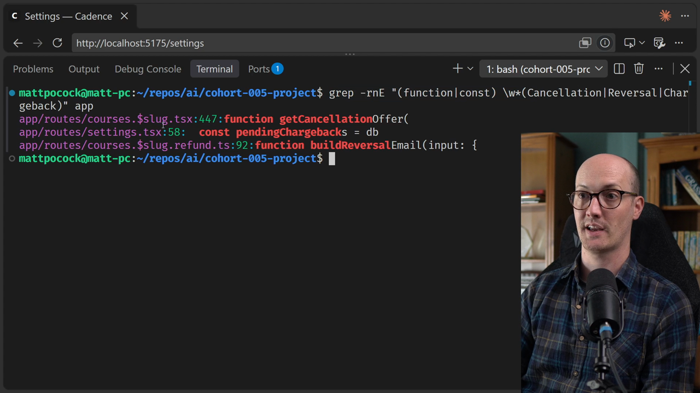
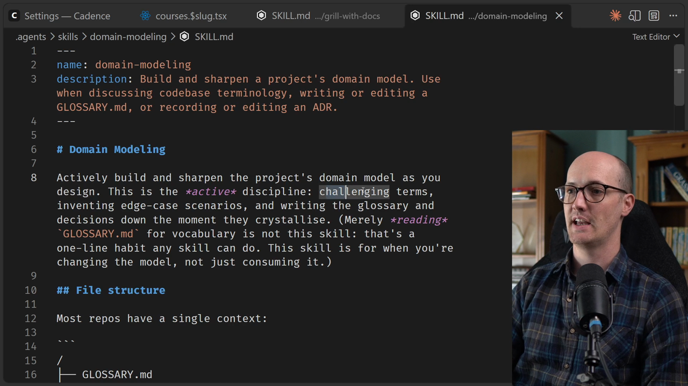

# Domain Language

<CommitMap packageManager="npm">
  <Commit id="seed-liams-refund">Follow along: Liam's $79 purchase seeded, with "Cancel my purchase" on his course page</Commit>
</CommitMap>

<Prerequisites title="Crash Course Prerequisites">
  <Prerequisite href="https://www.aihero.dev/workshops/ai-coding-crash-course/how-to-run-the-exercises-a0eb0474">
    How `npm run reset` jumps your repo to the lesson's starting commit.
  </Prerequisite>
  <Prerequisite href="https://www.aihero.dev/workshops/ai-coding-crash-course/models-harnesses-agents-environments-2b9a99a1">
    What an agent actually is: a model, a harness and an environment working together.
  </Prerequisite>
  <Prerequisite href="https://www.aihero.dev/workshops/ai-coding-crash-course/the-grill-execute-clear-loop-fac85414">
    How grilling works: the agent interviews you until you both share the same design.
  </Prerequisite>
  <Prerequisite href="https://www.aihero.dev/workshops/ai-coding-crash-course/the-steering-map-c061e049">
    How files like GLOSSARY.md steer the agent, and what they cost in context.
  </Prerequisite>
  <Prerequisite href="https://www.aihero.dev/workshops/ai-coding-crash-course/what-are-agent-skills-20f91a4e">
    What a skill is and how you invoke one like `/grill-with-docs`.
  </Prerequisite>
</Prerequisites>

Ever since AI coding became viable, the thing so many people underestimate is communication. The quality of that communication between user and [agent](https://www.aihero.dev/ai-coding-dictionary/agent) is going to be a big factor in determining the quality of the output.

The language we use, the things we define, how compressed or verbose that language is - all of it has a huge impact.

[Models](https://www.aihero.dev/ai-coding-dictionary/model) these days have a reputation for being pretty hard to talk to. Consider asking an agent about Cadence, our course platform: "Can a learner get their money back?"

It might reply with:

> The reversal eligibility envelope is evaluated by the cancellation gate, which defers to the chargeback settlement handler once the entitlement lease is released.

That answer contains four **invented names**, terms that simply don't exist in the codebase. The agent decided to start calling things by these names itself.

The reason agents invent names like this is efficiency. Squeezing lots of meaning into a small name means it can reuse that name again and again without having to explain itself every time. But for a user who doesn't know what these terms mean, it's a nightmare.

## A Shared Vocabulary Fixes This

The best way around this is a shared vocabulary: a `GLOSSARY.md` file used for communicating between the user and the agent.

It sounds incredibly simple, but this technique has ramifications further down the line. It's one of the best techniques for:

- Increasing the quality of your communication with the agent
- Increasing the agent's quality of output
- Improving your codebase
- Improving the experience for your users downstream

## The Cost of Inconsistent Language

This isn't just a theoretical problem. There's a live issue in our demo application, Cadence, that isn't really a bug, it's a language issue.



If we log in as Liam Thompson and go to his Introduction to TypeScript course, the course page offers a button labelled **"Cancel my purchase"**.

After submitting, the terminal prints the confirmation email sent to Liam. That email uses a completely different word:

```txt
subject: Reversal requested — Introduction to TypeScript

Hi Liam Thompson,

We have your Reversal request for "Introduction to TypeScript".
The Reversal is for $79.00, the amount you paid.

Our team reviews every Reversal by hand. You do not need to do
anything else — we will email you again when it is done.

— The Cadence team
```

And then on the account settings page, a third name appears:



**"Pending Chargeback."**

So Liam asked to cancel his purchase, got an email saying his Reversal request was accepted, and now sees a Pending Chargeback on his account. Three names for the same thing. That kind of inconsistent language is a nightmare for users.

### The Drift Lives in the Code Too

It's not just the UI - the same drift exists in the code identifiers:

| Name                   | Where it lives                       |
| ---------------------- | ------------------------------------ |
| `getCancellationOffer` | `app/routes/courses.$slug.tsx`       |
| `buildReversalEmail`   | `app/routes/courses.$slug.refund.ts` |
| `pendingChargebacks`   | `app/routes/settings.tsx`            |



Any agent walking through this setup has to find all these different names for the same thing. And because it can't, code gets duplicated, because the agent simply can't find what it's looking for.

## Fixing Language With `/grill-with-docs`

The fix is: when you're figuring out what you want to build, also figure out the language you want to use to build it.

The way to do this is an improvement to the `/grill-me` [skill](https://www.aihero.dev/ai-coding-dictionary/skill) called `/grill-with-docs`. It builds on two skills layered together:

- **`/grilling`** - the foundation, the same relentless interview as `/grill-me`
- **`/domain-modeling`** - layered on top, which actively challenges your language as you work through a [grilling](https://www.aihero.dev/ai-coding-dictionary/grilling) session

The `/domain-modeling` skill:

- Challenges terms
- Invents edge-case scenarios
- Writes a glossary and a set of decision records the moment they crystallise

The files it writes are `GLOSSARY.md` and entries in `docs/adr/`. Every other skill in the setup then reads from this glossary to ensure it's using consistent language.



Throughout this section, we're going to learn how to replace `/grill-me` with `/grill-with-docs`, settle these language decisions, and turn them into a clean codebase, and a better product too.

## Ubiquitous Language

A lot of the ideas here come from [Domain-Driven Design](https://en.wikipedia.org/wiki/Domain-driven_design) by Eric Evans. DDD calls this a **Ubiquitous Language**.

This is a big, thick book, and we're really taking just one or two ideas from it. None of the hardcore stuff - no aggregates, no event sourcing. Just a glossary and the application of that glossary.

The one big thing to take from that book is the word **ubiquitous**. This language has to be the same _everywhere_ it's used:

- The way the team talks about the product
- The product UI itself
- The code

The moment you figure out the right name for the thing you're building, you've basically built the thing, because you understand how to use it in conversation, how to talk about it, and how to frame it to the agent so it can build it.

<Quiz>
  <QuizQuestion data={{
    id: "ubiquitous-language-scope",
    question: "You add a new term to your GLOSSARY.md. Where does that term need to appear for the language to be truly ubiquitous?",
    type: "multiple-choice",
    choices: [
      { answer: "a", label: "In the GLOSSARY.md file only, so the agent can reference it" },
      { answer: "b", label: "In the codebase identifiers only, since users don't see code" },
      { answer: "c", label: "In the team's conversation, the product UI, and the code identifiers" },
      { answer: "d", label: "In the agent's prompts, but not necessarily the UI or code" }
    ],
    correct: "c",
    answer: "Ubiquitous means everywhere - the team's conversation, the product UI, and the code all have to use the same term. A glossary term that never reaches the UI or the code identifiers has only gone part of the way."
  }} />
  <QuizQuestion data={{
    id: "agent-invented-names-reason",
    question: "Why does an agent invent its own names for concepts rather than using plain language?",
    type: "multiple-choice",
    choices: [
      { answer: "a", label: "It is trying to match the naming conventions of the codebase" },
      { answer: "b", label: "Compact invented names are token-efficient and can be reused without re-explaining" },
      { answer: "c", label: "It randomly selects terminology from its training data" },
      { answer: "d", label: "It prefers technical jargon to appear more authoritative" }
    ],
    correct: "b",
    answer: "Agents invent compact names because they are token-efficient - a name that encodes a lot of meaning can be reused throughout a response without the agent having to explain the concept each time. The problem is that the user has no idea what those names mean."
  }} />
</Quiz>
