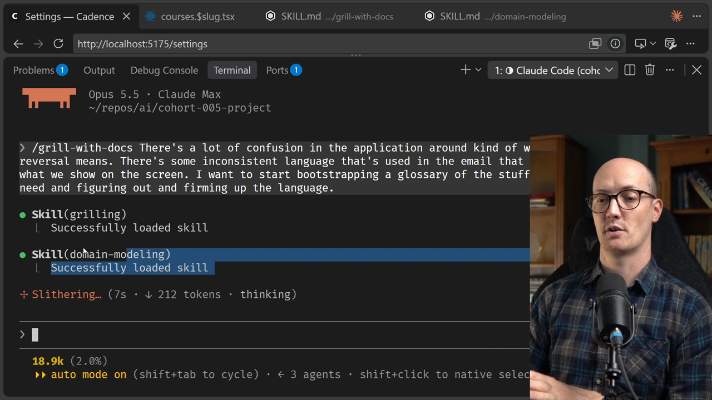
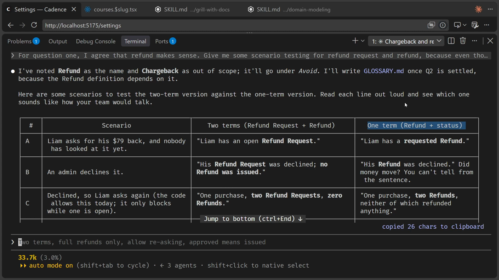
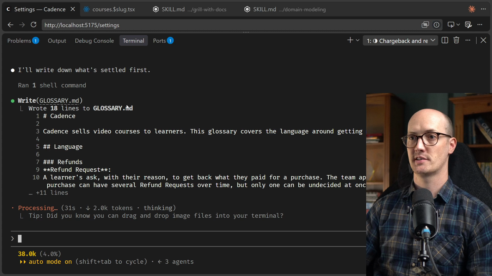
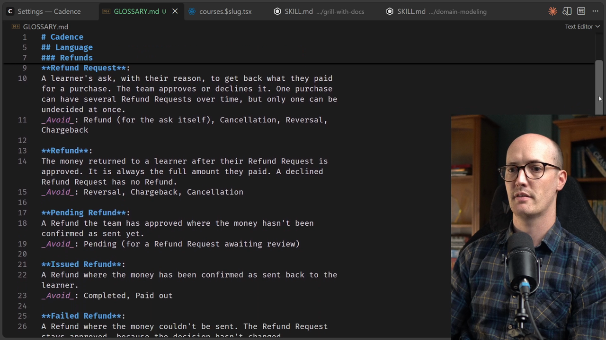
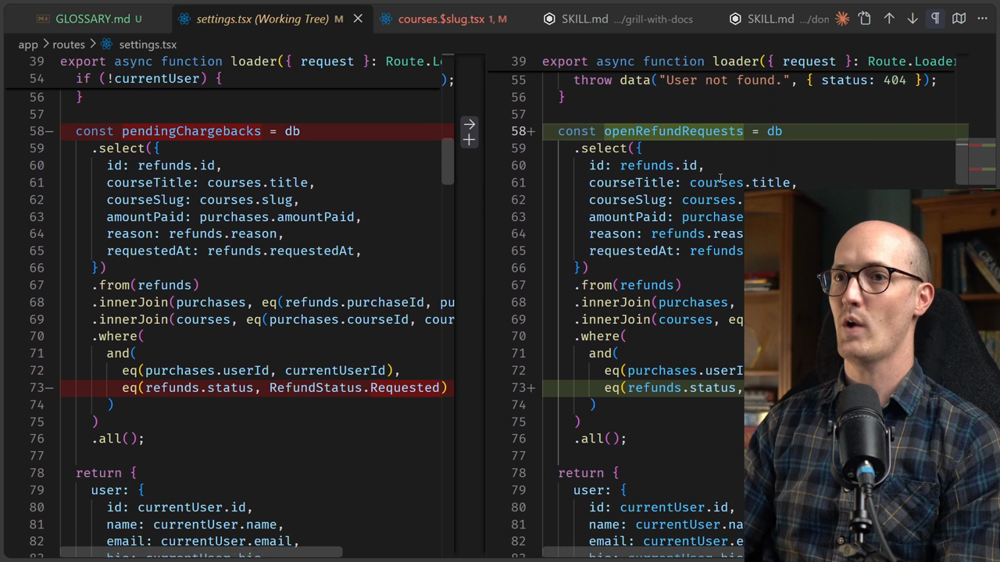
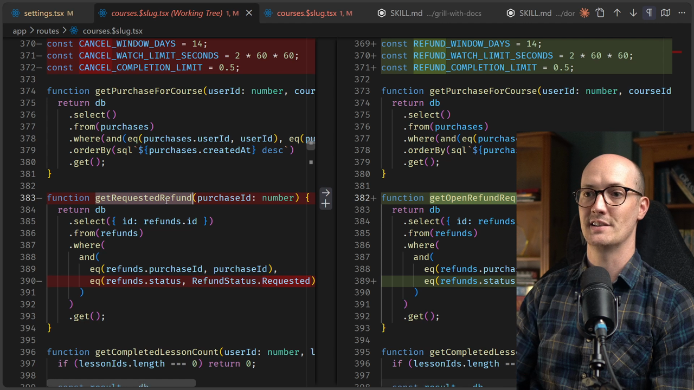

# Using Grill with Docs Solution


<CommitMap packageManager="npm">
  <Commit id="seed-liams-refund">Start the lesson: Liam's purchase seeded at $79, three names for a refund once you click through, no `GLOSSARY.md` yet</Commit>
  <Commit id="create-glossary-and-fix-refund-drift">See my solution: `GLOSSARY.md` created and the code renamed to Refund and Refund Request</Commit>
</CommitMap>

## The Problem: One Concept, Four Names

There's a lot of confusion in the application around what "Pending Chargeback" or "Reversal" means. The same concept, a learner asking for their money back, is called something different depending on where you look:

| Where | Word used |
| --- | --- |
| DB schema, route file, commit messages | `refund` / `RefundStatus.Requested` |
| Course page button and form | "Cancel my purchase" / "cancellation" |
| Confirmation email | "Reversal" |
| Settings page | "Pending Chargeback" |

Error messages in the route even say "cancel": "You have watched too much of this course to cancel it."

The goal is to bootstrap a `GLOSSARY.md` that firms up the language, so the domain model is consistent everywhere.

## Running /grill-with-docs

The `/grill-with-docs` [skill](https://www.aihero.dev/ai-coding-dictionary/skill) is a relentless interview that sharpens a plan or design, and creates docs (ADRs and a glossary) as it goes. Running it loads two sub-skills: `/grilling` and `/domain-modeling`.

```
/grill-with-docs There's a lot of confusion in the application around kind of what pending
  chargeback or reversal means. There's some inconsistent language that's used in the email
  that we send to users versus what we show on the screen. I want to start bootstrapping a
  glossary of the stuff around that that we might need and figuring out and firming up the
  language.
```



The [agent](https://www.aihero.dev/ai-coding-dictionary/agent) greps the codebase for `chargeback|reversal|refund|dispute|pending`, reads the refund route, the schema, and the course page, and comes back with its first round of questions.

## Round 1: Naming the Concept

The agent surfaces the four-name problem and asks three questions.

**Q1: What do we call this concept?**

The recommendation is `refund`. If you put yourself in the shoes of the learner, you're not asking to cancel your purchase. You want a refund. That's the clearest word.

```
For question one, I agree that refund makes sense.
```

**Q2: One term or two?**

This is where it gets interesting. There are actually two events here: when the refund request is created, and when the money actually goes back to the learner. The agent flags that with one word you get a sentence like:

> "The refund was declined, so nothing was refunded."

That sentence is genuinely confusing. Before committing to two terms, it's worth doing some scenario testing, because even "Refund Request" and "Refund" are quite similar to each other.

**Q3: Are real chargebacks in scope?**

Bank-initiated chargebacks: does our domain need to model them? The answer here is no: this is "you're not going to need it" territory. Chargebacks go under _Avoid_.

## Round 2: Scenario Testing Two Terms vs One

The agent produces a scenario table comparing the two-term model against a single-term model.



| # | Scenario | Two terms (Refund Request + Refund) | One term (Refund + status) |
| --- | --- | --- | --- |
| A | Liam asks for his $79 back, nobody has looked at it yet | "Liam has an open **Refund Request**." | "Liam has a **requested Refund**." |
| B | An admin declines it | "His **Refund Request** was declined; **no Refund was issued**." | "His **Refund** was declined." Did money move? You can't tell. |
| C | Declined, so Liam asks again | "One purchase, **two Refund Requests**, **zero Refunds**." | "One purchase, **two Refunds**, neither of which refunded anything." |
| D | Admin approves but for $40, not $79 | "The **Refund Request** asked for $79; the **Refund** was $40." | "The **Refund**'s requested amount was $79; its refunded amount was $40." |

Scenarios C and D make the case. With a single term, "one purchase, two Refunds, neither of which refunded anything" is genuinely hard to parse.

This is the power of scenario testing: it makes the feature concrete in terms of language. If you can talk about the edge cases, you can model them in code.

```
So for question two, whether it's one term or two, I'm going to say use two terms, refund
  request makes sense. I think let's go always the full amount for now. Let's allow learners
  to ask again after a decline. That's fine by me.
```

**Q6: Is "approved" the same as "the money has gone back"?**

There's no payment processor connected yet, no Stripe, nothing. The agent initially recommends treating approved and issued as the same thing. But even without a processor wired up, it's worth modelling the lifecycle now, because when one is connected, the gap between "approved" and "money confirmed as sent" will definitely matter.

```
I think for question six, even though we're not yet planning to integrate it with a payments
  platform, we probably do need to do some modelling around that. So can you give me some
  suggestions and do some scenario testing around question six?
```

## Round 3: The Refund Lifecycle

The agent writes the first version of `GLOSSARY.md` - with **Refund** and **Refund Request** defined - then runs scenario testing on Q6.



The lifecycle scenarios for Q6:

| # | Scenario | (a) Single step | (b) Refund lifecycle |
| --- | --- | --- | --- |
| 1 | Approved Monday, processor confirms Thursday. What does Liam see Tuesday? | "Refunded." That's a lie for three days. | "Request approved · Refund **pending**" |
| 2 | Processor rejects it - Liam's card is closed | No way to say this. | "Request approved · Refund **failed**." The decision stands; only the money step failed. |

Scenario 2 rules out the single-step model entirely. Two separate questions need two separate states: the team's *decision* lives on the Refund Request, and the *money* lives on the Refund.

The agent also adds a Chargeback entry to the glossary. That's unwanted - it doesn't belong there.

```
I didn't want you to add chargeback. It doesn't feel like it belongs in our glossary.
  For question six, I absolutely agree that B should be the lifecycle that we choose.
```

## Round 4: The Full Lifecycle + Learner-Facing Copy

`GLOSSARY.md` now has the full set of terms:



**Refund Request statuses:**

| Status | Meaning |
| --- | --- |
| **Open** | The team hasn't decided yet. "Pending" now belongs to Refunds only - avoid it here. |
| **Approved** | The team accepted the request. Leads to a Refund. |
| **Declined** | The team turned it down. No Refund. The learner may ask again. |

**Refund statuses:**

| Status | Meaning |
| --- | --- |
| **Pending Refund** | Approved, money not yet confirmed as sent. |
| **Issued Refund** | Money confirmed as sent back to the learner. |
| **Failed Refund** | Money couldn't be sent. The Refund Request stays approved, because the decision hasn't changed. |

The "Open" recommendation for an undecided request comes from the code itself. The codebase already used phrases like "you already have a request open" and `getOpenRefund`. It also avoids the stutter of "a Requested Refund Request".

**Q11: What does the learner-facing copy say?**

Every word on screen should now be a glossary term:

- Button: **"Request a refund"**
- Email subject: **"Refund requested - \{course\}"**
- Settings heading: **"Refund Requests"**, with each row showing its status

```
Question eleven, agree. That looks awesome.
```

Questions 10 and 12 (failed refund retry behaviour, and what happens to a purchase after a refund) are both parked as out of scope for now.

## Implementing the Code Changes

With the glossary settled, the instruction to implement is straightforward:

```
Implement the code changes
```

The agent renames the enum, generates a database migration, and updates the copy across the app. One important detail: the generated migration only changes the default value for new rows. The agent appends a data fix to convert existing rows too.

```sql
UPDATE `refunds` SET `status` = 'open' WHERE `status` = 'requested';
```

### `app/db/schema.ts`

The `RefundStatus` enum value `Requested` becomes `Open`:

```diff
export enum RefundStatus {
-  Requested = "requested",
+  Open = "open",
   Approved = "approved",
   Declined = "declined",
}
```

### `app/routes/settings.tsx`

"Pending Chargeback" becomes "Refund Requests", and the badge reads "Open":



```diff
-  const pendingChargebacks = db.select(...)
+  const openRefundRequests = db.select(...)
     .where(
-      eq(refunds.status, RefundStatus.Requested)
+      eq(refunds.status, RefundStatus.Open)
     )
```

```diff
-  <h2>Pending Chargeback</h2>
-  <p>One chargeback is waiting on us.</p>
+  <h2>Refund Requests</h2>
+  <p>One refund request is waiting on us.</p>
```

```diff
-  <span>Pending Chargeback</span>
+  <span>Open</span>
```

### `app/routes/courses.$slug.tsx`



Function names follow the glossary:

```diff
-function getRequestedRefund(purchaseId: number) {
+function getOpenRefundRequest(purchaseId: number) {
```

```diff
-  // What the learner is offered if this purchase cannot be cancelled.
-  function getCancellationOffer(...)
+  // What the learner is offered if this purchase cannot be refunded.
+  function getRefundOffer(...)
```

### `app/routes/courses.$slug.refund.ts`

The email and error messages now use the glossary terms throughout:

```diff
-  subject: `Reversal requested - ${input.courseTitle}`,
+  subject: `Refund requested - ${input.courseTitle}`,
```

```diff
-  throw data("You must be logged in to cancel a purchase.", { status: 401 });
+  throw data("You must be logged in to request a refund.", { status: 401 });
```

The benefits of clear domain language echo through the code. Local variable names, code comments, error messages - all of it lines up with the glossary. Having an agent pile through and align everything to the domain language is cheap, and it makes these kinds of refactors much easier to justify.

## What's Left

The glossary uses "learner" without ever defining it. Is that the right word? What about users, instructors and admins - do those need their own definitions too?

Once you start seeing the world this way, it is really hard to stop. Go into one of your own repositories, find a feature where the language wasn't firm enough, and try rebuilding the domain model using `/grill-with-docs` and its scenario testing.

