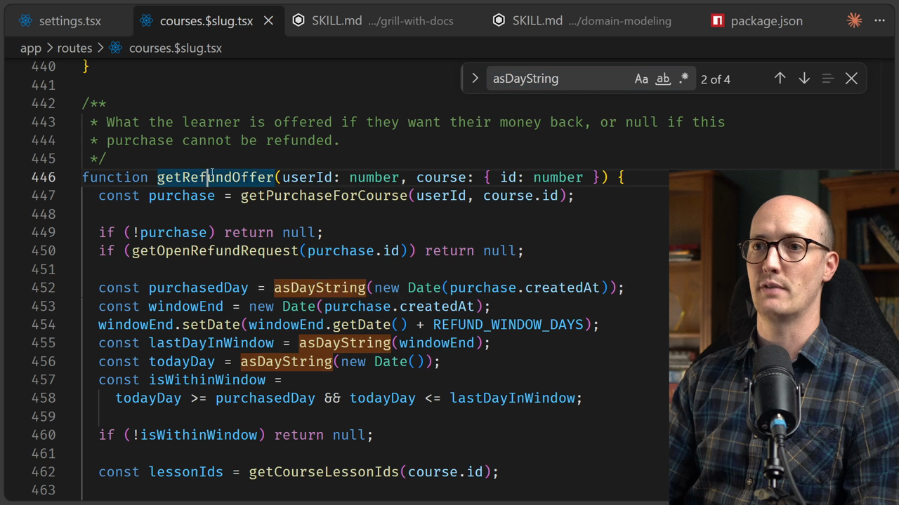

# ADRs


<CommitMap packageManager="npm">
  <Commit id="create-glossary-and-fix-refund-drift">Explore the code - the glossary is in place, and the 14-day Refund window is counted in whole days</Commit>
</CommitMap>

<Prerequisites title="Crash Course Prerequisites">
  <Prerequisite href="https://www.aihero.dev/workshops/ai-coding-crash-course/statelessness-1fdb45c1">
    Why the agent forgets everything, and why decisions worth keeping have to live in the repo.
  </Prerequisite>
  <Prerequisite href="https://www.aihero.dev/workshops/ai-coding-crash-course/the-grill-execute-clear-loop-fac85414">
    How grilling works, since grilling is the moment decisions get made and recorded.
  </Prerequisite>
  <Prerequisite href="https://www.aihero.dev/workshops/ai-coding-crash-course/what-are-agent-skills-20f91a4e">
    What a skill is, since ADRs are written by the `/domain-modeling` skill.
  </Prerequisite>
  <Prerequisite href="https://www.aihero.dev/workshops/ai-coding-crash-course/should-you-keep-your-specs-18386094">
    Why written-down decisions drift from the code, and what primary and secondary sources are.
  </Prerequisite>
</Prerequisites>

In our exploration of `/grill-with-docs`, we've been looking at the `/domain-modeling` [skill](https://www.aihero.dev/ai-coding-dictionary/skill), glossaries, scenario testing, figuring things out. But we've not really looked at the other thing the `/domain-modeling` skill does: editing and creating ADRs.

## What Are ADRs?

ADRs are Architectural Decision Records. They are records of decisions taken.

The reason they exist is quite simple. If you read code, especially comments, or the implementation itself, that code can tell you what it does. If the code is well structured, it can tell you exactly what it returns, it can use your domain language, it can explain everything about itself.

In other words, code can tell you what you ended up with. But it can't tell you all the things you decided against, the approaches you didn't take.

> Code is like the answer with all of the working rubbed out.

That working is what ADRs are for. They're a list of all the major decisions made inside a repository or project, there to preserve history so we don't make the same mistakes again.

## The ADR Format

The format is defined in `.agents/skills/domain-modeling/ADR-FORMAT.md`. The basic template is intentionally tiny:

```md
# {Short title of the decision}

{1-3 sentences: what's the context, what did we decide, and why.}
```

That's it. An ADR can be a single paragraph. You can have optional sections:

- **Considered Options** - only when the rejected alternatives are worth remembering
- **Consequences** - only when non-obvious downstream effects need to be called out

But the ADR needs to be very small and very tight.

## Offer ADRs Sparingly

As soon as people see this, they think: if you give an [agent](https://www.aihero.dev/ai-coding-dictionary/agent) a folder full of markdown files, it is just going to keep adding to them. The folder is just going to grow and grow.

So what is the criteria for adding an ADR? The bottom of `.agents/skills/domain-modeling/SKILL.md` covers this:

```md
### Offer ADRs sparingly

Only offer to create an ADR when all three are true:

1. **Hard to reverse**: the cost of changing your mind later is meaningful
2. **Surprising without context**: a future reader will wonder "why did they do it this way?"
3. **The result of a real trade-off**: there were genuine alternatives and you picked one for specific reasons

If any of the three is missing, skip the ADR.
```

Here's how those criteria play out in practice:

| Decision | Hard to reverse? | Surprising? | Real trade-off? | Needs ADR? |
|---|---|---|---|---|
| Use Recharts for charts | No | No | No | No |
| Use Sonner for toasts | No | No | No | No |
| Move from React to Vue | Yes | Yes | Yes | Yes |

Picking a library like Recharts or Sonner is easy to strip out and replace. But moving from React to Vue is a decision that would take a lot of hours to walk back, and that's the kind of thing worth recording.

## A Worked Example: The Refund Window



Let's make this concrete. In `app/routes/courses.$slug.tsx`, there's an `asDayString` helper, called inside `getRefundOffer` just below it.

The function returns what the learner is offered if they want their money back, or `null` if the purchase can't be refunded.

The key decision is in how `isWithinWindow` is calculated:

```ts
// Compare whole days, not hours - a purchase at 23:00 should still get its
// full fourteenth day.
function asDayString(when: Date) {
  const year = when.getFullYear();
  const month = String(when.getMonth() + 1).padStart(2, "0");
  const day = String(when.getDate()).padStart(2, "0");
  return `${year}-${month}-${day}`;
}

function getRefundOffer(userId: number, course: { id: number }) {
  const purchase = getPurchaseForCourse(userId, course.id);

  if (!purchase) return null;
  if (getOpenRefundRequest(purchase.id)) return null;

  const purchasedDay = asDayString(new Date(purchase.createdAt));
  const windowEnd = new Date(purchase.createdAt);
  windowEnd.setDate(windowEnd.getDate() + REFUND_WINDOW_DAYS);
  const lastDayInWindow = asDayString(windowEnd);
  const todayDay = asDayString(new Date());
  const isWithinWindow =
    todayDay >= purchasedDay && todayDay <= lastDayInWindow;

  if (!isWithinWindow) return null;
```

The refund window is counted in **whole days**, not hours. Here's why that matters:

- If a user purchases on the 20th of September at 9am...
- Counting in **hours**: the window shuts at 9am on 4th October
- Counting in **whole days**: the window shuts at midnight at the end of 4th October

The whole-days approach gives the learner a more generous refund window. But this is pretty surprising without context. An agent could totally ignore this while working through the code, and just switch freely between hours and whole days.

The only place this decision is currently recorded is the comment directly above `asDayString`. It's just noted down in the code, and not obvious elsewhere.

## Why ADRs Live at the Top Level

Having decisions in a global `docs/adr/` folder at the top of the repo means the agent can find them and surface them more easily.

It's also important to capture them at the right moment. When you're [grilling](https://www.aihero.dev/ai-coding-dictionary/grilling), that's the moment you're making decisions, so it makes sense to turn the important ones into Architectural Decision Records right then. That's why `/grill-with-docs` does domain modeling and ADRs at the same time.

## ADRs vs. Secondary Sources

It's worth addressing a common concern. Adding markdown files to a repository that describe what the code does is risky.

The codebase is a **[primary source](https://www.aihero.dev/ai-coding-dictionary/primary-source)**. It's large, but it's the source of truth, the stuff that actually executes. A [specification](https://www.aihero.dev/ai-coding-dictionary/spec) or docs file is a **[secondary source](https://www.aihero.dev/ai-coding-dictionary/secondary-source)**: much smaller, but not actually true by definition. Secondary sources can go out of date and confuse the agent.

The thing about an ADR is that it's meant to fill in only the gaps you can't see from the code:

- It is **not** a new source of truth for what the code is supposed to do
- It is **only** there to explain the stuff the code can't explain itself

The same is true for the glossary. Understanding the glossary allows you to navigate the code more easily. Both document types exist purely to fill in what the code can't answer for itself, and both are worth the time and [tokens](https://www.aihero.dev/ai-coding-dictionary/token) it takes to create and maintain them.

<Quiz>
  <QuizQuestion data={{
    id: "adr-criteria-all-three",
    question: "A colleague wants to write an ADR every time they add a new npm package. What's wrong with that approach?",
    type: "multiple-choice",
    choices: [
      { answer: "a", label: "Most package choices fail all three criteria" },
      { answer: "b", label: "ADRs should only be written after a grilling session" },
      { answer: "c", label: "The docs/adr/ folder should stay empty until the project is finished" },
      { answer: "d", label: "ADRs are only for decisions that affect the database schema" }
    ],
    correct: "a",
    answer: "All three criteria must be met: hard to reverse, surprising without context, and the result of a real trade-off. Most package choices are easy to swap out and well-understood, so they fail all three. Writing an ADR for every package would flood the folder with noise and make the genuinely important decisions harder to find."
  }} />
  <QuizQuestion data={{
    id: "adr-not-secondary-spec",
    question: "An ADR documents a whole-days refund window decision. A junior dev reads it and treats it as the definitive spec for how the refund system works. What's the problem?",
    type: "multiple-choice",
    choices: [
      { answer: "a", label: "ADRs are only readable by agents, not humans" },
      { answer: "b", label: "ADRs are secondary sources that can go out of date" },
      { answer: "c", label: "The refund window is too simple a decision to deserve an ADR" },
      { answer: "d", label: "ADRs should be deleted once the decision has been implemented" }
    ],
    correct: "b",
    answer: "An ADR fills in what the code can't explain - it's not a replacement spec. The working code is the primary source of truth. Treating an ADR as a definitive spec risks acting on stale information if the code has moved on since the ADR was written."
  }} />
</Quiz>
