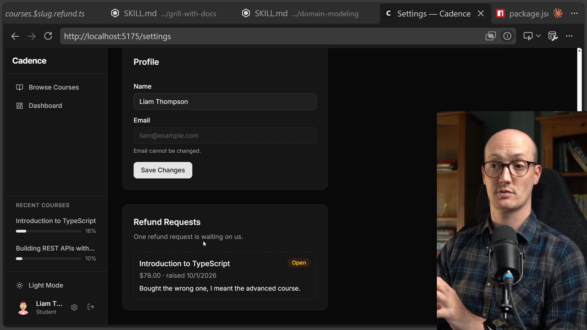

# Writing an ADR

<CommitMap packageManager="npm">
  <Commit id="create-glossary-and-fix-refund-drift">Start the lesson: `GLOSSARY.md` with Refunds terms only, Liam's Open Refund Request, no `docs/adr/`</Commit>
  <Commit id="admin-refund-approval-adr">See my solution: updated glossary, four ADRs in `docs/adr/`, and the Platform Admin refunds screen</Commit>
</CommitMap>

<Prerequisites title="Crash Course Prerequisites">
  <Prerequisite href="https://www.aihero.dev/workshops/ai-coding-crash-course/sessions-and-the-context-241f60ee">
    What a session is, so starting a new one for each grilling makes sense.
  </Prerequisite>
  <Prerequisite href="https://www.aihero.dev/workshops/ai-coding-crash-course/statelessness-1fdb45c1">
    Why the agent forgets everything, and why decisions worth keeping have to live in the repo.
  </Prerequisite>
  <Prerequisite href="https://www.aihero.dev/workshops/ai-coding-crash-course/why-plan-mode-sucks-2d6ef1a6">
    Why agents rush to build, and why you agree on a design before any code gets written.
  </Prerequisite>
  <Prerequisite href="https://www.aihero.dev/workshops/ai-coding-crash-course/the-grill-execute-clear-loop-fac85414">
    The grill-then-build loop this exercise runs: grill the screen, then let the agent build it.
  </Prerequisite>
</Prerequisites>

Liam has an Open Refund Request in Cadence, but there's no way to actually approve or decline it yet. That feature doesn't exist.

Before building it, there's a thorny question to answer: if Liam's Refund Request is approved, what happens to his progress in *Introduction to TypeScript*? Delete it? Keep it? Keep it for a while? That decision involves real money and deserves careful thought.

This is the perfect moment to reach for an architectural decision record (ADR), and to lean on the language already established in `GLOSSARY.md`.

## Steps To Complete

### Grill the refund approval screen

- [ ] Start a new agent [session](https://www.aihero.dev/ai-coding-dictionary/session) and [grill](https://www.aihero.dev/ai-coding-dictionary/grilling) the refund approval screen using `/grill-with-docs`

Use the existing glossary language in your prompt: terms like **Refund Request**, **Open Refund Request**, **Approved Refund Request**, and **Issued Refund** - rather than inventing new ones. Precise glossary terms make the grilling session sharper and keep the output consistent with the rest of the codebase.

- [ ] Build the refund approval screen based on the grilling output

The screen should allow a support team member to approve or decline an Open Refund Request.

### Decide on any ADRs

- [ ] Consider what decisions surfaced during grilling that deserve an ADR

The central open question is: when a Refund Request is approved, what happens to the learner's enrollment and progress?

| Option | Trade-off |
|---|---|
| Hard-delete the enrollment | Simple, but progress is gone forever |
| Soft-delete the enrollment | Recoverable, but adds complexity |
| Retain for N days | Gives a grace period, but requires cleanup logic |

- [ ] Write any ADRs you think are needed and place them in `docs/adr/`

Because this decision involves people's money, it's worth capturing the reasoning, not just the outcome.
