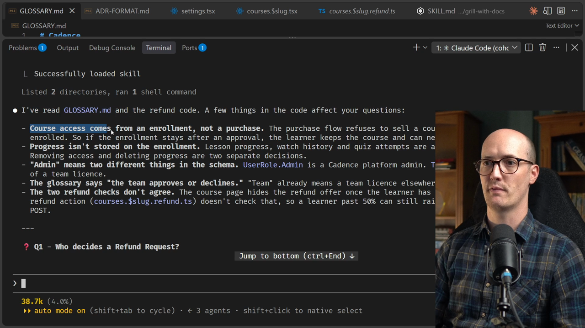
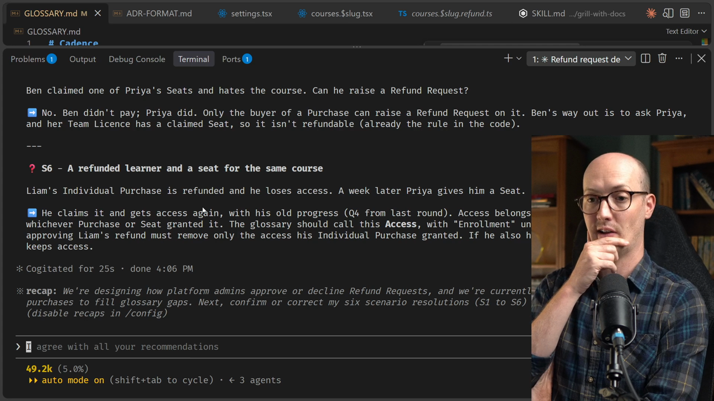
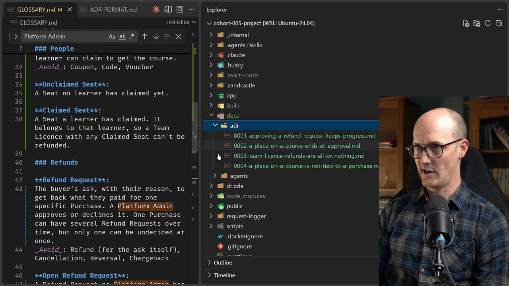

# Writing an ADR Solution


<CommitMap packageManager="npm">
  <Commit id="create-glossary-and-fix-refund-drift">Start the lesson: `GLOSSARY.md` with Refunds terms only, Liam's Open Refund Request, no `docs/adr/`</Commit>
  <Commit id="admin-refund-approval-adr">See my solution: updated glossary, four ADRs in `docs/adr/`, and the Platform Admin refunds screen</Commit>
</CommitMap>

We start with `GLOSSARY.md` open and an agent [session](https://www.aihero.dev/ai-coding-dictionary/session) ready to run `/grill-with-docs`. The goal: figure out everything the app needs to know before we can let a Platform Admin approve or decline an Open Refund Request.

## The opening prompt

The feature request goes in as a single `/grill-with-docs` prompt:

```
/grill-with-docs In our application, there's no way to actually approve an open refund
request. We need a way for admins to log into a screen that they can see all of the refund
requests that are available, the amount of progress that's been made on those courses, and
then decide whether or not to approve them. I'm going to consider what happens to the refund
afterwards as out of scope. Let's just focus on approving the refund for now. However, the
moment that the open refund request gets approved, we need to decide what to do about the
user's access to the course. Or even at what point they lose access to the course as well,
and whether we remove their progress in the course.
```

## Round 1: what the agent found

The [agent](https://www.aihero.dev/ai-coding-dictionary/agent) reads `GLOSSARY.md`, the schema and the refund route, and immediately surfaces four problems.

**Confusing enrollments.** Course access comes from an Enrollment, not a Purchase. If the Enrollment stays after an approval the learner keeps the course and can never buy it again.

**Progress lives elsewhere.** Lesson progress, watch history and quiz attempts are all stored per learner and lesson. Removing access and deleting progress are two completely separate decisions.

**"Admin" means two things.** `UserRole.Admin` is a Cadence platform admin. `TeamMemberRole.Admin` is the admin of a Team Licence.

**A security bug.** The course page hides the refund offer once a learner has completed 50% of lessons, but `courses.$slug.refund.ts` doesn't enforce this. A learner past 50% can still raise a Refund Request with a direct POST, curling their way to a refund request.



The agent also spots that the glossary says "the team approves or declines", but "team" already means a Team Licence elsewhere in the app. You can feel how confusing these sentences are to say, and that confusion is a signal to keep going.

### Eight questions, eight answers

The agent then asks eight questions. Here they are alongside the answers given:

| # | Question | Decision |
|---|----------|----------|
| Q1 | Who decides a Refund Request? | Platform Admins only. Rename them **Platform Admin** in the glossary; team admins become **Team Admin**. |
| Q2 | Is declining in scope? | Yes, same screen, same transition. |
| Q3 | When does the learner lose access? | On approval (option B). Raising it would lock out a learner whose request is declined; waiting for the Refund is too late. |
| Q4 | What happens to their progress? | Keep it. Deleting can't be undone, and the watch history is the evidence behind the approval decision. |
| Q5 | Can a refunded learner buy again? | Yes. An Approved Refund Request ends that purchase; a new one is a new purchase. |
| Q6 | What does an admin see as progress? | Live figures for lessons, hours and days, with a flag on any rule the request breaks. |
| Q7 | Which eligibility rule is correct? | The 50%-of-lessons limit applies. Fix the server action separately. |
| Q8 | Which requests does the screen list? | Open Refund Requests by default, oldest first, with filters for Approved and Declined. |

After these answers, the agent updates `GLOSSARY.md`, adding a new `### People` section with **Platform Admin** and **Team Admin**, and rewriting every "the team" reference.

## Round 2: team licences get gnarly

The agent then flags one more finding from the code: when a Team Admin buys seats, the refund action only blocks the request if a Seat has already been claimed. Unclaimed Seat codes stay redeemable while the request is Open.

This raises the question of what happens to a Team Licence purchase when its Refund Request is approved, for example if someone claims a seat while the request is still Open.

As soon as a sentence is hard to understand, that's a signal: there are gaps in the glossary making communication confusing. The right move is scenario testing.

```
For question one, that all feels a little bit gnarly, and it feels like there are gaps in
the glossary that are making communication confusing. Can we do some scenario testing?
```

## Scenario testing

The agent checks the purchase and seat-claiming code before writing the scenarios, and immediately finds more problems:

- The code has three names for the same thing: the code calls it a "coupon", the refund code says "seat", and you'd say "team licence".
- Access isn't linked to the purchase that granted it. An enrollment row stores only the learner and the course.
- The refund flow always picks the learner's most recent purchase of that course, which is the wrong one if they later bought a Team Licence.

Six scenarios, six decisions.

### S1 - Priya buys seats

Priya pays $790 for 10 seats on Introduction to TypeScript. She doesn't take a seat herself. This is a different kind of thing from Liam paying $79 for himself.

- **Individual Purchase** - bought for yourself, grants access to the buyer.
- **Team Licence** - bought for others, grants **Seats**, not access.
- Use **Seat**, not Coupon. "Coupon" implies a discount; nothing here is discounted.

### S2 - Priya regrets it, no seats claimed

Approval ends what the Purchase granted. For a Team Licence with no Claimed Seats, that means the Unclaimed Seats can never be claimed.

### S3 - A seat gets claimed while the request is Open

Seats can't be claimed while a Refund Request is Open. The Team Licence is frozen. If the request is declined, the Seats work again. This keeps the rule simple: a Refund is always the full amount.

### S4 - Liam buys for himself, then buys a Team Licence

A Refund Request belongs to one specific Purchase the learner chooses. Individual Purchases are refundable from the course page; Team Licences from the team page.

### S5 - Ben claims a seat then wants his money back

No. Ben didn't pay. Only the buyer of a Purchase can raise a Refund Request on it.

### S6 - A refunded learner gets a seat for the same course

He claims it and gets access again, with his old progress. Access belongs to the learner and the course, whichever Purchase or Seat granted it.

This scenario work pulls out crucial new language:

- **Claimed Seat** vs **Unclaimed Seat**
- **Individual Purchase** vs **Team Licence**
- A Refund Request belongs to one specific Purchase



## Pruning the glossary

The agent updates `GLOSSARY.md` with the new terms, but also adds two terms that don't belong:

- **Void Seat** - a horrible collection of words. Rejected.
- **Access** - too fuzzy and vague. It's obvious when someone has access and when they don't. Doesn't need a glossary entry.

```
I don't like that you've added the word access, and I also don't think we need a term for
void seat. And void seat is a horrible collection of words anyway.
```

The lesson here is to use your own taste. If a word doesn't feel right, reject it.

## Round 3: eight more questions

With the glossary cleaned up, the agent asks another eight questions. These use the new language cleanly, and that ease of communication is the language doing its job.

| # | Question | Decision |
|---|----------|----------|
| Q1 | Where does a Team Admin raise a Refund Request on a Team Licence? | From the team page, next to the Team Licence. |
| Q2 | Can a Platform Admin approve a request that breaks the rules? | Yes, the flags are information. A Claimed Seat is the only hard block. |
| Q3 | Are decisions final? | Yes. A wrongly declined buyer can raise a new Refund Request. |
| Q4 | Does declining need a note? | Yes, mandatory. Approval note is optional. |
| Q5 | Is the buyer told about the decision? | Yes, approval email and decline email (with the note). |
| Q6 | What does the buyer see in Settings after a decision? | Decided Refund Requests alongside Open ones, with status and any decline note. |
| Q7 | What happens to comments and ratings when access ends? | Keep them, including the rating's place in the course average. |
| Q8 | What if two Platform Admins decide the same request at once? | First decision wins. The second sees "already decided". |

## Writing the ADRs

After posting a shared-understanding summary, the agent notes it didn't suggest an ADR, reasoning that none of these decisions is hard to reverse and the result of a real trade-off at the same time.

It's worth pushing back on that. We're dealing with people's money, and this session has involved a lot of dense decision-making that shouldn't get lost.

```
I think I'd like you to take a second pass at the ADRs for what we could potentially pull
out of this, because it does feel like there's a lot of dense decision making that's been
done, and I don't want to lose any of it going forward.
```

The agent applies three tests to every decision:

1. Hard to reverse
2. Surprising to a future reader
3. A real trade-off

Four decisions pass. The agent writes them to `docs/adr/`.



### ADR 0001 - Approving a Refund Request keeps the learner's progress

Notice how short this is: three lines of markdown, no sections:

```md
# Approving a Refund Request keeps the learner's progress

When a Platform Admin approves a Refund Request on an Individual Purchase, the buyer loses
their place on the course but keeps their lesson progress, watch history, quiz attempts,
comments and rating. Deleting it can't be undone, the watch history is the evidence the
approval was decided on, and a learner who buys again or claims a Seat later should pick up
where they left off. Rows for a learner with no place on the course are expected, not
orphans to clean up.
```

### ADR 0002 - A place on a course ends at approval

This one has a `## Considered Options` section, which records why the other two options were rejected:

```md
# A place on a course ends when the Refund Request is approved

The buyer keeps the course while their Refund Request is Open and loses it the moment a
Platform Admin approves it, not when the Refund is issued.

## Considered Options

- **When the request is raised**: rejected, because a buyer whose request is declined would
  have been locked out for nothing.
- **When the Refund is issued**: rejected, because a Failed Refund would leave the buyer
  holding both the course and an approved Refund Request, and it would tie the course to
  money movement that is handled separately.
```

### ADR 0003 - Team Licence refunds are all-or-nothing

```md
# Team Licence refunds are all-or-nothing, and Seats freeze while one is Open

A Refund is always the full amount paid, so a Team Licence with any Claimed Seat can't be
refunded, and there are no partial refunds for its Unclaimed Seats. To stop a Seat being
claimed between the request and the decision, a Team Licence's Unclaimed Seats can't be
claimed while it has an Open Refund Request. If the request is declined they work again.
If it's approved they can never be claimed.

## Considered Options

- **Let Seats be claimed while Open, and only allow Decline afterwards**: rejected, because
  the Team Admin's request would be quietly defeated by a colleague.
- **Refund part of the money for the Unclaimed Seats**: rejected, because it breaks "a
  Refund is always the full amount" and needs a per-Seat price.
```

### ADR 0004 - A learner's place on a course is not tied to a Purchase

This one has a `## Consequences` section, documenting the bug it fixes:

```md
# A learner's place on a course is not tied to the Purchase that granted it

A learner has one place per course, whether it came from an Individual Purchase or a Claimed
Seat, and the place doesn't record which. A Refund Request, by contrast, belongs to one
specific Purchase. So approving a refund on an Individual Purchase must check whether the
learner also holds a Claimed Seat for that course, and leave their place alone if they do.

## Consequences

The code used to attach a Refund Request to the buyer's newest Purchase of the course. A
learner who bought for themselves and then bought a Team Licence would have refunded the
wrong one. The buyer now chooses the Purchase: Individual Purchases from the course page,
Team Licences from the team page.
```

## What makes these ADRs earn their place

All four are absolutely tiny. And all four are non-obvious, capturing decisions that would genuinely surprise a future reader and can't easily be undone.

The decisions that didn't make the cut (who has permission, that eligibility rules are flags not hard blocks, that decisions are final) are all easy to reverse and belong in the [PRD](https://www.aihero.dev/ai-coding-dictionary/spec) instead.

It's also worth noticing a pattern from this session: **adding more things to the glossary clarifies existing entries**. The moment "Platform Admin" was minted, every fuzzy reference to "the team" or "admin" became a fixable problem.

## What's next

The implementation (a Platform Admin screen at `app/routes/admin.refunds.tsx`, `app/lib/refunds.server.ts` with 23 new tests, plus team page, settings and seat-claim changes) is not shown on screen. Reset to the `admin-refund-approval-adr` commit to see it working.

The language built in `GLOSSARY.md` and the four ADRs in `docs/adr/` are what make everything going forward feel like solid ground, especially when we get to wayfinding and planning later in the course.

The decisions you made during scenario testing, and the ADRs you chose to keep and reject, are worth discussing. Join us on [Discord](https://www.aihero.dev/discord) to share how you got on.

