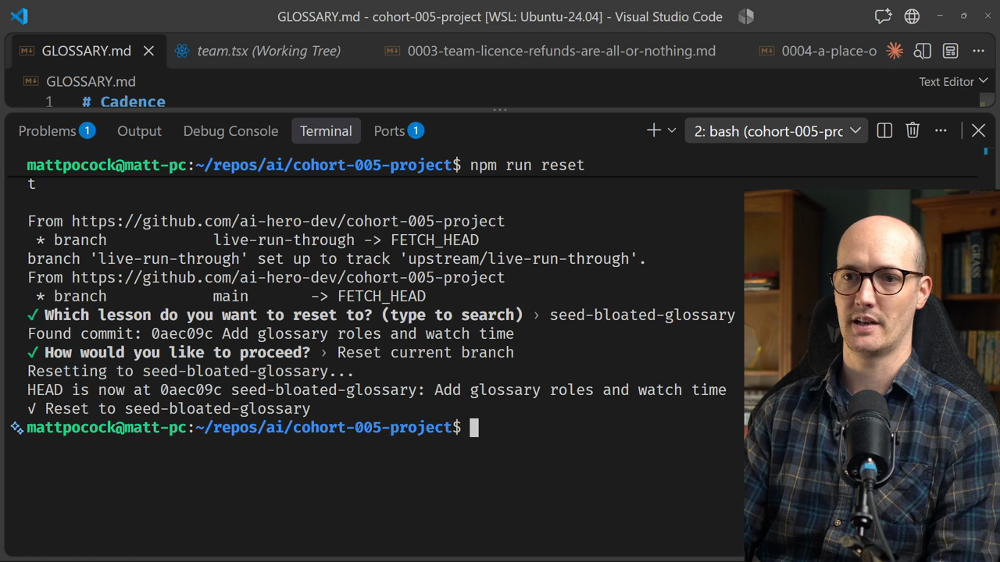
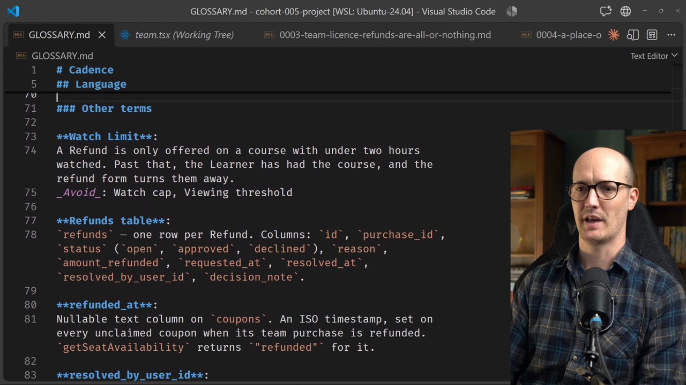

# Pruning the Glossary

<CommitMap packageManager="npm">
  <Commit id="seed-bloated-glossary">Start the lesson: `GLOSSARY.md` has grown an "Other terms" pile of implementation details and general programming terms</Commit>
  <Commit id="prune-the-glossary">See my solution: glossary pruned to domain terms, settled on Student and Enrollment</Commit>
</CommitMap>

<Prerequisites title="Crash Course Prerequisites">
  <Prerequisite href="https://www.aihero.dev/workshops/ai-coding-crash-course/how-to-run-the-exercises-a0eb0474">
    How `npm run reset` jumps your repo to the lesson's starting commit.
  </Prerequisite>
  <Prerequisite href="https://www.aihero.dev/workshops/ai-coding-crash-course/smart-zone-dumb-zone-d4b92bd0">
    Why every wasted line in a file the agent reads makes it dumber.
  </Prerequisite>
  <Prerequisite href="https://www.aihero.dev/workshops/ai-coding-crash-course/the-steering-map-c061e049">
    How files like GLOSSARY.md steer the agent, and what they cost in context.
  </Prerequisite>
  <Prerequisite href="https://www.aihero.dev/workshops/ai-coding-crash-course/pruning-db28fc2c">
    The pruning tests (single source of truth, sediment, no-ops) you'll apply to each entry.
  </Prerequisite>
</Prerequisites>

Give an [agent](https://www.aihero.dev/ai-coding-dictionary/agent) a markdown file and it will eventually fill it with garbage. `GLOSSARY.md` is no exception, especially in a repo with a lot of churn and contributors who aren't using these [skills](https://www.aihero.dev/ai-coding-dictionary/skill).

The glossary in this project has picked up an "Other terms" section. Some entries are real domain language, and some don't belong. Your job is to prune it down and work out the right rules for doing so.

Pruning is an essential skill for working with domain language. The sediment here is modest. Real files can run to hundreds or thousands of lines of unused terms.

## Steps To Complete

### Reset To The Bloated Glossary

- [ ] Run the reset script

```bash
npm run reset seed-bloated-glossary
```

- [ ] Reset your current branch to the `seed-bloated-glossary` commit



- [ ] Open `GLOSSARY.md` and read the new "Other terms" section



Read every entry. Ask yourself whether each one belongs in a glossary of this project's domain language, and why or why not.

### Prune With Your Agent

- [ ] Open your agent and start a `/grill-with-docs` [session](https://www.aihero.dev/ai-coding-dictionary/session)

- [ ] Ask the agent to prune `GLOSSARY.md` down to just the terms the project needs

```txt
Let's prune GLOSSARY.md down to only the terms we actually need.
```

Don't just accept its first answer. Work out the rules for what stays and what goes, and make sure the agent applies them to each entry.

### Check The Result

- [ ] Review the pruned `GLOSSARY.md`

You should end up with a sharp glossary that is ready to be used again. If you want to compare your result with mine, the solution is in the `prune-the-glossary` commit.
