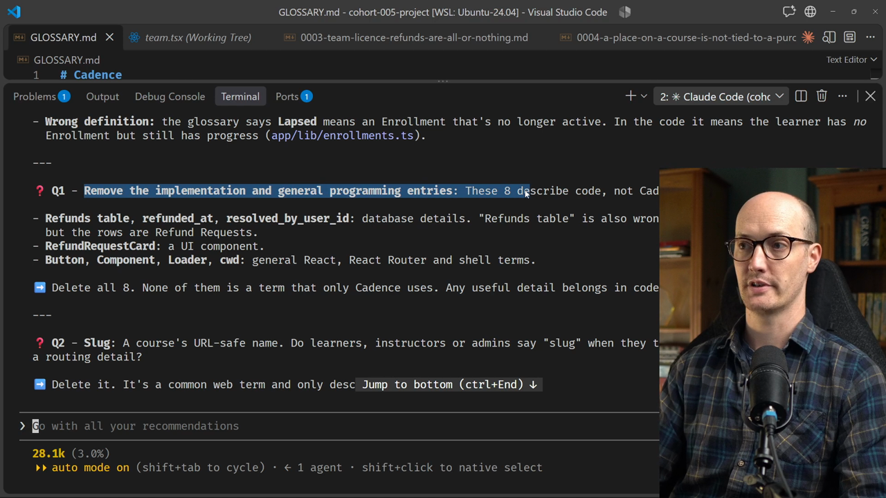
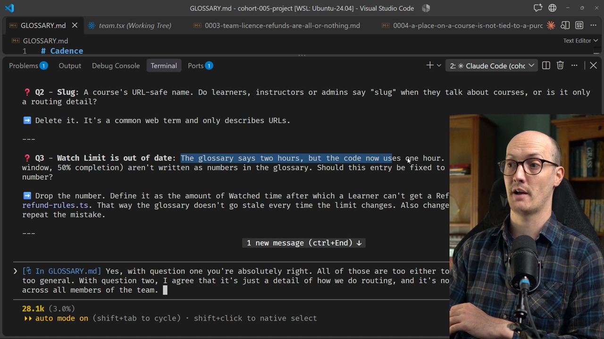
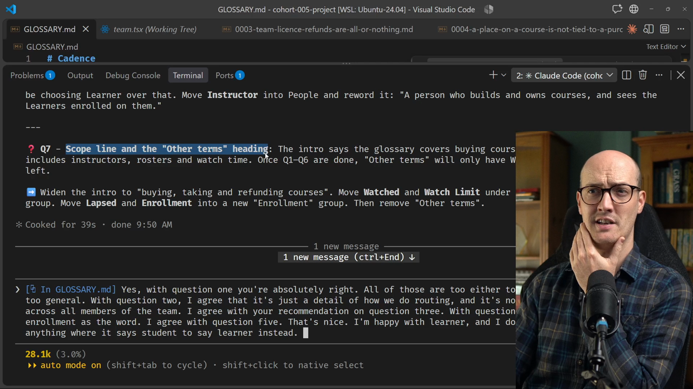
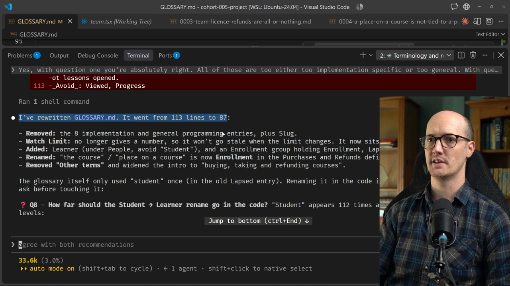
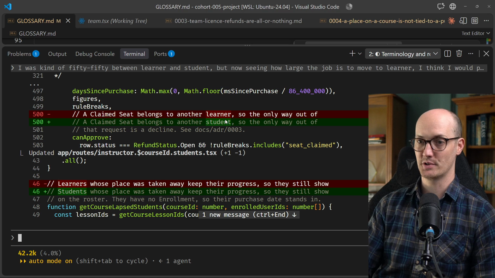
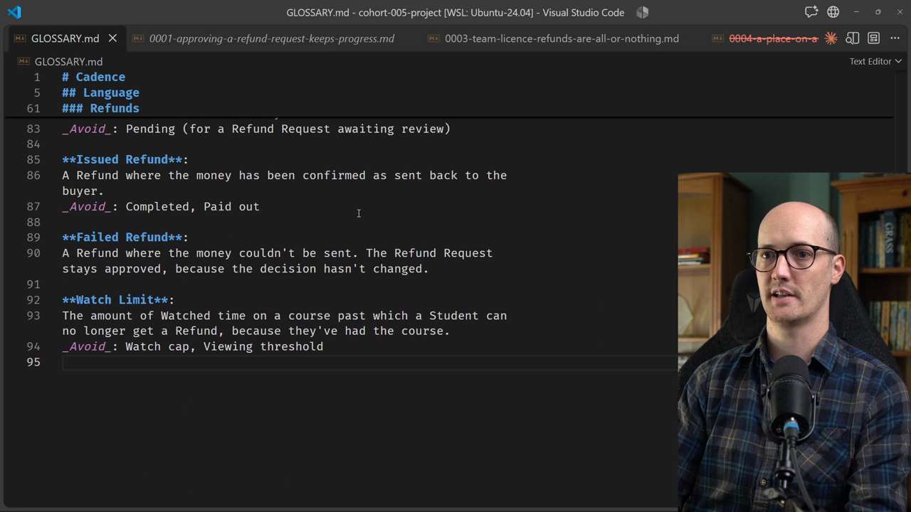

# Pruning the Glossary Solution

<CommitMap packageManager="npm">
  <Commit id="seed-bloated-glossary">Start the lesson: `GLOSSARY.md` has grown an "Other terms" pile of implementation details and general programming terms</Commit>
  <Commit id="prune-the-glossary">See my solution: glossary pruned to domain terms, settled on Student and Enrollment, ADRs renamed to match</Commit>
</CommitMap>

## Asking the agent to review the glossary

I dictate what I want here, and I keep it simple. There's no need to over-complicate the prompt. Let's see how it goes.

```txt
/grill-with-docs Could we take a look at the glossary.md? It feels a little bit bloated, and I think there's stuff in there that's not specific to our domain.
```

## Question 1: remove implementation and general programming entries



Question one has come back saying: remove the implementation and general programming entries. There are eight entries that describe code, not Cadence's business.

The first group is the implementation details:

- the refunds table
- `refunded_at`
- `resolved_by_user_id`
- `RefundRequestCard`

### Implementation details do not belong in the glossary

The refunds table entry is an absolute classic. It's the kind of thing [agents](https://www.aihero.dev/ai-coding-dictionary/agent) love to add to `GLOSSARY.md`: implementation details. They love adding the specifics of the code, but the glossary should not contain them.

Implementation details change all the time. If you put them in the glossary, the glossary has to be updated every time the implementation changes.

These four entries especially don't add anything to the conversation. They don't belong in the domain model, because they're too specific to the implementation.

### Terms that are too general

There are also some terms that are too general to be useful to our domain model.

- **Button**: a clickable element that fires an action when the user presses it. I think everyone at this point knows what a button is.
- **Component**: far too general. We are trying to model what a course management application is, and a component isn't specifically useful for that model.
- **`cwd`**: even though it's short and maybe confusing to non-developers, it isn't specific to Cadence, so it doesn't belong in the glossary.
- **Loader** and **slug**: the same is true. They're too general.

My reply:

```txt
Yes, with question one, you're absolutely right. All of those are either too implementation specific or too general.
```

## Question 2: slug

Question two is addressing slug, a course's URL-safe name. Do learners, instructors or admins say "slug" when they talk about courses, or is it only a routing detail?

```txt
With question two, I agree that it's just a detail of how we do routing and it's not ubiquitous. It's not shared across all members of the team.
```

You can imagine this changing. If slug becomes an important part of the user interface, with "choose the slug" or "generate a slug", then it might belong in the domain model. It would have logic attached, and we'd need to talk about it and resolve bugs about it.

Building a glossary is an art, not a science. There's probably an argument for including slug. But I like to keep my glossary as short as I possibly can, so I'm going to omit it.

## Question 3: the stale watch limit



Next, it says the watch limit is out of date. The glossary says two hours, but the code now uses one hour.

Looking at the entry, it says "under two hours watched". So it had added an implementation detail to the glossary entry, and that detail has gone out of date.

```ts
export const REFUND_WATCH_LIMIT_SECONDS = 60 * 60;
```

We're seeing the pain of including implementation details in the glossary first-hand.

The agent recommends dropping the number. That way the glossary doesn't go stale every time the limit changes.

```txt
I agree with your recommendation on question three.
```

## Question 4: enrollment versus "place on a course"

Zooming down to question four, there's some vague language. We have "enrollment" in one place and "place on a course" in another.

We're using a phrase where we could compress the idea into a single word, and I agree that enrollment makes sense.

```txt
With question four, I agree. Let's use enrollment as the word.
```

## Question 5: Lapsed

Question five is about Lapsed. The agent found that the glossary defined it as an Enrollment that is no longer active, shown as a badge on the instructor's student roster. So it's used in the user interface and communicated to users.

I think this one makes sense as an entry to keep, although we should organize it next to Enrollment.

It's done a nice job of redefining it too:

> A learner who has lost their enrollment on a course but still has progress on it.

```txt
I agree with question five. That's nice.
```

## Question 6: learner or student?

Question six asks whether we should add "learner" as a defined term: someone who takes courses on Cadence. This consolidates something that currently lives across other definitions. Learner is used in about eight definitions but never defined.

It also looks like some places in the code say "student", which is interesting.

This is one of those where I really don't have a preference. They're both about equally good, but we need to agree on one or the other. So I said I was happy with learner, and that anything saying student should be updated.

```txt
I'm happy with learner, and I do think we should update anything where it says student to say learner instead.
```

That's a nice win: it makes things easier for the agent to navigate, and easier to talk about.

## Question 7: headings



Now it's asking how to structure the headings inside the glossary, and I really don't care.

```txt
Question seven, go with whatever you fancy. I don't care.
```

Let's fire this off and see what we get.

## The rewritten glossary, and a second look at student



It's rewritten `GLOSSARY.md`, which went from 113 lines to 87.

It also found that the student versus learner question is a big one: "Student" is all over the code.

What about learner? How often does it occur in the codebase? Let's ask and get a quick response, just to get a feel for it.

```txt
What about learner? How often does learner occur within the codebase?
```

| Term | Occurrences |
| --- | --- |
| learner | 8 |
| student | 180 |

The code already agrees on student. With only eight occurrences of learner against 180 of student, student is the thing to rally around.

I was about 50-50 between the two. But seeing how large the job would be to move to learner, I'd prefer to stick with student.

```txt
I was kind of fifty-fifty between learner and student, but now seeing how large the job is to move to learner, I think I would prefer just to stick with student. We should also take the existing learner entries and move them over to say students instead.
```

## Question 9: the ADRs

The agent had an earlier question, question nine, which I'll go back to. Should the ADRs keep saying "place on a course"?

We've basically picked a term for this now: Enrollment. So should we adjust the ADRs to say Enrollment? I think we should. It's cleaner, and it reinforces the term every time the agent reads them.

```txt
Going back to question nine, yes, let's update the ADRs' text so it says enrollment and not just place on a course.
```

## Updating the code and ADRs



With that, we should be getting close to a final result. The agent is going through the code, and it's mostly comments. Comments are a really great place to reinforce domain language too.

```diff
- * - An Individual Purchase: the buyer loses their place on the course, unless
- *   they also hold a Claimed Seat for it (docs/adr/0004). Their progress stays
+ * - An Individual Purchase: the buyer loses their Enrollment, unless
+ *   they also hold a Claimed Seat for the course (docs/adr/0004). Their progress stays
```

In the `docs/adr` folder, we can see it has updated the ADRs to the new language. The buyer loses their Enrollment, and it says student instead of learner.

```diff
-When a Platform Admin approves a Refund Request on an Individual Purchase, the buyer loses their place on the course but keeps their lesson progress, ...
+When a Platform Admin approves a Refund Request on an Individual Purchase, the buyer loses their Enrollment but keeps their lesson progress, ...
```

## Final questions: filenames and code

It's come back with another couple of questions. It's asking about the file names of the ADRs.

```txt
Yes
```

It's also asking whether it should update "place on the course" in code.

```txt
Yes
```

I told it to update the ADR file names to use the new language, and to use the Enrollment language in code too.

You might think this is a hardcore way to approach it, making sure the code represents the domain language. But it is essential. These changes are so cheap to make with agents. Why wouldn't you fix all the broken windows in your application and make the domain language the same everywhere?

## The final glossary



It's come back with its final summary. Let's look at what the glossary actually looks like in its final state.

The Watch Limit has been added to the refund section, which is useful. And no number is in it:

```markdown
**Watch Limit**:
The amount of Watched time on a course past which a Student can no longer get a Refund, because they've had the course.
_Avoid_: Watch cap, Viewing threshold
```

There's a section near the top about Enrollment: a Student's place on a course.

```markdown
### Enrollment

**Enrollment**:
A Student's place on a course, which lets them take it. A Student has at most one Enrollment per course, whether it came from an Individual Purchase or a Claimed Seat.
_Avoid_: Place on a course, Access

**Lapsed**:
A Student who has lost their Enrollment on a course but still has progress on it.
```

People also has its own section: Student, Instructor, Platform Admin and Team Admin.

```markdown
### People

**Student**:
Someone who takes courses on Cadence.
_Avoid_: Learner, User

**Instructor**:
A person who builds and owns courses, and sees the Students enrolled on them.

**Platform Admin**:
A member of Cadence staff who runs the platform. Only a Platform Admin decides Refund Requests.

**Team Admin**:
A Student who buys and manages a Team Licence. A Team Admin has no say over Refund Requests.
```

## Pruning is an art

Pruning this thing isn't simple. There's an art to figuring out exactly what belongs in the glossary and what doesn't. But it becomes more useful over time, the more attention you pay to it.

And it's present in all the language used in the ADRs too. We now have Enrollment there instead of "a place on the course".

Over time, our language gets more exact and more precise, and the code benefits.

Nice pruning, well done, and I will see you in the next one.

