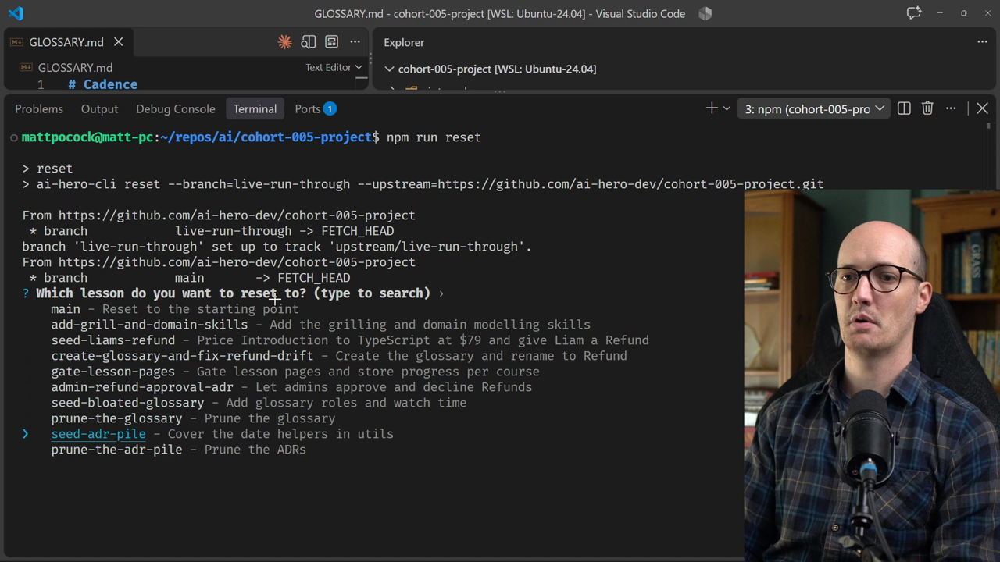

# Pruning ADRs

<CommitMap packageManager="npm">
  <Commit id="seed-adr-pile">Start the lesson: `docs/adr/` has grown to 11 ADRs, some stale, some never worth recording</Commit>
  <Commit id="prune-the-adr-pile">See my solution: four ADRs deleted, 0009 reworded to the glossary, 0012 records the full-price reversal</Commit>
</CommitMap>

<Prerequisites title="Crash Course Prerequisites">
  <Prerequisite href="https://www.aihero.dev/workshops/ai-coding-crash-course/how-to-run-the-exercises-a0eb0474">
    How `npm run reset` jumps your repo to the lesson's starting commit.
  </Prerequisite>
  <Prerequisite href="https://www.aihero.dev/workshops/ai-coding-crash-course/the-grill-execute-clear-loop-fac85414">
    How a grilling session works, so you can drive `/grill-with-docs` through the pile.
  </Prerequisite>
  <Prerequisite href="https://www.aihero.dev/workshops/ai-coding-crash-course/pruning-db28fc2c">
    Why steering files only grow, and the tests for cutting them back.
  </Prerequisite>
  <Prerequisite href="https://www.aihero.dev/workshops/ai-coding-crash-course/should-you-keep-your-specs-18386094">
    Why written-down decisions drift from the code, and when to archive rather than trust them.
  </Prerequisite>
</Prerequisites>

We've seen how useful it is to prune a glossary down to a better size. Now the same problem shows up somewhere else: a huge steaming pile of ADRs.

Your job is to go through `docs/adr/` and decide what stays, what gets deprecated, and what gets deleted. You'll hold each ADR up to the three-part test from the `/domain-modeling` [skill](https://www.aihero.dev/ai-coding-dictionary/skill).

## Steps To Complete

### Set Up The Pile

- [ ] Reset your project to the `seed-adr-pile` commit

Open your terminal and run the reset script:

```bash
npm run reset seed-adr-pile
```



- [ ] Look through `docs/adr/`

You should see a load of ADRs. Whoa.

### Hold Each ADR To The Test

- [ ] Remember the three-part test from the `/domain-modeling` skill

An ADR is only worth keeping if it is all of these:

1. **Hard to reverse**: the cost of changing your mind later is meaningful.
2. **Surprising without context**: a future reader will wonder why it was done this way.
3. **The result of a real trade-off**: there were genuine alternatives, and you picked one for specific reasons.

Any ADR that doesn't match this needs a closer look.

- [ ] Decide whether each suspect ADR should be deleted or deprecated

You have two choices:

| Choice | When to use it |
| --- | --- |
| Delete | Remove the file wholesale. Totally fine. |
| Deprecate | The ADR is valuable history, but no longer represents an up-to-date decision. Mark it as no longer present in the code. |

Deprecating fits when you made a decision, but later made a different one. You keep the history of your decisions while keeping your ADRs up to date.

### Run The Session

- [ ] Open a fresh agent [session](https://www.aihero.dev/ai-coding-dictionary/session)

Just like in the previous exercise, start with a clean session.

- [ ] Start a [grilling](https://www.aihero.dev/ai-coding-dictionary/grilling) session with docs

```txt
/grill-with-docs
```

- [ ] Ask the [agent](https://www.aihero.dev/ai-coding-dictionary/agent) to look at the ADRs and work out what can be pruned

Remember to hold every ADR to the three-part test, and remember you can either delete or deprecate.

- [ ] Apply the deletions and deprecations

Check the changes in `docs/adr/` once the session is done. Then compare with the `prune-the-adr-pile` commit in the solution.
