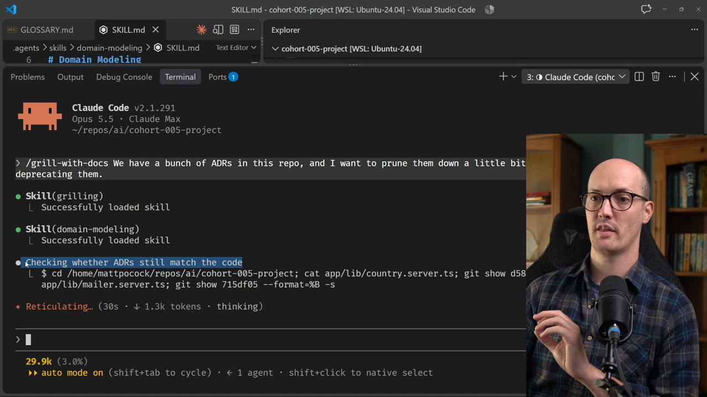
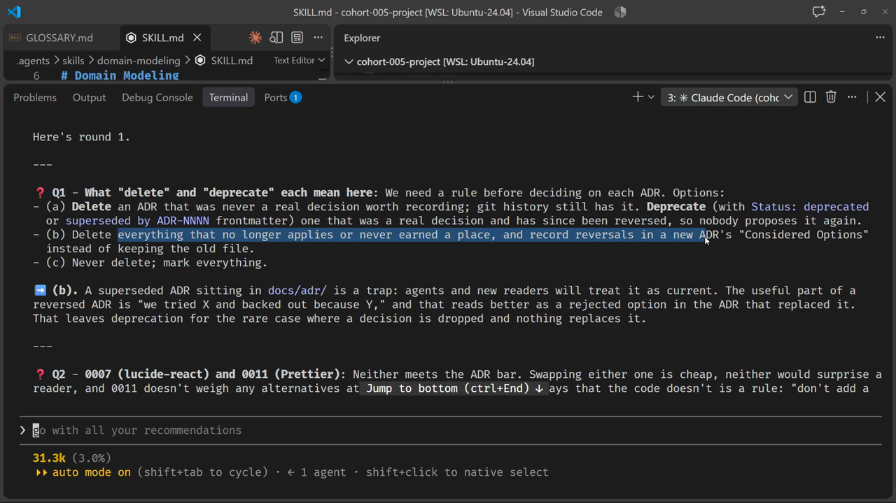
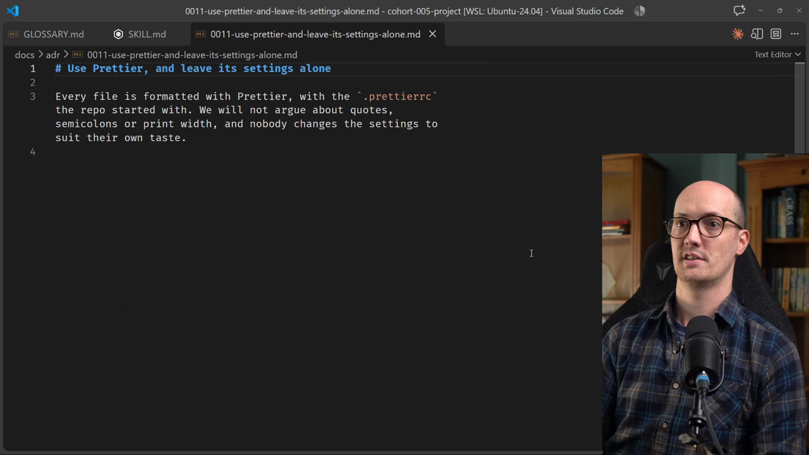
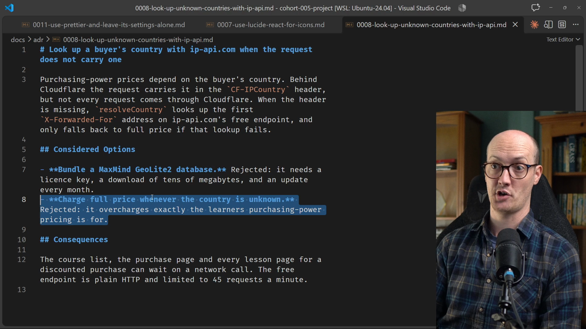
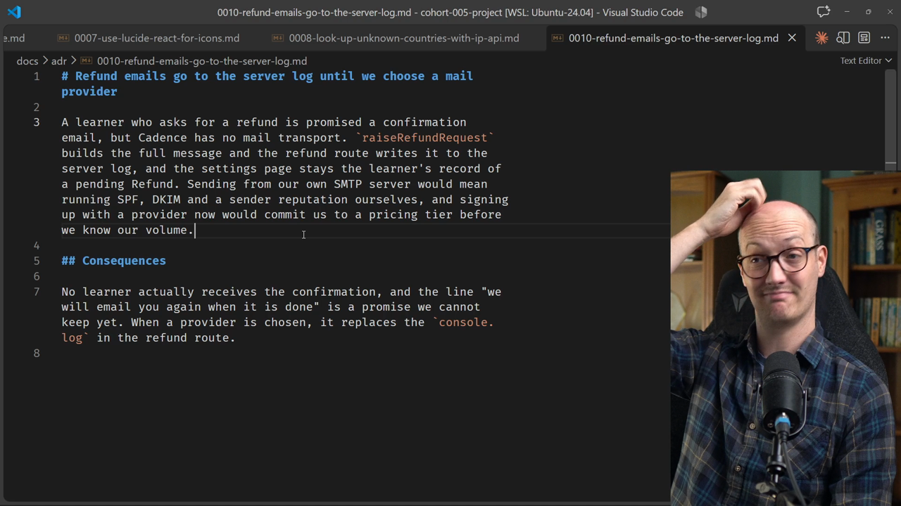
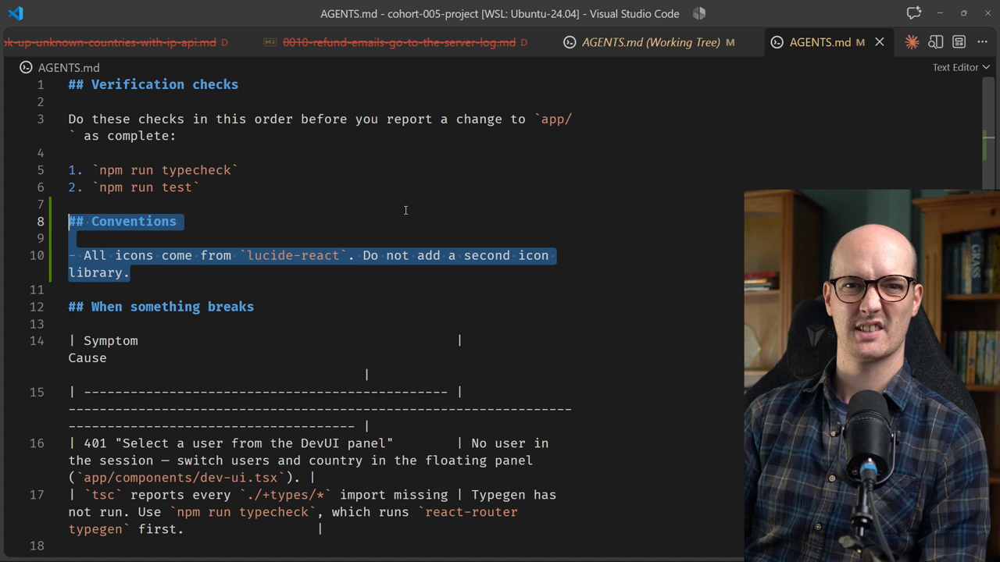
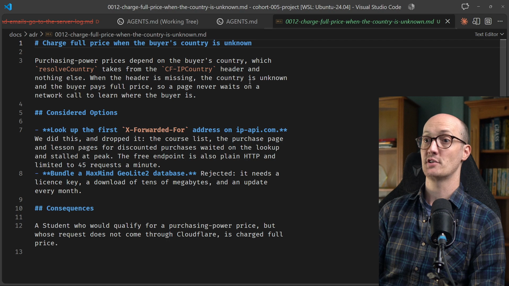

# Pruning ADRs Solution

<CommitMap packageManager="npm">
  <Commit id="seed-adr-pile">Start the lesson: `docs/adr/` has grown to 11 ADRs, some stale, some never worth recording</Commit>
  <Commit id="prune-the-adr-pile">See my solution: four ADRs deleted, 0009 reworded to the glossary, 0012 records the full-price reversal</Commit>
</CommitMap>

## The prompt

We have a bunch of ADRs in this repo. I want to prune them down a little, either by deleting them or deprecating them. So let's send off a prompt.

```
We have a bunch of ADRs in this repo, and I want to prune them down a little bit, either by deleting them or deprecating them.
```

## The agent checks the ADRs against the code

The [agent](https://www.aihero.dev/ai-coding-dictionary/agent) starts by exploring. It doesn't launch a [subagent](https://www.aihero.dev/ai-coding-dictionary/subagent), but it does something crucial: it checks whether the ADRs still match the code.

That is the important part. An ADR that no longer matches the code is the one you most need to find.



## Question 1: what do "delete" and "deprecate" mean?

The agent's first question is what delete and deprecate actually mean here.

| Option | Delete | Deprecate |
| --- | --- | --- |
| A | An ADR that was never a real decision worth recording | An ADR that was a real decision but has since been reversed |
| B | Everything that no longer applies or never earned a place | Nothing by default. Reversals are recorded in a new ADR's considered options instead of keeping the old file |

The agent recommends B. A superseded ADR sitting in `docs/adr/` is a trap, because agents and new readers will treat it as current.

I agree. There's not much difference between A and B here, so I'm happy to go with B.



## Question 2: ADRs that don't meet the bar

Next, the agent points at two ADRs: 0007 (`lucide-react`) and 0011 (Prettier). It says neither meets the ADR bar.

Let's look at the Prettier one first. It's very, very short.

```markdown
# Use Prettier, and leave its settings alone

Every file is formatted with Prettier, with the `.prettierrc` the repo started with. We will not argue about quotes, semicolons or print width, and nobody changes the settings to suit their own taste.
```

This doesn't feel ADR worthy to me. It feels pretty frivolous. It's tiny, it isn't surprising, it's what most repos do, and it's easy to back out of.

Now the Lucide one:

```markdown
# Use lucide-react for icons

We looked at Heroicons, Phosphor and Lucide. Lucide has the widest set and matches the shadcn/ui components we already use, so all icons come from `lucide-react`. Do not add a second icon library.
```

Same story. This isn't surprising, and it's really easy to back out of.

So I agree with the agent: both are too frivolous for the ADR bar.



## Question 3: a decision that has been reversed

Question three looks at a decision that has now been reversed. Let's see what ADR 0008 actually says.

```markdown
# Look up a buyer's country with ip-api.com when the request does not carry one
```

When the request doesn't carry a country, we look it up with ip-api.com. The ADR also lists some considered options, and one of them is now the thing the code actually does.

```markdown
## Considered Options

- **Bundle a MaxMind GeoLite2 database.** Rejected: ...
- **Charge full price whenever the country is unknown.** Rejected: it overcharges exactly the learners purchasing-power pricing is for.
```

The code no longer looks at ip-api.com at all. It just charges full price. So this ADR is out of date and we need to update it somehow.

The agent recommends writing a new ADR and removing 0008. That reverses an old decision by writing a new ADR, which I think is fine.



So for question three: yes, write a new ADR and remove the original one.

If we remove an ADR, it isn't gone. It's still in the commit history, and you can go back and look at it if you need to.

## Question 4: emails and Postmark

Another one: 0010, where refund emails go to the server log, has been replaced by Postmark. The code now has a mail transport interface.

Honestly, this doesn't feel ADR worthy either. Let's take a look.

```markdown
# Refund emails go to the server log until we choose a mail provider
```

The ADR says refund emails go to the server log until we choose a mail provider. A mail provider has since been chosen, so it's plain out of date. I don't think it's worth an ADR anyway.

We can always choose another email provider, and that would make this ADR irrelevant again. So I agree.

For question four, let's not worry about an ADR for our mail transport, especially since it's behind a reusable interface anyway.



## Questions 5 and 6: keepers and glossary clashes

The agent says that 0005, 0006 and 0009 all pass the ADR bar. I'm just going to take that on faith.

For question five, I trust the agent's judgement. That sounds fine.

In question six, some terms in the ADRs clash with the glossary. I agree, let's update the ADRs to use the glossary while we're here.

Then, onwards and upwards. The agent came back quickly with a shared understanding, so I think we're doing well.

## Implementing

Okay, let's implement this. Hopefully it's a relatively quick job.

We now have a big chunk of changes. One of them is an addition to `AGENTS.md` saying all icons come from `lucide-react`.

```markdown
## Conventions

- All icons come from `lucide-react`. Do not add a second icon library.
```

I don't think I need this. It feels like an instruction the agent can figure out on its own, so I'm going to delete it.



## Reviewing the changes

First, four ADRs have been removed: 0007, 0008, 0010 and 0011.

A couple of others are updated to use the glossary's language, such as Platform Admins and Instructors. That's good. In 0009 the change looks like this:

```diff
-A purchase made before this column existed has no country, and there is no way to recover it. Staff are exempt from the country check.
+A purchase made before this column existed has no country, and there is no way to recover it. Platform Admins, and the Instructor who owns the course, are exempt from the country check.
```

### The reversal ADR

The final one, 0012, is essentially a reversal of the previous ADR, with the considered options written in.

```markdown
# Charge full price when the buyer's country is unknown

...

## Considered Options

- **Look up the first `X-Forwarded-For` address on ip-api.com.** We did this, and dropped it: ...
- **Bundle a MaxMind GeoLite2 database.** Rejected: ...
```

The first option is the old implementation, where we looked up the first `X-Forwarded-For` address on ip-api.com. It says we used to do this and then dropped it.

This is a great ADR. It's close to impossible to figure out from the code itself, because it records a decision not to do something.

Now the agent won't try this again. If it looks at this feature and wonders why it doesn't work that way, the answer is written down.



## The result

We now have a healthy ADR list that's still pretty solid. That's eight entries.

```txt
0001-approving-a-refund-request-keeps-progress.md
0002-an-enrollment-ends-at-approval.md
0003-team-licence-refunds-are-all-or-nothing.md
0004-an-enrollment-is-not-tied-to-a-purchase.md
0005-store-money-as-integer-cents.md
0006-one-sqlite-file-through-drizzle.md
0009-record-the-buyers-country-on-the-purchase.md
0012-charge-full-price-when-the-country-is-unknown.md
```

If you feel your ADR list is getting out of control, you now know exactly what to do and what kinds of decisions to make.

Nice work, and I will see you in the next one.

