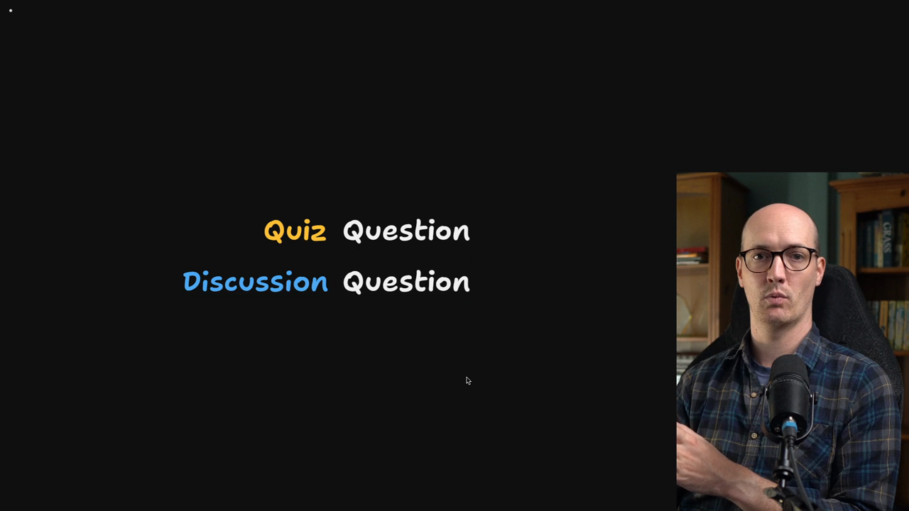
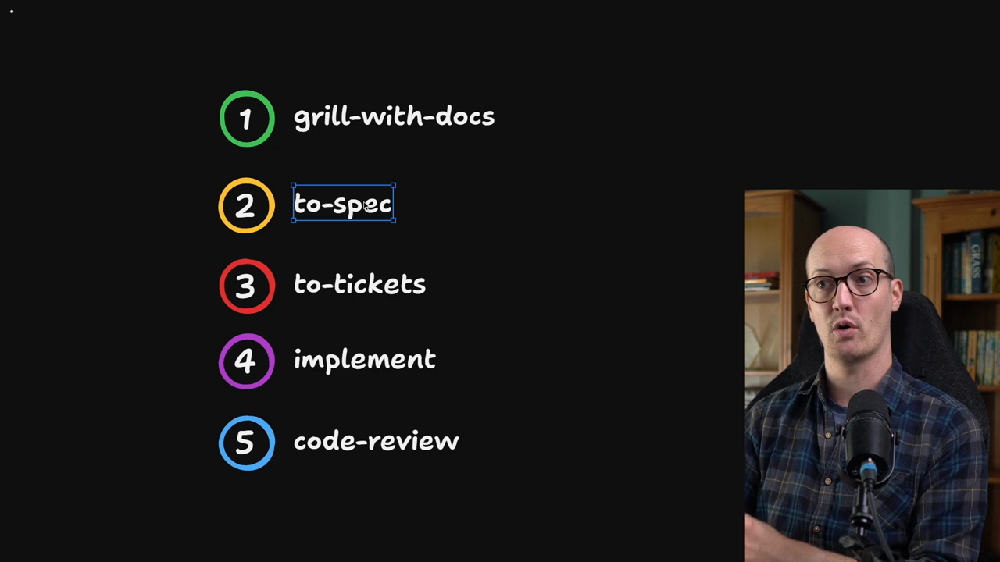

# Q&A

<Prerequisites title="Crash Course Prerequisites">
  <Prerequisite href="https://www.aihero.dev/workshops/ai-coding-crash-course/where-we-re-going-6167bf7e">
    The five-step system (grill, spec, tickets, implement, review) the glossary fits into.
  </Prerequisite>
  <Prerequisite href="https://www.aihero.dev/workshops/ai-coding-crash-course/the-grill-execute-clear-loop-fac85414">
    How grilling works: the agent interviews you until you both share the same design.
  </Prerequisite>
  <Prerequisite href="https://www.aihero.dev/workshops/ai-coding-crash-course/what-are-agent-skills-20f91a4e">
    What a skill is and how you invoke one like `/grill-with-docs`.
  </Prerequisite>
  <Prerequisite href="https://www.aihero.dev/workshops/ai-coding-crash-course/how-to-tackle-massive-tasks-6199ee6b">
    Why big work splits into a spec and tickets, so you know when glossary changes should land.
  </Prerequisite>
</Prerequisites>

With that, we've got a good handle on how domain language works, how ADRs work, and how to use `/grill-with-docs` to sharpen your language before you get started.

Let's go through a few commonly asked questions about this approach.

## Is one glossary always enough?

What happens when your app gets bigger and bigger? There's already a good example in the application that we haven't glossaried yet: questions and answers in Cadence.

Quizzes have questions. As part of a quiz, the learner gets asked a question, which they provide answers to. All of these have entities in the database.

But lessons also have discussions, where learners can ask questions and instructors have a view of all the answers in the discussion.

If we use the word "question" for both of these, that gets confusing pretty quickly.

### Prefix the entity

One simple way to handle this is to always prefix the entity. You always know whether you're talking about the quiz question or the discussion question, and you never refer to something as just a "question".

| Term | Where it lives |
| --- | --- |
| Quiz question | Asked to a learner as part of a quiz |
| Discussion question | Asked by a learner in a lesson discussion |

This is similar to what we already have with platform admins and team admins. They are never referred to on their own as "admin", and that's specifically mentioned in the avoid section.

### When prefixing isn't enough

You might get to a point where you're doing way too much prefixing. You realize there are actually two different conversations happening, each using different words.

Eric Evans talks about this in Domain-Driven Design, where he says multiple models are in play on any large project.

In an ideal world, a large company uses a single set of language to talk about its business. In practice, this is often different in different parts of the organization.

Take the refund and chargeback language we looked at earlier:

| Team | How they use the language |
| --- | --- |
| Product | "Refund" describes a request and its outcome |
| Finance | A much deeper model, with a difference between a refund and a chargeback |

The product simply doesn't need to care about the difference that finance has.

Both teams are right. This is just two ubiquitous languages being used in the same company. In DDD, you call each one a **bounded context**: the context within which that part of the company operates.

Both parts of the company might have developers who contribute to the same repository. If you have different bounded contexts inside your repository, you want to make that really explicit.

### Splitting with the `/domain-modeling` skill

I've thought of this in the `/domain-modeling` [skill](https://www.aihero.dev/ai-coding-dictionary/skill). A repo can have either:

- A single context, with a single bounded context at the root.
- A `GLOSSARY-MAP.md`, which maps to different glossaries in different parts of the application.

So even with different bounded contexts, different ways of speaking within the same repository, the `/domain-modeling` skill can handle it.

You can also have different ADRs within a bounded context. There's a global set of ADRs that you can append to if they affect the entire company, or you can write ADRs just for one bounded context.

The rule: split whenever you feel like two bounded contexts are trying to fit into the same glossary.

<Quiz>
  <QuizQuestion data={{
    id: "split-glossary-bounded-contexts",
    question: "Your repo's single glossary has an entry for \"Refund\" that the product team and the finance team define in incompatible ways. Both definitions are correct for their team. What do you do?",
    type: "multiple-choice",
    choices: [
      { answer: "a", label: "Keep one glossary, take the product definition and mark finance's usage as avoid" },
      { answer: "b", label: "Give each team its own glossary and list both in a GLOSSARY-MAP.md at the root" },
      { answer: "c", label: "Prefix every term in the one glossary with the name of the team that owns it" },
      { answer: "d", label: "Let the agent reconcile the two definitions into a single merged glossary entry" }
    ],
    correct: "b",
    answer: "Two teams each speaking a correct, different language is two bounded contexts, so each gets its own glossary, mapped from GLOSSARY-MAP.md. Picking one team's definition makes the other team wrong. Prefixing everything is for a handful of clashes like quiz question versus discussion question, not for separate conversations. An agent merging definitions invents language the team doesn't use."
  }} />
</Quiz>

## When do you ship updates to the glossary?

Say you have the loop where you [grill](https://www.aihero.dev/ai-coding-dictionary/grilling) with docs, go to [spec](https://www.aihero.dev/ai-coding-dictionary/spec), then [tickets](https://www.aihero.dev/ai-coding-dictionary/ticket), implement, and code review. At what point do you merge the changes to the glossary?

In my opinion, as soon as you've made the decision, and maybe agreed with your team that this is the term you want to use. Do it even before you've written the spec.

By the time you reach the implement step, the codebase is already in line with how you want it to look. You can also update `GLOSSARY.md` yourself and make sure it looks exactly how you want before moving on to spec and tickets.

The same goes for renaming code, as we hit a few times during the exercises. Do the rename before you make the spec.

That way, when the spec and tickets are created, they point to files that have already been renamed, and the codebase is easier to navigate.

<Quiz>
  <QuizQuestion data={{
    id: "glossary-merge-timing",
    question: "The grill has settled on a new term and agreed a rename across the code. Your workflow is grill, spec, tickets, implement, code review. When do you land the glossary change and the rename?",
    type: "multiple-choice",
    choices: [
      { answer: "a", label: "Before writing the spec, so tickets reference already renamed files" },
      { answer: "b", label: "During implementation, in the same changes as the feature code itself" },
      { answer: "c", label: "At code review, once the feature has been proven to work correctly" },
      { answer: "d", label: "After the feature ships, as a separate documentation pass later on" }
    ],
    correct: "a",
    answer: "Once the decision is made, update glossary.md and rename code before the spec. Then the tickets reference the right files and the codebase already matches the language. Waiting until implementation, review, or after shipping means the spec and tickets are written against old names and need reworking."
  }} />
</Quiz>

## How do you pick good words?

What do good glossary terms actually look like? Most of the time, we're building applications for other people. Real people who are going to use this stuff in the world to do things.

The best domain language comes from your users.

If you can match the language used in the product with the way people think about using it, you end up with a product that's easy to use and easy to work on.

So the answer is simple. Really listen to your users, and mine the words they use for ideas for the glossary and for how to build the application.

This is especially true early in a project. You want conversations with lots of users to think about how to model the thing they need built.

## Do you need the glossary first?

Does `/grill-with-docs` need a glossary, or can you build one up as you go?

I hope these lessons have shown you that you can work with no glossary whatsoever and build it up slowly, clarifying the picture as you grow.

In my opinion, the glossary is never quite finished. There's always something that could be defined and is on the edge of being defined.

Adding to the glossary and pruning it is pretty hard work. There's a lot of thinking to do, because you're clarifying the product in real time.

So go slowly, and only create the entries you need for building the thing you're building. Rushing is also how you end up with poor quality entries that you then need to prune.

## Can an agent own the glossary?

Another question I get a lot: can an [agent](https://www.aihero.dev/ai-coding-dictionary/agent) own the glossary and be responsible for it, without a [human in the loop](https://www.aihero.dev/ai-coding-dictionary/human-in-the-loop) at all?

In my opinion, this is the fastest way to turn your glossary into an absolute dumpster fire.

The point of this language is that it's ubiquitous. It's used in the code, by the team, and in the product. Crucially, the team is humans and it's now also agents.

If the agent goes off and invents its own terminology, that won't sit well with the team, because the team will be using different language from the agent.

So no, an agent cannot own the glossary on its own. Working on the glossary is one of the highest value ways a human can contribute to the health of the codebase.

<Quiz>
  <QuizQuestion data={{
    id: "agent-glossary-ownership",
    question: "To save time, a teammate proposes letting an agent maintain glossary.md on its own, with no human review. What is the problem with this?",
    type: "multiple-choice",
    choices: [
      { answer: "a", label: "Agents can't reliably write markdown files like glossary.md" },
      { answer: "b", label: "The glossary would grow too slowly to stay useful to the team" },
      { answer: "c", label: "The agent invents terms the team doesn't use, splitting the language" },
      { answer: "d", label: "Agents can only edit one bounded context's glossary at a time" }
    ],
    correct: "c",
    answer: "The language is only useful if it's ubiquitous across code, team and product, and the team includes agents. An agent inventing its own terminology splits the language. Agents can write markdown fine, the risk is more entries of poor quality rather than too few, and bounded contexts are not a limit on agents."
  }} />
</Quiz>

## Further reading

I hope you're now feeling inspired to find the language that defines your product.

If you want to read more, [the blue book](https://en.wikipedia.org/wiki/Domain-driven_design) (Eric Evans' Domain-Driven Design) is good, of course. There's also [Vaughn Vernon's book](https://www.worldofbooks.com/en-gb/products/implementing-domain-driven-design-book-vaughn-vernon-9780321834577), which I think is on my bedside table.

Either way, the main ideas are about ubiquitous language: finding the right words, and making those words used everywhere inside the product.
