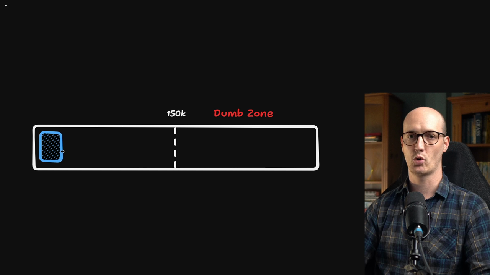
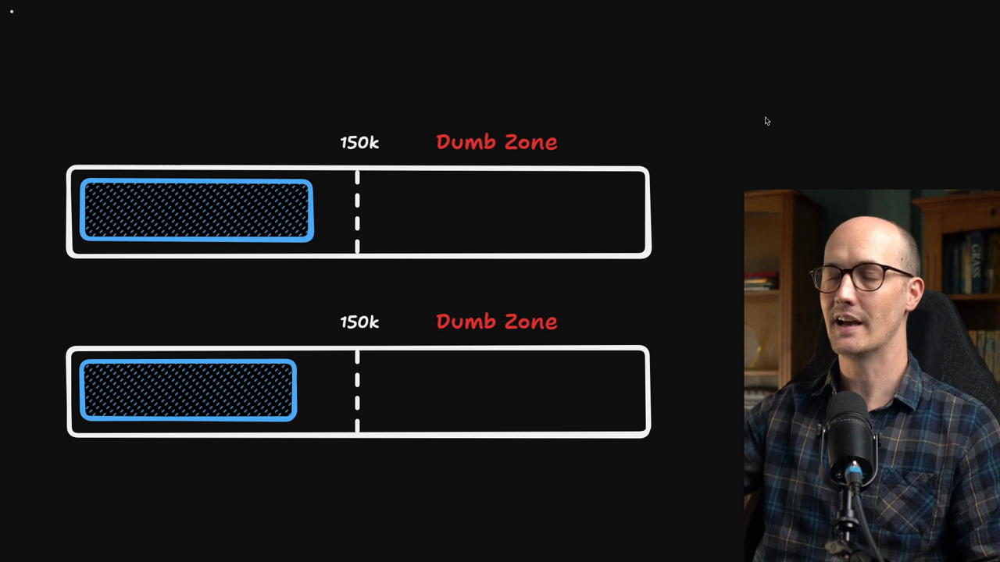
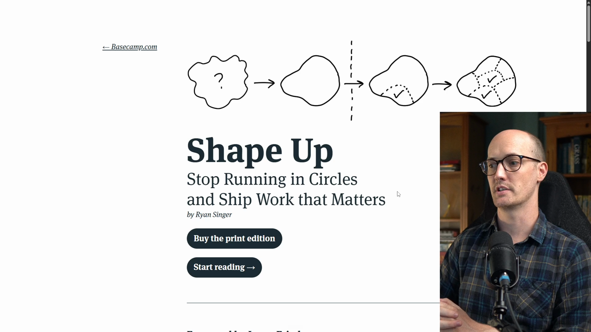
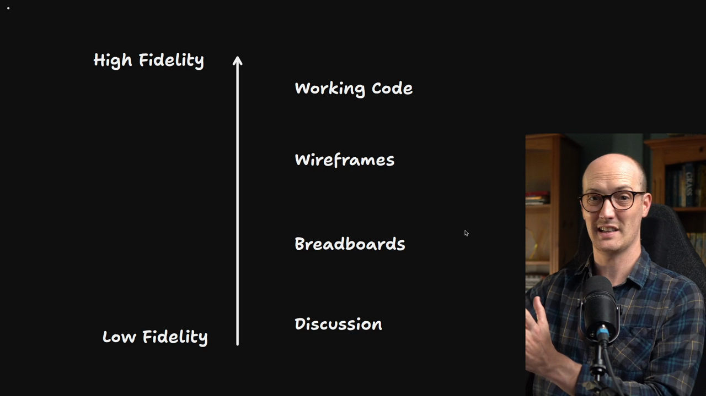
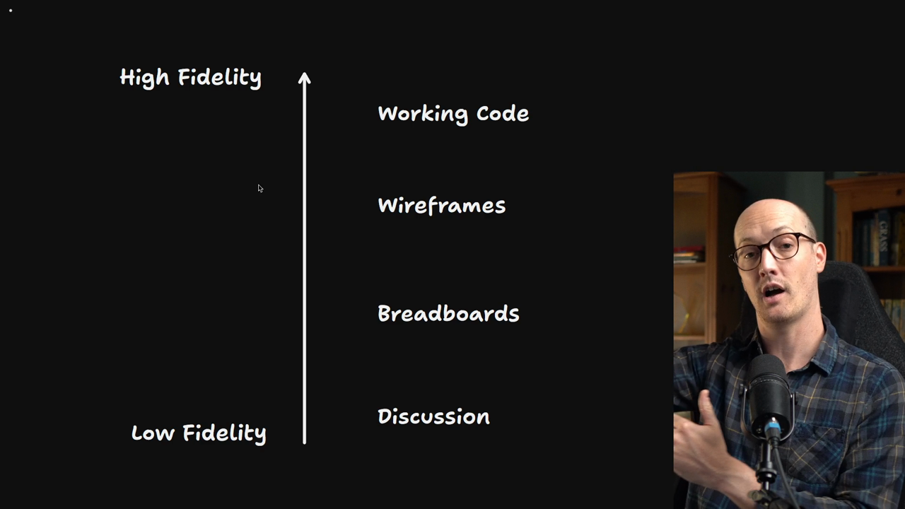
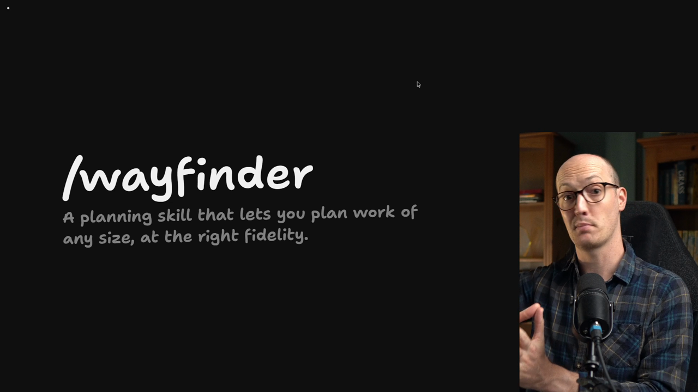

# The Limits Of One Session

<Prerequisites title="Crash Course Prerequisites">
  <Prerequisite href="https://www.aihero.dev/workshops/ai-coding-crash-course/sessions-and-the-context-241f60ee">
    What a session and its context are, so the limits of one session make sense.
  </Prerequisite>
  <Prerequisite href="https://www.aihero.dev/workshops/ai-coding-crash-course/smart-zone-dumb-zone-d4b92bd0">
    Why an agent gets worse as its context fills, which is what ends a long grilling session.
  </Prerequisite>
  <Prerequisite href="https://www.aihero.dev/workshops/ai-coding-crash-course/the-grill-execute-clear-loop-fac85414">
    How grilling works: the agent interviews you until you both share the same design.
  </Prerequisite>
  <Prerequisite href="https://www.aihero.dev/workshops/ai-coding-crash-course/compaction-2388148c">
    What compaction does, and why its summary loses detail from a long session.
  </Prerequisite>
</Prerequisites>

Later in this course, we are going to look at how you can automate the creation of work. When you have an idea that you need to build, you can pass it off to an [agent](https://www.aihero.dev/ai-coding-dictionary/agent) and it will go away and build it.

This is very exciting. When I first noticed it, I realized something interesting: the bottleneck has moved.

Instead of the bottleneck being that the work needs to be done, the bottleneck is now that the work needs to be planned.

So I started thinking about how to make a planning setup that lets me plan huge chunks of work. They needed to be big enough that I could actually saturate the number of agents I have available to work on it.

## Problems with single-session grilling

The annoying thing I noticed was that [grilling](https://www.aihero.dev/ai-coding-dictionary/grilling) wasn't quite cutting it for me. The reason was pretty simple: grilling is one [session](https://www.aihero.dev/ai-coding-dictionary/session).

As you answer more questions, add more questions and talk more with the agent, you eventually reach a point where you're going into the [dumb zone](https://www.aihero.dev/ai-coding-dictionary/smart-zone).

### What happens at 200,000 tokens?

This is a question I get a lot. When you're doing a `/grill-with-docs` session, what do you do when it reaches 200,000 or 300,000 [tokens](https://www.aihero.dev/ai-coding-dictionary/token)?

The annoying thing is that this session history is really valuable. It has all of your answers and all of your thinking in it. If you [compact](https://www.aihero.dev/ai-coding-dictionary/compaction) it to make it smaller, you often lose really rich information.

### Splitting across sessions

Some people split the work into multiple sessions. They say, "I've got this idea that I need to figure out. I'm going to grill part of it in one session and another part in another session."

But that can be really tricky. What if questions in session one relate to questions in session two? It just gets really painful.

### Prototyping makes it worse

This is especially true when you start [prototyping](https://www.aihero.dev/ai-coding-dictionary/prototyping). Say you're in a `/grill-with-docs` session and you realize you want to build some kind of prototype.

So you open another session just to figure out that thing, and then maybe hand it back to the `/grill-with-docs` session.

You end up doing an awful lot of [context](https://www.aihero.dev/ai-coding-dictionary/context) management and session switching, and it felt pretty painful to me.

The worst part is that you need to know the shape of what you're doing up front, so you can work out how many sessions to break it into. All of that just felt really strange.

## Lessons from Shape Up

Whenever my process of working with agents feels wrong or off, it helps me to go back to what I was doing pre-AI and mine that for ideas.

My Bible for this, pre-AI, was *Shape Up* by Ryan Singer. It's a book all about finding the right shape of work, having discussions at the right fidelity, and then shipping the right thing.

## Understanding planning fidelity

It's worth defining what I mean by fidelity. Whenever you're planning work, you can do that planning at a low fidelity or at a high fidelity.

Here is the ladder, from lowest to highest:

| Fidelity | What it looks like |
| --- | --- |
| Discussion | Grilling, and figuring out the language you want to use to describe the feature |
| Breadboarding | Figuring out the actions needed, using boxes and arrows |
| Wireframes | Seeing how it's organized on the page, linking things to different pages and understanding how it's shaped |
| Prototyping | Half-working code |
| Working code | Actual code, working in production |

Low fidelity means low commitment. You're just talking about something, and you haven't committed any tokens to building it yet.

Higher fidelity is more committing. It takes more tokens to get there, and you have a better idea of where you're going, but of course it's slower.

## Agents enable higher fidelity

The cool thing about agents is that they let you work at a higher fidelity than you were used to, because prototypes are now really cheap to produce.

It's still important to stay at low fidelity and discussion for some things. But I wanted a technique that would push me towards high fidelity when that was useful.

Those were the two problems I wanted to solve:

- Nasty session management during planning
- Working at the correct fidelity, all the time

## Introducing Wayfinder

This is how I came up with Wayfinder. It's a planning [skill](https://www.aihero.dev/ai-coding-dictionary/skill) that lets you plan work of any size over multiple sessions, and it chooses the right fidelity for each part of the plan.

It really is amazing for planning work with lots of unknown unknowns. That means tons of things you need to validate, and things where you have no idea how they'll integrate into your application or how you'll build them.

Essentially, if you don't know how you're going to get there, you can use Wayfinder to find your way.

In this section, we are going to master using Wayfinder for planning really hard things and also really big things.

Nice work, and I will see you in the next one.

<Quiz>
  <QuizQuestion data={{
    id: "grilling-compaction-loses-answers",
    question: "Your grill-with-docs session is past 200,000 tokens and there is still a lot left to decide. Why is compacting it a poor fix?",
    type: "multiple-choice",
    choices: [
      { answer: "a", label: "It throws away the rich answers the session holds" },
      { answer: "b", label: "It resets the skills the agent has loaded so far" },
      { answer: "c", label: "It deletes the glossary you have written so far" },
      { answer: "d", label: "It only works inside a prototyping session" }
    ],
    correct: "a",
    answer: "The session history is valuable because it holds all of your answers and thinking, and compacting it to make it smaller often loses that rich information. Compaction doesn't unload skills or delete files on disk, and it isn't tied to prototyping."
  }} />
  <QuizQuestion data={{
    id: "grilling-split-sessions-pain",
    question: "To stay out of the dumb zone, you grill one half of a feature in one session and the other half in a second session. What goes wrong?",
    type: "multiple-choice",
    choices: [
      { answer: "a", label: "Questions in one session depend on the other" },
      { answer: "b", label: "The second session can't read the codebase" },
      { answer: "c", label: "Each session must use a different model" },
      { answer: "d", label: "Nothing, as long as both halves are small" }
    ],
    correct: "a",
    answer: "Questions in session one often relate to questions in session two, so you end up shuttling context between them, and you have to know the shape of the work up front to decide how to split it. Both sessions can read the same codebase, nothing forces a different model, and keeping each half small doesn't stop them depending on each other."
  }} />
  <QuizQuestion data={{
    id: "agents-enable-higher-fidelity",
    question: "Prototypes are now really cheap for an agent to produce. What does that change about how you plan?",
    type: "multiple-choice",
    choices: [
      { answer: "a", label: "You can plan at a higher fidelity when it's useful" },
      { answer: "b", label: "You can skip discussion and always start in code" },
      { answer: "c", label: "You no longer need to plan before you build" },
      { answer: "d", label: "You should plan everything as working code" }
    ],
    correct: "a",
    answer: "Cheap prototypes let you work at a higher fidelity than you were used to, pushing towards prototypes when that is useful. Low fidelity discussion still matters for some things, so skipping it, skipping planning, or jumping straight to working code for everything all throw away the low commitment of the lower rungs."
  }} />
</Quiz>
