# Charting The Way

<CommitMap packageManager="npm">
<Commit id="add-wayfinder-skill">Start the lesson: adds the `wayfinder`, `prototype` and `research` skills under `.agents/skills/`</Commit>
</CommitMap>

<Prerequisites title="Crash Course Prerequisites">
  <Prerequisite href="https://www.aihero.dev/workshops/ai-coding-crash-course/subagents-756fafe5">
    What a subagent is: a fresh context you hand work to, which is how research tickets get resolved.
  </Prerequisite>
  <Prerequisite href="https://www.aihero.dev/workshops/ai-coding-crash-course/the-grill-execute-clear-loop-fac85414">
    How grilling works, since most tickets on the map are grilling sessions.
  </Prerequisite>
  <Prerequisite href="https://www.aihero.dev/workshops/ai-coding-crash-course/what-are-agent-skills-20f91a4e">
    What a skill is and how you invoke one like `/wayfinder`.
  </Prerequisite>
  <Prerequisite href="https://www.aihero.dev/workshops/ai-coding-crash-course/set-up-your-issue-tracker-30629075">
    How GitHub issues work as the ticket tracker that holds the map and its tickets.
  </Prerequisite>
  <Prerequisite href="https://www.aihero.dev/workshops/ai-coding-crash-course/split-features-across-context-windows-with-tickets-d9aa8395">
    How tickets block each other, which is how the map decides what's on the frontier.
  </Prerequisite>
</Prerequisites>

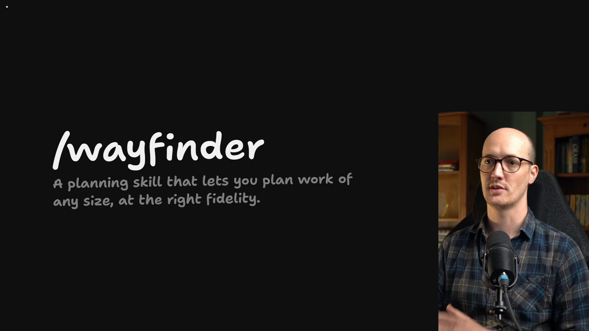

Last time we learned why Wayfinder exists and the problem it solves. Now let's look at what it is and how it goes about it.

## Getting the skill

You can grab it yourself by running this:

```bash
npm run reset add-wayfinder-skill
```

I'm going to reset my current branch. The Wayfinder [skill](https://www.aihero.dev/ai-coding-dictionary/skill) then appears inside the `.agents/skills/` folder.

## The opening of the skill

The skill starts with a rather poetic opening: a loose idea has arrived, too big for one [agent](https://www.aihero.dev/ai-coding-dictionary/agent) [session](https://www.aihero.dev/ai-coding-dictionary/session) and wrapped in fog.

It then describes the two data structures: a map, and the decision [tickets](https://www.aihero.dev/ai-coding-dictionary/ticket) for that map.

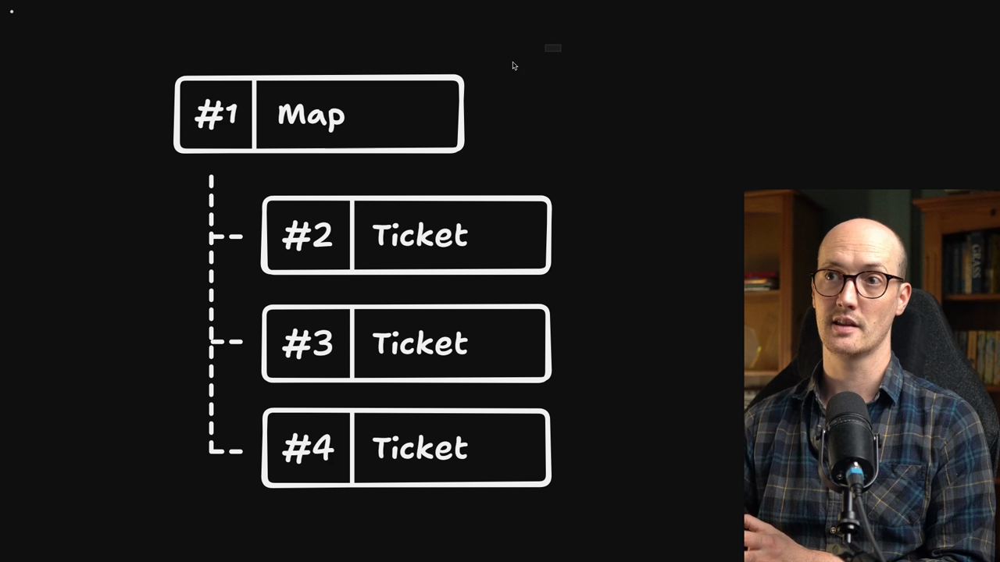

A map has sub-tickets based on it. Each of these is technically a ticket in your issue tracker. In our case they are GitHub issues.

- The map is a GitHub issue.
- Each decision ticket is also a GitHub issue underneath it.

## Resolving the map

You go through and resolve the decision tickets one at a time. Once you've resolved all of them, essentially closing the issues, your map is ready to go.

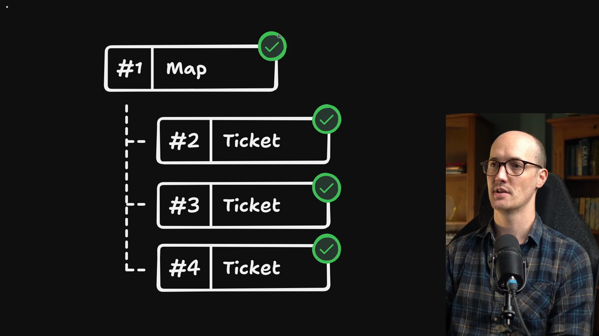

In other words, you have made all the decisions needed. You have found your way to your destination.

## The destination

But what is your destination? That is what you decide in your very first session. The way from here to the destination isn't visible yet, and wayfinding is about finding that way.

The skill puts it like this: the destination varies per effort, and naming it is the first act of charting. It shapes every ticket.

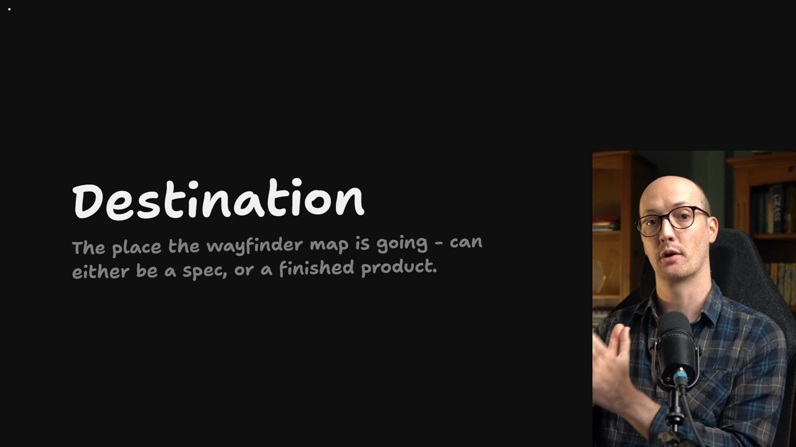

The destination is the first thing you decide. Once you have it, you can figure out the way there.

One really cool thing about Wayfinder is that you can use it for non-coding work. I have a Wayfinder map for this course, and the destination is the finished course.

### A spec as the destination

For coding, I recommend making the destination a [spec](https://www.aihero.dev/ai-coding-dictionary/spec). That is how we're going to use it in this course.

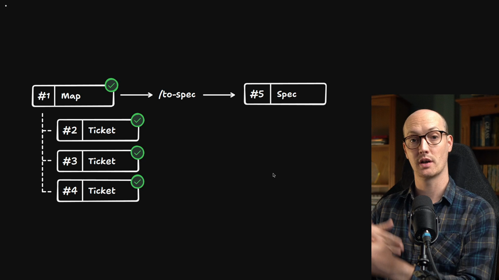

We decide everything that might need to go into the specification and create a really detailed spec. Then we [hand it off](https://www.aihero.dev/ai-coding-dictionary/handoff) to some agents to build it for us.

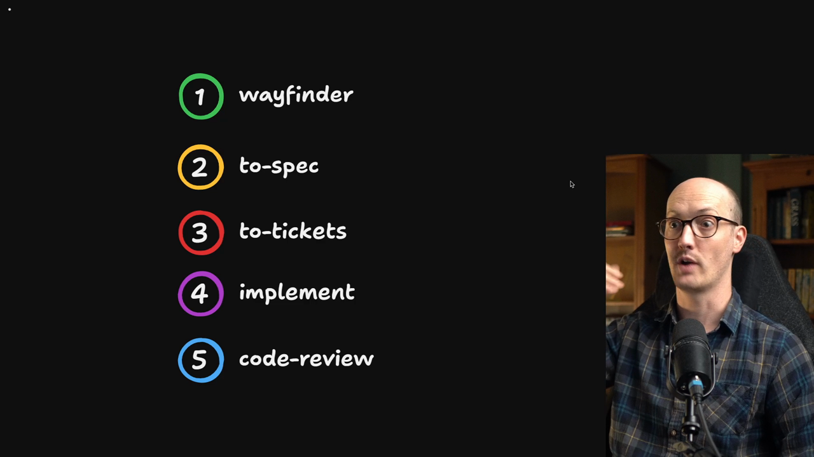

So far we've used `/grill-with-docs` as our pre-spec ritual for big chunks of work. But it's best for neatly scoped work.

Wayfinder is good for large projects, huge chunks of work. We create big specs out of them and run them through our normal loop.

## The map in detail

Let's look at these data structures more closely.

The map is a single issue on this repo's issue tracker, labeled `wayfinder:map`. Its decision tickets are child issues of the map.

The map acts as an index of all the decisions taken. When we turn the map into a spec with `/to-spec`, the spec has the map as its index, its entry point to all the decisions made.

Each ticket then holds all the detail: the [grilling](https://www.aihero.dev/ai-coding-dictionary/grilling) sessions and everything that led to the decisions.

In other words, the whole map is a low-resolution view. It contains:

- The destination.
- Some general notes.
- All the decisions made so far.
- All of the fog of war around those decisions.

## Fog of war

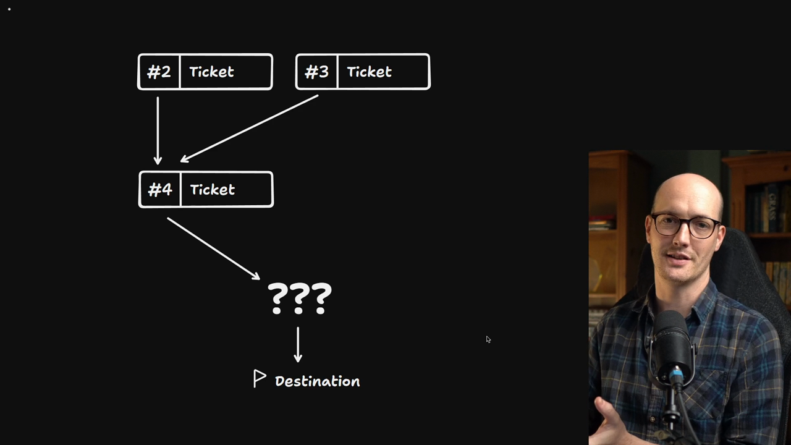

Fog of war is a metaphor I'm really proud of.

When you're planning big chunks of work, you often won't know your way to the destination. If you knew everything you needed to do and decide, work would be a lot easier.

You can only see a few decisions in front of you at any one time. You can't see the whole board. As you go through the map, you reveal more of it.

## Blocking and the frontier

Crucial to this is that tickets can have blocking relationships to each other.

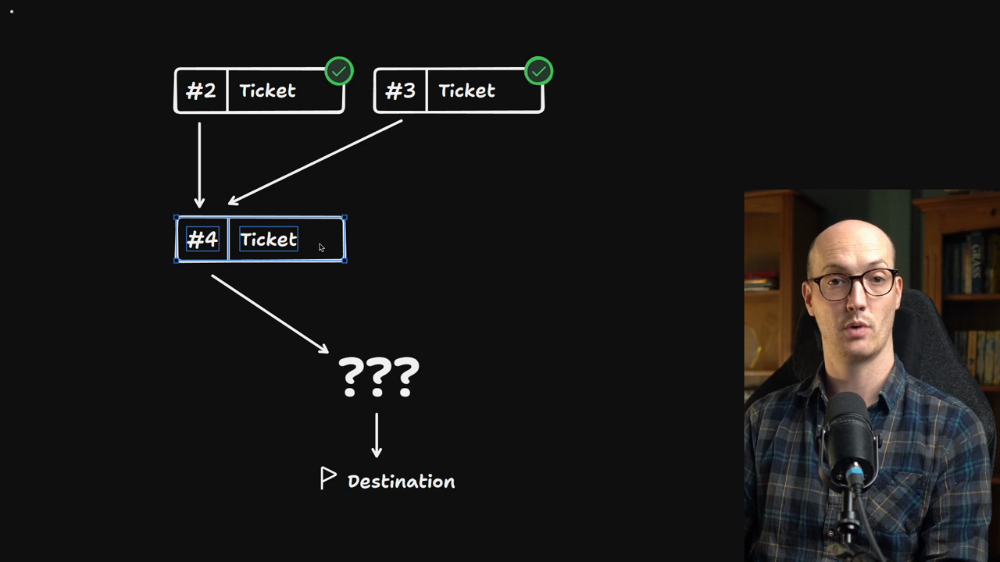

For instance, both of two decisions might need to be made before we can make a third. Only when those two tickets are closed can we open the third.

We can use the issue tracker's native dependency tracking for this. GitHub, for instance, has a "blocked by" feature that lets tickets be blocked by others.

A ticket is unblocked when every ticket blocking it is closed. The **frontier** is the open, unblocked, unclaimed children.

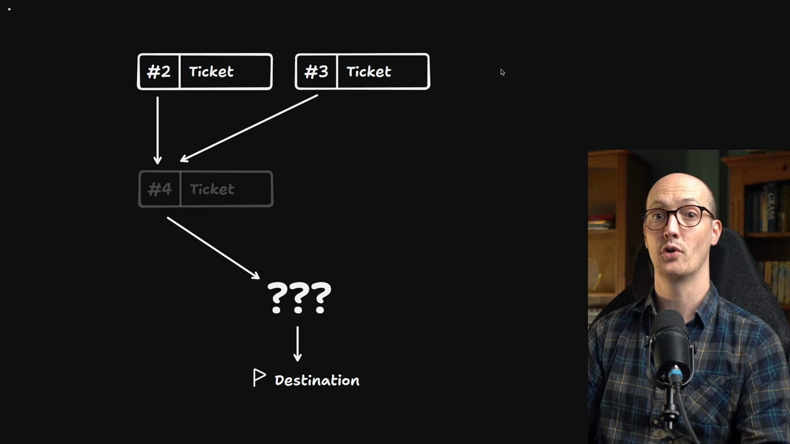

In this map, number four is blocked because numbers two and three haven't been closed yet. Two and three are the frontier of open tickets, so they can be tackled at the same time.

## Clearing the fog

How do you clear the fog of war and make your way to the destination?

As you make decisions, they reveal more decisions you need to make. During the wayfinding session for number two, another ticket might present itself.

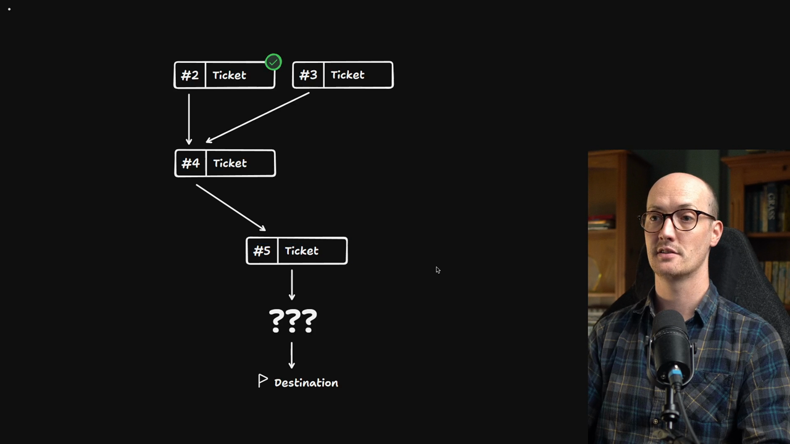

So you create ticket number five and add it to the map.

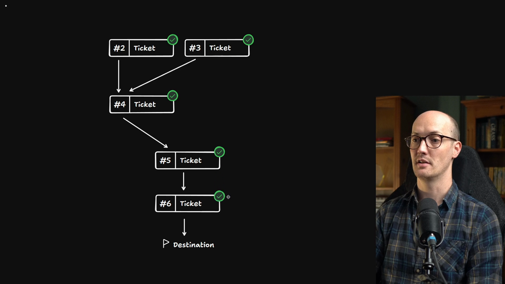

Once number five is done, you may realize you can see your way to the destination. We have everything we need. Once you've completed number six, the destination is complete and the map can be turned into a spec.

These tickets form a graph, a directed acyclic graph if you want to be technical. Decisions inside the tickets open up more space and clear the fog of war, so you can figure out your way to the destination.

Some maps can have 50 or 60 tickets. They can scale to enormous specifications and projects.

## The four ticket types

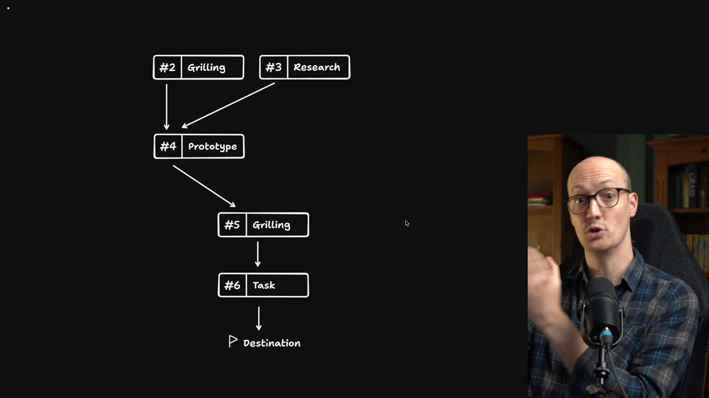

What are you actually doing inside these tickets? There are four types in Wayfinder, each used for different things.

| Type | Used for | Mode |
| --- | --- | --- |
| Grilling | Answering a list of questions in a standard grilling session | With you |
| [Prototype](https://www.aihero.dev/ai-coding-dictionary/prototyping) | Raising fidelity by making something to react to | With you |
| Research | Fetching third-party information you don't have locally | [AFK](https://www.aihero.dev/ai-coding-dictionary/afk), a [sub-agent](https://www.aihero.dev/ai-coding-dictionary/subagent) |
| Task | Manual work that must happen before a decision | A checklist for you |

### Grilling

The most common type is the grilling ticket. In one agent session, you answer a list of questions, in a standard `/grill-with-docs` session.

In the skill's ticket types, grilling is the conversation, the default case. It says to always call the skill [tool](https://www.aihero.dev/ai-coding-dictionary/tool) twice, for grilling and domain modeling.

### Prototype

Grilling is quite low fidelity. It's discussion. What if we need something higher fidelity? What if we need to look at something before we can decide which way to go?

For that we have prototype tickets. They let you raise the fidelity on questions where you need to see something working.

A prototype ticket raises the fidelity of the discussion by making a cheap, rough, concrete artifact to react to. It calls a separate skill, `/prototype`.

The skill says to use it when "how should it look" or "how should it behave" is the key question.

### Research

A research ticket is for when you need third-party information or data you don't have access to locally.

That means reading documentation, third-party APIs, or local resources like knowledge bases, to surface a fact that a decision waits on.

Sometimes we can't grill anything until we have the information we need, and research goes out and gets it.

Unlike the others, this one doesn't need your help. It is AFK, away from keyboard, and is resolved immediately by a sub-agent.

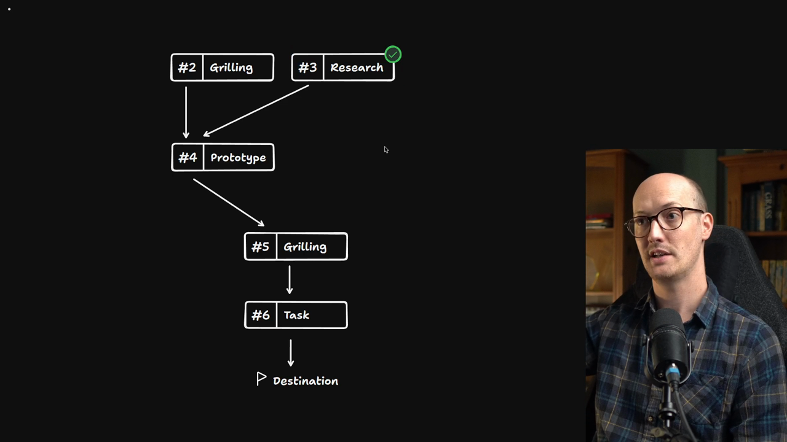

The ticket is created and then immediately scheduled to a sub-agent. The sub-agent does the research and attaches it to the ticket.

This is very useful. Once you've done your grilling session, you can get to the prototype immediately.

### Task

Finally, the task ticket is for manual work that must happen before a decision can be made.

That might be signing up for a service so we can build a prototype, provisioning access to something, or moving data into a certain shape.

This one isn't really a decision ticket. The agent creates a list of manual steps for you to follow, such as provisioning the service, so that what needs doing gets done.

## Invoking Wayfinder

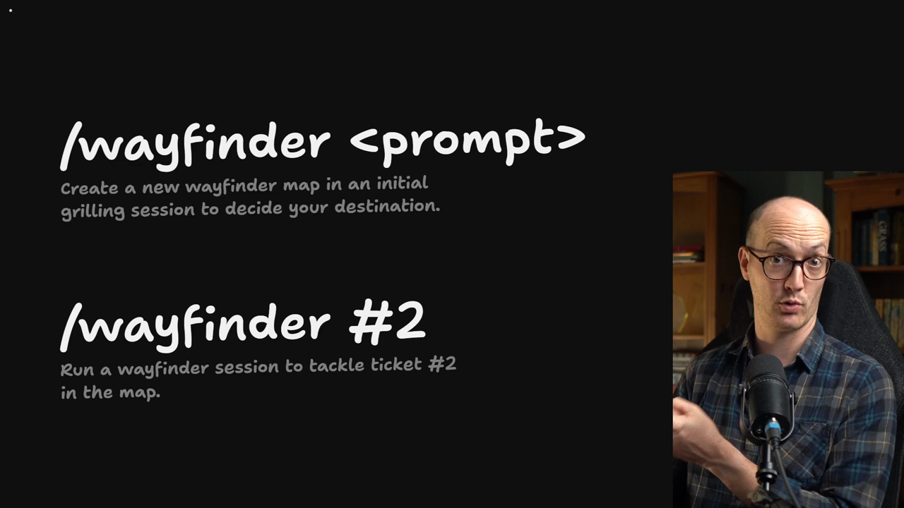

How do you get Wayfinder to create the map and run the tickets? There are two modes, and it detects which one you want.

- Run `/wayfinder` with a prompt, and it creates a new map. It has a grilling session with you to decide where you're going and what your destination is.
- Once the map exists, run `/wayfinder` with a ticket number in a new session. It runs a Wayfinder session to tackle that specific ticket.

```txt
/wayfinder <prompt>
/wayfinder #2
```

## Before you carry on

That was a lot of information. Make sure you've got it before we carry on. Go to the bottom of this page for quizzes on maps, tickets and everything we've covered.

Once you've taken them and feel comfortable, I'm excited to start wayfinding with you.

Good luck, and I'll see you in the next one.

<Quiz>
  <QuizQuestion data={{
    id: "wayfinder-map-structure",
    question: "You're starting a Wayfinder effort in a repo that uses GitHub issues. How will the work be laid out?",
    type: "multiple-choice",
    choices: [
      { answer: "a", label: "One issue labeled `wayfinder:map`, with each decision ticket as a child issue" },
      { answer: "b", label: "One big issue with a checklist where each item is a decision" },
      { answer: "c", label: "A markdown file in the repo with one section per decision" },
      { answer: "d", label: "Separate unlinked issues per decision, with no map issue" }
    ],
    correct: "a",
    answer: "The map is a single issue labeled `wayfinder:map`, and each decision ticket is its own child issue underneath it. A checklist can't be blocked, claimed or closed per decision, so it loses the frontier. A markdown file isn't in your issue tracker, and unlinked issues have no map to act as the index. The map is ready once every ticket is closed."
  }} />
  <QuizQuestion data={{
    id: "wayfinder-map-vs-ticket-detail",
    question: "You're turning a finished map into a spec and need the full grilling discussion behind one decision. Where do you look?",
    type: "multiple-choice",
    choices: [
      { answer: "a", label: "In the map body, which stores every decision in full" },
      { answer: "b", label: "In the ticket the map links to for that decision" },
      { answer: "c", label: "In the map's destination section" },
      { answer: "d", label: "In the map's fog of war notes" }
    ],
    correct: "b",
    answer: "The map is a low-resolution index: the destination, general notes, a line per decision made, and the fog of war. Each ticket holds the detail of the grilling sessions that led to its decision. The destination only says where the map is going, and the fog of war covers decisions not yet specified, not those already made."
  }} />
  <QuizQuestion data={{
    id: "wayfinder-frontier-definition",
    question: "A map has tickets #2 and #3, and ticket #4 is blocked by both. #2 is open and unassigned, #3 is open and already claimed by a colleague's session. Which tickets are on the frontier?",
    type: "multiple-choice",
    choices: [
      { answer: "a", label: "#2 only" },
      { answer: "b", label: "#2 and #3" },
      { answer: "c", label: "#2, #3 and #4" },
      { answer: "d", label: "None until both #2 and #3 are closed" }
    ],
    correct: "a",
    answer: "The frontier is the open, unblocked, unclaimed children. #2 qualifies. #3 is open and unblocked but claimed, so it is out. #4 is blocked until both #2 and #3 close. The frontier does not wait for every ticket to close."
  }} />
  <QuizQuestion data={{
    id: "wayfinder-ticket-type-choice",
    question: "You can't decide on an approach until you know what a third-party API supports, and the docs are not in your repo. Which ticket type fits, and how does it get resolved?",
    type: "multiple-choice",
    choices: [
      { answer: "a", label: "Grilling, in a live session where you answer questions together" },
      { answer: "b", label: "Prototype, by building a rough version to react to" },
      { answer: "c", label: "Research, resolved AFK by a sub-agent that attaches its findings" },
      { answer: "d", label: "Task, with a checklist of manual steps for you to follow" }
    ],
    correct: "c",
    answer: "Research tickets fetch information you don't have locally, and a sub-agent resolves them immediately without you. Grilling is discussion and can't conjure the missing facts. A prototype is for questions about how something should look or behave. A task is manual work such as provisioning access, not information gathering."
  }} />
  <QuizQuestion data={{
    id: "wayfinder-prototype-or-not",
    question: "You have two open questions: which of two layouts feels right for a new screen, and what rate limits a third-party API enforces. Which ticket types do they need?",
    type: "multiple-choice",
    choices: [
      { answer: "a", label: "Layout gets a prototype ticket, rate limits get a research ticket" },
      { answer: "b", label: "Layout gets a research ticket, rate limits get a prototype ticket" },
      { answer: "c", label: "Both get prototype tickets, since seeing something working settles both" },
      { answer: "d", label: "Both get grilling tickets, since every decision is a conversation" }
    ],
    correct: "a",
    answer: "A prototype is the answer when how something should look or behave is the key question, because you need a cheap, rough artifact to react to. Rate limits are a fact outside your repo, so a research ticket fetches them. Prototyping the API wastes effort on a fact you can simply look up, and grilling the layout stays low fidelity when you need to see it."
  }} />
</Quiz>
