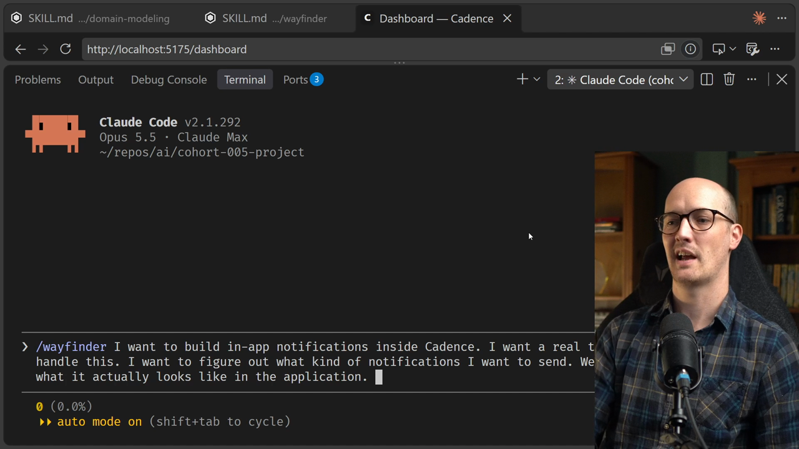
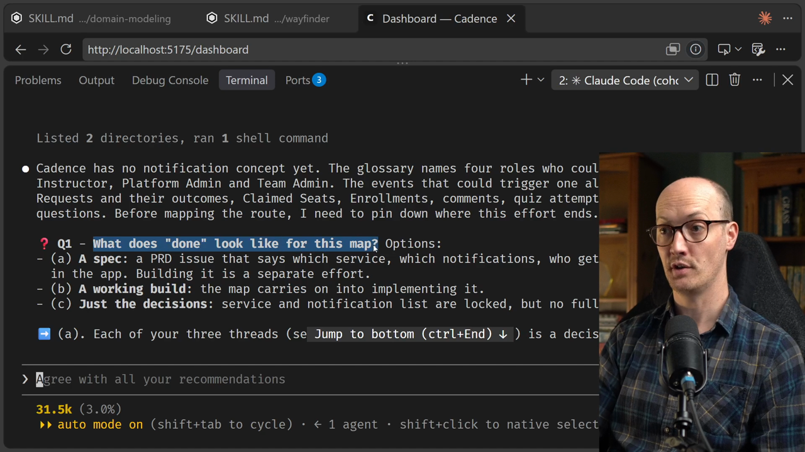
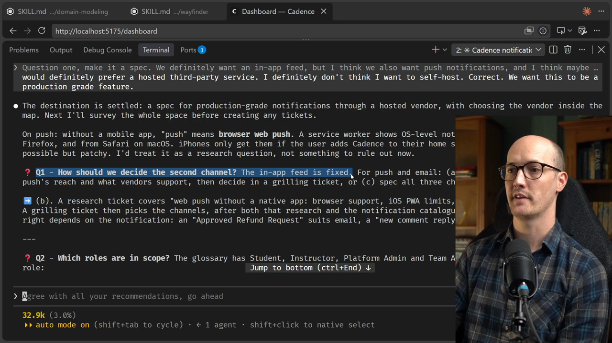
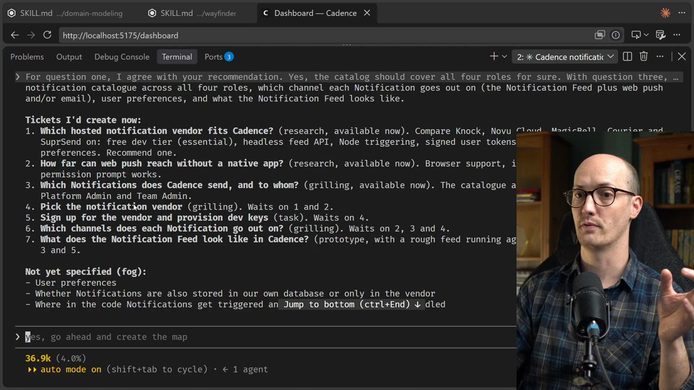
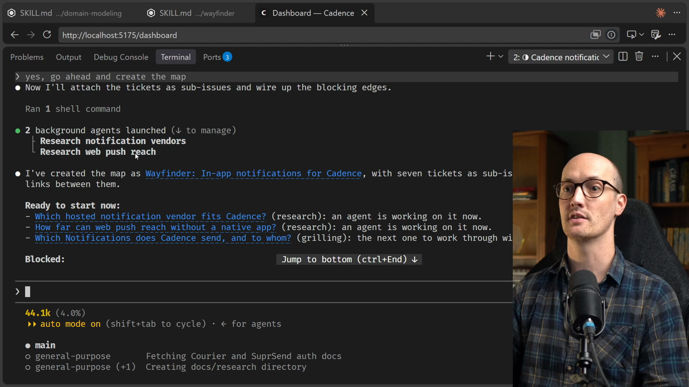
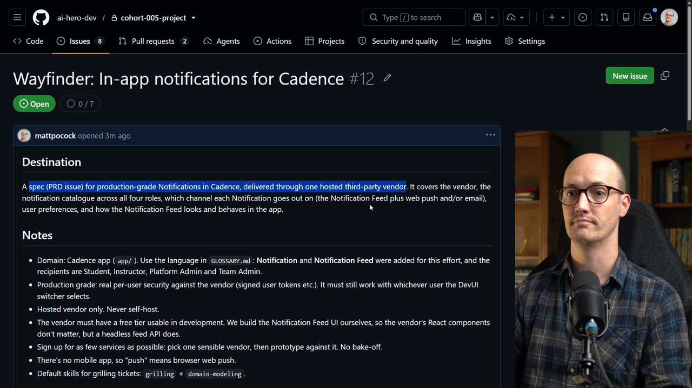
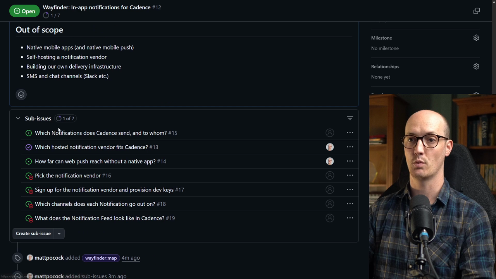
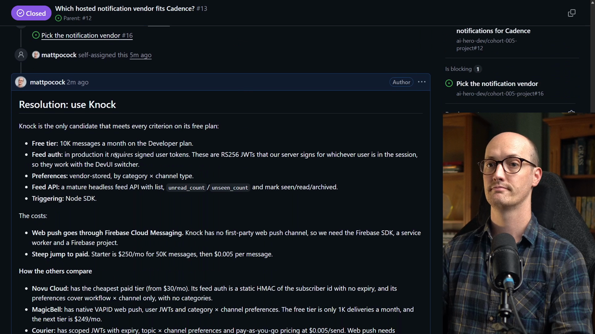
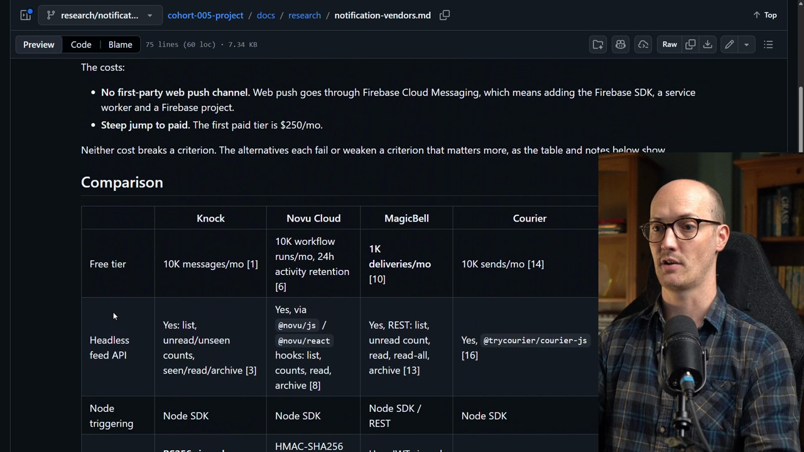
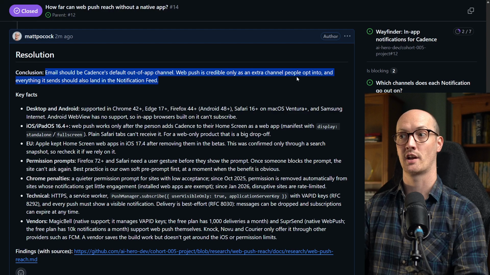

# Chart The Map Solution

<CommitMap packageManager="npm">
  <Commit id="add-wayfinder-skill">Start the lesson: the `wayfinder`, `prototype` and `research` skills added under `.agents/skills/`</Commit>
  <Commit id="add-notification-terms">The Notifications section added to `GLOSSARY.md` during the grilling</Commit>
  <Commit id="add-seed-wayfinder-issues">The `seed-wayfinder-issues` script, which loads my map and tickets into your GitHub issues</Commit>
  <Commit id="research-notification-vendors">The vendor research behind the first research ticket, in `docs/research/notification-vendors.md`</Commit>
  <Commit id="research-web-push-reach">The web push research, in `docs/research/web-push-reach.md`</Commit>
  <Commit id="remove-research-docs">See my solution: the lesson's end state, with the research docs removed again</Commit>
</CommitMap>

We start with a good old prompt, typed as the arguments to the `/wayfinder` [skill](https://www.aihero.dev/ai-coding-dictionary/skill). The goal is to build in-app notifications inside Cadence.

```txt
/wayfinder I want to build in-app notifications inside Cadence. I want a real third-party service to handle this. I want to figure out what kind of notifications I want to send. We'll need to figure out what it actually looks like in the application.
```

That is probably enough. In-app notifications are well known, so we don't need to over-specify at this point.



The [agent](https://www.aihero.dev/ai-coding-dictionary/agent) loads the `/grilling` and `/domain-modeling` skills. So we are essentially in a `/grill-with-docs` [session](https://www.aihero.dev/ai-coding-dictionary/session), just with a bit of extra wayfinding in there.

## Round One of Grilling

The first question is what done looks like for this map. Should it be a [spec](https://www.aihero.dev/ai-coding-dictionary/spec), a working build, or just the decisions? I answer question one: make it a spec.

It knows that a spec and a working build are the two main options.



### Pinning down scope

The next question is about scope: what counts as in-app? This is a really important part of wayfinding, especially at this early stage. You are figuring out the exact scope of what needs to be built and what the destination looks like. It would be very easy to go too far.

My answer:

- We definitely want an in-app feed.
- We also want push notifications.
- Maybe we could explore email too.

There is no mobile application for Cadence. So I wonder how possible app notifications actually are, and whether we need to default to email instead.

### Vendor and purpose

Its third question is whether the vendor is still open, since I said "a real third-party service". Its recommendation is that choosing the vendor is part of the map, driven by research [tickets](https://www.aihero.dev/ai-coding-dictionary/ticket).

For question three, yes, choosing a vendor is definitely part of this map. I would prefer a hosted third-party service. I don't think I want to self-host.

Then it asks what this is for. Cadence currently uses a dev UI user switcher and not real auth, so should this spec be for a production-grade feature? Correct, we want a production-grade feature.

Those all feel like sensible questions with reasonably sensible answers.

## Round Two of Grilling

The second round starts with how to decide the second channel. The in-app feed is fixed. For push and email, do we decide now, research, or spec all three channels?

Its recommendation is to open a research ticket, which makes sense to me. For question one, I agree with the recommendation.



Notice how modest it is about what it knows. It knows that it needs to go out and find information, which agents rarely do. Sometimes they just barrel ahead without it.

### Roles, vendor needs and prototyping

Next it asks which roles are in scope. The glossary has student, instructor, platform admin and team admin.

Our domain modeling is now coming back to us. We are reaping the benefits of the work we've already done. Yes, the catalogue should cover all four roles.

Then it asks what a vendor should have to support, including a React in-app feed component, prebuilt or headless. For question three:

- I don't really care about React in-app components. I feel comfortable building this ourselves.
- The main thing we need is a free tier that's usable in development.

Question four asks whether we want to try vendors hands-on before choosing. After research narrows it to two, we could choose from the docs alone, or add a task ticket to sign up for both.

I would like to sign up for as few services as possible. I want to choose one sensible vendor, then [prototype](https://www.aihero.dev/ai-coding-dictionary/prototyping) it to see if it's working.

### Preferences and naming

Question five is a good scope question: can users control their notifications? Should that be per category, or per category and per channel? I agree with the recommendation.

Question six is a domain modeling question. What should we call it? I would add a notification to the glossary. It recommends notification and inbox for the place in the app, but I prefer notification and notification feed. Those feel most natural to me.

## Reaching Shared Understanding

Before the map is even created, I can already start to feel the way there. We will do some research, then have a task to sign up for the vendor, then maybe some prototyping to see how it works.

We can see it is already writing to `GLOSSARY.md`, which is excellent. The edit adds a Notifications section, with "Inbox" listed under _Avoid_ because I chose "Notification Feed".

```markdown
### Notifications

**Notification**:
A message Cadence sends a person to tell them something that concerns them has happened.
_Avoid_: Alert, Message, Activity

**Notification Feed**:
The place inside Cadence where a person sees their Notifications.
_Avoid_: Inbox, Activity feed
```

It looks like we have reached shared understanding. So it creates a whole bunch of tickets, and it leaves a bunch of things not yet specified in the fog.



### The four ticket types

This map has around seven tickets, and all four types are represented.

| Ticket type | Purpose in this map                                      |
| ----------- | -------------------------------------------------------- |
| Research    | Find out which vendor fits, and how far web push reaches |
| [Grilling](https://www.aihero.dev/ai-coding-dictionary/grilling)    | Decide things like the notification catalogue            |
| Task        | Sign up for the vendor                                   |
| Prototype   | See what the feed looks like in Cadence                  |

This is my first run through this exercise and I was dearly hoping that would happen. From a teacher's point of view, I'm very happy.

## Creating the Map

This all looks good, so I tell it to go ahead and create the map. What we will notice is that two research agents get fired off straight away.

```txt
yes, go ahead and create the map
```

It has created everything, which is very exciting. It has also launched two agents in the background. They are already researching the notification vendors and the web push reach.



## Reading the Map

Let's open up the map and see what it looks like. It reads from top to bottom.

- **Destination.** A spec at the top, for production-grade notifications in Cadence delivered through one hosted third-party vendor.
- **Notes.** Some vague notes, which is nice. It is remembering the decisions made in our charting efforts.
- **Decisions so far.** Nothing yet, because we've made no decisions.
- **Not yet specified.** The stuff in the fog, essentially.
- **Out of scope.** No native mobile apps, no self-hosting a notification vendor, and no building our own delivery infrastructure.



### The tickets

At the bottom are the tickets. We can see which are open and which are currently blocked.

We can even see the ones already assigned to agents. In fact, one just closed while I was filming it. Both research tickets have been grabbed by agents.



The first ticket is the only one available, and it is a grilling session. It has the label `wayfinder:grilling` on the right. The ticket body holds the question it will take into the session.

```markdown
## Question

What is the notification catalogue? For each of Student, Instructor, Platform Admin and Team Admin: which events produce a Notification, who exactly receives it, and what it says at a high level. Start from events that already exist in the code (Refund Requests and their outcomes, Refunds, Enrollments, Claimed Seats, comments, questions, ratings, new lessons) and decide which make the cut for v1.
```

### Following along

The tricky thing about running this as an exercise is that you will probably end up with a very different map from mine.

So during this section I'm going to save every map, ticket and update as it goes through. You can follow along exactly, or chart it yourself and use my work as a reference.

On Path 1, recreate this lesson's end state in your own repo. First close the map you charted, using its issue number, because the seed script refuses to run while you have an open map. Then reset to the commit that adds the seed script, and seed the issues from the checkpoint:

```bash
gh issue close <issue-number>
npm run reset add-seed-wayfinder-issues
npm run seed-wayfinder-issues 01-chart-the-map
```

## The Research Comes Back

The map has already been updated by the two agents. Both are closed, and it has picked an actual service based on its research.

Take the first ticket: which hosted notification vendor fits Cadence? It keeps the original ticket and question. The resolution is to use Knock.



It compared Novu Cloud and MagicBell, among others. Knock was the only candidate that met every criterion on its free plan, including a free tier, signed user tokens, vendor-stored preferences and a headless feed API.

### Full research on a throwaway branch

Something clever happens here too. The comment gives you a summary of what it found. The full research is saved to a throwaway branch, inside a real file.

Any agent can go and read the entire research if it wants to.



It links back to the original sources and includes a full comparison. Here is a slice of it.

|                           | Knock                                      | Novu Cloud                    | MagicBell                           |
| ------------------------- | ------------------------------------------ | ----------------------------- | ----------------------------------- |
| Per-user feed auth        | RS256 signed user token, mandatory in prod | Static HMAC with no expiry    | User JWT signed with project secret |
| Web push                  | Via FCM only                               | Via FCM, OneSignal and others | Native VAPID                        |
| Vendor-stored preferences | Category × channel type                    | Workflow × channel only       | Category × channel                  |

### The web push research

Back on the map, the other research ticket is resolved too. The question was how far web push can reach without a native app.

Its conclusion:

```markdown
**Conclusion:** Email should be Cadence's default out-of-app channel. Web push is credible only as an extra channel people opt into, and everything it sends should also land in the Notification Feed.
```



## Ready to Go

We now have the map and the research done, and we can go and grill on it. Everything is ready for us to succeed.

It is a very exciting time. I just love working with Wayfinder, it's very fun. Nice work, and I'll see you in the next one.
