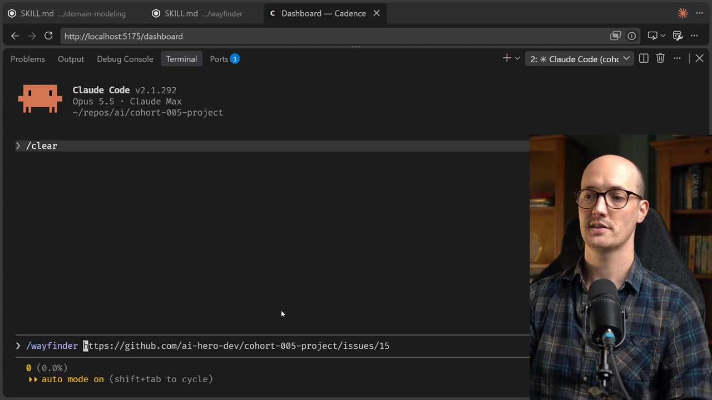

# Grilling Ticket

<CommitMap packageManager="npm">
  <Commit id="remove-research-docs">Start the lesson: the research docs removed, with the Notifications terms in `GLOSSARY.md`</Commit>
  <Commit id="add-discussion-terms">See my solution: a Discussions section (`Discussion Question`, `Discussion Reply`) added to `GLOSSARY.md`</Commit>
</CommitMap>

<Prerequisites title="Crash Course Prerequisites">
  <Prerequisite href="https://www.aihero.dev/workshops/ai-coding-crash-course/smart-zone-dumb-zone-d4b92bd0">
    Why a fresh context gives you a sharper agent than a long-running one.
  </Prerequisite>
  <Prerequisite href="https://www.aihero.dev/workshops/ai-coding-crash-course/managing-your-claude-code-session-78bcc6c8">
    The hands-on basics of driving the agent, including `/clear`.
  </Prerequisite>
  <Prerequisite href="https://www.aihero.dev/workshops/ai-coding-crash-course/the-grill-execute-clear-loop-fac85414">
    How a grilling session works: the agent asks, you answer or overrule, until you agree.
  </Prerequisite>
  <Prerequisite href="https://www.aihero.dev/workshops/ai-coding-crash-course/clear-compact-handoff-or-subagent-3cb75ac9">
    Why you clear at a phase boundary instead of carrying on from the last session.
  </Prerequisite>
</Prerequisites>

Your Wayfinder map has a first decision [ticket](https://www.aihero.dev/ai-coding-dictionary/ticket) waiting. In my map, it asks which notifications Cadence sends and to whom. This type of ticket is a [grilling](https://www.aihero.dev/ai-coding-dictionary/grilling) ticket: a decision that is mostly conversation.

Your job is to run a fresh grilling [session](https://www.aihero.dev/ai-coding-dictionary/session) on the first grilling ticket in your own map, and keep going until that ticket is closed.

## Steps To Complete

### Set Up Your State

- [ ] Choose your path

**Path 1, my setup:** to start exactly as I did, run the reset script from the repo:

```bash
npm run reset remove-research-docs
```

Then seed my map and tickets. This lesson starts from the `01-chart-the-map` checkpoint, which gives you the map with the first ticket open.

```bash
npm run seed-wayfinder-issues 01-chart-the-map
```

**Path 2, your own map:** skip the reset and the seed, and use the map you built in the previous lesson. Use mine as a guide.

### Run The Grilling Session

- [ ] Find the first grilling ticket in your map

In mine, it is the ticket titled "Which Notifications does Cadence send, and to whom?". It has the `wayfinder:grilling` label. Copy its link address from GitHub.

- [ ] [Clear](https://www.aihero.dev/ai-coding-dictionary/clearing) your [agent](https://www.aihero.dev/ai-coding-dictionary/agent)'s [context](https://www.aihero.dev/ai-coding-dictionary/context)

Do not carry on from the session where you charted the map. Start fresh:

```txt
/clear
```

- [ ] Kick off the grilling session by running Wayfinder with the ticket URL

Paste in the link you copied, replacing the placeholder:

```txt
/wayfinder <URL-of-your-ticket>
```



- [ ] Work through the grilling session until the decision is made

Answer the agent's questions and overrule any recommendation you disagree with. Keep going until you have resolved the ticket's question.

### Check Your Result

- [ ] Confirm the ticket is closed

By the end of the lesson, your first decision ticket in the Wayfinder map should be grilled and closed. Check the issue in GitHub to verify.

When you are done, watch the solution to compare how my session played out.
