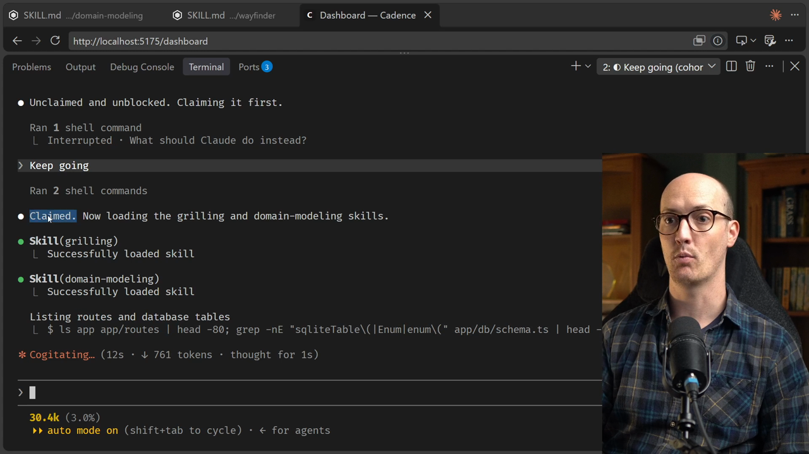
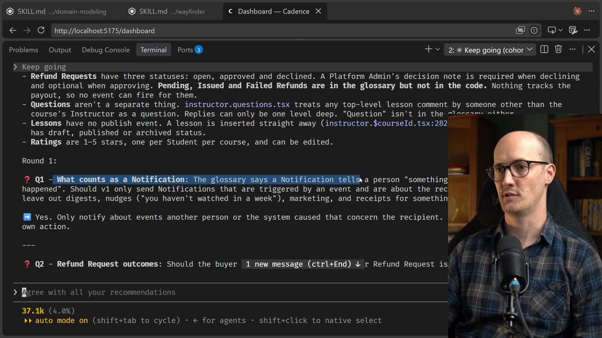
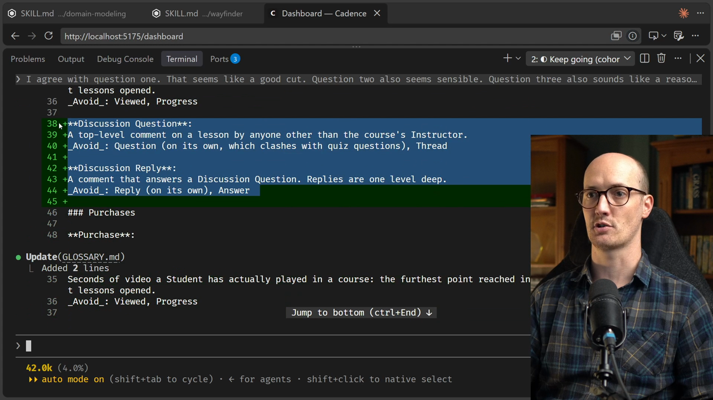
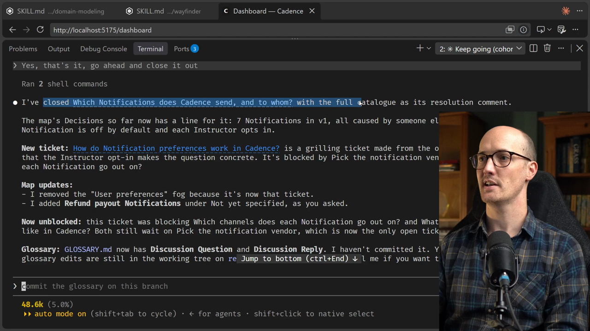
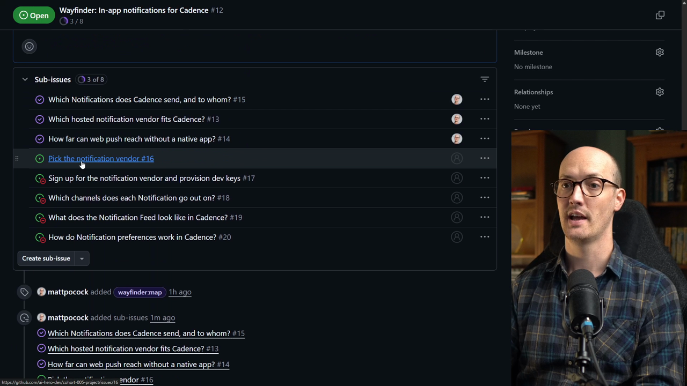

# Grilling Ticket Solution

<CommitMap packageManager="npm">
<Commit id="remove-research-docs">Start the lesson: the research docs removed, with the Notifications terms in `GLOSSARY.md`</Commit>
<Commit id="add-discussion-terms">See my solution: the Discussions section (`Discussion Question`, `Discussion Reply`) added to `GLOSSARY.md`</Commit>
</CommitMap>

We kick this off again by telling the [agent](https://www.aihero.dev/ai-coding-dictionary/agent) to keep going.

```
Keep going
```

The first thing I expect is for it to claim the Wayfinder [grilling](https://www.aihero.dev/ai-coding-dictionary/grilling) [ticket](https://www.aihero.dev/ai-coding-dictionary/ticket). Then we can look at the shell commands it wrote.



It reads the glossary, grabs all of the issues, works out the dependency relationships, and grabs each one.

It then generates a few facts. It has found some information in the code, probably by looking inside the glossary, and it is ready to go.

## Round 1: Ten Questions

We start with some standard questions, beginning with "What counts as a notification?"

By this point in the course we've done a lot of grilling, so I won't bore you with all of it. I'll show you the entire question on screen, then my answer without much preamble.



Here is how my answers went:

| Question | Topic                                         | My answer                      |
| -------- | --------------------------------------------- | ------------------------------ |
| 1        | What counts as a notification                 | Agree, a good cut              |
| 2        | Refund request outcomes                       | Sensible                       |
| 3        | Refund requests and platform admins           | Reasonable recommendation      |
| 4        | Refund payouts                                | Agree                          |
| 5        | Claimed seats and team admins                 | Good recommendation            |
| 6        | Notification on every new enrollment          | Override: make it customisable |
| 7        | Questions and replies                         | Agree, but rename the terms    |
| 8        | Ratings and instructors                       | Agree                          |
| 9        | New lesson notification for enrolled students | Agree                          |
| 10       | Notifications for platform admins             | Agree                          |

### Question 3 and domain modeling

I'll just say, notice how nicely question 3 is phrased using our existing domain modeling.

### Question 4: refund payouts

Refund payouts are specified in the glossary, but they don't actually exist in the running code. I agree with the recommendation. We should put them under "not yet specified", because they don't exist in the running code yet.

### Question 6: customisable per instructor

Question 6 asks whether instructors should get a notification on every new enrollment. Here I want this to be customisable per instructor.

Some instructors will want to feel validated by receiving new notifications all the time. For others it will be too onerous.

### Question 7: questions and replies

As part of its recommendation, the agent says we should have question and reply in the glossary.

I happen to know that "question" occurs in multiple parts of the application, with quiz questions too. So I want to prefix the terms with "discussion".

```
I agree with your recommendations, but question and reply should be
discussion question and discussion reply, because we can have quiz
questions as well, and I don't want those terms to step on each other.
```

### Questions 8 to 10

I agree with the recommendation for question 8.

For question 9, I agree that enrolled students should not get a notification when a lesson is added.

For question 10, which covers notifications for platform admins, I also agree with the recommendation.

## Glossary Updates

Some speedy grilling done there, not bad.

Updates are coming into `GLOSSARY.md`: `Discussion Question` and `Discussion Reply`.



## Round 2: Five Follow-Ups

We have another round of questions, and we do the same thing.

| Question | Topic                                                                                        | My answer    |
| -------- | -------------------------------------------------------------------------------------------- | ------------ |
| 11       | Should the enrollment notification be off or on by default?                                   | Agree        |
| 12       | Which enrollments count?                                                                     | Agree        |
| 13       | Who hears about a discussion reply?                                                          | Sounds right |
| 14       | Does editing or deleting a discussion question or discussion reply ever send a notification? | Sounds right |
| 15       | Discussion questions from platform admins or other instructors                               | Agree        |

Well, that was pretty easy.

## Shared Understanding and Closing the Ticket

It looks like we have shared understanding. The agent gives me a full catalogue of all the decisions.

It is going to post that as the resolution to the ticket and close the ticket. It even gives me a nice recommendation for what to say, so I'll say that.

```
Yes, that's it, go ahead and close it out
```

Notice how effectively we stay inside the [smart zone](https://www.aihero.dev/ai-coding-dictionary/smart-zone) here. We're not stressed about turning this grilling into an implementation [session](https://www.aihero.dev/ai-coding-dictionary/session). We just save it back to the map and continue on our way.

I really like how Wayfinder takes the stress and the management out of this. It makes it easy to do your grilling sessions and walk away.

## Checking the Result on GitHub

The agent has closed the ticket, with the full catalogue as its resolution comment.



Here is the ticket we've just done. It is closed, and it has a big, beautiful table inside it.

Looking back at the map, the parent shows that issue is now closed. Our next one is a grilling ticket: "Pick the notification vendor".



In the map itself, under the decisions so far, we have "Which notifications does Cadence send and to whom?", with a little summary inside the map.

With that, our job is done. Nice work, and I'll see you in the next one.
