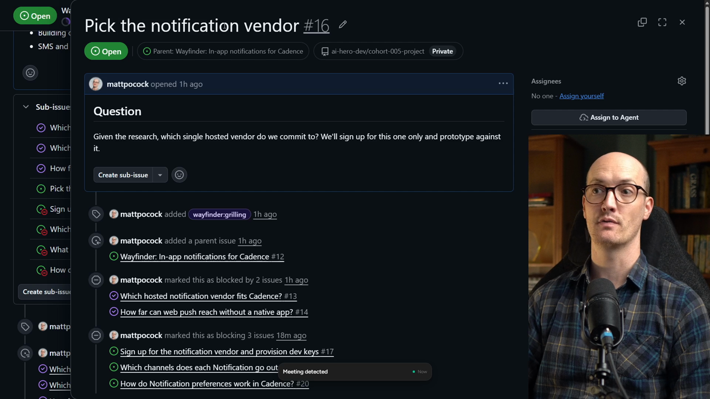

# Grilling Ticket 2

<CommitMap packageManager="npm">
  <Commit id="add-discussion-terms">Start the lesson: the Discussions terms in `GLOSSARY.md`. This lesson only changes GitHub issues, not code</Commit>
</CommitMap>

<Prerequisites title="Crash Course Prerequisites">
  <Prerequisite href="https://www.aihero.dev/workshops/ai-coding-crash-course/hallucination-77d5b4c6">
    Why decisions should rest on research in context, not on what the model thinks it knows.
  </Prerequisite>
  <Prerequisite href="https://www.aihero.dev/workshops/ai-coding-crash-course/the-grill-execute-clear-loop-fac85414">
    How a grilling session works, so you can run this one on your own.
  </Prerequisite>
  <Prerequisite href="https://www.aihero.dev/workshops/ai-coding-crash-course/split-features-across-context-windows-with-tickets-d9aa8395">
    What it means for a ticket to be blocked, and why its blockers must close first.
  </Prerequisite>
</Prerequisites>

Our map has another [grilling](https://www.aihero.dev/ai-coding-dictionary/grilling) [ticket](https://www.aihero.dev/ai-coding-dictionary/ticket) on the frontier: pick the notification vendor. The research tickets are closed, so we have what we need to decide.

This lesson is mostly here for completeness, so you can see every stage of the process. What you learn will be similar to the previous grilling [session](https://www.aihero.dev/ai-coding-dictionary/session).

## Steps To Complete

### Set Up The Map

- [ ] Choose your path

This lesson only changes GitHub issues, not code.

**Path 1, my setup:** seed your issues to the start of this lesson. Use the ticket gist's checkpoint to get the same map state as mine.

```bash
npm run seed-wayfinder-issues 02-grilling-ticket
```

This gives you the map with both research tickets and the first grilling ticket closed, and **Pick the notification vendor** open and unblocked.

**Path 2, your own map:** skip the seed and work the grilling tickets on your own map. Use mine as a guide.



### Pick Up The Ticket

- [ ] Find the next grilling ticket on your map

In my map it is "Pick the notification vendor". On Path 2, solve all of your own grilling tickets instead.

- [ ] Read the ticket's question

```md
## Question

Given the research, which single hosted vendor do we commit to? We'll sign up for this one only and prototype against it.
```

- [ ] Check the resolutions of its two closed blockers

These are the research the decision rests on:

- "Which hosted notification vendor fits Cadence?"
- "How far can web push reach without a native app?"

### Grill The Ticket

- [ ] Run a grilling session on the ticket with your [agent](https://www.aihero.dev/ai-coding-dictionary/agent)

Walk through the ticket the same way you did in the previous grilling session, and see which vendor you land on.

- [ ] Resolve the ticket once the session settles on a vendor

Close the ticket with the decision recorded, ready for the next tickets on the map to build on.

If you want to jump to the end state instead, the checkpoint for the end of the lesson is:

```bash
npm run seed-wayfinder-issues 03-grilling-ticket-2
```
