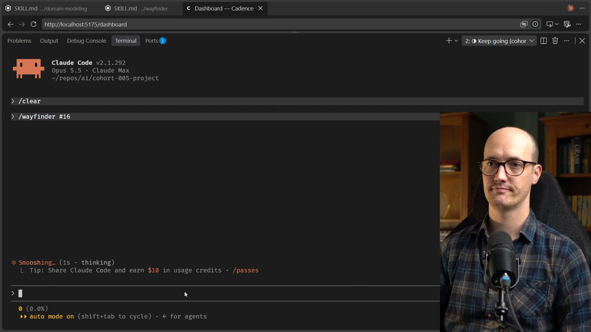
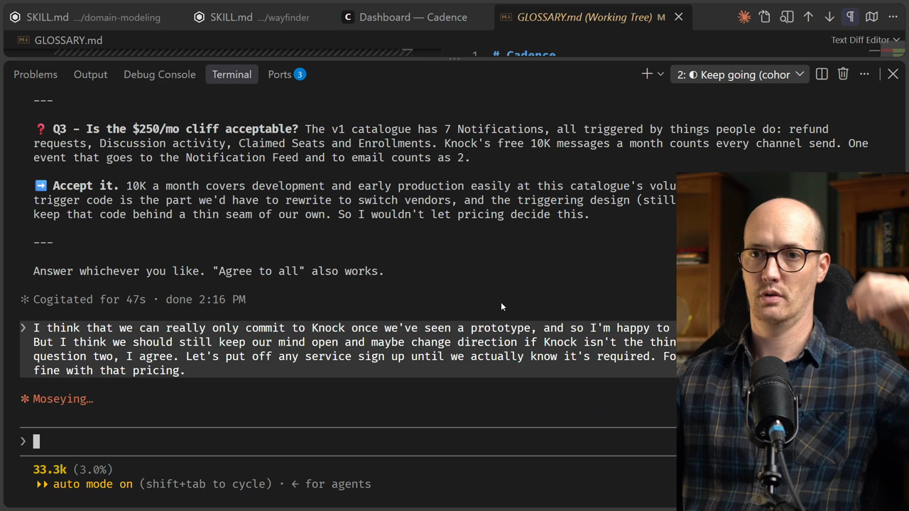
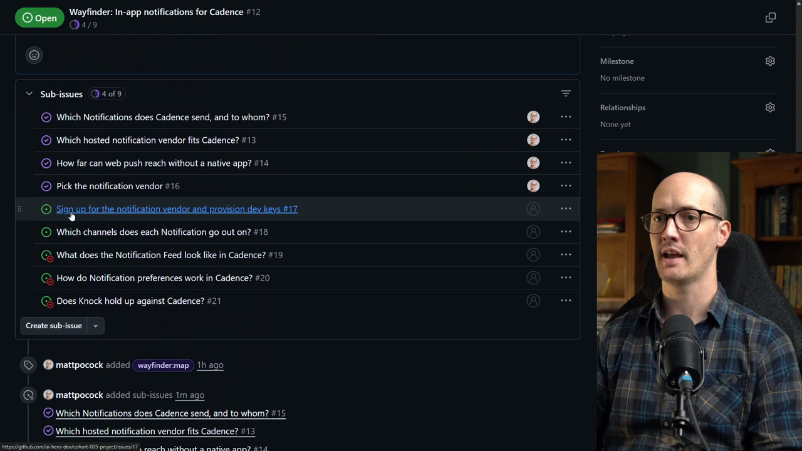
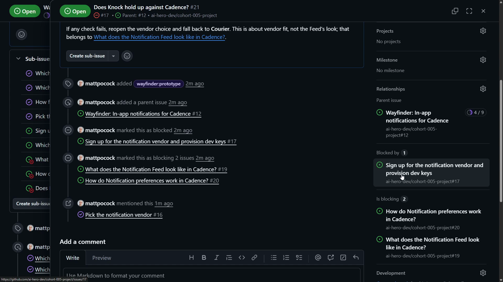

# Grilling Ticket 2 Solution

<CommitMap packageManager="npm">
  <Commit id="add-discussion-terms">Start the lesson: the Discussions terms in `GLOSSARY.md`. This lesson only changes GitHub issues, not code</Commit>
</CommitMap>

This lesson changes no code. The [agent](https://www.aihero.dev/ai-coding-dictionary/agent) only reads and writes GitHub issues. To follow along on Path 1, seed the issues from the [ticket](https://www.aihero.dev/ai-coding-dictionary/ticket) gist's checkpoints:

```bash
npm run seed-wayfinder-issues 02-grilling-ticket
```

That is the start of the lesson: the map with both research tickets and the first [grilling](https://www.aihero.dev/ai-coding-dictionary/grilling) ticket closed, and **Pick the notification vendor** open and unblocked. The end state is checkpoint `03-grilling-ticket-2`.

## Starting the session

I'm going to grab the vendor ticket. I go into my agent, [clear](https://www.aihero.dev/ai-coding-dictionary/clearing) out my previous [session](https://www.aihero.dev/ai-coding-dictionary/session), and then run Wayfinder with that ticket.

```
/clear
```

```
/wayfinder #<ticket-number>
```



## Question 1: commit to Knock?

The first question is whether we're going to commit to Knock, the notification vendor.

This is a tricky decision, and I think we're making it at the wrong fidelity. We'll only really know if we can commit once we've signed up, played around with it, got a real sense of what it can do, and maybe even seen a [prototype](https://www.aihero.dev/ai-coding-dictionary/prototyping).

So I say that to the agent.

```
I think that we can really only commit to Knock once we've seen a prototype. And so I'm happy to give it a go, first of all, but I think we should still keep our mind open and maybe change direction if Knock isn't the thing that we actually want.
```

## Question 2: extra sign-ups

The next question says some vendors come with extra sign-ups attached:

- Web Push needs a Firebase project, because Knock sends Web Push through FCM.
- As far as the agent knows, Knock, Courier and MagicBell all route email through a provider you connect yourself. None of them sends production email on its own.

I don't really know what FCM is. I assume it's something to do with needing a Firebase project. That's a little annoying.

What it's basically asking is: do we sign up for them right now, or put them off until we know they're needed?

```
For question two, I agree. Let's put off any service sign up until we actually know it's required.
```

## Question 3: the pricing cliff

Question three asks whether the $250 a month cliff is acceptable.

```
For question three, yes, I'm fine with that pricing.
```

That all looks OK to me.



## Feeling the fog

Whenever I'm running Wayfinder, I can feel the fog in front of me. I didn't know about those extra sign-ups needed based on the vendor we picked. That's pretty irritating and not what I was imagining.

But sometimes you can only figure this stuff out by talking about it and working it out.

## Question 4: what does the prototype have to prove?

The agent now asks what the prototype has to prove.

The map already has a ticket about what the notification feed looks like in Cadence. But that ticket is about UI and layout, not whether the vendor fits. So the agent suggests another, smaller prototype ticket: does Knock hold up against Cadence?

I like breaking things down into small tickets. We can even prototype both at the same time in different worktrees.

```
I agree with your recommendation for question four. Let's have two prototype tickets.
```

## Question 5: the fallback

Question five asks what the fallback is if Knock fails.

```
For question five, Courier sounds fine as a fallback.
```

## Question 6: what waits for the prototype?

Question six asks what waits for the prototype. The prototype is currently blocked by signing up for the notification vendor and provisioning dev keys.

It's basically asking what shape the graph should have and which blocking relationships we want. I'm fine to accept its recommendation.

```
Yep, your recommendation sounds fine.
```

This feels like a pretty short grilling session. The agent then goes ahead and records it on the ticket.

## The extended map

We now have our map. There's a new decision on it: pick the notification vendor. And two tickets are now open: a task ticket and another grilling session.



Both prototype tickets sit quite close to the end. One is the feed prototype, and the other is the new "does Knock hold up against Cadence?" ticket.

Opening the Knock ticket shows the blocked-by relationship on the right: sign up for the notification vendor and provision the dev keys.



So that's the one we should do next.

## What we learned

In this lesson we saw something new: the map can be extended the more you learn and the more decisions are made.

I hope you feel, too, that we're getting more clarity on what we're actually building.

Nice work, and I'll see you in the next one.
