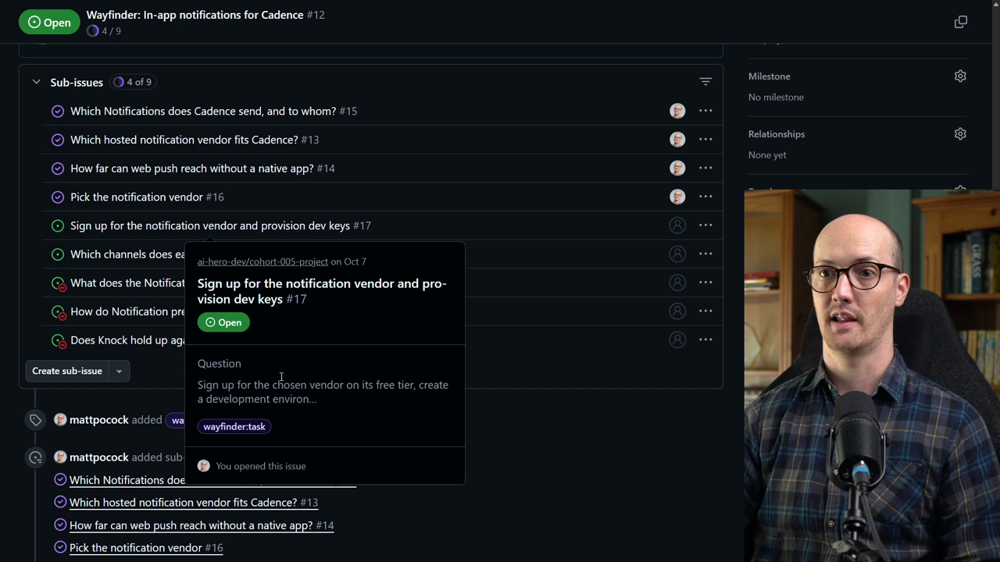
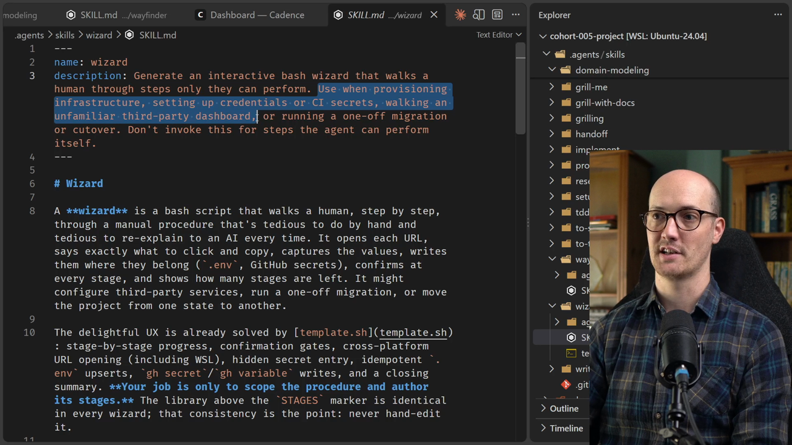

# Task Ticket

<CommitMap packageManager="npm">
  <Commit id="add-discussion-terms">Start the lesson: the repo before the Knock signup ticket is picked up</Commit>
  <Commit id="add-wizard-skill">Add the `wizard` skill: `.agents/skills/wizard/SKILL.md` appears in your repo</Commit>
</CommitMap>

<Prerequisites title="Crash Course Prerequisites">
  <Prerequisite href="https://www.aihero.dev/workshops/ai-coding-crash-course/models-harnesses-agents-environments-2b9a99a1">
    What the agent can and can't reach in its environment, and why some steps need a human.
  </Prerequisite>
  <Prerequisite href="https://www.aihero.dev/workshops/ai-coding-crash-course/running-bash-commands-99b27a39">
    How bash mode works, and why an interactive script belongs in its own terminal.
  </Prerequisite>
  <Prerequisite href="https://www.aihero.dev/workshops/ai-coding-crash-course/what-are-agent-skills-20f91a4e">
    How a skill's description lets the agent invoke it on its own.
  </Prerequisite>
</Prerequisites>

The next [ticket](https://www.aihero.dev/ai-coding-dictionary/ticket) on our Wayfinder map is a task ticket. It asks us to sign up for Knock, our notification vendor, and provision some development keys.

Signing up for services and plugging them together is fiddly, especially when there are several of them. A `/wizard` [skill](https://www.aihero.dev/ai-coding-dictionary/skill) can make this as brainless as possible.

Your job is to get the [agent](https://www.aihero.dev/ai-coding-dictionary/agent) to build a wizard for the ticket, then run it yourself.

## Steps To Complete

### Choose Your Path

- [ ] Pick Path 1 or Path 2

**Path 1, my setup:** seed my map and tickets to the start of this lesson.

```bash
npm run seed-wayfinder-issues 03-grilling-ticket-2
```

**Path 2, your own map:** skip the seed and work the next task ticket on your own map. Use mine as a guide.

### Confirm It's a Task Ticket

- [ ] Open the next ticket on the Wayfinder map: **Sign up for the notification vendor and provision dev keys**



Check that it carries the `wayfinder:task` label and is unclaimed. Unlike a decision ticket, it is resolved when the work is done, not when something is decided.

### Add the Wizard Skill

- [ ] Run the reset command to add the `/wizard` skill to your repo

```bash
npm run reset add-wizard-skill
```

A new `/wizard` skill will appear in your skills directory.

- [ ] Read the skill's description



It generates an interactive bash wizard that walks a human through steps only they can perform. That covers provisioning infrastructure, setting up credentials or CI secrets, walking an unfamiliar third-party dashboard, and one-off migrations or cutovers.

The skill is [model](https://www.aihero.dev/ai-coding-dictionary/model) invoked, meaning the agent can reach for it on its own at the right moment. This ticket is a classic use case.

### Run Wayfinder on the Ticket

- [ ] Call Wayfinder with the ticket number, the same way you did for the decision tickets

```txt
/wayfinder #<ticket-number>
```

- [ ] Check that the agent creates a wizard for you

You should see it author an interactive wizard script for provisioning the Knock environment, rather than trying to do the dashboard steps itself.

### Run the Wizard

- [ ] Open a **new terminal** and run the wizard there

The wizard is interactive, so you can't run it inside Bash mode from your agent. Copy the command the agent gives you into a separate terminal.

- [ ] Work through the wizard's prompts until the environment variables are provisioned

When it finishes, the development keys the ticket asked for should be in place. Good luck, and I'll see you in the solution.
