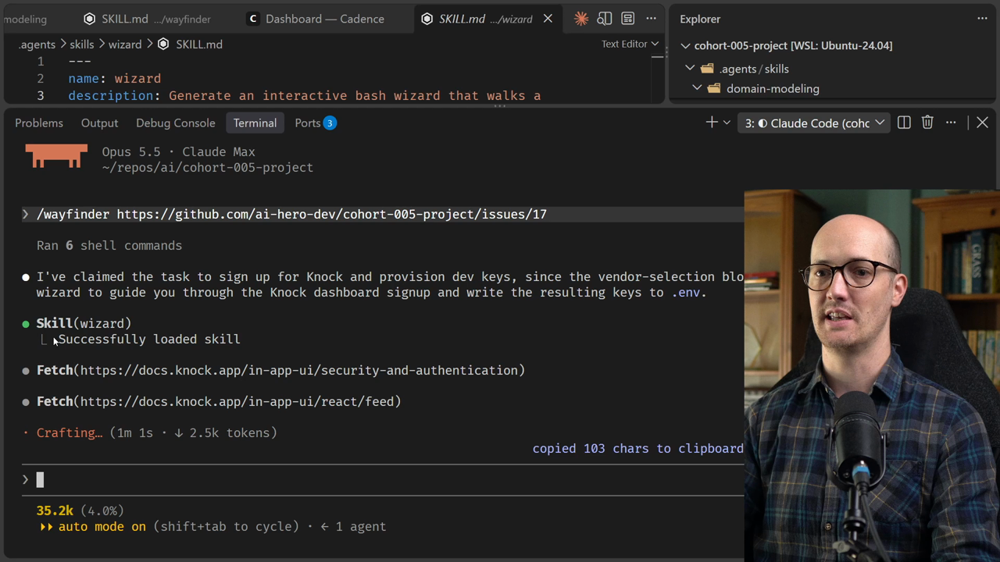
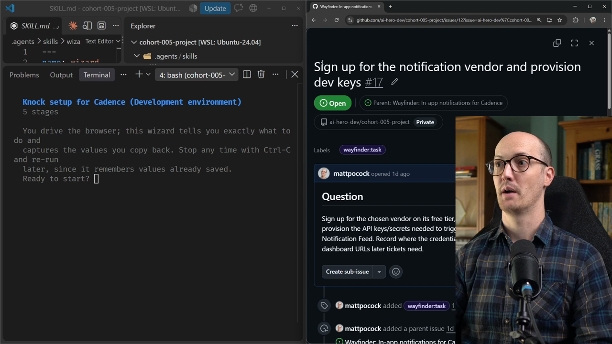
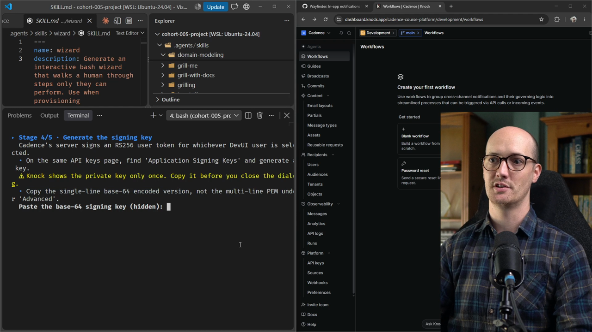
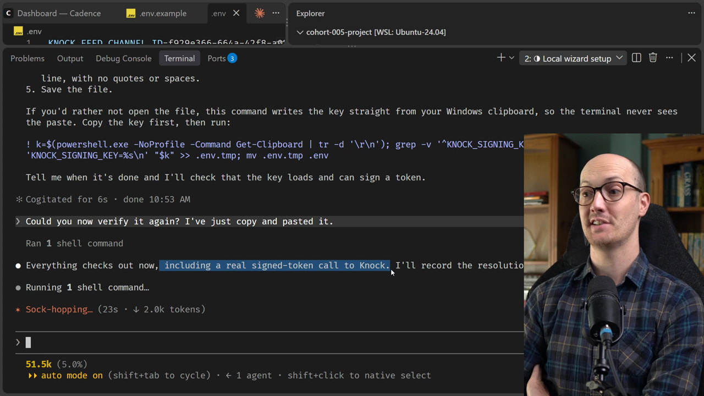

# Task Ticket Solution

<CommitMap packageManager="npm">
  <Commit id="add-discussion-terms">Start the lesson: the repo state before the Knock ticket is picked up</Commit>
  <Commit id="add-wizard-skill">Get the wizard skill: `.agents/skills/wizard` added to your repo</Commit>
</CommitMap>

The risk with any command or [skill](https://www.aihero.dev/ai-coding-dictionary/skill) that we're not invoking ourselves is whether the [agent](https://www.aihero.dev/ai-coding-dictionary/agent) will invoke it or not.

As we know from the crash course, a lot of this depends on how we've written the description. How detailed is it? Which leading words are in there? Will they trigger based on the task we're doing?



And here we go, beautifully. The agent says:

```txt
I'll build you a wizard to guide you through the Knock dashboard signup and write the resulting keys to .env.
```

It has read all of the research, the Wayfinder map, and all of the [tickets](https://www.aihero.dev/ai-coding-dictionary/ticket) this one depends on. So it knows exactly where we are in the process. It knows we've chosen Knock, it has all the [context](https://www.aihero.dev/ai-coding-dictionary/context) it needs, and it's ready to go.

It even goes and checks Knock's docs for the exact dashboard paths, so that the wizard doesn't make up steps.

If you're following along, you probably have a task like this. It might not be for the same service, but the wizard will give you whatever you need to make signing up for it really simple.

## Running the Wizard Outside the Agent

We're at a measly 44K [tokens](https://www.aihero.dev/ai-coding-dictionary/token), and we have a bash script for our Knock setup wizard.

As I mentioned in the problem video, I'm not going to run this inside the agent. Instead I copy and paste the script, open a terminal, and run it there.

```
bash scripts/knock-setup-wizard.sh
```

My layout is the agent on the left and the browser on the right, because the wizard automatically opens URLs for me.



### Stage 1: Create the account

I press enter because I'm ready to start, and it opens `dashboard.knock.app`. It gives me a list of steps:

- Sign up or log in, and create an account/organization for Cadence.
- Stay on the free Developer plan. Don't start a trial or a paid plan.
- Use the environment switcher in the top left to pick the Development environment.

I've done those. I've signed up, I have the Development environment selected in the top left, and I'm on the free Developer plan, so I'm okay to carry on.

It now tells me to paste the dashboard URL from the address bar, just to keep for the record. So I paste it in.

### Secrets never reach the agent

One cool thing about these wizards is that this isn't connected to an agent at all. I can paste secrets in here, and I know they never leave my system.

The wizard only does with those secrets what it's scripted to do. It doesn't send them to an agent, which would send them on to Anthropic or somewhere else.

### Stage 2: Create the in-app feed channel

It tells me to click Settings at the bottom of the left sidebar, then Channels and sources, and to create an in-app feed channel named `Cadence feed`.

I'm a bit scared of secrets appearing on the screen, so I do this one myself. It turns out I already have an in-app feed channel, so I paste in the channel ID.

### Stage 3: Copy the API keys

Next I copy the API keys. In the left sidebar, I go to Platform, then API keys, and copy the public key.

I do that, and the process receives my public key and my secret key.

### Stage 4: Generate the signing key

On the same API keys page, it asks me to find the Application Signing Keys and generate a key. It says to copy the single-line base64 encoded version.

Notice how easy and brainless this is. It opens the exact right pages for us, tells us exactly what to do, and then it's just a text input that we paste things into.



### Stage 5: Enhanced security mode

Now it tells me to turn on enhanced security mode. It's pretty honest about its own weaknesses here:

```txt
Knock's docs don't say where the toggle is. Try the API keys page or the environment settings first.
```

It turns out it was on the API keys page. I press `Y`, because enhanced security mode is now on.

And there we go, our setup is complete. We've written four values to `.env`.

## The Resulting `.env`

Here's what my `.env` file looks like now:

- `KNOCK_FEED_CHANNEL_ID`
- `KNOCK_PUBLIC_API_KEY`
- `KNOCK_SECRET_API_KEY`
- `KNOCK_SIGNING_KEY`

This is of course gitignored, so it won't be saved to our public repo when we commit. These values are just for our local setup.

## Verifying the Setup

I go back into my agent and say:

```
Okay, successfully run the wizard. Can you just verify that everything looks good locally?
```

I submit this, and it should then close out the ticket, because the job is done.

It goes through and verifies the signing key format without revealing it. Agents know not to read keys into their environment variables. They don't always get it right, but here we can see it trying to verify everything without actually reading the values.

### The signing key was cut off

I'm glad I did this. The long signing key wasn't loaded properly, and it was cut off.

I can't be bothered to walk through every step of the wizard again, so I ask:

```
Could you just tell me how to do that step manually?
```

I'm pretty sure I just need to copy and paste the signing key into the `.env` again. So I go back to Platform, then API keys, and do that manually.

Then I ask:

```
Could you now verify it again? I've just copy and pasted it.
```



Everything checks out now. It even made a real signed token call to Knock, so it tested the API keys against Knock's API.

## Recording the Resolution

The agent then goes through and records the resolution, putting it on the map itself.

Our job is done. We now know that our local setup works, and we're ready to start [prototyping](https://www.aihero.dev/ai-coding-dictionary/prototyping).

## Wrap-Up

Hopefully you enjoyed the wizard skill. It's kind of extra, and not strictly necessary. But when I was setting up five different vendors at once, it was really useful.

Nice work, and I'll see you in the next one.

