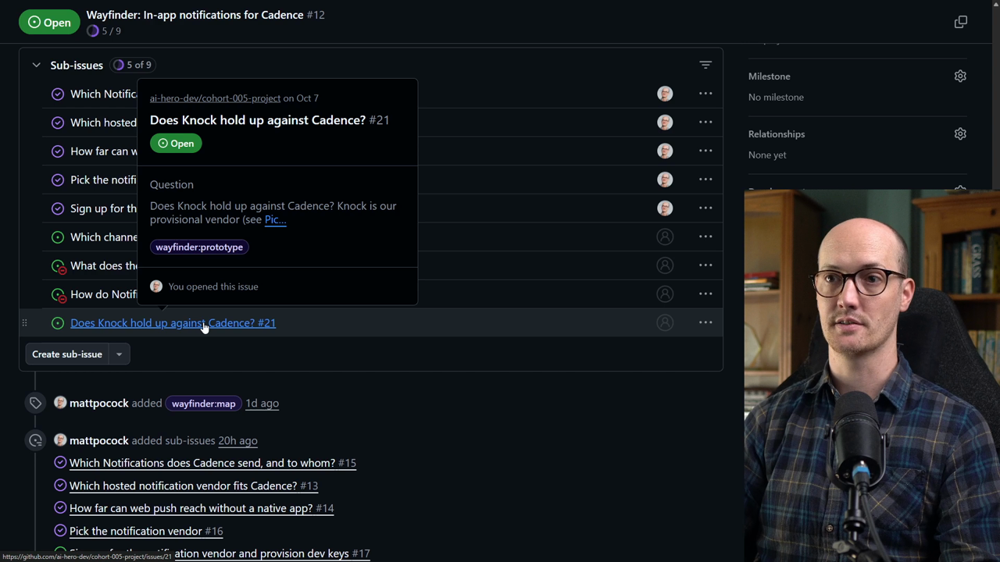

# Prototype Ticket

<CommitMap packageManager="npm">
  <Commit id="add-wizard-skill">Start the lesson: with the `wizard` skill in `.agents/skills/wizard/`</Commit>
  <Commit id="knock-spike">See my solution: the Knock prototype built</Commit>
  <Commit id="remove-knock-spike">The prototype removed again, leaving `main` with only the decision</Commit>
</CommitMap>

<Prerequisites title="Crash Course Prerequisites">
  <Prerequisite href="https://www.aihero.dev/workshops/ai-coding-crash-course/smart-zone-dumb-zone-d4b92bd0">
    Why you clear the context before a big, messy session like this one.
  </Prerequisite>
  <Prerequisite href="https://www.aihero.dev/workshops/ai-coding-crash-course/how-much-did-it-cost-abb3ab6e">
    What tokens cost, so you know what you're spending when you spend them freely.
  </Prerequisite>
  <Prerequisite href="https://www.aihero.dev/workshops/ai-coding-crash-course/codebase-exploration-205910ac">
    How the agent learns your codebase by reading it, which is why prototype code stays off `main`.
  </Prerequisite>
</Prerequisites>

We're five [tickets](https://www.aihero.dev/ai-coding-dictionary/ticket) out of nine, and the next one to work on is the [prototype](https://www.aihero.dev/ai-coding-dictionary/prototyping) ticket: **Does Knock hold up against Cadence?** Our API keys are provisioned, so we're ready to build something real.



A prototype lets you see what you're building at a higher fidelity, and higher fidelity means much better feedback. So this ticket isn't done when the prototype exists. It's done once your decisions are integrated and the prototype looks the way you want.

## Steps To Complete

### Set up the session

- [ ] Choose your path

**Path 1, my setup:** seed the GitHub issues for the start of this lesson, then reset the repo to the starting point.

```bash
npm run seed-wayfinder-issues 04-task-ticket
```

```bash
npm run reset add-wizard-skill
```

Seeding `04-task-ticket` marks the Knock sign-up ticket, **Sign up for the notification vendor and provision dev keys**, as closed. It does not give you any keys. Do your own Knock sign-up first, with the wizard from the Task Ticket lesson. Have `KNOCK_SECRET_API_KEY`, `KNOCK_PUBLIC_API_KEY`, `KNOCK_FEED_CHANNEL_ID` and `KNOCK_SIGNING_KEY` in your `.env` before you continue.

**Path 2, your own map:** skip both and work the next prototype ticket on your own map. Use mine as a guide.

- [ ] Open the prototype ticket, **Does Knock hold up against Cadence?** (labelled `wayfinder:prototype`), and read the four checks it asks you to confirm.

### Run the prototype session

- [ ] Go back to your [agent](https://www.aihero.dev/ai-coding-dictionary/agent) and [clear](https://www.aihero.dev/ai-coding-dictionary/clearing) the [context](https://www.aihero.dev/ai-coding-dictionary/context)

```
/clear
```

- [ ] Run `/wayfinder`, passing in the prototype ticket

Paste in your prototype ticket's link, replacing the placeholder:

```
/wayfinder <URL-of-your-ticket>
```

- [ ] Keep the prototype outside your main checkout

The prototype should live on a throwaway branch, not in `main`. This is the same setup as the earlier research ticket, **Which hosted notification vendor fits Cadence?** Its resolution is a comment on the issue, and its full findings are a Markdown file on a separate branch.

That way your agent can reference the prototype, but it won't confuse it for actual code.

- [ ] Look at the research ticket to see how that pattern works before you start.

### Iterate on the prototype

- [ ] Spend [tokens](https://www.aihero.dev/ai-coding-dictionary/token) freely

This [session](https://www.aihero.dev/ai-coding-dictionary/session) should feel token expensive. Do some proper [vibe coding](https://www.aihero.dev/ai-coding-dictionary/vibe-coding): look at what the agent built, say "no, I don't like this, give me that instead", and repeat.

- [ ] Keep going until your decisions are visible in the code and the prototype

Don't close the ticket until the prototype looks the way you want and every decision is integrated.

- [ ] Compare your result with the solution once you're done, using the `knock-spike` commit.
