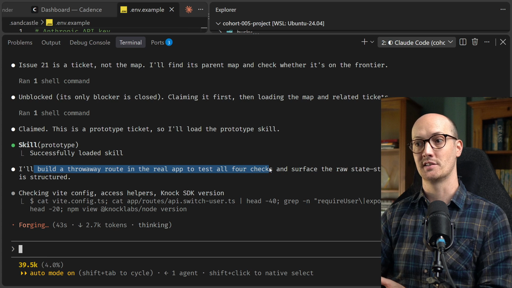
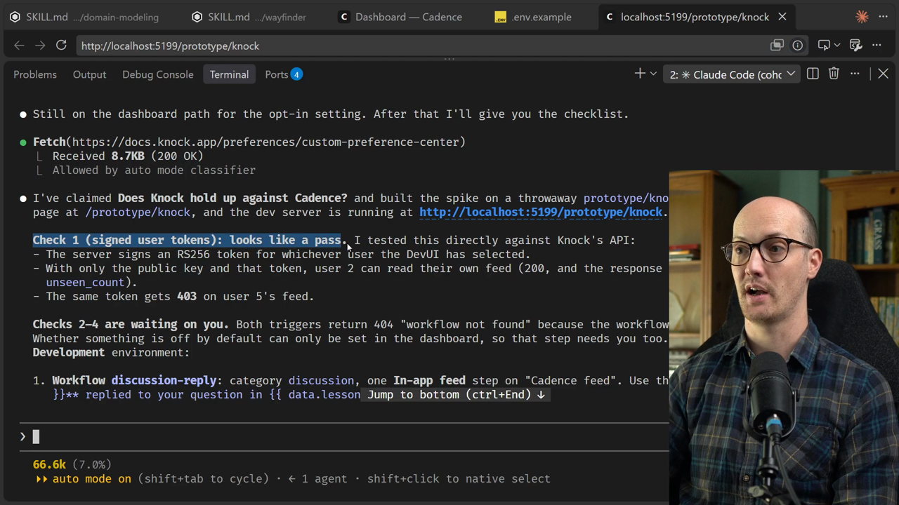
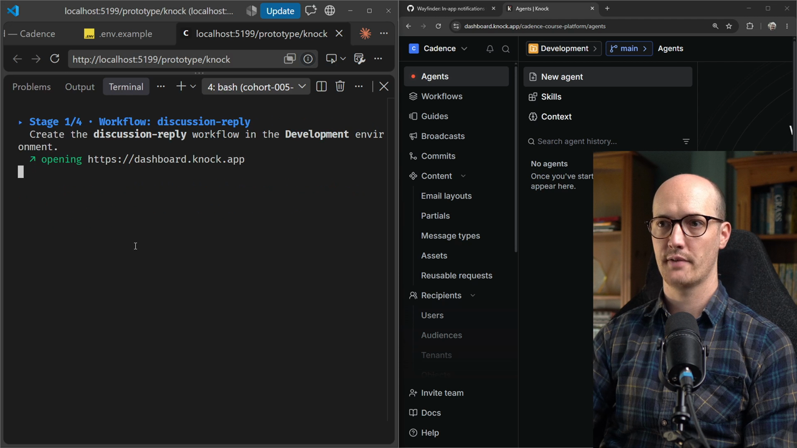
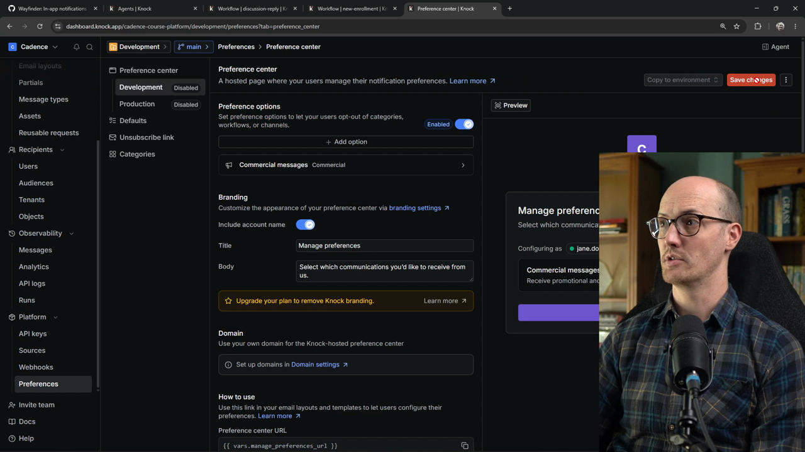
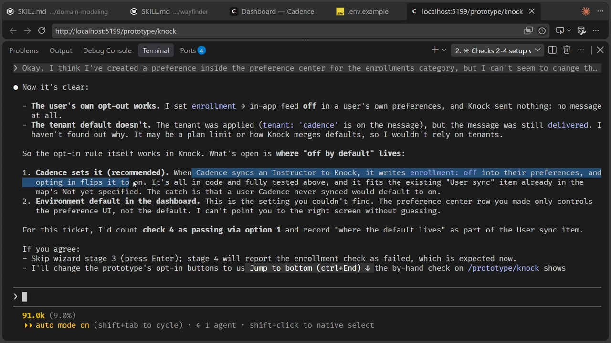
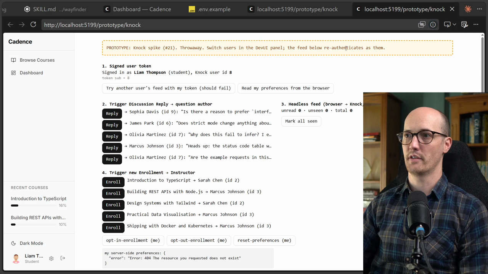
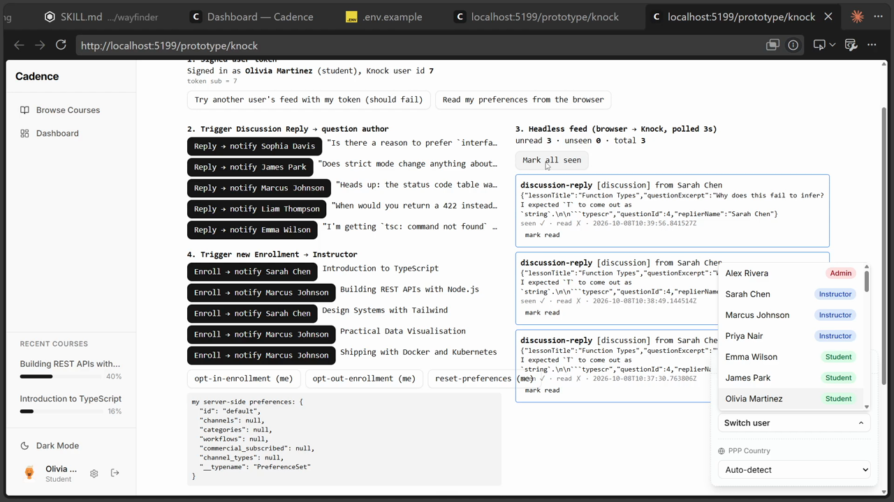
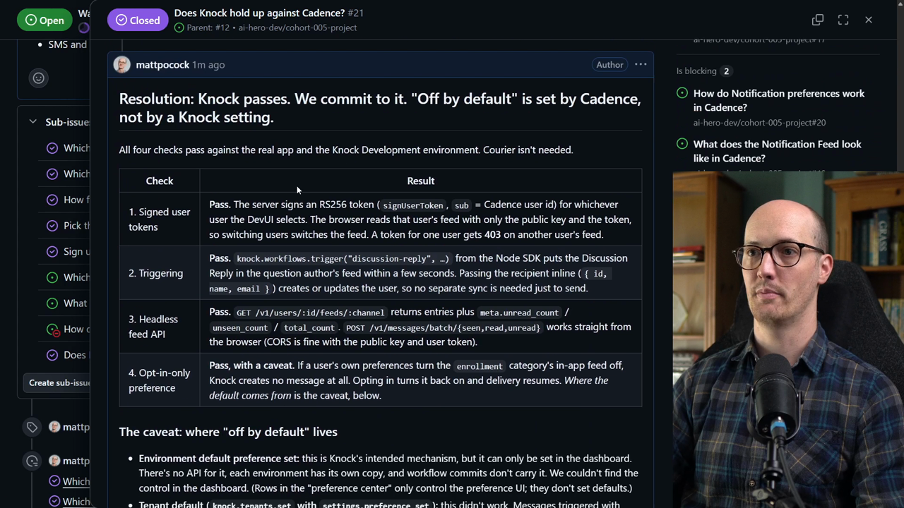

# Prototype Ticket Solution

<CommitMap packageManager="npm">
  <Commit id="add-wizard-skill">Start the lesson: the repo with the `wizard` skill added, before any Knock code</Commit>
  <Commit id="knock-spike">See my solution: the Knock prototype on `prototype/knock-spike`</Commit>
  <Commit id="remove-knock-spike">The prototype removed again, leaving `main` with only the decision</Commit>
</CommitMap>

## Why prototyping is my favorite part of Wayfinder

Let's get [prototyping](https://www.aihero.dev/ai-coding-dictionary/prototyping). I'll tell you a secret: I love prototyping with Wayfinder. It's the stage I enjoy most.

This is where you see the thing come to life. You communicate with the [agent](https://www.aihero.dev/ai-coding-dictionary/agent) in a high-fidelity way, and it makes everything that comes after so much better.

## Claiming the ticket and starting the spike

The agent has claimed the prototype [skill](https://www.aihero.dev/ai-coding-dictionary/skill). It's going to build a throwaway route in the real app to test all four checks.



It goes off to the Knock docs to see what it needs to do. It has also installed the Node SDK (software development kit).

It has probably pulled in the original research on Knock too, because it's all linked via the Wayfinder map.

That's one of the best things about Wayfinder. When you [grill](https://www.aihero.dev/ai-coding-dictionary/grilling) and prototype manually, you're always thinking about saving information and not [clearing](https://www.aihero.dev/ai-coding-dictionary/clearing) [context](https://www.aihero.dev/ai-coding-dictionary/context) at the wrong moment.

With Wayfinder, every decision goes back into the map. New [sessions](https://www.aihero.dev/ai-coding-dictionary/session) like this one pull in only what they need, so it's very [token](https://www.aihero.dev/ai-coding-dictionary/token) efficient.

## The first report: check one passes

The agent has come back. It built the spike on a throwaway branch, `prototype/knock-spike`, and started the dev server on `http://localhost:5199`.

It references what to check from the [ticket](https://www.aihero.dev/ai-coding-dictionary/ticket) itself. Check one, signed user tokens, looks like a pass.



With only the public key and that token, user 2 can read their own feed.

But checks two to four are waiting on me. I need to set something up in Knock itself.

## Asking the agent for a wizard

I think we know what I'm going to do here.

```
Could you create a wizard for me to set up the thing I need for checks two to four?
```

I'm lazy. I've got stuff to do. I've got Twitter to check. I don't want to click through this myself.

This is the benefit of a [model](https://www.aihero.dev/ai-coding-dictionary/model)-invoked skill. I can just say "create a wizard for me". I don't have to invoke it manually, and the agent goes and grabs it.

We have a new wizard here: `scripts/prototype-knock-wizard.sh`. I open a new terminal and run it.

```bash
bash scripts/prototype-knock-wizard.sh
```



## Stage one: the `discussion-reply` workflow

I have my browser on the right and the wizard on the left. The wizard says I need to create a workflow, named `discussion-reply`.

Each stage reads out instructions like these:

```bash
step "Workflows → Create workflow. Name it '$1'; the key must be exactly: $1"
step "Categories: add '$2'. Save to open the workflow builder."
step "Add a channel step → In-app feed → choose the 'Cadence feed' channel."
step "Open the step's template and set the markdown body to:"
step "Save, then Commit (top right) to Development."
```

The steps I followed:

1. Create the workflow and name it `discussion-reply`.
2. Add a `discussion` category, save it, and the workflow builder opens.
3. Add a channel step, In-app feed, and choose the Cadence feed channel. It's the in-app feed at the bottom right.
4. Open the step's template and set the markdown body to the text the wizard gives me.
5. Save the changes.

The markdown body for this workflow is:

```txt
**{{ data.replierName }}** replied to your question in {{ data.lessonTitle }}
```

Oh no, after saving I also need to commit to development, in the top right. I commit, and we're good.

The wizard then checked and triggered the workflow itself. I love it when it validates what I've done.

## Stage two: the `new-enrollment` workflow

Now we create a new enrollment workflow. Same thing: open the step's template and set the markdown body.

```txt
**{{ data.studentName }}** enrolled in {{ data.courseTitle }}
```

I'm very happy we used the wizard, because this would have been a pain to click through myself. It's committed and triggerable. Enter to continue.

## Stage three: where the wizard gets confusing

The next stage says that in platform preferences, we want to add the workflow category `enrollment`. Under it, we turn the in-app feed channel off.

The screen is a bit of a mess. I look for the workflow category: preferences, enrollment, maybe. Or perhaps I need defaults instead.



I really don't know what we're doing. I click around until something works. Then I give up: I'm totally lost.

So I go back to my agent and moan that the wizard isn't clear enough. I paste in the whole stage, so it has perfect context on where I am.

```
I reached this stage and couldn't manage to operate the Knock UI. Can you assist me, or maybe even do it programmatically?
```

It feels like we're at a stage where I could get a bot to use a computer and click through for me. But I want to provision this myself. I'm nervous about giving an agent full control over resources that could be paid. Maybe I need to get over that.

## Working out the preference center

I think I've figured it out. This is the preference center. You create an enrollment preference option, and after enabling it you can turn channel types on and off.

On the right-hand side there's a manage preferences screen where you toggle things. It relates to the category of enrollment notifications.

I save the changes there, then possibly go into defaults. But I still have no idea how to change the defaults, so I'm about halfway there.

I tell the agent where I've got to:

```
Okay, I think I've created a preference inside the preference center for the enrollments category, but I can't seem to change the default of it.
```

The agent validates against my keys, which is handy.

All the frustration we're feeling here is good validation of whether Knock is the right product for us. That's what prototyping is for: getting a feel for the product and making sure it fits what we want.

## The agent finds a workaround

It has found a solution. We don't need to set the defaults in Knock itself, because Cadence can set them.

When Cadence syncs an instructor to Knock, it writes `enrollment: off` into their preferences. Opting in flips it to on.

That's fine with me, because it's an extra Knock screen I don't have to worry about. I can skip wizard stage three, and then we're basically done and can start operating the prototype.



That sounds good to me.

Hopefully we're done with the Knock dashboard, which is unexpectedly nasty. You can tell I'm not sponsored by Knock.

## Prototype code takes shortcuts

The prototype skill is told to take shortcuts and not worry about production-ready code. So you get things like this:

```ts
const existing = await knock.users
  .getPreferences(id, "default")
  .catch(() => null);
```

It's a try/catch that ignores any error. `.catch(() => null)` means if this fails, we ignore it.

That's the sort of thing I'd expect code review to catch. For a prototype, it doesn't matter.

## Operating the prototype

Now we can go to the prototype and see what we're cooking with.



This isn't a "does it look good" prototype. It's a "does it behave right" prototype. We have a bunch of buttons to click, and we see what happens.

We're logged in as Liam Thompson. I wonder if we can change user. Yes, we can switch to Sarah Chen. Let's stay as Liam for now.

There are buttons on the left to trigger discussion replies. The agent gave us a list of specific checks to run:

1. Start as Sarah Chen and click reply on Emma Wilson's question.
2. Switch to Emma.
3. The notification should appear within about three seconds.

I switch to Sarah Chen. I'm not sure which button replies to Emma, so I click all of them. The headless feed refreshes. Then I go to Emma Wilson, and nothing appears.

## Reporting bugs back to the agent

Nothing happened, so I tell the agent:

```
I can't see the button as Sarah Chen to reply to Emma Wilson's question. I clicked all of the reply buttons and none of them worked.
```

Again, a nice bit of gnarly QA.

It looks like an actual error in the prototype. The agent comes back with an updated sequence of things to do.

I sign in as Sarah Chen and notify Olivia Martinez. Then I sign in as Olivia Martinez, and in her headless feed we should see notifications.



Finally, it's working. I can mark one as read, mark it unread, or mark all as seen.

The Mark all seen button doesn't seem to work, so I tell the agent:

```
When I'm logged in as Olivia and I press mark all seen, it's not working.
```

## Check four: the opt-in preference

While that's running, I perform check four. As Olivia, or any student, I click enroll and notify Marcus Johnson.

Marcus should get nothing new, which is exactly what we see.

Then, as Marcus, I click Opt-in Enrollment. That button is down here. I should now be opted into enrollments.

Next I go to James Park, enroll and notify Marcus Johnson. Switching back to Marcus, we see the new enrollment from James Park. That bit's working.

## The Mark all seen explanation

The agent has come back with more information. It looked broken because marking items as seen doesn't make them read, and only read items dim.

In Knock, there's a difference between seen items and read items.

| State | Set by | Effect in the prototype |
| --- | --- | --- |
| Seen | Mark all seen | Does not dim the item |
| Read | Mark read | Dims the item |

I've validated these three checks, to save you some brain space.

That was a lot of QA. These prototype UIs can feel super messy, and that's intentional. They give you loads of buttons to mess about with the feature, try to break it, and see how the logic fails. I think we've got something robust enough.

## Saving the learnings to the map

I go back to my agent:

```
Okay, I'm pretty happy with this prototype. I think we've done enough QA on it. Let's save our learnings back to the map.
```

We're at around 107K tokens, which is expected. That leaves room in the [smart zone](https://www.aihero.dev/ai-coding-dictionary/smart-zone) if we wanted to keep iterating. But I think we've proven what we came to prove.

The agent has closed the prototype ticket, and we can see the resolution comment.



The main finding is that "off by default" is now set by Cadence, not by a Knock setting.

```md
## Resolution: **Knock passes. We commit to it.** "Off by default" is set by Cadence, not by a Knock setting.
```

It even lists some pitfalls for later tickets:

```md
### Pitfalls for later tickets
- A workflow's **category only exists at runtime once the workflow is committed.**
- Triggering a workflow that isn't committed returns a 404 ("workflow not found").
- **Seen isn't read:** marking items seen doesn't change `unread_count`.
- `users.setPreferences` replaces the whole preference set by default. Merge with the existing set when changing one key.
```

It has taken everything we learned and tried, and that makes a rich nugget of context for the agent that implements this.

That agent has an easy time. It has the entire prototype implementation to reference, plus all the pitfalls we found.

We've essentially done what traditional agile software development calls a spike. We've done the hard yards so future development can be easy.

Nice work, and I'll see you in the next one.
