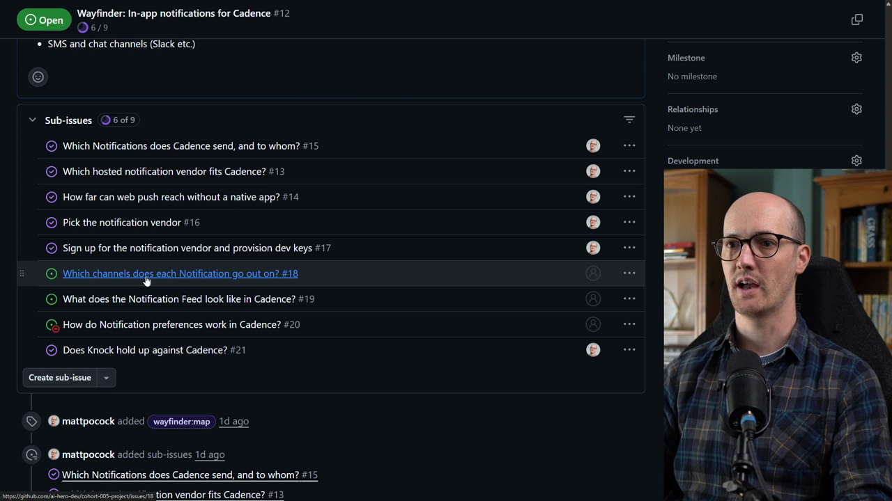

# Finish The Map

<CommitMap packageManager="npm">
  <Commit id="remove-knock-spike">Start the lesson: the Knock prototype removed, no notification code in the app</Commit>
  <Commit id="notification-feed">Mid-lesson: the Notification Feed prototype, built while resolving the feed ticket</Commit>
  <Commit id="remove-notification-feed">See my solution: the feed prototype removed again, the code state the lesson ends on</Commit>
</CommitMap>

<Prerequisites title="Crash Course Prerequisites">
  <Prerequisite href="https://www.aihero.dev/workshops/ai-coding-crash-course/the-grill-execute-clear-loop-fac85414">
    How grilling works, since two of the three tickets are grilling sessions.
  </Prerequisite>
  <Prerequisite href="https://www.aihero.dev/workshops/ai-coding-crash-course/clear-compact-handoff-or-subagent-3cb75ac9">
    Why each ticket gets its own fresh session rather than one long one.
  </Prerequisite>
  <Prerequisite href="https://www.aihero.dev/workshops/ai-coding-crash-course/how-to-tackle-massive-tasks-6199ee6b">
    Why the map's job is a spec: the destination the tickets lead to.
  </Prerequisite>
  <Prerequisite href="https://www.aihero.dev/workshops/ai-coding-crash-course/split-features-across-context-windows-with-tickets-d9aa8395">
    How blocked tickets work, so you know why preferences waits for channels.
  </Prerequisite>
</Prerequisites>

Our Wayfinder map for in-app notifications is nearly done. Six of its nine child [tickets](https://www.aihero.dev/ai-coding-dictionary/ticket) are closed, and three remain: a [grilling](https://www.aihero.dev/ai-coding-dictionary/grilling) ticket, a [prototype](https://www.aihero.dev/ai-coding-dictionary/prototyping) ticket, and a final grilling ticket.

Your job is to work through all three until the map is fully closed out. Then take one more look at the **Not yet specified** section and make sure all the fog has cleared.

This is a long lesson, so you can stop at any of the checkpoints below.

## Steps To Complete

### Set Up Your Starting Point

**Path 1, my setup:** do both steps below. **Path 2, your own map:** skip them and close out the rest of your own map. Use mine as a guide.

- [ ] Reset your local code to the `remove-knock-spike` commit

```bash
npm run reset remove-knock-spike
```

This makes sure you don't have the Knock prototype code locally. The app should have no notification code in it.

- [ ] Load the starting state of the GitHub issues

```sh
npm run seed-wayfinder-issues 05-prototype-ticket
```

The map is the GitHub issue **Wayfinder: In-app notifications for Cadence**. It has three open tickets:

| Ticket | Type | State |
|---|---|---|
| Which channels does each Notification go out on? | grilling | open, unblocked |
| What does the Notification Feed look like in Cadence? | prototype | open, unblocked |
| How do Notification preferences work in Cadence? | grilling | open, blocked by the channels ticket |



### Resolve The Channels Ticket

- [ ] Open your [agent](https://www.aihero.dev/ai-coding-dictionary/agent) and run Wayfinder on the channels ticket

Pass in the ticket you want to work on.

```
/wayfinder #<ticket-number>
```

- [ ] Work through the grilling [session](https://www.aihero.dev/ai-coding-dictionary/session) until the ticket is resolved and closed

Checkpoint: `npm run seed-wayfinder-issues 06a-channels-ticket` loads the map as it stands after this ticket.

### Resolve The Notification Feed Prototype Ticket

- [ ] Run Wayfinder on the feed ticket and build the prototype

This ticket is a prototype, so expect to write throwaway code to answer the question. Close the ticket once you have your answer.

- [ ] Remove the prototype code when you are done

The `notification-feed` commit shows the prototype and `remove-notification-feed` shows it removed again.

Checkpoint: `npm run seed-wayfinder-issues 06b-feed-prototype`

### Resolve The Preferences Ticket

- [ ] Run Wayfinder on the preferences ticket

It was blocked by the channels ticket, so it should now be unblocked.

- [ ] Work through the grilling session until the ticket is closed

Checkpoint: `npm run seed-wayfinder-issues 06c-preferences-ticket`

### Clear The Fog

- [ ] Keep working through the Wayfinder map until every ticket is closed

- [ ] Review the **Not yet specified** section of the map

Check that the fog has been cleared out. Anything left there should have been either resolved by a ticket or turned into one.

- [ ] Confirm the map is complete

Every ticket should be closed. To compare against the finished state, run:

```sh
npm run seed-wayfinder-issues 06-finish-the-map
```

To skip to the end of the lesson, reset your code to `remove-notification-feed` and seed the `06-finish-the-map` checkpoint.
