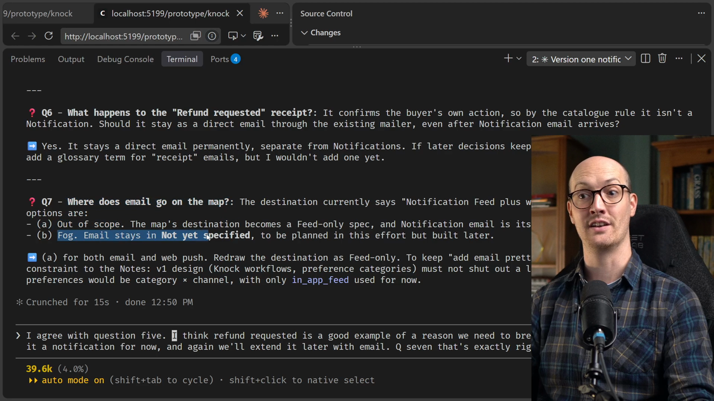
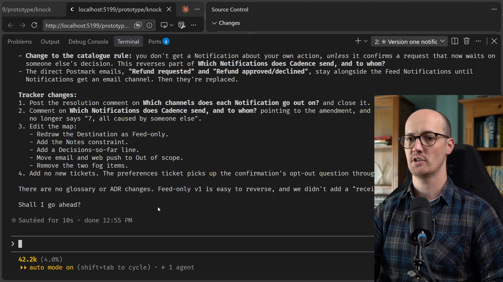
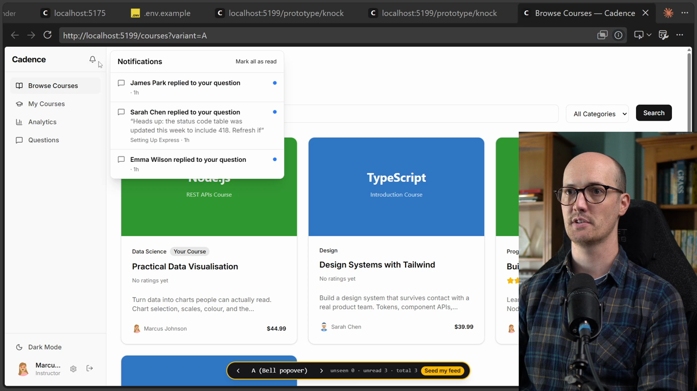
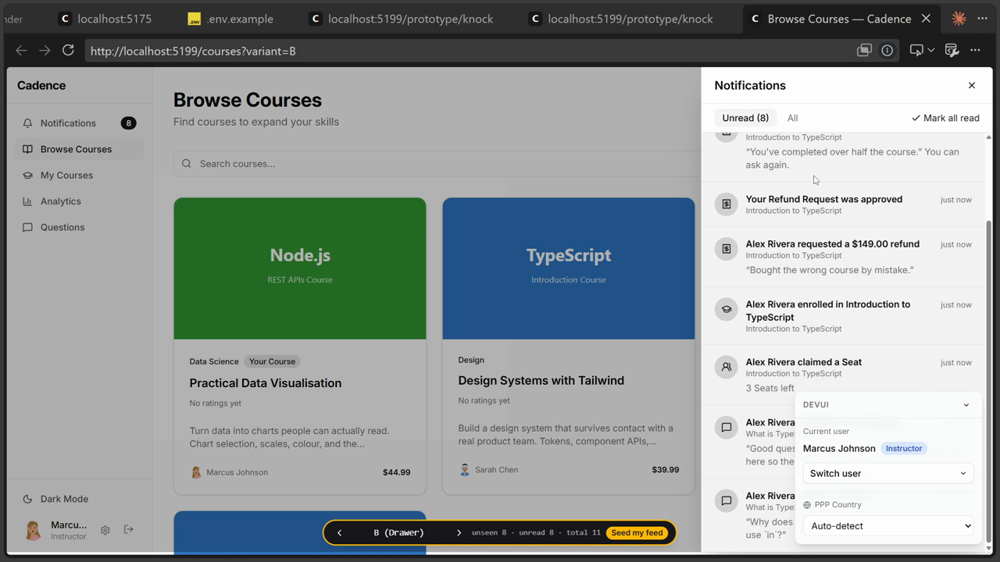
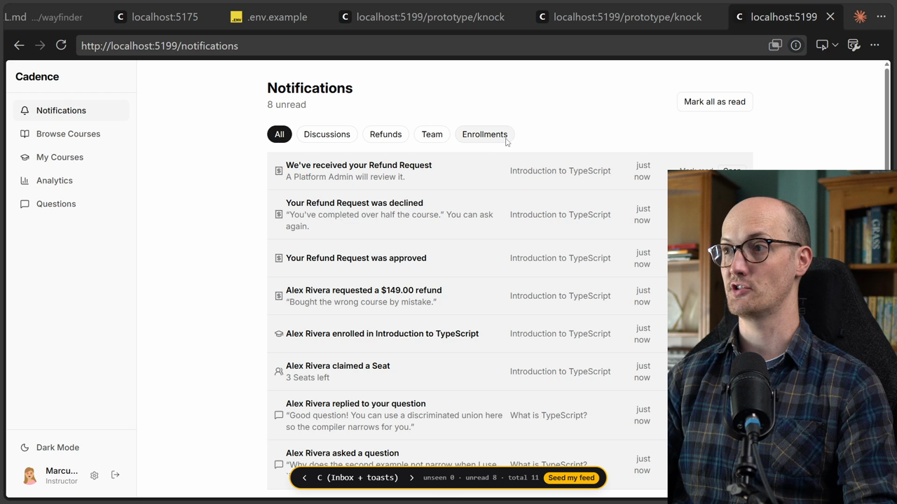
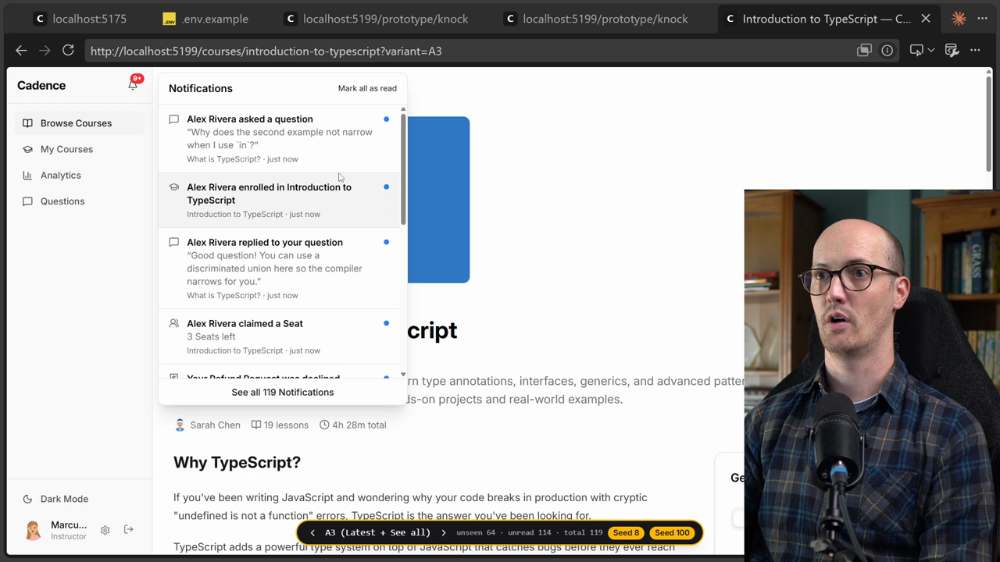
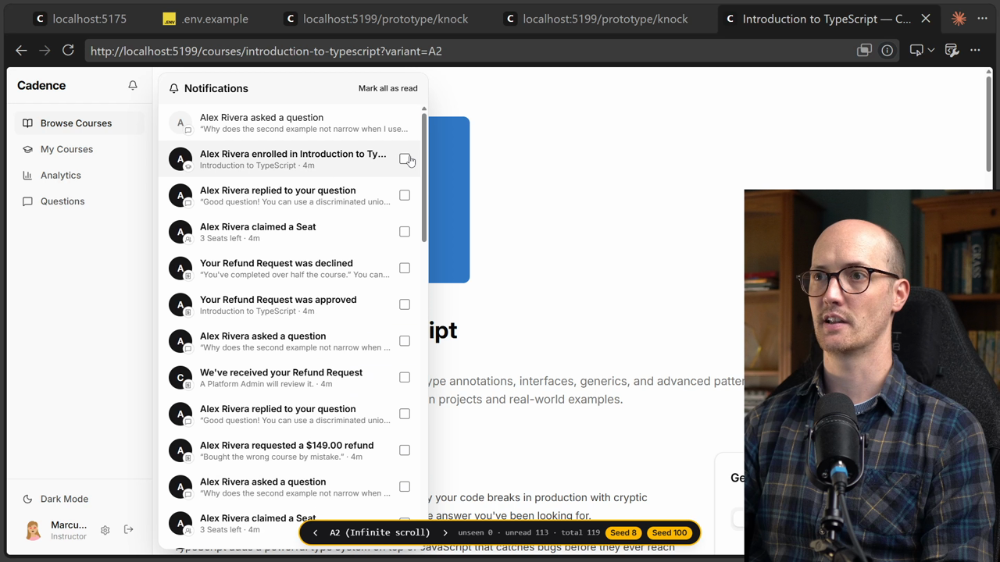
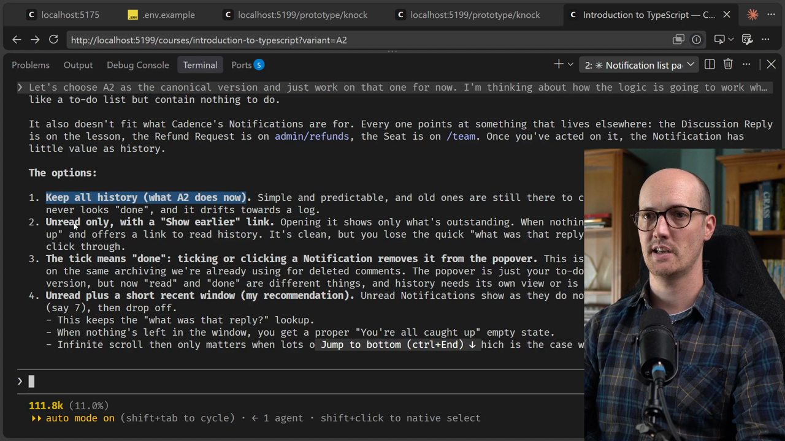
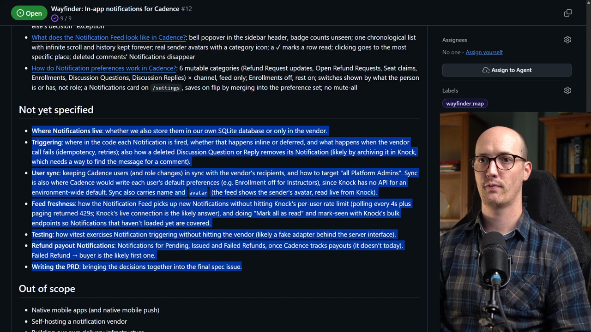
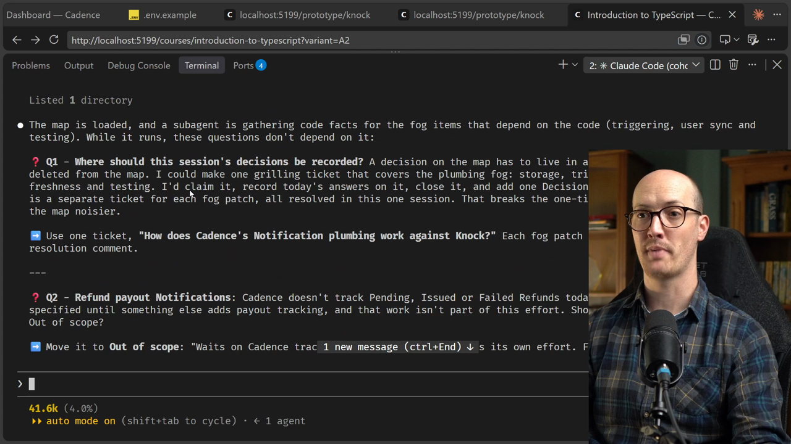

# Finish The Map Solution

<CommitMap packageManager="npm">
  <Commit id="remove-knock-spike">Start the lesson: the Knock prototype removed, no notification code in the app</Commit>
  <Commit id="notification-feed">See the throwaway Notification Feed prototype with the bell popover variants</Commit>
  <Commit id="remove-notification-feed">See the end state: the prototype removed again</Commit>
</CommitMap>

## Settling in for the long haul

This lesson is a long one. I'm going to focus on driving it myself, so it's more like watching me code than me over-explaining everything.

That should make it go quicker, and you'll see how I work through these maps.

There are four [tickets](https://www.aihero.dev/ai-coding-dictionary/ticket) to get through, and each one gets its own [session](https://www.aihero.dev/ai-coding-dictionary/session), with the [context](https://www.aihero.dev/ai-coding-dictionary/context) [cleared](https://www.aihero.dev/ai-coding-dictionary/clearing) in between:

1. Which channels does each notification go out on? ([grilling](https://www.aihero.dev/ai-coding-dictionary/grilling))
2. What does the notification feed look like? ([prototype](https://www.aihero.dev/ai-coding-dictionary/prototyping))
3. How do notification preferences work? (grilling)
4. A final grilling session on the fog left on the map itself

## Ticket 1: which channels does each notification go out on?

The grilling session is about which channels each notification goes out on.

Question one asks: does every notification land in a notification feed? I'm going to agree to that.

### Is email in version one?

The next question is about scope. Is email in version one?

We've already proven our point here. We've signed up for a third-party service, that service can be extended later, and it can be the hub for all of our notifications.

So my answer is that email should not be in version one.

### Is web push in version one?

Now it's asking whether web push is in version one. I'm going to say no to that one as well. Let's keep the scope small and get to the finish line.

### What happens to the refund emails?

Question 4 asks what happens to the refund emails Cadence already sends. The [agent](https://www.aihero.dev/ai-coding-dictionary/agent)'s recommendation is to mint a new term, a transactional email, which would be different from a notification.

I think that's too complicated. Instead, let's send them through notifications, and then extend the notification system later to add email for the things you really do need an email for.

With that, I'm ready to submit round one.

## Round two: email, refunds and the map's scope

I've now gone through and answered all of these three-option questions.

Question 5 asks when the refund approved or declined email gets removed. The recommendation is option B: when notifications get an email channel. I agreed with that.

### Breaking a rule we decided earlier

I made a good point in question six, about the "Refund requested" receipt. This is a rare occasion where you do want a notification sent to the user.

The agent asked whether it should stay as a direct email through the existing mailer. In my opinion, we should make "Refund requested" a notification, which can later be extended by email.

That's a good example of an implementation breaking a rule we decided before.

### Where does email go on the map?

Then it asks where email goes on the map. Is it out of scope, or is it in "not yet specified"?

It recommends out of scope, and I agree. We will do email at some point, but for now we're focusing on getting everything into the notification system and extending it later.

In other words, this map is bounded to version one: the thing we're about to do.



### Extending a closed map

One cool thing you can do with Wayfinder maps is take an old map that you closed with a PR, and scope in what was out of scope back then. You extend from the previous Wayfinder map.

That's another benefit of having these in your issue tracker. They're a great historical record.

### Resolving the ticket

The next three questions are simple implementation ones, and I'm happy to agree with all of them.

We've reached shared understanding with no glossary or ADR changes. So I tell the agent to go ahead and resolve the ticket.



## Running tickets in parallel

The next open ticket is the prototyping ticket: what would the notification feed actually look like?

Now it's settled, I can clear the context and run Wayfinder again to grab the next issue.

If I were doing this in real life and not filming it, I might run two at the same time. Looking at the remaining issues, two are open and they're fairly independent of each other.

Switching between two agents that are grilling separate aspects of the same thing is really fun, and a big time saver over traditional grilling.

There's some context-switching cost, because you're thinking about number one and then number two. But they're both about the same topic, so you're approaching it from two different angles.

For simplicity of filming, I'll do one after the other.

## Ticket 2: prototyping the notification feed

We're at 72.9k [tokens](https://www.aihero.dev/ai-coding-dictionary/token) and a prototype has been built. There's a dev server running, so let's take a look.

When the prototype [skill](https://www.aihero.dev/ai-coding-dictionary/skill) works on a user interface, it creates little variants. Here we've got A, B and C.

| Variant | What it is |
|---|---|
| A | Bell popover |
| B | Drawer |
| C | Inbox and toasts |

### Variant A: the bell popover

If we click into A, we can see "James Park replied to your question", then Sarah Chen, then Emma Wilson. We can mark all of those as read here.

That's a really nice placement over all the UI.



### Variant B: the drawer

One cool thing about this prototype is that we can seed my feed. There's a button that seeds this person's feed. We're currently logged in as Marcus Johnson, the instructor.

If I press "Seed my feed", a few notifications should pop up.

Look at that, we've got eight notifications, and they open as a drawer. I really don't like this. It's way too large.

I wanted to see what it looks like with lots of notifications in, and yes, it looks pretty good.



### Variant C: inbox and toasts

Let's look at C. We've got an inbox and toasts, so there's a full notifications inbox.

Here we can properly filter things down, and mark all as read. It also gives me links to open, which is quite nice.



Overall, I'm pretty impressed by the bell popover.

## Imposing my own likes and dislikes

Prototyping is an opportunity for me to impose my own likes and dislikes.

When I click a notification, I go to the right thing, which is good, and it marks it as read.

### Seen versus read

There's also a difference between seen and read. If I refresh the page, there's no notification number on the bell, but the rows still have the dot because they haven't been read or actioned.

I really like that difference. That's really nice, actually.

### What happens with 40, or 100?

My question is what happens when we have 40 notifications. Why don't I press "Seed my feed" again and see?

Is this just going to increase indefinitely? What happens if we have a hundred notifications in here?

So let's pull open the agent and ask:

```
I really like A here, I think it's fantastic. Can you give me another variant of that? But I want to know what the options are in regards to pagination. How are we going to handle it if there are a hundred notifications in there?
```

### The agent asks questions back

It's actually asked me some questions. It's asking about badge counts, and about deleted comments: if a comment is deleted, should its notification disappear from the feed?

My answers:

- Deleted comments should disappear.
- I like the badge counts.
- Clicking should take us to the most specific place we can.
- The refund request confirmation can just mark itself read.

You can think of prototyping as high-fidelity grilling. It's grilling with something to look at.

### Multiple variants teach different things

Now it's going to do its thing again and add more bell popover variants, each showing a different way to handle pagination.

That's what the prototype skill does. It doesn't give you one variant, it gives you several, and each can teach you something different.

It's always better to look at multiple of them. This is why AI is so useful here: we can spit these out with hardly any effort.

## Comparing pagination variants

It's come back with more variants. The "Seed my feed" button is gone, and we now have "Seed 8" versus "Seed 100". Let's seed 100.

| Variant | How it pages |
|---|---|
| A | A "Load more" button at the bottom of the list |
| A2 | Infinite scroll |
| A3 | Only the latest notifications, then a "See all" button |

We've got a 9+ badge on the notification button, which I like. Then we can see tons of notifications and a "Load more" button at the bottom.


### A2: infinite scroll

What happens with infinite scroll? I like this design it's added too. It keeps iterating on it without us having to say anything.

I quite like this infinite scroll. I can just keep on going, and going, and going.

### A3: latest plus "See all"

What about A3? We've got the latest at the top, then a "See all" button.

I really like this setup, but the top area is a little clunky. I really like the infinite scroll.



## Giving visual feedback

A2 is the one. Here's the feedback I dictated:

- I don't need the totals at the top.
- I don't need the unread button in the header.
- I want a little control on each notification to mark it as read, which disappears once clicked.
- I want the text back in the top right: an explicit "Mark all as read" button rather than a less explicit checkbox.
- The icons in the little boxes need to be smaller.

I really like the new design. Okay, I've dictated all that feedback and I'm going to submit it.

It's come back with its changes, and we've got rid of the things I didn't like. I still don't like the checkbox. It should be a check mark.



## When should read notifications disappear?

One thing that comes to mind is when read notifications should disappear. Are they just going to hang out here until the end of time? I suppose that's kind of fine.

I want to ask the agent about this and see if I can get some different prototypes. First, I'll choose A2 as the canonical version and work on that one for now.

```
Let's choose A2 as the canonical version and just work on that one for now. I'm thinking about how the logic is going to work when the user has no notifications or no unread notifications and opens up the notifications bar. Are we just going to show the most recent notifications forever? Can you think of some solutions to that? Is that a good user experience or should we try to improve it?
```

I'm feeling this will be the last round.

### Dropping to lower fidelity

It's done something interesting. It's gone back to a lower fidelity and laid out the options:

1. Keep all history.
2. Show unread only, with a "show earlier" link.
3. The tick means done, and clicking a notification removes it from the popover.
4. Unread plus a short recent window, which is the agent's recommendation.

Reading all of those, I think keeping all history is just fine. It's simple and predictable. I agree that option one is probably the best.

With that, I'm ready to close this prototype ticket. I'm pretty happy with what we've got.



We dropped down to a lower fidelity to discuss a question about the prototype, and resolved it without spending any tokens.

## Ticket 3: how do notification preferences work?

Now we're onto how notification preferences work in Cadence.

I clear the context and run Wayfinder on the ticket. This is our last ticket.

It asked the first round of questions, and I said yes to all of them. But I want to add something.

### Keep the vendor behind an interface

Any code that touches Knock should be behind some kind of interface, so we can swap in a different provider if we need to.

We'll touch on this more in the codebase design section. I definitely want it here, because Knock seems fine enough for our purposes, but what if the pricing becomes really weird? I have a feeling we might need to swap it out later.

It gave me a small follow-up on question nine, and then I think we're done with the ticket.

That's the end of that decision ticket. A very, very short grilling session.

## Clearing the fog

All nine of our sub-issues are closed, but I wouldn't consider the map finished yet.

We still have this big list of fog: the stuff that's "not yet specified". Before I close the map, I want a final check on it.



I clear the context in my agent, run Wayfinder, and pass it the map's number:

```
/wayfinder #<map-number> So we've closed every ticket, but there's still some stuff left over in the not yet specified section. Can we have a grilling session about that? Ideally, I want to close all the fog before we close the map.
```

### Mop-up questions

It's come back with a bunch of questions, mostly mop-up. Things that have probably already been decided, where it just wants my say.

First there's some housekeeping: where should these decisions be recorded? It suggests using one ticket.

I went through every one of them, and they're all obvious yeses. All ten get a thumbs up from me.



### The fog is cleared

It's now created and claimed its plumbing ticket, and the fog on the map is cleared.

So there we go. All of that work and all of those decisions have become an incredibly detailed map: a beautiful index of every grilling session and every bit of prototyping.

It's ready to be turned into a [spec](https://www.aihero.dev/ai-coding-dictionary/spec).

Well done for your patience, and for making it this far. We're going to see how well the agent does with all of this rich information to work from.

Nice work, and I'll see you in the next one.

<Quiz>
  <QuizQuestion data={{
    id: "wayfinder-fog-before-closing",
    question: "Every ticket on your map is closed, but the Not yet specified section still lists leftover items. What do you do before closing the map?",
    type: "multiple-choice",
    choices: [
      { answer: "a", label: "Close the map, since the open tickets are all done" },
      { answer: "b", label: "Run a grilling session on the fog, recorded on one ticket" },
      { answer: "c", label: "Delete the fog section so the map looks finished" },
      { answer: "d", label: "Open a prototype ticket for each fog item" }
    ],
    correct: "b",
    answer: "Closed tickets don't mean the map is finished. A final grilling session clears the leftover fog, usually mop-up decisions you mostly already agree with, and records them on a single ticket. Closing early or deleting the section loses decisions, and prototyping every item spends tokens on questions that are mostly already settled."
  }} />
</Quiz>
