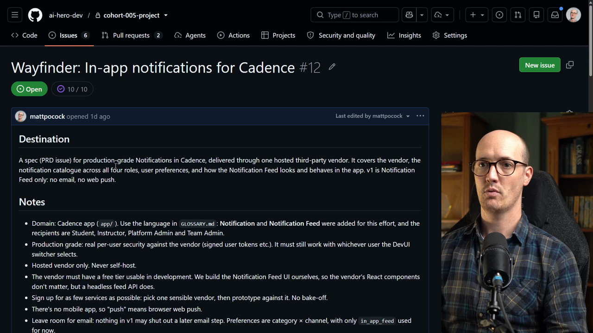

# Spec → Implement

<CommitMap packageManager="npm">
  <Commit id="remove-notification-feed">Start the lesson: the Wayfinder map is finished and the Notification Feed prototype has been removed</Commit>
  <Commit id="ship-in-app-notifications">See my solution: the full in-app Notifications implementation produced by `/implement-spec`</Commit>
</CommitMap>

<Prerequisites title="Crash Course Prerequisites">
  <Prerequisite href="https://www.aihero.dev/workshops/ai-coding-crash-course/write-great-specs-with-this-skill-362ad013">
    What a spec contains and how `/to-spec` writes one.
  </Prerequisite>
  <Prerequisite href="https://www.aihero.dev/workshops/ai-coding-crash-course/split-features-across-context-windows-with-tickets-d9aa8395">
    How `/to-tickets` splits a spec into vertical-slice tickets.
  </Prerequisite>
  <Prerequisite href="https://www.aihero.dev/workshops/ai-coding-crash-course/executing-your-tickets-8389d87c">
    How tickets get implemented with feedback loops and review, then QA'd.
  </Prerequisite>
  <Prerequisite href="https://www.aihero.dev/workshops/ai-coding-crash-course/the-implement-spec-skill-47372df2">
    What `/implement-spec` does: runs every ticket with subagents and code review.
  </Prerequisite>
</Prerequisites>

Our Wayfinder map is complete. Every decision about the notifications feature has been made and written down, but the raw map is too dense to hand straight to an implementation [agent](https://www.aihero.dev/ai-coding-dictionary/agent).

So we're going to convert it. The map becomes a [spec](https://www.aihero.dev/ai-coding-dictionary/spec), the spec becomes [tickets](https://www.aihero.dev/ai-coding-dictionary/ticket), and the tickets get implemented. By the end, you should have a working notifications feature built from an incredibly detailed set of [context](https://www.aihero.dev/ai-coding-dictionary/context).



## Steps To Complete

### Choose Your Path

- [ ] Pick Path 1 or Path 2

**Path 1, my setup:** reset the code and seed my finished map.

```bash
npm run reset remove-notification-feed
npm run seed-wayfinder-issues 06-finish-the-map
```

To skip straight to implementing, seed `07b-tickets` instead. It holds my spec and build tickets, ready to pick up.

**Path 2, your own map:** skip both and turn your own finished map into a spec. Use mine as a guide.

### Turn The Map Into A Spec

- [ ] Run `/to-spec`, passing in the completed Wayfinder map

Run this in your agent, using the URL of your own map issue:

```txt
/to-spec <link-to-your-wayfinder-map-issue>
```

The spec should link back to the Wayfinder map, so the agent can trace every decision to its source.

### Create The Tickets

- [ ] Run `/to-tickets` to break the spec into implementation tickets

```txt
/to-tickets
```

Each ticket should link back to the Wayfinder map and to its [prototypes](https://www.aihero.dev/ai-coding-dictionary/prototyping). That gives the agent everything it needs when it picks one up.

### Implement And Ship

- [ ] [Clear](https://www.aihero.dev/ai-coding-dictionary/clearing) the context so the implementing agent starts fresh

- [ ] Run `/implement-spec`, passing in the spec you just created

```txt
/implement-spec #<issue-number>
```

The agent will have the entire Wayfinder map to read, plus the spec, plus all the tickets. It should just work first time.

- [ ] Set up Knock for the new feature

Create a service token in the Knock dashboard (account settings → Service tokens), and add it to `.env`:

```txt
KNOCK_SERVICE_TOKEN=...
```

Then push the Knock workflows, and give existing users their default preferences:

```bash
npm run knock:push-workflows
npm run knock:sync-users
```

Both scripts arrive with the implementation (in my solution, `ship-in-app-notifications`), so if your agent named them differently, check `package.json`.

- [ ] Check the result and QA the notifications feature

By the end, you should have a spec that has been implemented and is ready to check out. Look over the work and make sure the notifications behave the way the map decided they should.
