# Spec → Implement Solution

<CommitMap packageManager="npm">
  <Commit id="remove-notification-feed">Start the lesson: the Notification Feed prototype removed, with the Wayfinder skills and glossary in place</Commit>
  <Commit id="ship-in-app-notifications">See my solution: everything `/implement-spec` produced, plus `scripts/push-knock-workflows.ts` and the `knock-workflows` skill</Commit>
</CommitMap>

## Writing the spec

We kick this off by running `/to-spec` and passing in our Wayfinder map.

```
/to-spec https://github.com/<your-org>/<your-repo>/issues/<map-number>
```

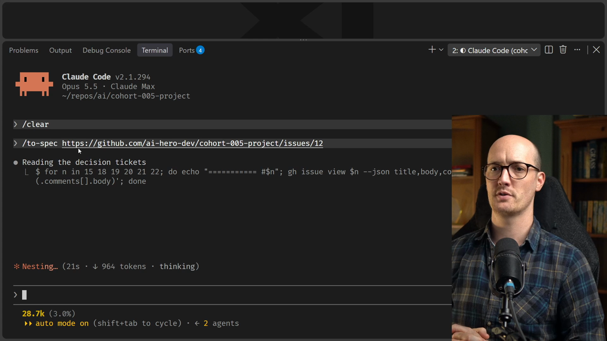

We can see it going through and reading all of the decision [tickets](https://www.aihero.dev/ai-coding-dictionary/ticket). `/to-spec` doesn't know anything about Wayfinder or Wayfinder's processes. It just understands that there are a ton of decision tickets here and that it needs to pull everything in.

### Proposing seams

One thing `/to-spec` does is propose seams that we test against. We'll talk about this more in the code-based design section. Basically, it's giving you an oversight of the modules that are going to be created.

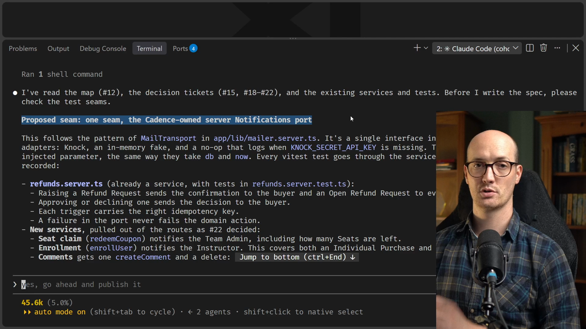

That seam looks good to me, so I'll send it off and it should create our [spec](https://www.aihero.dev/ai-coding-dictionary/spec).

## Reading the spec

Okay, we have our spec ready. It's "In-app Notifications for Cadence". The problem statement opens like this:

```md
## Problem Statement

People in Cadence can't tell when something that concerns them has happened.
```

Cadence has nowhere inside the app to tell someone what's happened.

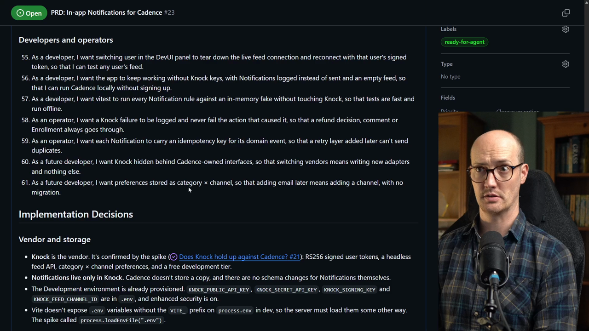

We have many, many user stories in here. Twenty, what are we up to? Whoa, whoa, whoa, 61 user stories.

There's also a bunch of implementation decisions:

- Knock is the vendor, and notifications live only in Knock.
- The entire notification catalog that we've decided.
- The services that fire notifications.
- A section on preferences.
- User sync, the client feed port and the feed UI.

All the way down at the bottom there's a bunch of further notes. The [prototype](https://www.aihero.dev/ai-coding-dictionary/prototyping) branches are listed explicitly, and we have the entire map coming from all of the issues.

This is essentially a compressed version of the map, turned into a spec ready to be fed into an [agent](https://www.aihero.dev/ai-coding-dictionary/agent).

### Why bother with a spec?

You probably could pass the map directly into an agent and just say, "Okay, implement this." But I find that having the spec flattens everything out.

It's essentially spoon feeding the agents. It makes it really easy for them to find the information they need.

## Turning the spec into tickets

Let's go back into our agent and run `/to-tickets`.

```
/to-tickets
```

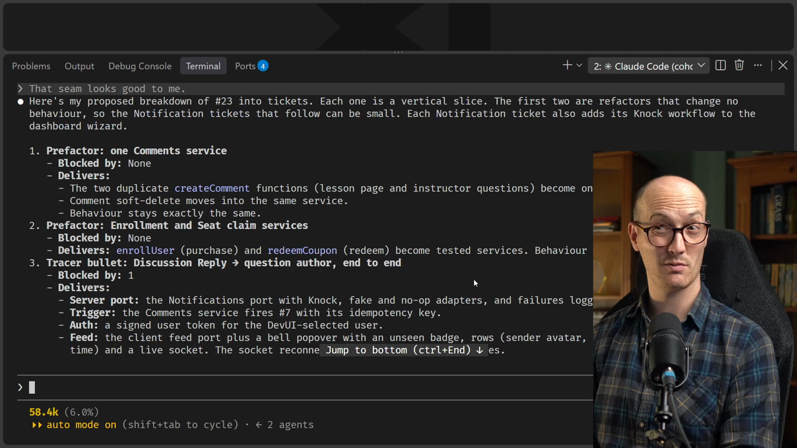

It's broken the spec down into lots of small tickets, which I don't mind too much. We're going to run this with `/implement-spec`, which runs lots of these things in parallel. There are actually five that can all be run in parallel here, which I think is better than breaking them into larger tickets.

But honestly, 12 is maybe too much. Maybe we could go down to eight. I'm largely just picking these numbers out of the air, based on what feels right.

Here are the eight it came back with:

| # | Ticket | Blocked by |
|---|---|---|
| 1 | Prefactor: Comments, Enrollment and Seat claim services | none |
| 2 | Tracer bullet: Discussion Reply to the question author, end to end | 1 |
| 3 | Notification Feed: full behaviour | 2 |
| 4 | Discussion Questions to the Instructor, and deleted comments disappear | 2 |
| 5 | Refund Request Notifications | 2 |
| 6 | Seat claim to the Team Admin | 2 |
| 7 | User sync and the Notifications card on `/settings` | 2 |
| 8 | Enrollment to the Instructor, opt-in | 7 |

We've got the initial tracer bullet there, which is good. Then tickets three to seven can all run in parallel, which feels good to me.

Let's send this off, and we should see a bunch of tickets underneath the spec.

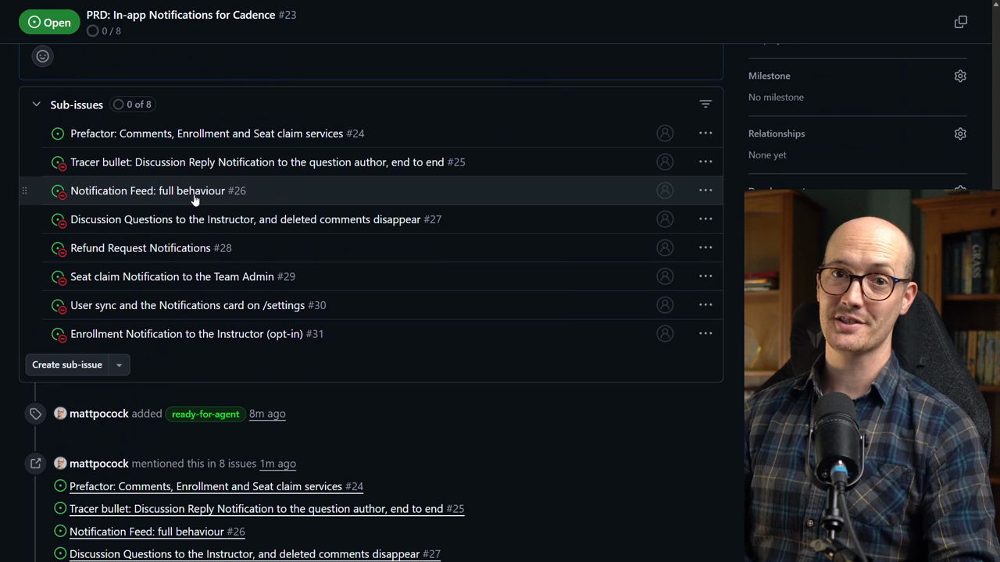

And we have our sub-issues. Eight tickets are ready to be implemented, with the same concept as the decision tickets. They've got their blocking relationships, and we can kick this off immediately.

## Running `/implement-spec`

I'm going to [clear](https://www.aihero.dev/ai-coding-dictionary/clearing) the [context](https://www.aihero.dev/ai-coding-dictionary/context), run `/implement-spec`, and pass it the number of the spec.

```
/clear
/implement-spec #<issue-number>
```

Then we are good to go. I'm not going to babysit this. I'll leave it to run, and when we come back we'll do a little autopsy and see how it went.

## The autopsy

Okay, we are back. I've taken a couple of hours off, and a ton of stuff has been implemented.

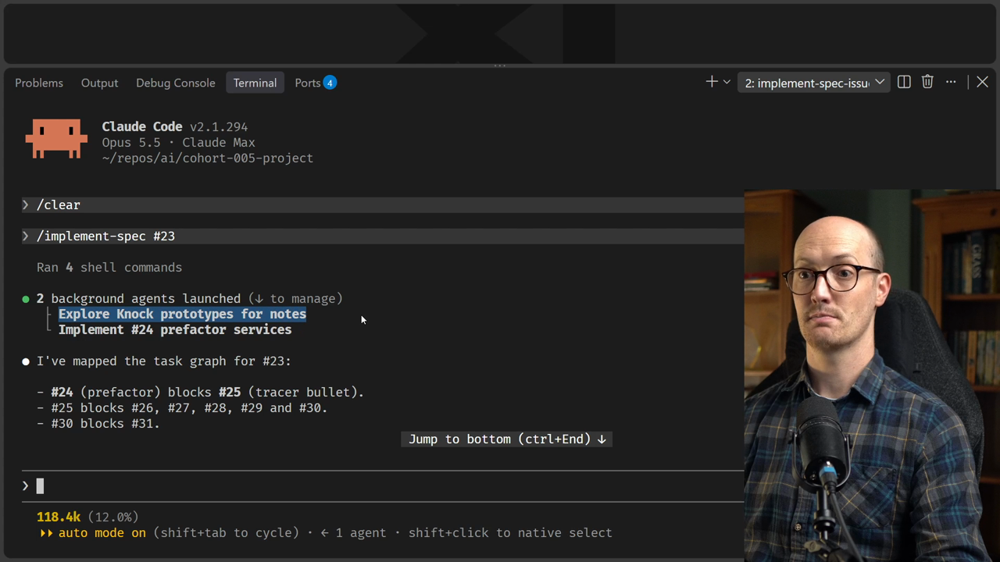

Going right back up to the top, we can see it explored the Knock prototypes. It looked at everything and created some exploration notes. That's what `/implement-spec` does, and it saved them to the `cohort-005-notes` folder.

Then it created an implementer and merged in the first piece of implementation. Then it merged in the second one. We're in the `feature/notifications` branch.

### The orchestrator spots a problem

This is pretty neat, actually. The orchestrator noticed that the previous implementer agent had an issue. It was picking up test files inside `.claude/worktrees/`, which padded the test count with duplicates.

It then asked the follow-up agent to exclude that folder in the vitest config:

```diff
-    exclude: [...configDefaults.exclude],
+    exclude: [...configDefaults.exclude, ".claude/**"],
```

### Parallel implementers and merging

The tracer bullet agent, the next implementer, built the next tracer bullet. A merger agent then merged it into `feature/notifications`, and it went on to implement five tickets at once.

It implemented the full feed behavior, discussion questions, refund notifications, seat claims and so on.

I was intrigued to see how it got on merging all of these. It looks like it merged the first one that finished, then merged a whole bunch of extras. It's merging each branch as it finishes, which is really nice.

There's stuff it can verify. It's verifying little bits of it, like paging the `after` cursor and checking that seen isn't read. But there is still stuff that needs me in the browser.

It then merges two branches in, merges everything into the integration branch, and runs through implementing everything.

## The code review

Once all the tickets are merged, it runs the code review [skill](https://www.aihero.dev/ai-coding-dictionary/skill). It does the spec review and the standards review.

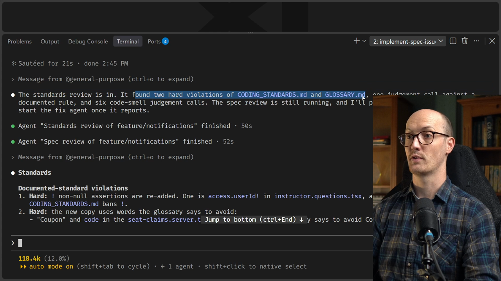

Let's see what it found. It found two hard violations of the coding standards and `GLOSSARY.md`, which is cool. Something in the glossary made it think, "You've named something incorrectly."

The new copy uses words the glossary says to avoid, which is incredible. The test helper `addLearner`, and "Coupon" and `code` in the `seat-claims.server.ts` error messages.

There's some other smells stuff in there, and it looks like there are some spec differences too.

Let me check if it went and fixed these. Yep, it's sending one agent to fix them.

We should be getting near the end of the conversation now. The fix agent fixed all 15 review findings and left alone the five things I'd said to keep.

## What still needs a human

Zooming down to the bottom, is there anything else to do? It looks like we do have another wizard to run through:

- It creates and commits all eight workflows in Knock development, and moves discussion reply into its own category.
- We run `npm run knock:sync-users` to give existing users their default preferences.
- Finally, we need to check the UI in the browser.

## Avoiding the Knock wizard

I really don't want to run this blooming wizard again and go back through the Knock UI, so I'm going to be a bit cheeky. I'll ask the agent:

```
What can I test without having to run that wizard and go back through Knock UI? I assume that you can't programmatically create all of the workflows that I need.
```

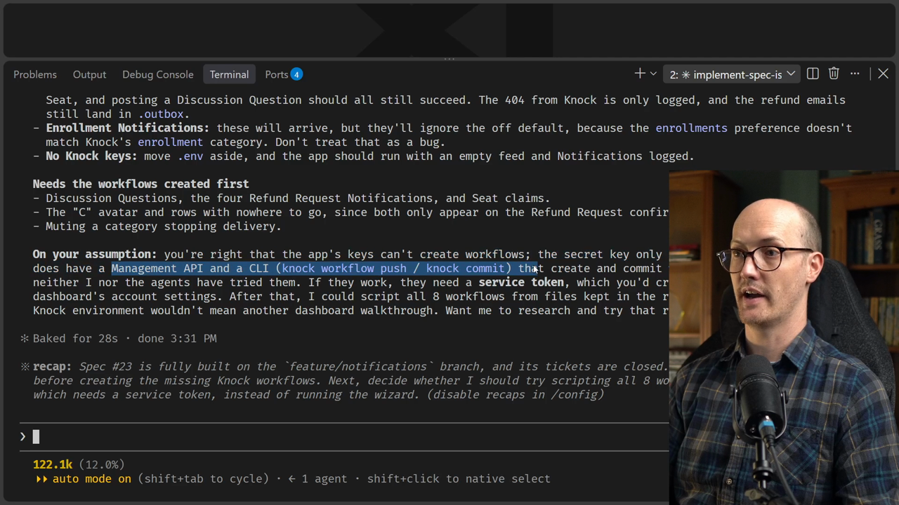

It actually does look like Knock has a management API and a CLI that create and commit workflows from JSON files. If they work, they need a service token, which you'd create once in the Knock dashboard's account settings.

I think that is well worth it.

### Compacting the session

I'm going to [compact](https://www.aihero.dev/ai-coding-dictionary/compaction) this [session](https://www.aihero.dev/ai-coding-dictionary/session). I want to retain most of the memory of what has been done, but there's loads that can be thrown away.

That's all the information we sent the [sub-agents](https://www.aihero.dev/ai-coding-dictionary/subagent) and all the information they sent back. We're essentially working with a finished PR now. We can compact safely, knowing the main details of the PR are in there, because we're moving to a different phase.

```
/compact
```

Then I ask the agent:

```
Do some research on the Management API and the CLI to see what we need and see if you can handle that yourself.
```

I know this is a lot of work and fannying about just so I don't have to touch the Knock UI, but it might be worth it.

It's looking good. The management API turns out to do everything the dashboard wizard does.

That means we can write our Knock workflows in code with our agent, then run a script to get everything set up. It looks like `npm run knock:push-workflows`. That's really nice.

## Teaching the agent about the script

One thing I'm immediately thinking is how we teach the agent, going forward, about this push workflows script. Of course it can discover it, but it might be nice if we just tell it.

This seems like the kind of thing we should write a skill for, so the agent knows about it from now on. We have the `/writing-for-agents` skill that we covered in the crash course, so we might as well use it.

```
This seems like the kind of thing that we should be writing a skill for, just to make sure that the agent knows about this going forward. So can you just write a very short skill? /writing-for-agents
```

### Creating the service token

While that's running, I'm going to do the things the agent is asking me to do:

1. Create a service token in the Knock dashboard.
2. Add it to `.env`.
3. Push the workflows.

I'll do both at the same time. For those following along, I found where it lives: inside Cadence, then Settings, then Service tokens. I can add a service token and call it "local agent".

I'm going to generate this and copy it into `.env`. My `.env` file now has the Knock service token in there along with my other stuff.

```txt
KNOCK_SERVICE_TOKEN=...
```

Now I can run `npm run knock:push-workflows`, and hopefully it just works. No, it doesn't. So I guess we copy and paste the error back to the agent.

### The skill it wrote

While it was doing this, the agent wrote the `/knock-workflows` skill, which should be nice and short. It's just 25 lines or so.

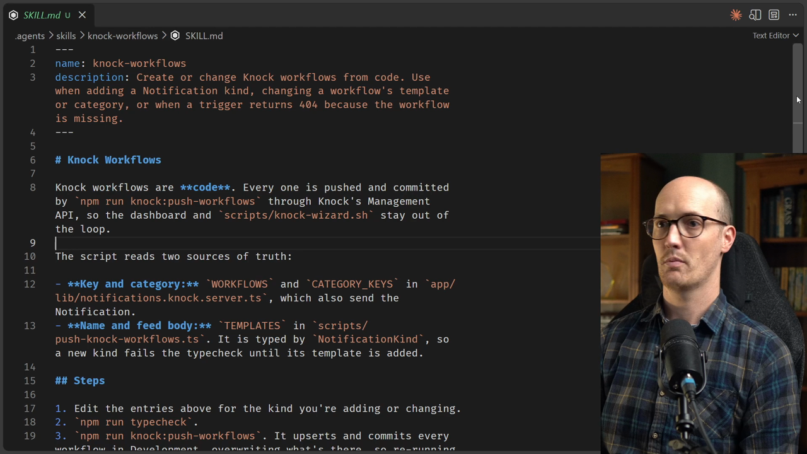

It talks about the credentials and the steps. The description says to create or change Knock workflows from code. Use it when adding a notification kind, changing a workflow's template or category, or when a trigger returns 404 because the workflow is missing.

```md
---
name: knock-workflows
description: Create or change Knock workflows from code. Use when adding a Notification kind, changing a workflow's template or category, or when a trigger returns 404 because the workflow is missing.
---

# Knock Workflows

Knock workflows are **code**. Every one is pushed and committed by `npm run knock:push-workflows` through Knock's Management API, so the dashboard and `scripts/knock-wizard.sh` stay out of the loop.

The script reads two sources of truth:

- **Key and category:** `WORKFLOWS` and `CATEGORY_KEYS` in `app/lib/notifications.knock.server.ts`, which also send the Notification.
- **Name and feed body:** `TEMPLATES` in `scripts/push-knock-workflows.ts`. It is typed by `NotificationKind`, so a new kind fails the typecheck until its template is added.

## Steps

1. Edit the entries above for the kind you're adding or changing.
2. `npm run typecheck`.
3. `npm run knock:push-workflows`. It upserts and commits every workflow in Development, overwriting what's there, so re-running it is the fix for any drift. Add `-- --promote production` to promote them to Production.

Done when the script prints a ✓ for every workflow.

## Credentials

The script needs `KNOCK_SERVICE_TOKEN` and `KNOCK_FEED_CHANNEL_ID` in `.env`. The app's secret key only triggers workflows and is rejected by the Management API. When the token is missing, ask the human to create one in the Knock dashboard, under account settings → Service tokens.
```

Going forward, our agents should know about all of this.

## Letting the agent debug it

I told the agent we hit an error when we ran the push workflows script, and I'm getting it to run the script itself to see if it works.

```
We hit an error when we ran npm run knock:push-workflows. Can you run it yourself and debug?
```

It looks like it was missing some required stuff, like an action URL:

```txt
Error: PUT /workflows/discussion-reply → 422: {"code":"invalid_params","message":"One or more parameters supplied were invalid","status":422,"type":"invalid_request_error","errors":[{"message":"must have exactly one of: action_url, action_buttons","field":"steps[0].template"}]}
```

We're going to cover this again later in the course. Having the agent get into loops where it has perfect information about what it's doing, and can safely push the button to try it, means you will inevitably hill climb towards a solution that works well.

So many times agents just don't have the right information. They can't fix the things going wrong because they can't see what they're doing. We'll get to that later though.

And just like that, it's fixed:

```txt
Knock account: Cadence
✓ discussion-reply (discussion-replies)
✓ discussion-question (discussion-questions)
✓ seat-claimed (seat-claims)
✓ new-enrollment (enrollments)
✓ refund-requested (refund-request-updates)
✓ refund-request-open (open-refund-requests)
✓ refund-approved (refund-request-updates)
✓ refund-declined (refund-request-updates)
```

All eight workflows are created and committed in our development setup.

## QA in the browser

It's finally time to QA this. I'm logged in as Marcus Johnson. When I click the notifications bell at the top left, we can see we're all caught up, and there's a settings icon that takes me to my notification settings.

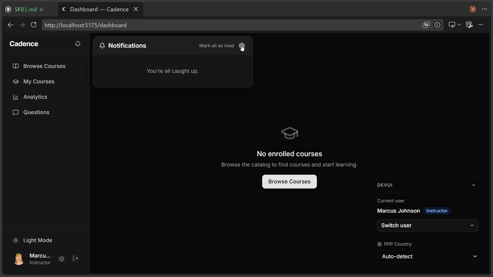

We've got Enrollments, Discussion Questions and Discussion Replies. That's really cool.

### Testing a discussion question

Marcus Johnson has the course Building REST APIs with Node, so I need someone who has taken that course. Emma Wilson has. I'll find a lesson and ask a question on it.

1. As Emma Wilson, ask "Why is this course so cool?" and post the comment.
2. Switch back to Marcus Johnson, who should now have a notification.

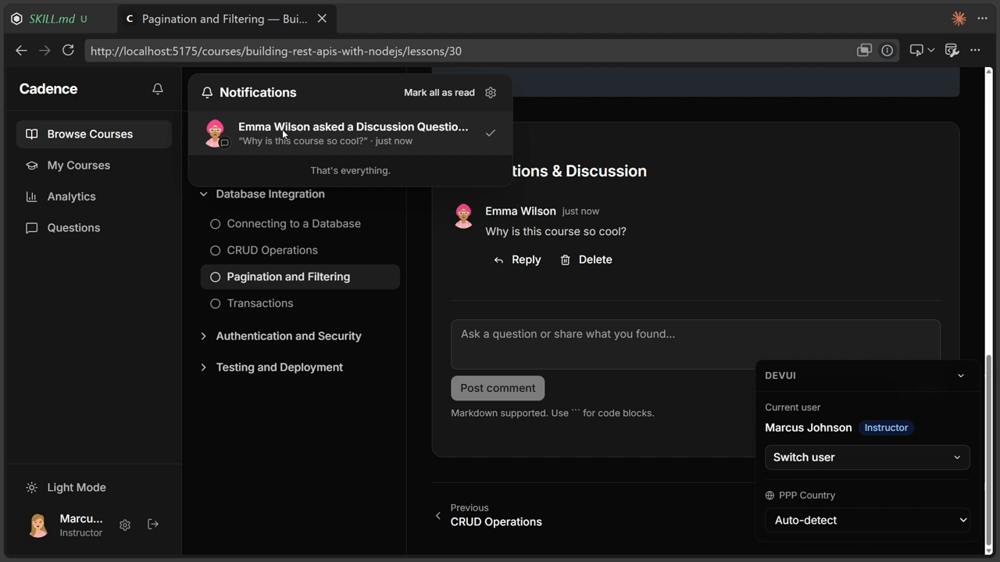

Yep, there we go. Emma Wilson asked a discussion question, "Why is this course so cool", just now. When you click it, it goes right to the comments. Really nice.

### Testing a reply

We can reply to Emma Wilson with "post reply". If we switch back to Emma Wilson, she has a notification.

I love that the avatars are all in here as well. You can see how closely this mimics how I wanted my prototype to look. It really has gone in and used the prototype, which is so cool.

### Testing preferences

The notification settings especially feel really good, and we can see that they have fewer switches. Let's test by turning off discussion replies for Emma Wilson.

Now I go back to the conversation as Marcus Johnson and reply to Emma Wilson again, saying "hey". Because Emma Wilson now has her notifications for that turned off, she does not receive a notification.

## The benefit of upfront planning

This is the benefit of doing all that upfront planning with Wayfinder. We planned at really high fidelity so we could give the agent the best context it possibly needed to reflect our decisions in the finished product.

Some things were done at different fidelities:

| Area | Fidelity |
|---|---|
| Design of the notifications bar | Super high fidelity, with a proper prototype and real feedback |
| Settings and notifications feed | Low fidelity, just a little discussion, with the agent using its own creativity |

Overall, I hope you're as impressed as I am, and I hope you enjoyed seeing the entire Wayfinder process end to end. Very nice work, and I will see you in the next one.

