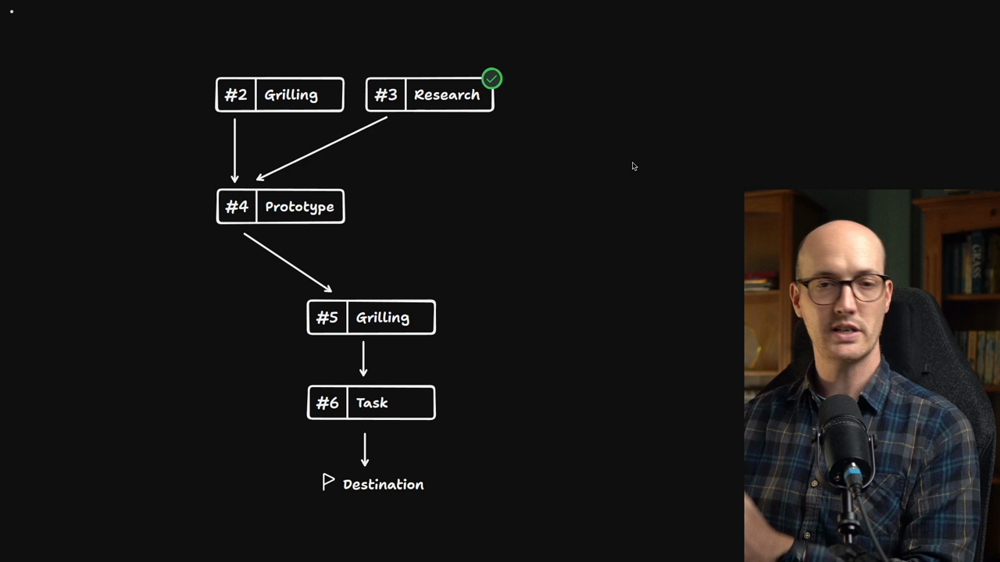
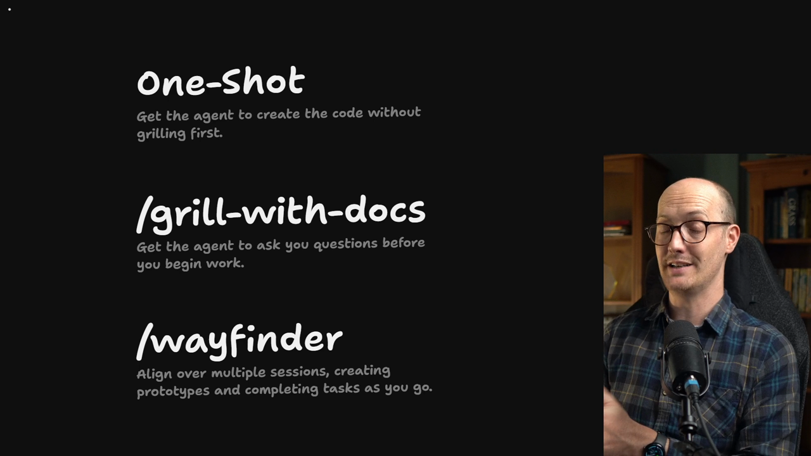
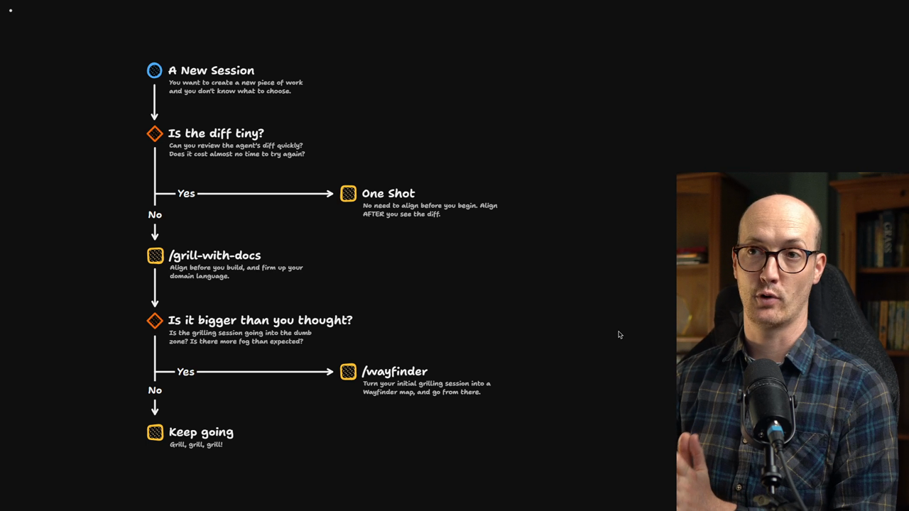

# Grill vs Wayfinder vs Ship First

<Prerequisites title="Crash Course Prerequisites">
  <Prerequisite href="https://www.aihero.dev/workshops/ai-coding-crash-course/smart-zone-dumb-zone-d4b92bd0">
    Why an agent gets worse as its context fills, the signal to graduate a grilling to Wayfinder.
  </Prerequisite>
  <Prerequisite href="https://www.aihero.dev/workshops/ai-coding-crash-course/why-plan-mode-sucks-2d6ef1a6">
    Why agents rush to build, and why you agree on a design before any code gets written.
  </Prerequisite>
  <Prerequisite href="https://www.aihero.dev/workshops/ai-coding-crash-course/the-grill-execute-clear-loop-fac85414">
    How grilling works: the agent interviews you until you both share the same design.
  </Prerequisite>
  <Prerequisite href="https://www.aihero.dev/workshops/ai-coding-crash-course/how-to-tackle-massive-tasks-6199ee6b">
    Why big work splits into a spec and tickets that each fit in one context window.
  </Prerequisite>
</Prerequisites>



We've now seen what a full Wayfinder flow looks like. It runs from [grilling](https://www.aihero.dev/ai-coding-dictionary/grilling), to [prototyping](https://www.aihero.dev/ai-coding-dictionary/prototyping), to research, to creating tasks, to turning that into a [spec](https://www.aihero.dev/ai-coding-dictionary/spec), to implementing that spec.

You'll probably agree this is a pretty heavy flow. When you walk through it yourself, you'll be faster than me, because you won't be explaining it as you go.

But it's still a lot of grilling [sessions](https://www.aihero.dev/ai-coding-dictionary/session), a lot of prototyping and a lot of thinking before the [agent](https://www.aihero.dev/ai-coding-dictionary/agent) does anything.

## Three options



So the question becomes: when should you use `/grill-with-docs`, and when should you use Wayfinder?

There's also a third option that I haven't really talked about before: when do you not use `/grill-with-docs` at all? When do you one-shot the code?

| Option | What it does |
| --- | --- |
| One-shot | Get the agent to create the code without grilling first. |
| `/grill-with-docs` | Get the agent to ask you questions before you begin work. |
| `/wayfinder` | Align over multiple sessions, creating prototypes and completing tasks as you go. |

## The decision tree


Of course, I have a decision tree for you.

At the top, you have a new session. You want to create a new piece of work, and you don't know which approach to choose.

## Is the diff tiny?

My first question is: is the diff the thing you're going to create tiny?

In other words:

- Are you changing the color of a button?
- Are you making a failing test pass?
- Is the thing you're reviewing really, really small?

If it's that small, you don't need to worry about misalignment with the agent.

### Why grilling exists

`/grill-me` and `/grill-with-docs` help prevent a specific pain. You create a huge diff, and it isn't at all what you wanted. You've wasted a ton of [tokens](https://www.aihero.dev/ai-coding-dictionary/token) and a ton of time creating something worthless to you.

But if the diff is really small, it barely matters if it's worthless. It's small enough that the agent can recreate it really quickly.

### One-shotting small changes

So often I'll say, "just go and do your work and see how you get on," and I'll review it afterwards.

I do this constantly for little things in QA:

- Change this icon.
- Change this text.
- This is maybe too big.
- The margins are too large.

That's loads of stuff, especially for UI. For those cases, I recommend one-shotting. Honestly, I've been using it more and more.

## Start with `/grill-with-docs`

For anything where the diff is even medium sized, anything that isn't tiny, `/grill-with-docs` works really well.

I actually recommend you start every session that you're not planning to one-shot with `/grill-with-docs`.

## Graduating to Wayfinder

Why? Because you can always graduate from `/grill-with-docs` to a Wayfinder session.

Say you're in a `/grill-with-docs` session and you realize you're going into the [dumb zone](https://www.aihero.dev/ai-coding-dictionary/smart-zone), and this is going to be way bigger than you thought. From inside the session, you can say:

```txt
Let's turn this into a wayfinding map.
```

That makes your initial decision really easy. You're just deciding between `/grill-with-docs` and one-shot.

### The failure case of starting with Wayfinder

The failure case is starting with Wayfinder, then realizing you've done all of this ceremony and created a big map, when the work is way simpler than you thought.

That's much harder to recover from, because you've already created all these assets.

So I always recommend starting with `/grill-with-docs`. If you feel there's way more fog than you expected, and this feels huge, you graduate to Wayfinder.

## The decision tree, summarized



This is your decision tree:

1. Is the diff tiny? Can you review it quickly, and does it cost almost no time to try again? If so, one-shot it and align after you see the diff.
2. Otherwise, start with `/grill-with-docs`. Align before you build, and firm up your domain language.
3. If the grilling session is going into the dumb zone, or there's more fog than expected, turn your initial grilling session into a Wayfinder map and go from there.

You don't have to grill everything. You certainly don't have to wayfind everything. You can be one-shotting more stuff than you think.

And you can use Wayfinder as an escape hatch for when `/grill-with-docs` gets too crazy.

Nice work, and I will see you in the next one.

<Quiz>
  <QuizQuestion data={{
    id: "one-shot-tiny-diff",
    question: "You want to change the text on a button. How do you start the session?",
    type: "multiple-choice",
    choices: [
      { answer: "a", label: "One-shot it and review the diff afterwards" },
      { answer: "b", label: "Grill with docs first to align on the change" },
      { answer: "c", label: "Open a Wayfinder map to chart the change" },
      { answer: "d", label: "Write a spec and tickets before any code" }
    ],
    correct: "a",
    answer: "Grilling exists to stop you wasting tokens and time on a huge diff that isn't what you wanted. A tiny diff is quick to review and cheap to recreate, so one-shot it and align after you see the diff. Grilling, a Wayfinder map or a spec are all ceremony a change this small doesn't need."
  }} />
  <QuizQuestion data={{
    id: "start-with-grill-not-wayfinder",
    question: "You're starting a medium-sized feature and you're not sure how big it really is. Which do you start with?",
    type: "multiple-choice",
    choices: [
      { answer: "a", label: "/grill-with-docs, graduating if it grows" },
      { answer: "b", label: "/wayfinder, in case it turns out large" },
      { answer: "c", label: "One-shot it, then grill if the diff is off" },
      { answer: "d", label: "/wayfinder, then drop back to a grill" }
    ],
    correct: "a",
    answer: "You can always graduate from a Grill with Docs session to a Wayfinder map. Starting with Wayfinder is the failure case: if the work turns out simpler than you thought, you've already built a big map and other assets, which is much harder to recover from. One-shotting is for diffs that are tiny, and this one isn't."
  }} />
  <QuizQuestion data={{
    id: "graduate-grill-to-wayfinder",
    question: "Partway through a grill-with-docs session, you're heading into the dumb zone and the fog keeps growing. What now?",
    type: "multiple-choice",
    choices: [
      { answer: "a", label: "Ask the agent to turn it into a wayfinding map" },
      { answer: "b", label: "Compact the session and keep on grilling" },
      { answer: "c", label: "Stop grilling and one-shot the code instead" },
      { answer: "d", label: "Start a second grilling session for the rest" }
    ],
    correct: "a",
    answer: "Wayfinder is the escape hatch for a grilling session that has grown too big: from inside the session you can say 'let's turn this into a wayfinding map'. Compacting loses the rich answers in the session, one-shotting a large, foggy piece of work risks a huge diff you didn't want, and splitting the grilling across sessions leaves questions in one depending on the other."
  }} />
</Quiz>
