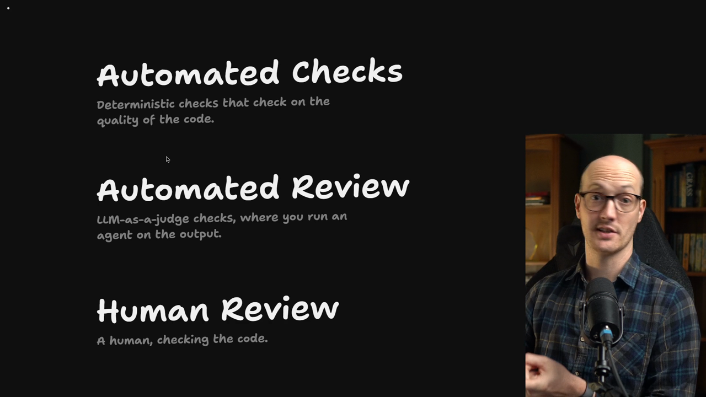

# The Three Kinds Of Review

<Prerequisites title="Crash Course Prerequisites">
  <Prerequisite href="https://www.aihero.dev/workshops/ai-coding-crash-course/non-determinism-c31d9cdd">
    Why the same prompt gives different answers, and so why a deterministic check beats an agent's judgement.
  </Prerequisite>
  <Prerequisite href="https://www.aihero.dev/workshops/ai-coding-crash-course/how-much-did-it-cost-abb3ab6e">
    What tokens cost, so you can see why checks that run on CPU cycles are so cheap.
  </Prerequisite>
  <Prerequisite href="https://www.aihero.dev/workshops/ai-coding-crash-course/enforcing-your-coding-standards-f1656d67">
    The layers of review: automated checks, automated review and human review, and what belongs in each.
  </Prerequisite>
</Prerequisites>

We now know how to align with our [agent](https://www.aihero.dev/ai-coding-dictionary/agent), and we know how to plan huge chunks of work. We are starting to move towards setting up our [software factory](https://www.aihero.dev/ai-coding-dictionary/software-factory).

However, a software factory is a bit like driving a car. When you are learning to drive, what is the first thing you need to learn? You need to learn how to slow the car down.

If you only focus on the ways you can accelerate and push forward your software factory, you will end up with a massive slop cannon.

We need to find ways to slow down and increase the quality of what we ship, so that we don't burn out.

## The three brakes

I think of there being three main brakes in our software factory. Brakes are the things that slow the car down.

| Brake | What it is | Driven by |
| --- | --- | --- |
| [Automated checks](https://www.aihero.dev/ai-coding-dictionary/automated-check) | Deterministic checks on the quality of the code | CPU cycles |
| [Automated review](https://www.aihero.dev/ai-coding-dictionary/automated-review) | Review of the code | Agents |
| [Human review](https://www.aihero.dev/ai-coding-dictionary/human-review) | An actual human checking the code | You |

### Automated checks

First, we have automated checks. These are deterministic checks that check on the quality of the code:

- Unit tests
- Type checking
- Linters
- Various other types of check that we can layer over our application

These are incredibly useful because they only cost CPU cycles. They don't cost [tokens](https://www.aihero.dev/ai-coding-dictionary/token).

So you can really go nuts with this, layering up tons of automated checks to make sure your agent does what you want it to.

### Automated review

Then we have automated review on top of that. This is different because it is driven by agents.

We have already seen a little of this with the `/code-review` [skill](https://www.aihero.dev/ai-coding-dictionary/skill). We have used it in the cohort, and we saw it in action in the previous section inside the `/implement-spec` skill.

There is a lot more juice to be squeezed out of automated review, so we are going to focus on that soon.

### Human review

The last layer, of course, is human review: an actual human checking the code.

## What this section covers

In this section, we are going to focus on the bottom two: automated review and human review. Automated checks will be covered later, in the Feedback Loops section.

We are going to look at:

- The various ways you can improve human review
- How much you should actually look at the code
- In what circumstances you should look at the code

We are then going to use human review to improve our automated review. In theory, the automated review can start doing more, and the human review can start doing less.

Hopefully, by the end, once we have learned all three, we will be able to put the brakes on our software factory. That keeps quality high, even as we start shipping.

Nice work, and I'll see you in the next one.

<Quiz>
  <QuizQuestion data={{
    id: "brakes-before-acceleration",
    question: "You're setting up a software factory. Why learn its brakes before you work on speeding it up?",
    type: "multiple-choice",
    choices: [
      { answer: "a", label: "Without brakes you build a slop cannon" },
      { answer: "b", label: "Brakes let the agents write code faster" },
      { answer: "c", label: "Brakes cut the token cost of every run" },
      { answer: "d", label: "Brakes are what let agents run in parallel" }
    ],
    correct: "a",
    answer: "Like learning to drive, you learn to slow down first. If you only focus on accelerating, you end up with a massive slop cannon, so the brakes are there to raise the quality of what you ship and stop you burning out. They slow things down rather than speeding them up, and not every brake saves tokens: automated review runs on agents."
  }} />
  <QuizQuestion data={{
    id: "automated-checks-cost-cpu-not-tokens",
    question: "Which brake can you layer on most heavily, and why?",
    type: "multiple-choice",
    choices: [
      { answer: "a", label: "Automated checks: they cost CPU, not tokens" },
      { answer: "b", label: "Automated review: agents never get tired" },
      { answer: "c", label: "Human review: you catch the most problems" },
      { answer: "d", label: "Automated review: it's fully deterministic" }
    ],
    correct: "a",
    answer: "Automated checks like unit tests, type checking and linters are deterministic and only cost CPU cycles, never tokens, so you can go nuts layering them up. Automated review is driven by agents, so it costs tokens and isn't deterministic. Human review is you, checking the code yourself."
  }} />
  <QuizQuestion data={{
    id: "three-brakes-who-drives",
    question: "You have an agent read a pull request and flag problems before you look at it. Which brake is that?",
    type: "multiple-choice",
    choices: [
      { answer: "a", label: "Automated review" },
      { answer: "b", label: "Automated checks" },
      { answer: "c", label: "Human review" }
    ],
    correct: "a",
    answer: "Automated review is the brake driven by agents, like the /code-review skill. Automated checks are deterministic tools such as tests, type checking and linters that run on CPU cycles, and human review is an actual human checking the code."
  }} />
</Quiz>
