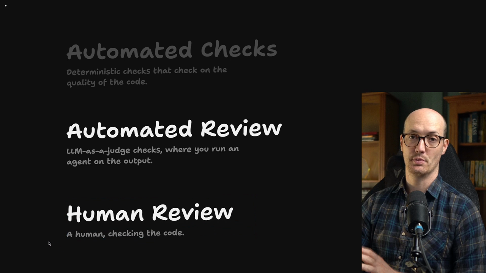
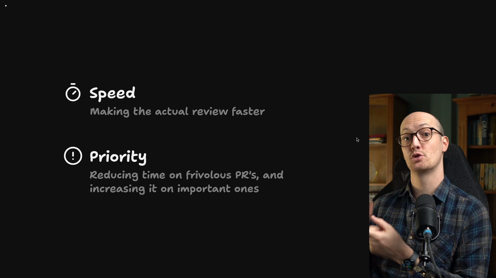
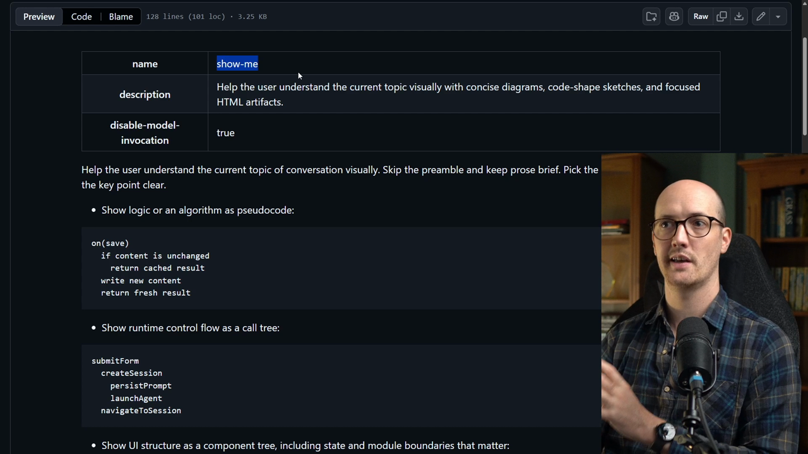
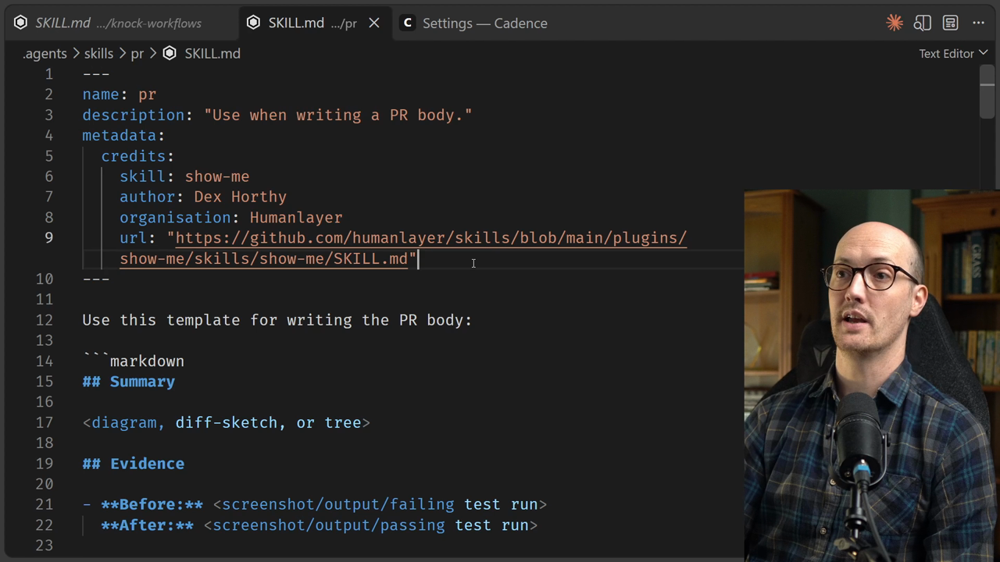
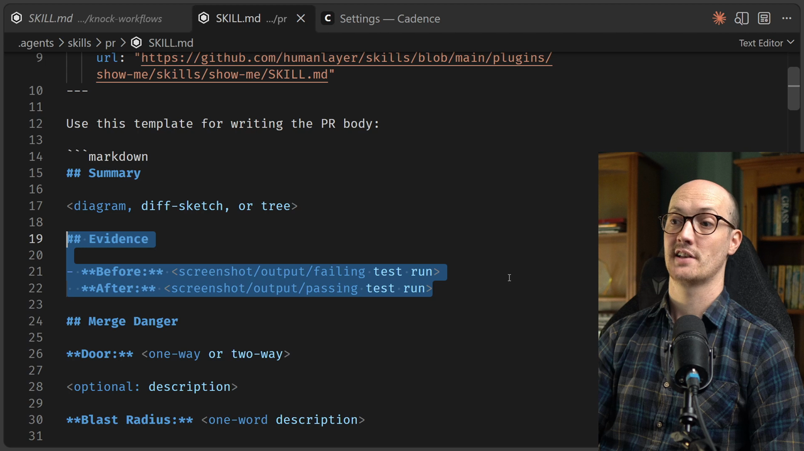
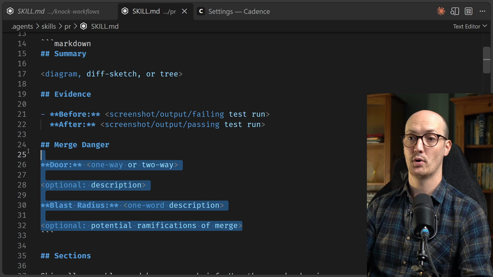
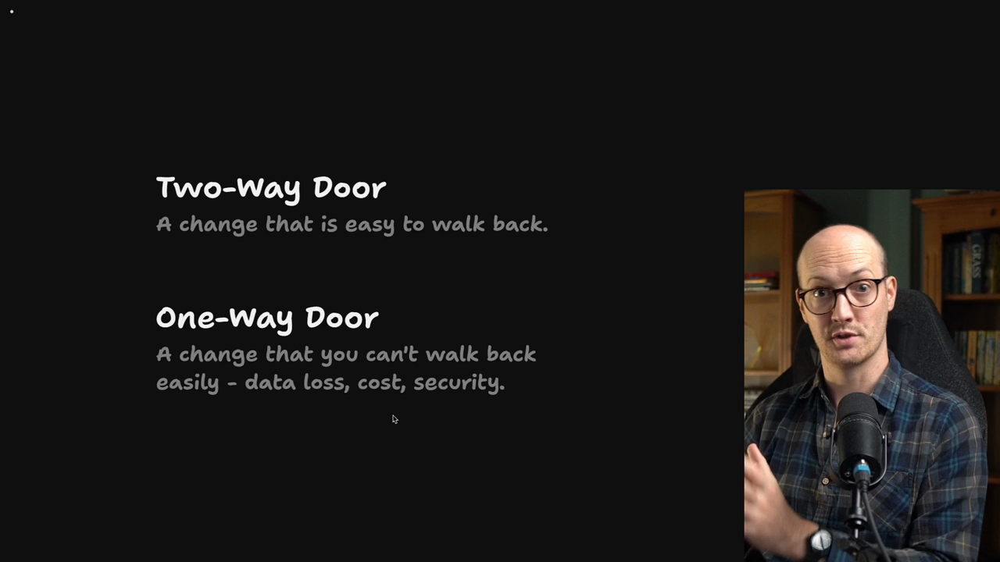
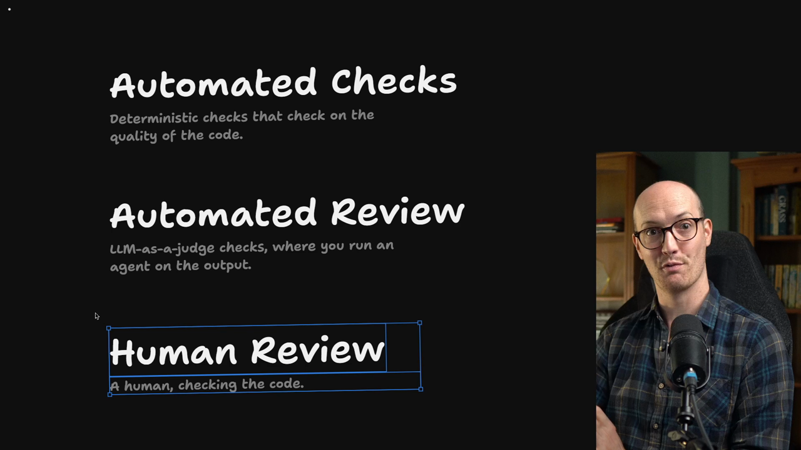

# The PR Skill

<CommitMap packageManager="npm">
  <Commit id="ship-in-app-notifications">Start the lesson: in-app notifications have shipped</Commit>
  <Commit id="add-pr-skill">See the result: the `pr` skill added to the project</Commit>
</CommitMap>

<Prerequisites title="Crash Course Prerequisites">
  <Prerequisite href="https://www.aihero.dev/workshops/ai-coding-crash-course/hallucination-77d5b4c6">
    Why an agent's confident summary can be wrong, so you ask for evidence before you trust it.
  </Prerequisite>
  <Prerequisite href="https://www.aihero.dev/workshops/ai-coding-crash-course/claude-and-your-ide-dd4750dd">
    How to review an agent's diff in your editor.
  </Prerequisite>
  <Prerequisite href="https://www.aihero.dev/workshops/ai-coding-crash-course/what-are-agent-skills-20f91a4e">
    What a skill is, and how one like `pr` gets picked up from its description.
  </Prerequisite>
  <Prerequisite href="https://www.aihero.dev/workshops/ai-coding-crash-course/enforcing-your-coding-standards-f1656d67">
    Where human review fits next to automated checks and automated review.
  </Prerequisite>
</Prerequisites>

## Goals for improving human review

We are going to start our journey by looking at [human review](https://www.aihero.dev/ai-coding-dictionary/human-review).



Specifically, we want to improve it in two ways:

- **Speed**: make sure a PR can be understood by someone reviewing it as fast as possible.
- **Priority**: make sure review time is prioritized correctly.



Not all PRs deserve the same treatment. Some PRs can be reviewed less than others.

## Agents write bad PR descriptions

Something I've noticed working with [agents](https://www.aihero.dev/ai-coding-dictionary/agent), and that I've sort of prayed would get better but never has, is that agents are still terrible at writing PR descriptions.

They write PR bodies that are full of garbage and really hard to review. That turns you off actually wanting to review the PR.

For a long time I had no idea how to fix this. I just thought agents were always going to write slop and that you couldn't control it.

## The `show-me` skill

That was until I found a gorgeous [skill](https://www.aihero.dev/ai-coding-dictionary/skill) called `show-me`, by Dex Horthy at HumanLayer, who is a big inspiration for a lot of my work.



The `show-me` skill helps the user understand the current topic of conversation visually. It tells the agent to skip the preamble, keep prose brief, and use visual pseudocode explainers.

I have found these little explainers outrageously useful for:

- Looking at UI
- Looking at file responsibility
- Component interaction
- Understanding how things happen over time, with Mermaid diagrams
- Diffs for component changes, file layout changes, and call tree or call stack changes

I started testing this out and I understood the intent of the change so much faster. Even before I was looking at the code, I understood why the code was being changed. That increased the speed of review.

## Adapting the skill for PR bodies

I took the `show-me` skill and tweaked it for pull requests. If you go into the project and run this, you will be able to see it:

```bash
npm run reset add-pr-skill
```



It is very simple and mostly a copy of `show-me`. It has a nice little description:

```markdown
---
name: pr
description: "Use when writing a PR body."
---
```

All the skill is, is a template for writing the PR body. The summary sits at the top, which is essentially the `show-me` material, the visual indicators.

```markdown
Use this template for writing the PR body:

## Summary

<diagram, diff-sketch, or tree>

## Evidence

- **Before:** <screenshot/output/failing test run>
  **After:** <screenshot/output/passing test run>

## Merge Danger

**Door:** <one-way or two-way>

<optional: description>

**Blast Radius:** <one-word description>

<optional: potential ramifications of merge>
```

Below the template, the sections for the summary are copied verbatim from `show-me`. The summary at the top is about getting the why of the PR as fast as possible.

## Before and after evidence

Speed has another component. You want to understand why the change is being made, but you also want to be sure the right change has been made.

So you want the agent to show you as much hard evidence as possible. That way you don't have to clone the branch, pull it down locally, poke around and test it yourself.

The next section in the PR body is the evidence, with a **before** showing a failure and an **after** showing a success.



We need the before so the agent can prove that what was happening before was actually broken. This is essential for bug fixes and new features. It gives the agent an extra hurdle to cross, and it proves to you that the thing is working.

The skill also describes what good evidence looks like:

```markdown
### Evidence

Concrete evidence that the change works. Show a before and after.

Screenshots are S-tier - when the environment is set up for it and the change is visual.

Execution-based evidence is A-tier. Test results, console output. Show the exact test that now fails and passes, using pseudocode.
```

In other words, the agent has to run the code to get console output and test results, and show the exact test that now fails and passes.

This evidence helps you review more speedily because you can have more confidence in the code. You can know at a basic level that the change is doing what it's supposed to.

## Prioritizing which PRs to review

What about the priority section? How do we prioritize the right PRs to review?

Even talking about review priority might feel controversial: the idea that we need to review some PRs and maybe not every PR. Before we talk about that properly, I want to frame it using the skill's framing.

Inside the PR body there is a `Merge Danger` section, made of a door and a blast radius.



## One-way vs two-way doors

The door idea is not original to me. I think it comes from AWS. It says every PR is either a one-way door or a two-way door.

- **Two-way door:** you can walk through and walk back if you need to. You can merge the PR and then unmerge it.
- **One-way door:** only goes one way. Walking through it makes something happen as a result, such as data loss, incurred cost, or a security implication.

A one-way door could be a change that sends an email to 50,000 people, or a breaking change in a public library.

One-way doors need to be reviewed much more closely than two-way doors.

## Blast radius of a change

The other thing in the `Merge Danger` section is the blast radius of the change. If something goes wrong, what are the potential ramifications?



This is different from the door. You can have a two-way door that is bad if it goes wrong, but you can easily walk it back. A one-way door with a massive blast radius, though? You had better believe I'm going to review that PR very closely.

| Door | Blast radius | Review attention |
| --- | --- | --- |
| Two-way | Small | Lowest. Might not need human review |
| Two-way | Large | Bad if it goes wrong, but easy to walk back |
| One-way | Large | Review very closely |

Both concepts together give you the priority to put on a PR.

## Priority varies by project

This differs not only by what the change is, but also by what the project is.

- **Personal software:** probably 95% of your changes are two-way doors. With few users, you can change loads of stuff.
- **Medical or finance projects with big security implications:** a lot of your changes will be one-way doors.

But not all of them will be. You can still prioritize certain PRs over others by looking closely at the door and the blast radius of the change.

You might even say that two-way doors with a small blast radius don't need human review. You can just review them on main.



Of course, if we want to skip human review, our [automated checks](https://www.aihero.dev/ai-coding-dictionary/automated-check) and [automated review](https://www.aihero.dev/ai-coding-dictionary/automated-review) need to be really solid first.

## Quizzes and next steps

Don't worry, we'll get there. For now, go to the bottom of this page and take the quizzes. Make sure these concepts are absolutely hammered in your head before we continue.

Next we're going to feel this for ourselves and try out the PR skill on a real pull request.

<Quiz>
  <QuizQuestion data={{
    id: "pr-door-blast-radius-priority",
    question: "A PR adds a database migration that drops a column. It touches one small internal table. Another PR changes the colour of a button across the whole app. Which needs the closer human review?",
    type: "multiple-choice",
    choices: [
      { answer: "a", label: "The button colour PR, since it touches the most users" },
      { answer: "b", label: "The migration, since dropping a column is a one-way door" },
      { answer: "c", label: "Both equally, since every PR deserves the same treatment" },
      { answer: "d", label: "Neither, since agents already review their own changes" }
    ],
    correct: "b",
    answer: "Data loss is a classic one-way door, and one-way doors need much closer review. The colour change is wide but easy to walk back, so it is a two-way door. Treating all PRs equally ignores the priority goal, and an agent's own review is not the human review being prioritized."
  }} />
  <QuizQuestion data={{
    id: "pr-skip-human-review-condition",
    question: "Your team wants to stop human review on small, low-risk PRs and review them on main instead. Which PRs fit that, and what should be in place first?",
    type: "multiple-choice",
    choices: [
      { answer: "a", label: "One-way doors with a small blast radius, with clear PR bodies" },
      { answer: "b", label: "Two-way doors with a small blast radius, with solid automation" },
      { answer: "c", label: "Any two-way door, whatever its blast radius, with few users" },
      { answer: "d", label: "Any PR that has a before and after in its evidence" }
    ],
    correct: "b",
    answer: "Only changes that are easy to walk back and have a small blast radius are candidates, and only after automated checks and review can be trusted. A one-way door always needs closer review, a wide blast radius still matters on a two-way door, and good evidence speeds review but does not remove the need for it."
  }} />
  <QuizQuestion data={{
    id: "pr-evidence-before-needed",
    question: "An agent's PR body for a bug fix only shows a passing test run after the change. What should you ask it to add?",
    type: "multiple-choice",
    choices: [
      { answer: "a", label: "A longer prose summary of every file that it touched" },
      { answer: "b", label: "Nothing, since a passing test is enough proof of a fix" },
      { answer: "c", label: "A before: a failing run that proves it was once broken" },
      { answer: "d", label: "A note asking the reviewer to clone it and test locally" }
    ],
    correct: "c",
    answer: "The before proves the earlier behaviour was actually broken, and gives the agent an extra hurdle to cross. A passing test alone does not show that. More prose makes the PR harder to review, and asking you to test locally defeats the purpose of evidence."
  }} />
</Quiz>
