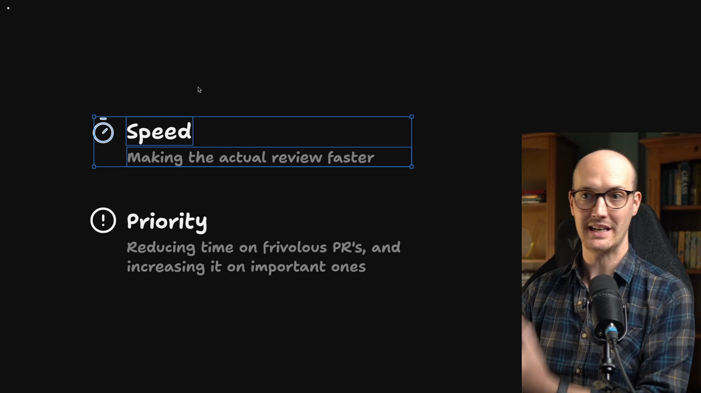
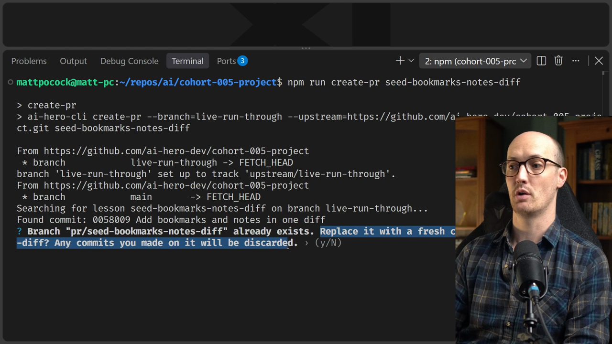
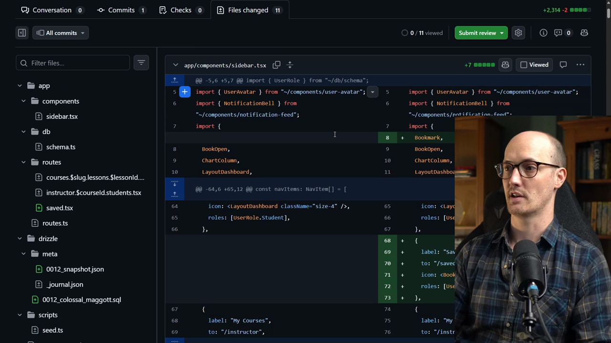

# Running The PR Skill

<CommitMap packageManager="npm">
  <Commit id="seed-bookmarks-notes-diff">Start the lesson: the Bookmarks and Notes feature as one big diff, with the `pr` skill already added</Commit>
</CommitMap>

<Prerequisites title="Crash Course Prerequisites">
  <Prerequisite href="https://www.aihero.dev/workshops/ai-coding-crash-course/models-harnesses-agents-environments-2b9a99a1">
    What an agent actually is, so you know what's writing your PR body.
  </Prerequisite>
  <Prerequisite href="https://www.aihero.dev/workshops/ai-coding-crash-course/hallucination-77d5b4c6">
    Why an agent's confident summary can be wrong, so you check the evidence it cites.
  </Prerequisite>
  <Prerequisite href="https://www.aihero.dev/workshops/ai-coding-crash-course/what-are-agent-skills-20f91a4e">
    How a skill like `pr` gets picked up from its description without you invoking it.
  </Prerequisite>
  <Prerequisite href="https://www.aihero.dev/workshops/ai-coding-crash-course/set-up-your-issue-tracker-30629075">
    How your agent reads GitHub through the `gh` CLI, which is how it sees the PR.
  </Prerequisite>
</Prerequisites>

You now have a PR [skill](https://www.aihero.dev/ai-coding-dictionary/skill), so let's put it to work. We've added a small script that turns one of our commits into a draft PR, complete with a base branch and a PR branch, just like a real repo.

That draft PR has no body yet. Your job is to get an [agent](https://www.aihero.dev/ai-coding-dictionary/agent) to write one from the diff, then read it critically.

The goal is speed: making the review faster, and working out how much review this PR actually needs.



## Steps To Complete

### Create The Draft PR

- [ ] Run the `create-pr` script from the root of the repo

```bash
npm run create-pr
```

The script runs through a few steps. If a PR already exists for this commit, it will ask whether you want to replace it. Answering `Yes` is fine.



- [ ] Open the draft PR on GitHub and look around

You should see a new base branch (the branch you'd merge into) and a PR branch holding the extra commit. Check the **Files changed** tab to see the diff as if it were a real PR.



- [ ] Note the PR number

The PR body is empty for now. Grab the number from the PR page. In my run it was `34`, but yours will likely differ.

### Write The PR Body

- [ ] Check the agent can see the `/pr` skill's `SKILL.md`

It lives at `.agents/skills/pr/SKILL.md`. It should be picked up automatically, so you shouldn't need to invoke it.

- [ ] Ask your agent to rewrite the PR body from the diff

Replace `<pr-number>` with your own PR number:

```txt
Take PR number <pr-number> and write a PR body for it based on what's in the diff.
```

### Read The Result

- [ ] Use the pseudocode and descriptions to understand what happened in the diff

Can you follow the change without reading every file?

- [ ] Look at the evidence the body cites

Does it show that the change is actually working and doing its thing?

- [ ] Look at the merge danger

Decide whether this is a one-way door or a two-way door.

### Make It Yours

- [ ] Think about how you would improve the skill

Note what you like and what you don't. The PR skill is there for you to tinker with and tailor to your own process. It's just one take on what a good PR body looks like.

When you're done, move on to the solution.
