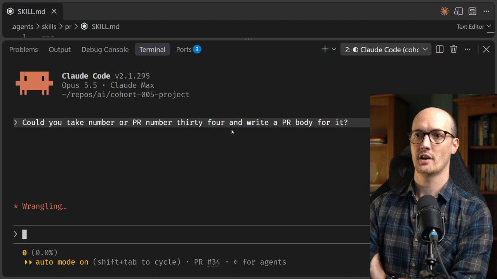
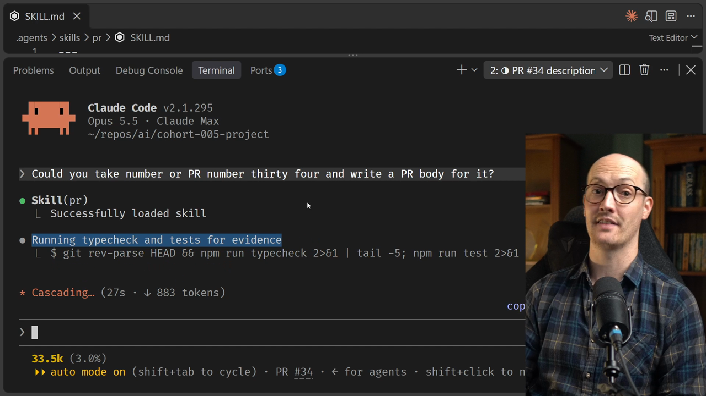
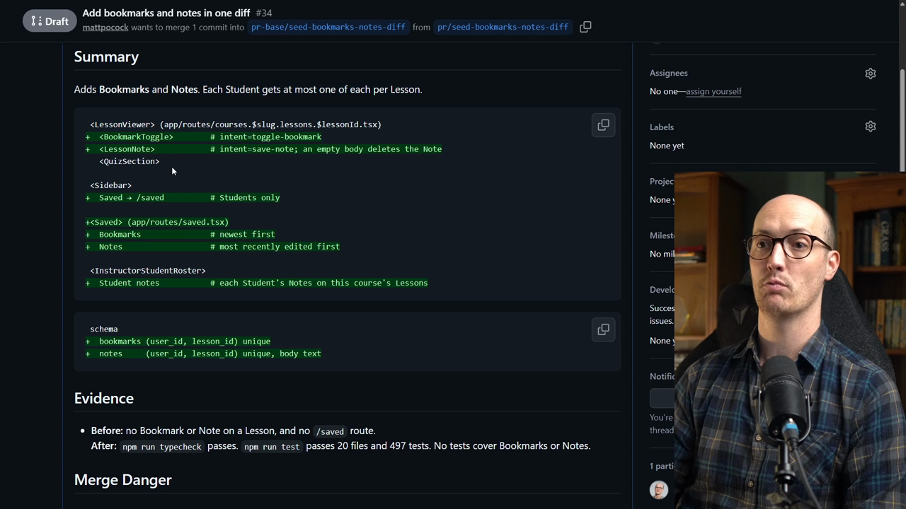
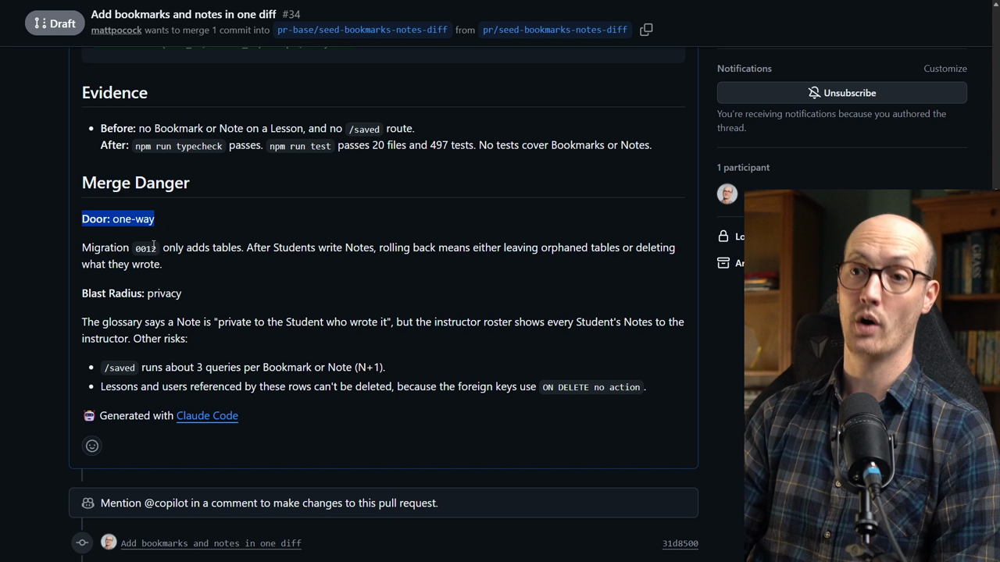

# Running The PR Skill Solution

<CommitMap packageManager="npm">
  <Commit id="seed-bookmarks-notes-diff">Start the lesson: the Bookmarks and Notes feature landed as one big diff, with the `pr` skill already added</Commit>
</CommitMap>

## Asking The Agent For A PR Body

The prompt is short. It asks the [agent](https://www.aihero.dev/ai-coding-dictionary/agent) to take PR number 34 and write a PR body for it.

```txt
Could you take PR number 34 and write a PR body for it?
```



The agent loads the `/pr` [skill](https://www.aihero.dev/ai-coding-dictionary/skill) by itself, which is what we want to see. It then runs the typecheck and the test suite to gather evidence.



## Posting The Proposed Body

The agent gives us a proposed body for the PR. I don't really care to review it here. I'm just going to say yes, post it, and see how it does when it sends it off.

```txt
yes, post it
```

The agent has also spotted some inconsistencies in the code, which we may want to take a look at in a minute.

## Reading The Summary

Here is the summary it gave us. There is very little actual text. It relies on a big JSX style diff.



Walking through the diff:

- **Lesson viewer:** there is now a bookmark toggle, so you can toggle bookmarks on and off, and a lesson note with a save note intent.
- **Sidebar:** a saved button that goes to your saved notes. Only students can see it.
- **Saved route:** bookmarks, newest first, then notes, most recently edited first.
- **Instructor student roster:** student notes, showing each student's notes on this course's lessons.
- **Schema:** the new tables, `bookmarks` and `notes`.

```diff
 <LessonViewer>
+  <BookmarkToggle>        # intent=toggle-bookmark
+  <LessonNote>            # intent=save-note
 <Sidebar>
+  Saved → /saved          # Students only
+<Saved>
+  Bookmarks               # newest first
+  Notes                   # most recently edited first
 <InstructorStudentRoster>
+  Student notes
```

Notice that it says students here, not learners. The `/pr` skill looks at your glossary to make sure it uses your domain language.

## Weak Evidence

Now, we're pretty weak on evidence here. The agent basically just looked at the code and said there's no bookmark or note on a lesson and no saved route.

But it is telling us it's weak on this. The typecheck and the tests pass, but no tests cover bookmarks or notes. That's pretty awkward.

## Merge Danger



This is a one-way door, because migration `0012` only adds tables.

After a student writes a note, rolling back means either leaving orphaned tables or deleting what they wrote. That's correct. We're giving students the opportunity to write notes, and if we roll back, we'd be deleting their data.

The blast radius is privacy. There's a contradiction:

- The glossary says a note is private to the student who wrote it.
- The instructor roster shows every student's notes to the instructor.

## Other Risks

It doesn't seem happy with the quality of this PR. It says `/saved` runs about three queries per bookmark or note, which is an N+1 problem.

It also says the lessons and users referenced by these rows can't be deleted, because the foreign keys use `ON DELETE no action`.

## What To Do Next

Just reading this relatively short summary has packed in a lot of information. Since this is a one-way door, we probably do need some [human review](https://www.aihero.dev/ai-coding-dictionary/human-review).

But we can also tell this PR is pretty low quality. The `/pr` skill didn't spend that many [tokens](https://www.aihero.dev/ai-coding-dictionary/token), yet it found lots of inconsistencies.

So we should probably run something on this before we spend our human energy reviewing it manually. That's what we're going to do next.
