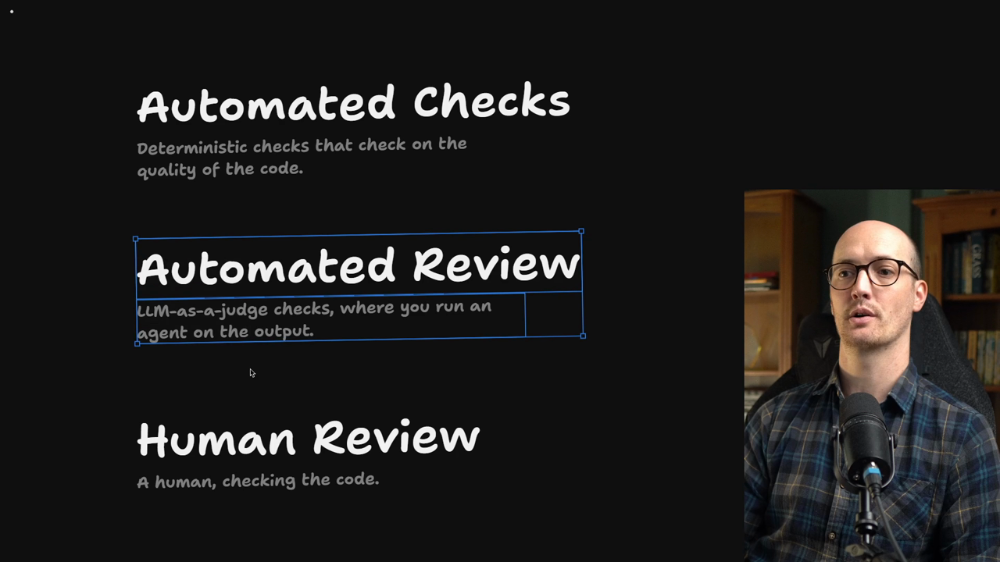
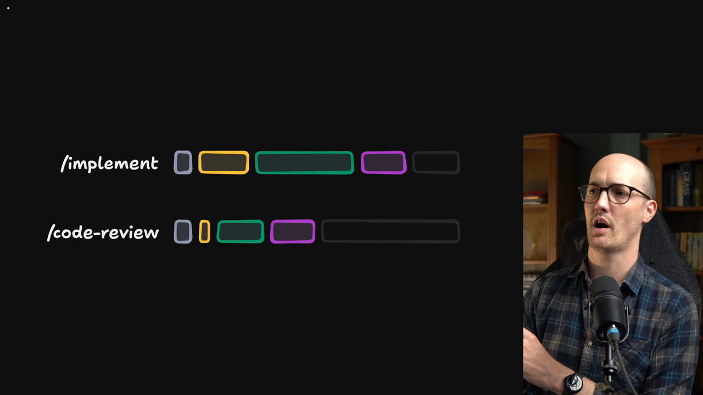
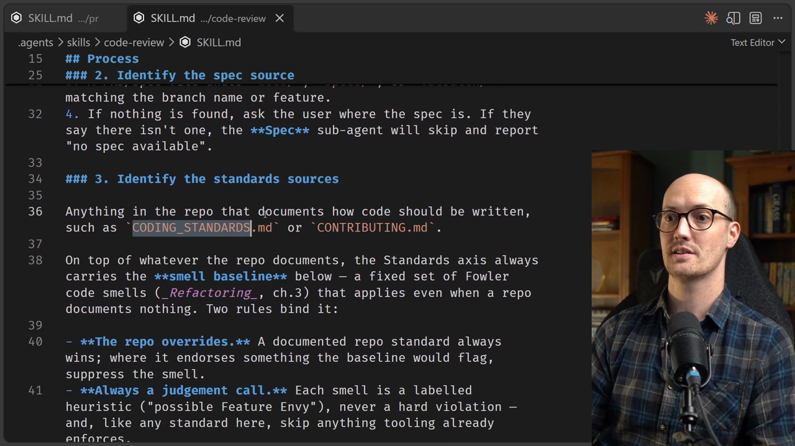
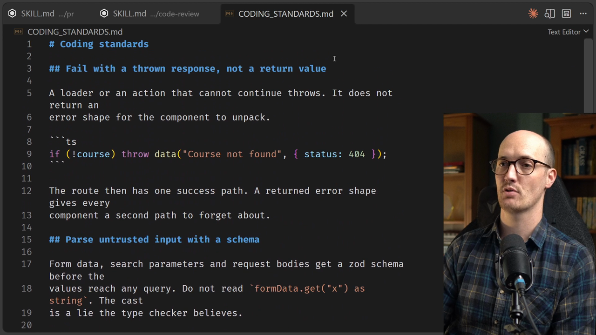
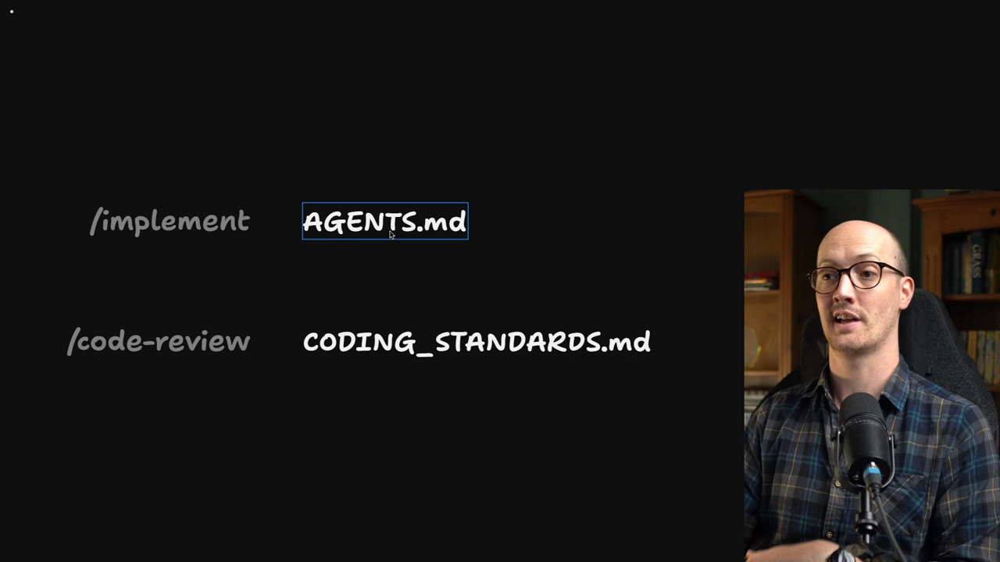
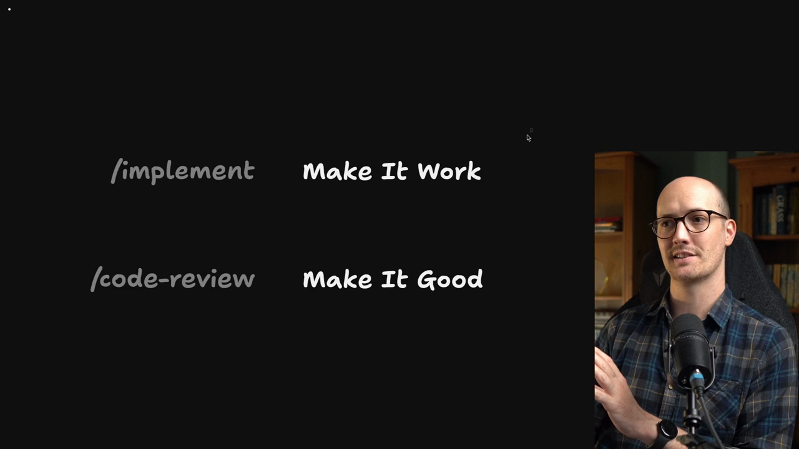

# The /code-review Skill

<Prerequisites title="Crash Course Prerequisites">
  <Prerequisite href="https://www.aihero.dev/workshops/ai-coding-crash-course/subagents-756fafe5">
    What a subagent is: a fresh context window, which is where the code review runs.
  </Prerequisite>
  <Prerequisite href="https://www.aihero.dev/workshops/ai-coding-crash-course/the-steering-map-c061e049">
    What AGENTS.md is and why it points to docs instead of holding everything.
  </Prerequisite>
  <Prerequisite href="https://www.aihero.dev/workshops/ai-coding-crash-course/what-are-agent-skills-20f91a4e">
    What a skill is and how you invoke one like `/code-review`.
  </Prerequisite>
  <Prerequisite href="https://www.aihero.dev/workshops/ai-coding-crash-course/executing-your-tickets-8389d87c">
    How tickets get implemented with `/implement`, then checked with `/code-review`.
  </Prerequisite>
  <Prerequisite href="https://www.aihero.dev/workshops/ai-coding-crash-course/enforcing-your-coding-standards-f1656d67">
    Where automated review sits next to checks and human review, and where `/code-review` comes from.
  </Prerequisite>
</Prerequisites>

So far we've looked at [human review](https://www.aihero.dev/ai-coding-dictionary/human-review). Now let's look at [automated review](https://www.aihero.dev/ai-coding-dictionary/automated-review).

In my opinion, most teams are not doing enough automated review. It is an amazing, very [token](https://www.aihero.dev/ai-coding-dictionary/token)-efficient way to save humans time.



The theory is that work moves through three stages:

1. [Automated checks](https://www.aihero.dev/ai-coding-dictionary/automated-check)
2. Automated review
3. Human review

The quality increases at each stage. By the time work reaches human review, you want the code to be as good as it can possibly be.

In other words, you don't want to waste human effort reviewing crap code.

## Why not get the implementer to do it right first time?



You may be wondering why we bother with automated review at all. Can't we just get the implementer to do its work right first time?

I've talked about this a bit in the crash course, but it's worth revisiting.

`/implement` has a lot of jobs to do. The [agent](https://www.aihero.dev/ai-coding-dictionary/agent) doing the actual work needs to:

1. Explore the codebase
2. Implement
3. Debug

A code review is a different shape of job. If you [clear](https://www.aihero.dev/ai-coding-dictionary/clearing) the [context](https://www.aihero.dev/ai-coding-dictionary/context) and review the diff that's been produced, the review agent:

- doesn't need to find the diff
- doesn't need to explore, because it's already in the right part of the codebase
- doesn't have any files it really needs to change

That means you can load up the code review with a lot of instructions. Tweak this, do this, find these patterns and remove them or report on them.

### Review runs in a sub-agent

Usually you run a [session](https://www.aihero.dev/ai-coding-dictionary/session) with `/implement`, and then call `/code-review` from within it. The code review runs in a [sub-agent](https://www.aihero.dev/ai-coding-dictionary/subagent).

In other words, it gets a fresh [context window](https://www.aihero.dev/ai-coding-dictionary/context-window) right then and there.

## Loading up the review agent

How do you load up this review agent? Look inside the `/code-review` [skill](https://www.aihero.dev/ai-coding-dictionary/skill). At step 3, it identifies the standards sources:

````markdown
### 3. Identify the standards sources

Anything in the repo that documents how code should be written, such as `CODING_STANDARDS.md` or `CONTRIBUTING.md`.
````



So anything we want identified in the automated review step, we can put inside `CODING_STANDARDS.md`. The `/code-review` skill will find it.

## The standards already in the repo

At this point the repo already has some coding standards written in `CODING_STANDARDS.md`. There are three:

- Do not write `any`, and do not write `!`. This stops the [model](https://www.aihero.dev/ai-coding-dictionary/model) cheating on TypeScript.
- Fail with a thrown response, not a return value.
- Parse untrusted input with a schema.

Here is the second one, in the file:

````markdown
## Fail with a thrown response, not a return value

A loader or an action that cannot continue throws. It does not return an
error shape for the component to unpack.

```ts
if (!course) throw data("Course not found", { status: 404 });
```
````



These are all very sensible, and all things the model would probably do on a good day anyway. Automated review is an extra line of defense to make sure it does.

## CODING_STANDARDS.md or AGENTS.md?



A lot of people would put these standards inside `AGENTS.md`. That way they're picked up by every agent that runs inside the codebase.

Honestly, I don't mind hiding these standards from the implementer, or at least not pushing them to it.

That leaves the implementer free to produce a rough draft. Then the code review, armed with everything in `CODING_STANDARDS.md`, can come in and polish it up.

| Skill | Job |
| --- | --- |
| `/implement` | Make it work |
| `/code-review` | Make it good |



## Wrapping up

Hopefully you now understand a bit more about why I like splitting up `/implement` and `/code-review`. You've also seen the different ways you can influence their behavior, and especially how to improve your automated review over time.

In the next lesson, we're going to try out `/code-review` to see if we can improve this PR.

<Quiz>
  <QuizQuestion data={{
    id: "coding-standards-file-placement",
    question: "You want every pull request checked for `any` casts and unparsed form data, but you don't want the implementing agent weighed down by those rules while it explores and debugs. Where do the standards go?",
    type: "multiple-choice",
    choices: [
      { answer: "a", label: "In `AGENTS.md`, so every agent in the codebase picks them up" },
      { answer: "b", label: "In `CODING_STANDARDS.md`, which the `code-review` skill finds" },
      { answer: "c", label: "In the `/implement` prompt, so it gets the code right first time" },
      { answer: "d", label: "In a reminder you paste to the reviewer on each run" }
    ],
    correct: "b",
    answer: "`CODING_STANDARDS.md` is picked up by the `code-review` skill at its standards-sources step, so the rules apply at review time. `AGENTS.md` and the `/implement` prompt both push the rules onto the implementer, which already has exploring, implementing and debugging to do. Pasting a reminder each run works once but isn't something the skill finds for you, and it won't improve over time."
  }} />
  <QuizQuestion data={{
    id: "review-fresh-context-benefit",
    question: "A teammate says a separate review step is wasteful because the implementer could simply do the work right first time. What is the strongest reply?",
    type: "multiple-choice",
    choices: [
      { answer: "a", label: "The implementer is busy exploring and debugging, while a fresh reviewer already has the diff and can take many instructions" },
      { answer: "b", label: "Reviewers are always smarter models than implementers, so a second pass catches more of the mistakes the first one made" },
      { answer: "c", label: "A review step means humans no longer need to look at the code, so it saves the team the most time overall" },
      { answer: "d", label: "Implementers can't read `CODING_STANDARDS.md`, so they never follow standards unless a reviewer enforces them" }
    ],
    correct: "a",
    answer: "The review agent gets a fresh context window, doesn't need to find or explore the diff, and has no files it needs to change, so you can load it with lots of instructions. Nothing says reviewers are smarter. Automated review exists to make human review less wasteful, not to replace it. And the implementer could read the file; the point is that you choose not to push it there."
  }} />
</Quiz>
