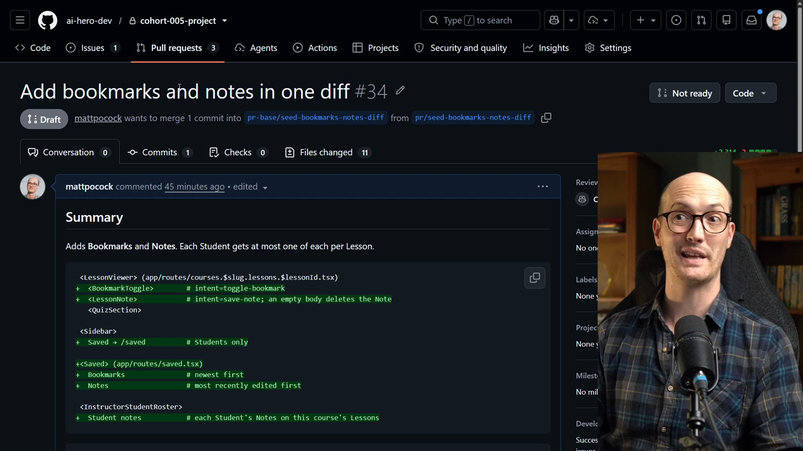
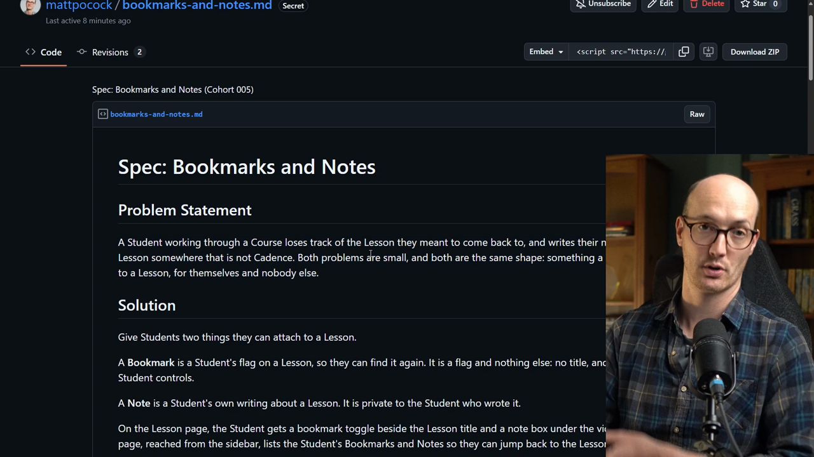
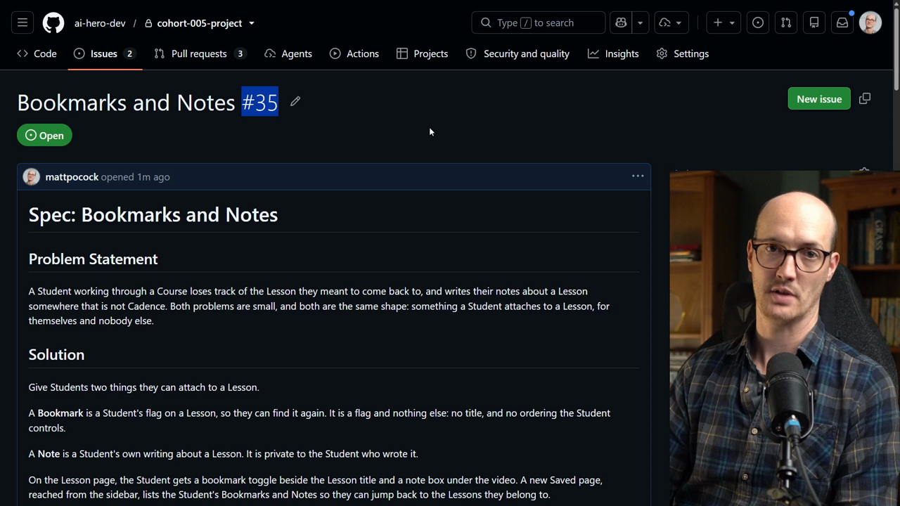

# Testing Out The Code Review Skill

<CommitMap packageManager="npm">
  <Commit id="seed-bookmarks-notes-diff">Start the lesson: the low-quality "Add bookmarks and notes in one diff" change that PR #34 contains</Commit>
  <Commit id="merge-bookmarks-notes-review-fix">See my solution: the fixes `/code-review` made to PR #34</Commit>
</CommitMap>

<Prerequisites title="Crash Course Prerequisites">
  <Prerequisite href="https://www.aihero.dev/workshops/ai-coding-crash-course/sessions-and-the-context-241f60ee">
    What a session is, and why the review runs in a fresh one.
  </Prerequisite>
  <Prerequisite href="https://www.aihero.dev/workshops/ai-coding-crash-course/set-up-your-issue-tracker-30629075">
    Why specs live in GitHub issues, where the review can read them.
  </Prerequisite>
  <Prerequisite href="https://www.aihero.dev/workshops/ai-coding-crash-course/write-great-specs-with-this-skill-362ad013">
    What a spec made by `/to-spec` contains, so you know what the code is reviewed against.
  </Prerequisite>
  <Prerequisite href="https://www.aihero.dev/workshops/ai-coding-crash-course/enforcing-your-coding-standards-f1656d67">
    Where automated review sits next to checks and human review, and where `/code-review` comes from.
  </Prerequisite>
</Prerequisites>

We have a suspiciously low quality PR. Before a human spends any time on it, we want to bump up its quality with an [automated review](https://www.aihero.dev/ai-coding-dictionary/automated-review).

The key idea: automated review shouldn't just produce a pile of comments for humans to read. It should fix what it finds, and only pass up the things it's unsure about.

## Steps To Complete

### Find the PR

- [ ] Open the PR and grab its number



In my case it's PR #34, "Add bookmarks and notes in one diff". Yours will have its own number, so check it before you run anything.

### Get the spec into an issue

Reviewing code against coding standards isn't enough on its own. [Agents](https://www.aihero.dev/ai-coding-dictionary/agent) sometimes take shortcuts they shouldn't, so we also want to review against a written [spec](https://www.aihero.dev/ai-coding-dictionary/spec). This is a two-axis review: standards, and spec.

We don't always have a spec (sometimes you go straight from a [grilling](https://www.aihero.dev/ai-coding-dictionary/grilling) [session](https://www.aihero.dev/ai-coding-dictionary/session) into implementation), but here we do.

- [ ] Open [the spec gist](https://gist.github.com/mattpocock/ab4bc7adcc8a473054fdd9221d20359f) I've written, using the typical `/to-spec` layout



- [ ] Run this command in your project repo to copy the spec into an issue

```bash
gh issue create --title "Bookmarks and Notes" --body "$(gh gist view ab4bc7adcc8a473054fdd9221d20359f --raw --filename bookmarks-and-notes.md)"
```

It reads the spec straight out of the gist with `gh gist view` and opens a new GitHub issue with it as the body.



In my case this created issue #35, "Bookmarks and Notes". Note down your issue number, because the agent needs it.

### Run the review

- [ ] In a fresh agent session, run `/code-review` against your PR number

Add the instruction to fix what you find, then point the agent at the spec issue. Replace the placeholders with your own PR and issue numbers:

```txt
/code-review PR #<pr-number> And fix what you find. The original spec is issue number <issue-number>.
```

Why "fix what you find"? If automated review only leaves comments, those comments land on the human reviewer and make the whole process slower. We want [human review](https://www.aihero.dev/ai-coding-dictionary/human-review) to be as fast and efficient as possible.

- [ ] Check that the prompt has all three parts before submitting
  - The right PR, so the agent reviews the correct diff
  - The instruction to fix what it finds
  - The spec issue, so it can review against the spec

### Check the result

- [ ] Let the agent run, and look at what it finds

It should find quite a lot. Hopefully you end up with something better that you can then properly human review.

- [ ] Read through the changes it made, and decide whether you would merge them

When you're done, watch the solution to compare.
