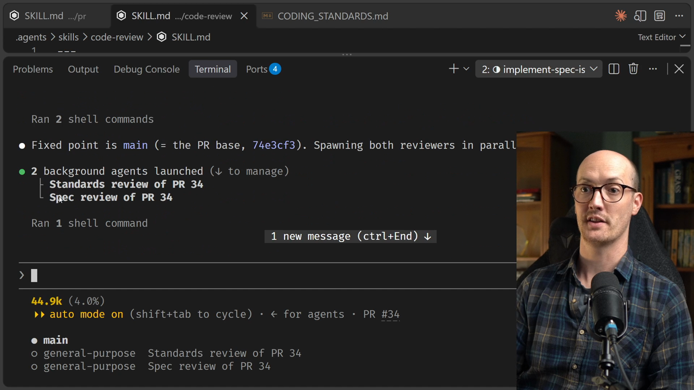
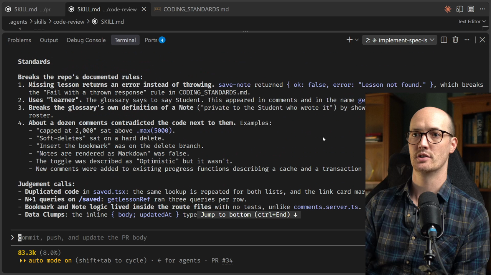
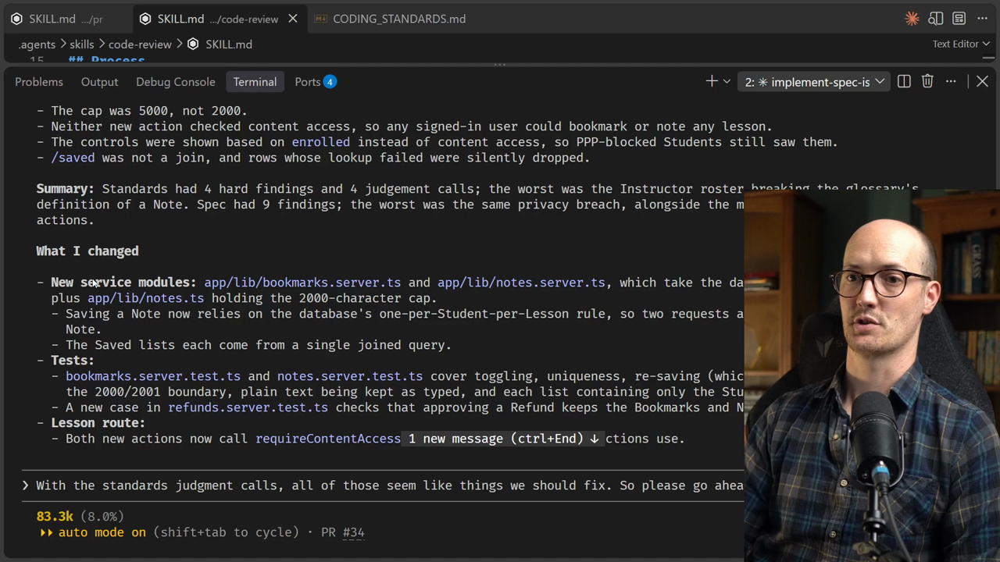
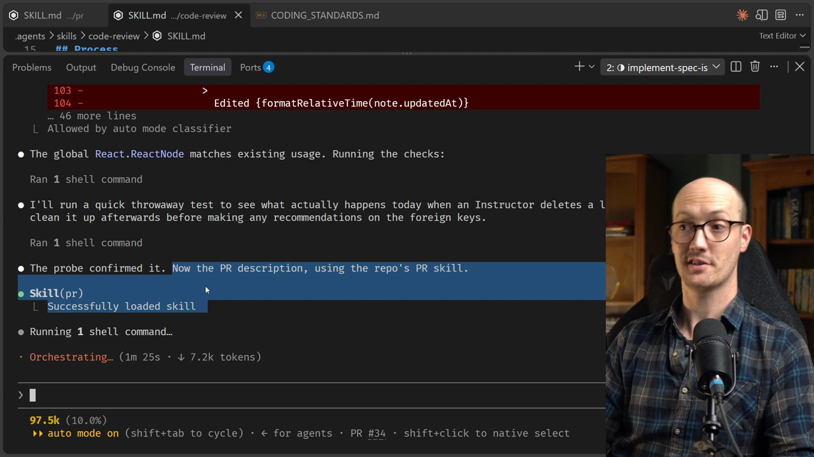
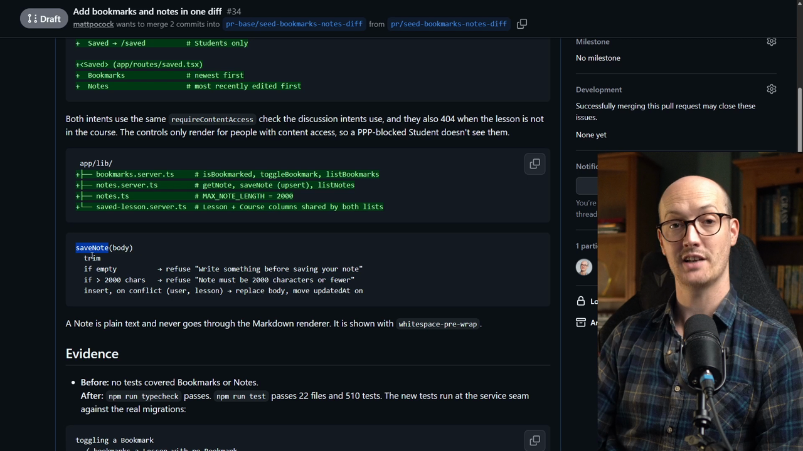

# Testing Out The Code Review Skill Solution

<CommitMap packageManager="npm">
  <Commit id="seed-bookmarks-notes-diff">Start the lesson: the deliberately low-quality Bookmarks and Notes diff that PR contains</Commit>
  <Commit id="merge-bookmarks-notes-review-fix">See my solution: the fixes `/code-review` made and pushed to the PR</Commit>
</CommitMap>

Let's run `/code-review` and see what happens.

The first thing it does is identify its fixed point. In this case that's `main`, the PR base.

Then it launches the standards review and the [spec](https://www.aihero.dev/ai-coding-dictionary/spec) review, in my case as background [agents](https://www.aihero.dev/ai-coding-dictionary/agent).



It finished pretty quickly, and now both reports are in. It's already going off to fix the issues on both.

Notice how proactive it is. It is in the make it good phase. It's not deferring these decisions to us. It has found a bunch of stuff, and now it's going to go and fix them.

## The standards report

Once it's complete, it has given us a full standards report and spec report.



We can see it's breaking the repo's documented rules in a few ways:

- A missing lesson returns an error instead of throwing. That broke a specific response rule inside `CODING_STANDARDS.md`.
- It uses "learner", but the glossary says to say Student.
- It breaks the glossary's own definition of a Note. The glossary says Notes are private to the Student who wrote them, but it was showing Notes to Instructors as well.
- About a dozen comments contradicted the code next to them. That's not good.

### Judgement calls

It also picked out some judgement calls that need us to take a look:

- Duplicated code in `saved.tsx`.
- N+1 queries on `/saved`.
- Bookmark and Note logic lives inside the route files with no tests.
- What it calls data clumps: an inline `{ body; updatedAt }` type is declared in two places.

The data clumps term comes from the `/code-review` [skill](https://www.aihero.dev/ai-coding-dictionary/skill) itself. I've added some built-in code smells to the skill that I think are universal across projects.

This means that even if you don't have a `CODING_STANDARDS.md`, it still finds some stuff. A lot of these come from the book _Refactoring_ by Martin Fowler, which has a huge list of them.

## Our instructions on the judgement calls

I'm going to tell it to use its own judgement on these. The standards judgement calls all seem like things we should fix, so please go ahead.

## The spec report

Next, we had missing or partial work against the spec. Here it references specific user stories that were not fulfilled in the diff:

- The Lesson page never showed when the Note was last edited.
- The note box sat under the lesson content instead of under the video.

There was also stuff that was not asked for by the spec: an Instructor "Student notes" section.

And there was stuff that was implemented wrong:

- The cap was 5000, not 2000.
- Neither action checked content access, so any signed-in user could bookmark or note any lesson.

## What it changed

It then describes what it changed. It created some new modules and a bunch of new tests. Inside the lesson route, the actions now call `requireContentAccess`, good.



At the bottom there's a list of decisions. I agree with its take on saving an empty note. I think that makes sense. I would like it to update the PR description.

Then it asks about the foreign keys with `ON DELETE no action`. I'm not sure how to resolve this one. It does seem really bad, and we need to do something about it, but I'm not sure what. So let's enter into a conversation to figure that out.

```txt
With the standards judgement calls, all of those seem like things we should fix. So please go ahead. I agree with your take on saving an empty note. I think that makes sense. I would like you to update the PR description. What do you think we should do about the foreign keys with the on delete no action?
```

Before answering my question, it goes across and fixes a couple of the other things I said yes to. Then it rewrites the PR description, and of course it pulls in the `/pr` skill.



It comes back having updated the PR description, and gives me a recommendation to leave the foreign keys as they are.

## Pushing the fixes

That all sounds good. Now I'll ask it to push to the PR itself.

```txt
Okay, that all sounds good. Now, can you push to the PR yourself? No need for a follow up issue.
```

It asks whether I want to open a follow-up issue. No need. I'm only saying that because I don't want to bother filming it. But when you're doing code review, it is a great opportunity to find things that might need follow-up issues or follow-up PRs.

Now we can see it has pushed the fixes to PR number 34.

## The rewritten PR description

The PR body has been subtly rewritten to reflect our changes.

The validation logic in `saveNote` is now pulled into this bit of pseudocode:

```text
saveNote(body)
  trim
  if empty          → refuse "Write something before saving your note"
  if > 2000 chars   → refuse "Note must be 2000 characters or fewer"
  insert, on conflict (user, lesson) → replace body, move updatedAt on
```

So it trims. If empty, refuse. If greater than 2000 characters, refuse. Then it inserts, and if there's a conflict it replaces the body and moves `updatedAt` on.



### Richer evidence

We also have richer evidence. Previously no tests covered this. Now it shows that it is actually executing all of these tests and running them.

### Merge danger

Let's see if the merge danger has changed. The door is still one-way, and privacy is still the blast radius.

However, no Instructor or Platform Admin view can read Note bodies anymore. So this is definitely less of a blast radius than before.

Before, a Student could have written "this lesson is really crap" inside a Note, and then the Instructor could have read it and got offended, I guess. More seriously, we were telling Students their private Notes were private, and they weren't, which is bad.

## Wrapping up

Hopefully we've now seen the benefits of a proper [automated review](https://www.aihero.dev/ai-coding-dictionary/automated-review) step. It can radically improve the quality of a PR before a human looks at it, not only by comparing it against the spec, but also by comparing it against the standards.

You'll notice one thing though: we've still not dived into the files changed and done a [human review](https://www.aihero.dev/ai-coding-dictionary/human-review). That's because there is one more thing I want to show you first.

Nice work, and I will see you in the next one.

