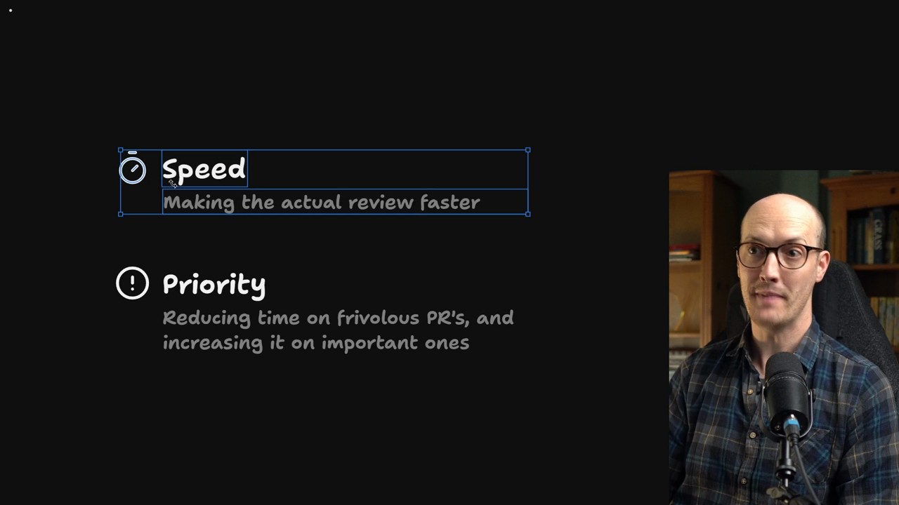
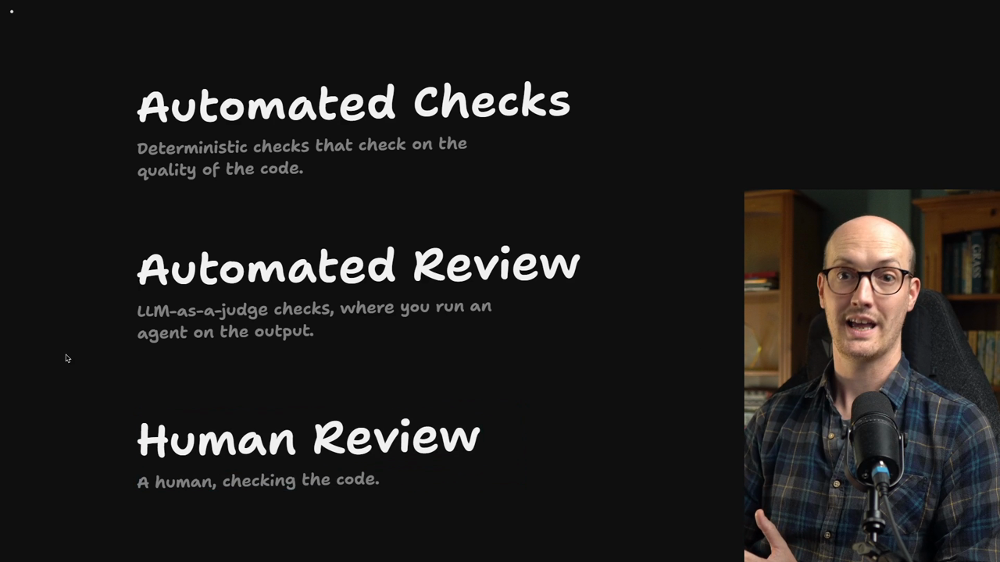
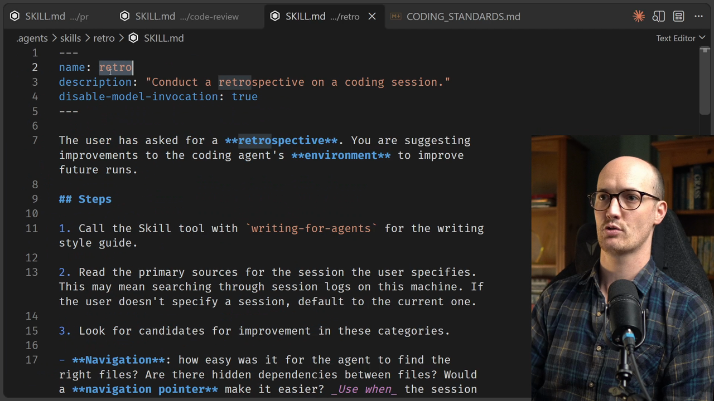

# Why Retro

<CommitMap packageManager="npm">
  <Commit id="merge-bookmarks-notes-review-fix">Start the lesson: the Bookmarks and Notes PR with its code review fixes merged</Commit>
  <Commit id="add-retro-skill">See the result: the `retro` skill added</Commit>
</CommitMap>

<Prerequisites title="Crash Course Prerequisites">
  <Prerequisite href="https://www.aihero.dev/workshops/ai-coding-crash-course/models-harnesses-agents-environments-2b9a99a1">
    What the agent's harness and environment are, since retro improves the environment.
  </Prerequisite>
  <Prerequisite href="https://www.aihero.dev/workshops/ai-coding-crash-course/statelessness-1fdb45c1">
    Why the agent remembers nothing between runs, so every fix has to land in the repo.
  </Prerequisite>
  <Prerequisite href="https://www.aihero.dev/workshops/ai-coding-crash-course/the-steering-map-c061e049">
    Where steering lives, so you know where the retro's improvements should go.
  </Prerequisite>
  <Prerequisite href="https://www.aihero.dev/workshops/ai-coding-crash-course/what-are-agent-skills-20f91a4e">
    What a skill is and how you invoke one, so running `/retro` makes sense.
  </Prerequisite>
  <Prerequisite href="https://www.aihero.dev/workshops/ai-coding-crash-course/enforcing-your-coding-standards-f1656d67">
    What coding standards are for, which is where retro's rules end up.
  </Prerequisite>
</Prerequisites>

## The Third Lens On Human Review

So far, we've been looking at [human review](https://www.aihero.dev/ai-coding-dictionary/human-review) through two main lenses: increasing its speed, and working out how to prioritize it.



But I've been burying the lede, because there's a third thing that makes all of this make sense.

Whenever we're doing human review, we're not only reviewing the code to make sure it's doing the thing we want. We should also be thinking about improving the **system that created the code**.

## Reviewing The Process, Not Just The Diff

Any time we're ploughing through a diff, we should be looking for patterns we can warn the [agent](https://www.aihero.dev/ai-coding-dictionary/agent) against next time.

- "I like this."
- "I don't like this."
- "Maybe it should have done that."
- "Maybe it shouldn't have done that."

The theory behind human review is that **you should never have to leave the same comment twice**.

Instead of constantly catching the agent's mistakes and reviewing the same garbage again and again, every comment you leave should go into the system and help improve it.



That means human review is there not only to improve the code, but also to improve two other things:

| Layer | What it is |
| --- | --- |
| [Automated review](https://www.aihero.dev/ai-coding-dictionary/automated-review) | LLM-as-a-judge checks, where you run an agent on the output |
| [Automated checks](https://www.aihero.dev/ai-coding-dictionary/automated-check) | Deterministic checks on the quality of the code |

For now, we're going to focus on using human review to improve automated review. Don't worry, we'll come back to the automated checks.

## Bringing In The Retro Skill

Of course, there is a [skill](https://www.aihero.dev/ai-coding-dictionary/skill) for that. Run this:

```bash
npm run cherry-pick add-retro-skill
```

We're using `cherry-pick` and not `reset` because we don't want to lose all of the good stuff that's in our PR.

When we run it, we end up with a `SKILL.md` inside `.agents/skills/retro`.



## What Retro Does

Here it is. The skill opens like this:

```markdown
The user has asked for a **retrospective**. You are suggesting improvements to the coding agent's **environment** to improve future runs.
```

Retro is a way of looking at any agent [session](https://www.aihero.dev/ai-coding-dictionary/session) and trying to find improvements to it. It looks for candidates for improvement in several categories.

The one we care about first is **coding standards**. It looks at things that could be turned into coding standards and suggests improvements to them, so it's looking at `CODING_STANDARDS.md`.

The other categories:

| Category | What Retro looks at |
| --- | --- |
| Coding standards | Things that could become rules in `CODING_STANDARDS.md` |
| Global `AGENTS.md` | Ways it could be pruned down |
| [Tool](https://www.aihero.dev/ai-coding-dictionary/tool) economy | Custom infrastructure the agent uses, and whether it could be streamlined |
| Automated checks | Checks that could catch mistakes (we'll look at these later in the course) |
| Navigation | How easily the agent found the right files, and whether a navigation pointer would help |

## How Retro Finds Sessions

You can use Retro on a single session, as we're going to do. Or you can ask it to look across many:

```txt
/retro look at my last 25 sessions to see if you can find improvements
```

This works because most [harnesses](https://www.aihero.dev/ai-coding-dictionary/harness) save their sessions to files on your local machine, so you can go back through the history. The `/retro` skill goes and finds those files, looks at the raw material the agent was seeing, and tries to suggest improvements.

## Why It's Worth Running

Agents usually suffer in silence. They won't moan to you about how bad their setup is.

So actually taking a look and going "okay, this is useful" or "this might need to change" really benefits them.

I've found that regularly running Retro has shocked me with how poor my agent's [environment](https://www.aihero.dev/ai-coding-dictionary/environment) actually is, and how many opportunities there are to improve it.

I imagine you're pretty excited to try it out, so let's do it. Nice work, and I'll see you in the next one.

<Quiz>
  <QuizQuestion data={{
    id: "retro-repeat-comment-destination",
    question: "In review you leave the same comment about the agent's naming habits for the third time this week. What is the best next move?",
    type: "multiple-choice",
    choices: [
      { answer: "a", label: "Feed the comment back into the system, so automated review catches it" },
      { answer: "b", label: "Keep leaving the comment, since catching mistakes is what review is for" },
      { answer: "c", label: "Fix the code by hand and skip the comment, to save everyone review time" },
      { answer: "d", label: "Ask the agent to apologise in the PR and promise never to repeat it" }
    ],
    correct: "a",
    answer: "You should never have to leave the same comment twice. Every comment worth leaving should improve the system, such as automated review or automated checks. Repeating the comment keeps you reviewing the same garbage forever. Fixing silently loses the signal entirely. An apology in the PR changes nothing about the agent's environment."
  }} />
  <QuizQuestion data={{
    id: "retro-session-source",
    question: "You want to know whether your agent's setup has been causing problems across your last 25 sessions. Where does Retro get its evidence?",
    type: "multiple-choice",
    choices: [
      { answer: "a", label: "The session files your harness saved on your local machine" },
      { answer: "b", label: "The complaints the agent raises unprompted during each session" },
      { answer: "c", label: "The review comments left on your PRs in the remote repository" },
      { answer: "d", label: "The summary you write by hand at the end of each session" }
    ],
    correct: "a",
    answer: "Most harnesses save sessions to local files, and Retro reads the raw material the agent saw. Agents usually suffer in silence rather than complaining, so there is nothing to collect from them directly. PR comments and hand-written summaries are not what the skill looks at."
  }} />
</Quiz>
