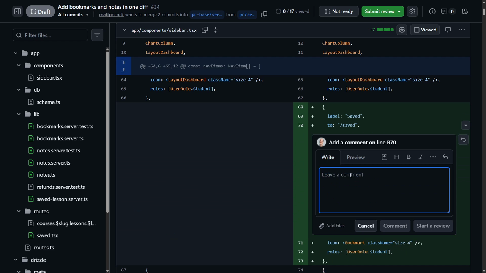

# Trying Out Retro

<CommitMap packageManager="npm">
  <Commit id="add-retro-skill">Start the lesson: the `/retro` skill is added and PR #34 (Bookmarks and Notes) is ready to review</Commit>
  <Commit id="coding-standards-comment-drift-rule">See my solution: new rules in `CODING_STANDARDS.md` produced by the retro</Commit>
</CommitMap>

<Prerequisites title="Crash Course Prerequisites">
  <Prerequisite href="https://www.aihero.dev/workshops/ai-coding-crash-course/sessions-and-the-context-241f60ee">
    What a session is, since `/retro` reads every session behind the PR.
  </Prerequisite>
  <Prerequisite href="https://www.aihero.dev/workshops/ai-coding-crash-course/statelessness-1fdb45c1">
    Why a lesson only sticks once it's written into the codebase, not left in the agent's memory.
  </Prerequisite>
  <Prerequisite href="https://www.aihero.dev/workshops/ai-coding-crash-course/the-teach-skill-e965c8c0">
    How to use `/teach` to understand code you're reviewing but didn't write.
  </Prerequisite>
  <Prerequisite href="https://www.aihero.dev/workshops/ai-coding-crash-course/enforcing-your-coding-standards-f1656d67">
    What coding standards are for, which is where retro's rules end up.
  </Prerequisite>
</Prerequisites>

The code review fixed the problems it found in the Bookmarks and Notes PR. But a fix only fixes things once. The habit that produced those problems is still there.

That's what `/retro` is for. In this exercise, you'll do a brief [human review](https://www.aihero.dev/ai-coding-dictionary/human-review) of the PR, focused on process rather than implementation. Then you'll run `/retro` over every [session](https://www.aihero.dev/ai-coding-dictionary/session) that led to it, and see what it suggests.

## Steps To Complete

### Do A Brief Human Review

- [ ] Open the PR in GitHub and read through the diff

Even if you're not a domain expert, use this as an opportunity to understand what the code is doing. If you have questions about it, ask the `/teach` [skill](https://www.aihero.dev/ai-coding-dictionary/skill).



- [ ] Leave line comments on anything that looks like it could become a rule

Remember, we're not reviewing for this one PR. We're looking for things that can go into coding standards, so you never have to make the same comment twice.

- Good: a comment that describes a pattern or a rule
- Not so good: a comment that's focused on one specific implementation detail

If a comment is too code and implementation focused, delete it.

### Run Retro

- [ ] Copy the number of your PR

- [ ] Run `/retro` in a fresh [agent](https://www.aihero.dev/ai-coding-dictionary/agent) session, pointing it at all the sessions that went into the PR, and ask it to grab the PR comments too

Replace `<pr-number>` with your own PR number:

```
/retro all the sessions that went into creating #<pr-number>. Grab all the PR comments too.
```

Because you left your comments in GitHub, the agent can read them locally.

- [ ] Read through the candidates that retro presents

See what it picked up from your comments and from the sessions themselves. Look for anything it suggests turning into coding standards.