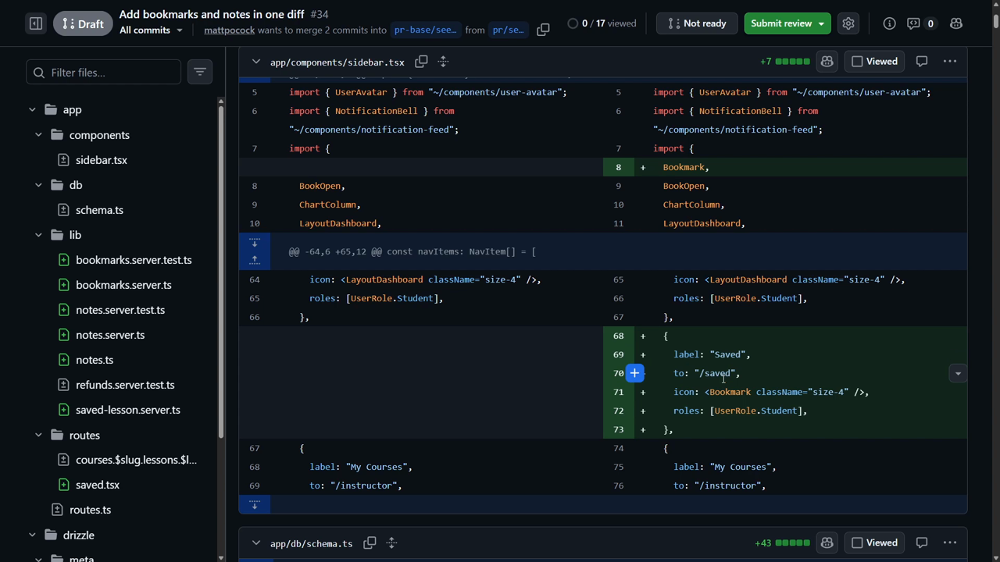
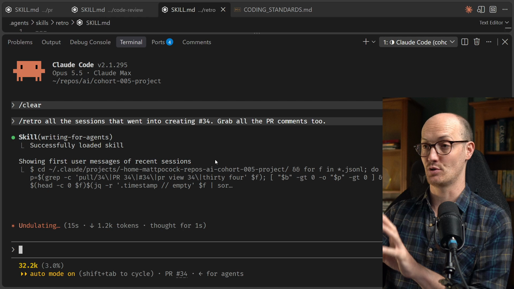
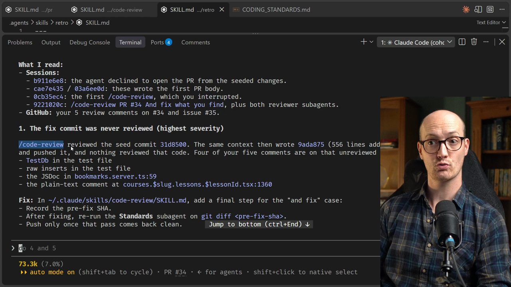
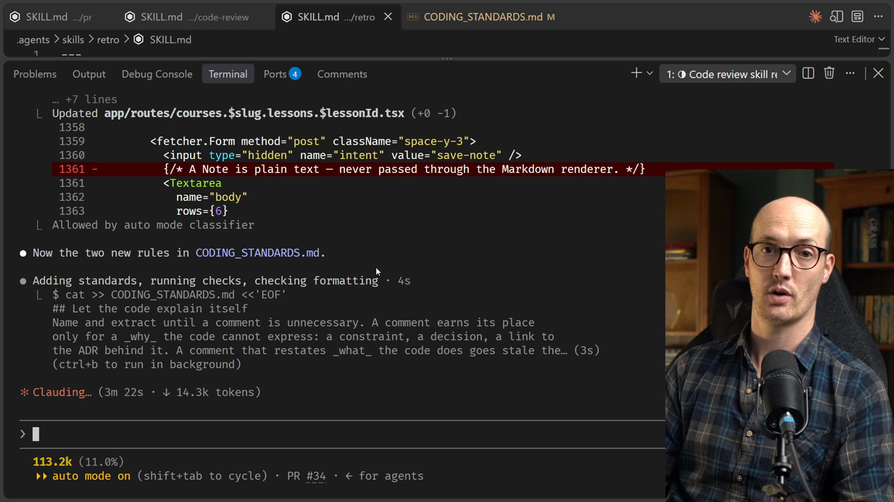
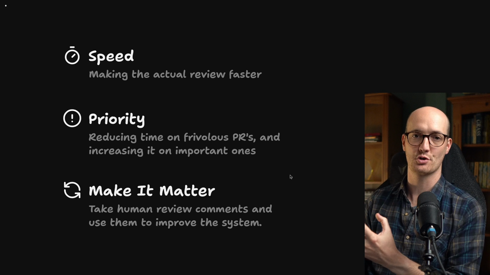

# Trying Out Retro Solution

<CommitMap packageManager="npm">
  <Commit id="add-retro-skill">Start the lesson: the `/retro` skill is added and PR #34 (Bookmarks and Notes) is ready for human review</Commit>
  <Commit id="coding-standards-comment-drift-rule">See my solution: two new rules in `CODING_STANDARDS.md`, banner comments removed, one shared `TestDb` type and branded `Markdown` / `PlainText` types</Commit>
</CommitMap>

## Reviewing UI labels and test setup

Time for a proper [human review](https://www.aihero.dev/ai-coding-dictionary/human-review). I'm going to leave comments on the PR in a way that can easily be turned into coding standards later.

The first thing I'm looking at is the sidebar component. There's a label of `Saved` that goes to the bookmark page.

```tsx
{
  label: "Saved",
  to: "/saved",
  icon: <Bookmark className="size-4" />,
  roles: [UserRole.Student],
},
```



Stuff in the sidebar shouldn't say "Saved". It should say the actual name of the feature it goes to. `Saved` doesn't obey our glossary. Anything in the UI should use terms from our glossary, like bookmarks or notes. So I'll comment that.

Going further down, in `bookmarks.server.test.ts`, I can see a `TestDb` type being created. This should live somewhere more global, so I'll comment on that too.

```ts
type TestDb = ReturnType<typeof createTestDb>;
```

There's also something I don't like inside the `beforeEach` block. The tests are set up without using actual functions from our module. They use the database directly, raw.

```ts
beforeEach(() => {
  db = createTestDb();
  base = seedBaseData(db);

  const module = db
    .insert(schema.modules)
    .values({ courseId: base.course.id, title: "Basics", position: 1 })
    .returning()
    .get();
```

Whenever you're doing setup for tests, you should be able to do it through the known functions of that module, not by calling the database raw.

That way, if we ever want to swap out how we contact the database, our tests largely won't be affected.

These are my opinions, based on how I've written code in the past. It makes sense to pass them to the [agent](https://www.aihero.dev/ai-coding-dictionary/agent), to at least give it an idea.

## Comments and branded types feedback

Next, a comment I'd prefer not to exist.

```ts
/** The Student's Bookmarks, newest first, each with its Lesson and Course. */
export function listBookmarks(db: Db, studentId: number) {
```

Comments like this can very quickly go out of date with the code itself. I'd much prefer the code itself be made more obvious. I find it really annoying when a comment just explains what a quite simple function does.

Now I'll show off a little domain expertise. We should differentiate in the type system between plain text and Markdown. That way every function knows what to expect, and we get more helpfulness from the type system.

Branded types are fun. I used to teach TypeScript, and I suppose I still am a TypeScript expert, so I've got to flex those muscles where I can.

I'm pretty happy with that. I've left four or five comments, which seems fine to me.

## Running retro on the PR sessions

Now let's run retro on all the [sessions](https://www.aihero.dev/ai-coding-dictionary/session) that went into creating the PR.

```
/retro all the sessions that went into creating #<pr-number>
```



One thing retro does is immediately load up the `/writing-for-agents` [skill](https://www.aihero.dev/ai-coding-dictionary/skill). That skill tells it how to design good skills, how to write in `AGENTS.md`, and how to judge the things it sees in the repo. So it's very important [context](https://www.aihero.dev/ai-coding-dictionary/context).

It found all six sessions behind the PR:

- One creating the PR.
- One writing its body.
- The code review and fix runs.

Those sessions include the [sub-agents](https://www.aihero.dev/ai-coding-dictionary/subagent) spawned by `/code-review`, so retro can look at sub-agents too. It's also looking at my PR comments and inspecting the code they point at.

Retro is pretty spendy on [tokens](https://www.aihero.dev/ai-coding-dictionary/token), because it has to review a lot of information to figure out what to do.

When you run retro over many sessions, say 25, it's good to batch the work into sub-agents. Tell it to use four or five sub-agents to go and look at those transcripts.

Okay, it's gone through and returned a big bunch of stuff. That's the retro.

## Judging the retro report

When you read a retro report, bear in mind that some things in it the agent will get wrong.

A lot of people ask me why I don't just have retro apply its own fixes without me reviewing them. It turns out retro can get itself into a weird loop. It endlessly tries to improve things, and ends up in a worse situation.



For instance, the first item says something true, but not as bad as it thinks. We ran code review to find some fixes and then fixed them, but we didn't run code review again.

Its proposed fix is to change the `/code-review` skill itself, adding a final step that reruns the standards check once the fixes have gone in.

In my opinion, that's a little bit too hardcore. You could certainly try it, and maybe it's a good idea, but for me it's okay.

Retro is still cool, though. It suggests things that might improve my process over time.

## Missing preferences and coding standards

Number two is that my preferences aren't written down, and the existing code teaches the opposite.

My PR comments include "make the code obvious instead of commenting". But the agent copied a project convention: a big banner header in a bunch of server modules. The fix commit even added 32 extra comment lines.

```ts
// ─── Bookmarks ───
// A Student's flag on a Lesson, so they can find it again. One per Student per
// Lesson, enforced by a unique index. See GLOSSARY.md for the language.
//
// Every function takes the database first, so tests can hand in an in-memory
// one. Uses positional parameters (project convention).
```

So our [automated review](https://www.aihero.dev/ai-coding-dictionary/automated-review) wasn't aligned with the kind of code I like to see.

Another comment was "set up tests through the module's own functions". A bunch of tests just call `db.insert(schema.…)` directly.

The report says both are judgement calls, so they belong in `CODING_STANDARDS.md`. Here's its suggested wording:

```md
## Let the code explain itself
Name and extract until a comment is unnecessary. A comment earns its place
only for a *why* the code cannot express.

## Arrange tests through the module under test
Test setup calls the module's own functions. When the function you need
doesn't exist, add it to the module rather than inserting rows directly.
```

I'd actually go further on the first rule. If the code can't express the why, you probably need an ADR, not a comment. But I'm fine with this rule.

It's also suggesting I add something from Martin Fowler's book that didn't make its way into my `/code-review` skill. That's quite funny.

And it says we should delete the banner comments from the five modules. Otherwise every new module copies them, and the reviewer keeps flagging code the implementer was right to imitate.

So we should update the coding standards, but also update the code, so the implementer copies good stuff.

## Choosing which fixes to apply

I've told the agent to ignore its recommendation for number one. I don't want any changes to the `/code-review` skill. Everything it suggested for number two is good.

We could go through every item and fix them all. There are certainly some good ideas in there. But to keep this lesson relatively short, I'll implement just number two.

Number five might be a good idea too. Number six as well, since that's the cool thing I said about branded types.

```
I'm going to ignore your recommendation for number one. I don't want any changes to the code review skill. But everything you've suggested in number two is good. Implement number five and six as well. Leave the rest undone.
```

Let's see what happens.

## The agent implements the changes

First it adds the branded types. It creates a new file with two of them:

```ts
declare const textFormat: unique symbol;

export type Markdown = string & { readonly [textFormat]: "Markdown" };
export type PlainText = string & { readonly [textFormat]: "PlainText" };

export function markdown(text: string): Markdown {
  return text as Markdown;
}

export function plainText(text: string): PlainText {
  return text as PlainText;
}
```

The schema columns then get marked with the right type. This comment body is specifically marked as Markdown, and the note body as plain text.

```diff
-    body: text("body").notNull(),
+    body: text("body").$type<Markdown>().notNull(),
```

```diff
-    body: text("body").notNull(),
+    body: text("body").$type<PlainText>().notNull(),
```

Now it implements number five, one shared test DB type. That shouldn't take very long.

```diff
-import { createTestDb, seedBaseData } from "~/test/setup";
+import { createTestDb, seedBaseData, type TestDb } from "~/test/setup";
...
-type TestDb = ReturnType<typeof createTestDb>;
```

Then it removes the module banner comments. Yep, all those comments are gone.

```diff
-// ─── Bookmarks ───
-// A Student's flag on a Lesson, so they can find it again. One per Student per
-// Lesson, enforced by a unique index. See GLOSSARY.md for the language.
-//
-// Every function takes the database first, so tests can hand in an in-memory
-// one. Uses positional parameters (project convention).
-
 export type Db = BetterSQLite3Database<typeof schema>;
```

Finally it adds the two new rules to `CODING_STANDARDS.md`.



Next time we run a code review, we'll have a `CODING_STANDARDS.md` that better reflects what we're trying to achieve.

And there we go, we have the final summary of everything that was done.

## Why retro powers human review

Retro is honestly one of the most powerful skills in my toolkit.



It really changes the calculation on whether you should do human review, and how much of it.

I find myself quite excited about human review now, because I know it matters. It's going to power up the automated review.

There's more. If a coding session goes wrong and a bug gets created, I can run retro on that session to make sure it doesn't happen again.

I hope you're as excited about the retro skill as I am. Nice work, and I'll see you in the next one.

<Quiz>
  <QuizQuestion data={{
    id: "retro-apply-fixes-judgement",
    question: "A retro report proposes five fixes. One of them adds a heavy extra step to your code review skill that you think is overkill. What do you do?",
    type: "multiple-choice",
    choices: [
      { answer: "a", label: "Let retro apply every fix so its loop can settle on its own" },
      { answer: "b", label: "Read the report, and tell the agent which fixes to skip" },
      { answer: "c", label: "Discard the whole report because one fix was wrong" },
      { answer: "d", label: "Apply the heavy step anyway, then remove it if it hurts" }
    ],
    correct: "b",
    answer: "Retro is suggesting, not deciding. Some of its findings are true but overstated, so you review the report and pick what to apply. Letting it apply everything risks an endless improvement loop that ends up worse off. Throwing the report away loses the good items, like the coding standards rules. Applying the step on spec just adds process you already judged too hardcore."
  }} />
  <QuizQuestion data={{
    id: "retro-unwritten-preference-source",
    question: "Your PR comments ask for code that explains itself instead of comments, yet the agent keeps adding banner comments to new modules. Retro finds banners already in five existing modules. Where does the fix belong?",
    type: "multiple-choice",
    choices: [
      { answer: "a", label: "Add a rule to the standards and delete the copied banners" },
      { answer: "b", label: "Only add a rule to the standards and leave the banners" },
      { answer: "c", label: "Only delete the banners and leave the standards alone" },
      { answer: "d", label: "Keep leaving the same PR comment on each new module" }
    ],
    correct: "a",
    answer: "The preference was never written down, and the existing code teaches the opposite. A rule alone still leaves the agent copying the banners, and deleting them alone leaves the preference unwritten for the reviewer. Repeating the PR comment never reaches the system that produces the code."
  }} />
</Quiz>
