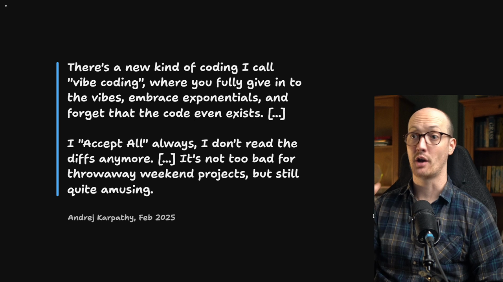
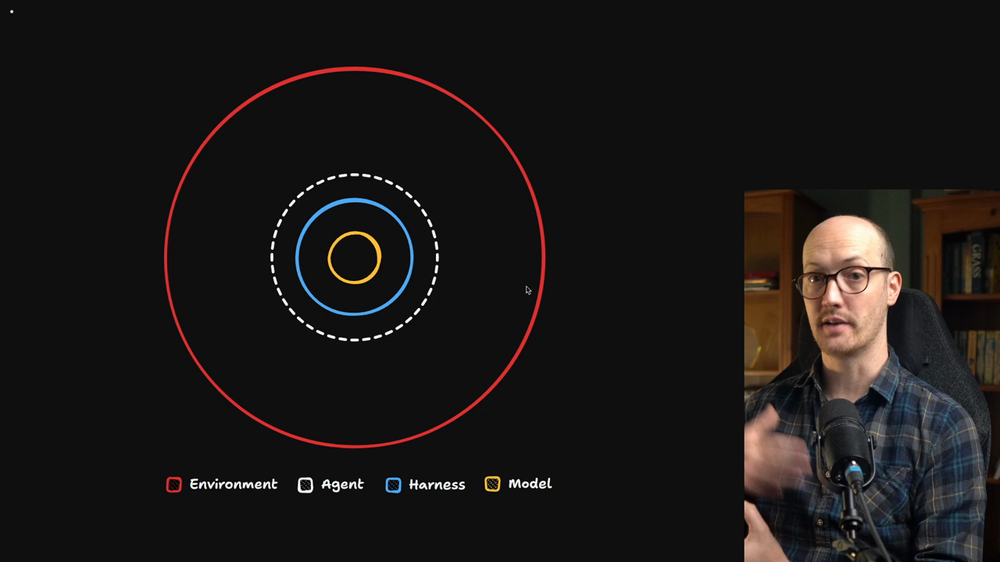
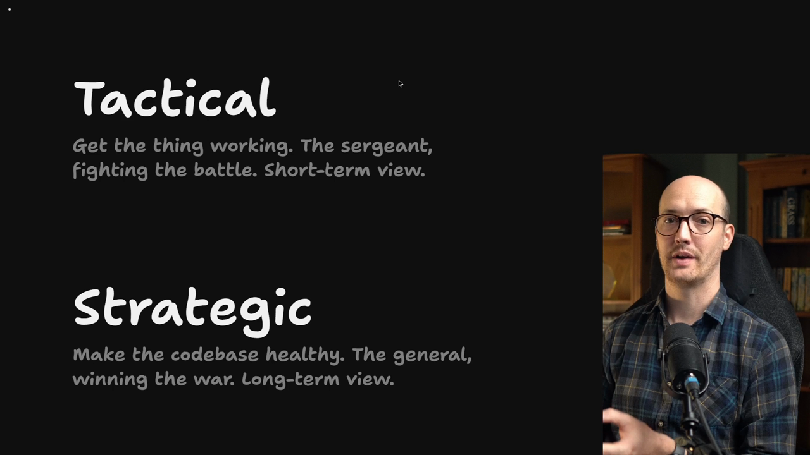
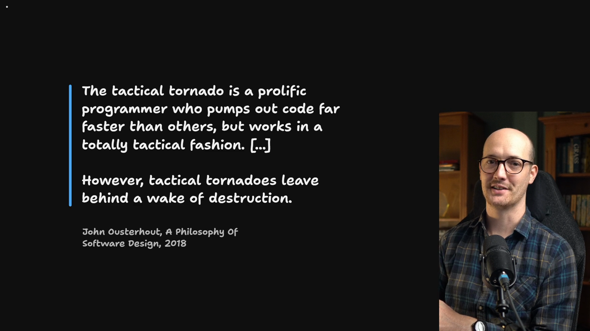

# Rescuing A Legacy Codebase

<Prerequisites title="Crash Course Prerequisites">
  <Prerequisite href="https://www.aihero.dev/workshops/ai-coding-crash-course/models-harnesses-agents-environments-2b9a99a1">
    What a model, harness, agent and environment are, so you can see why your codebase is the agent's environment.
  </Prerequisite>
  <Prerequisite href="https://www.aihero.dev/workshops/ai-coding-crash-course/build-a-feature-4e7fc274">
    What vibe-coded code looks like and why it ships bugs, which is the codebase you're rescuing.
  </Prerequisite>
  <Prerequisite href="https://www.aihero.dev/workshops/ai-coding-crash-course/enforcing-your-coding-standards-f1656d67">
    What an automated check is, and why it's the cheapest way to enforce a standard.
  </Prerequisite>
</Prerequisites>

Imagine you have been [vibe coding](https://www.aihero.dev/ai-coding-dictionary/vibe-coding), or you have received a codebase that was vibe coded.

The code mostly works. Maybe it has been deployed and people are using it. But you're a little bit scared of it.

### Karpathy's definition

Andrej Karpathy's original definition runs like this:

> There's a new kind of coding I call "vibe coding", where you fully give in to the vibes, embrace exponentials, and forget that the code even exists. [...] I "Accept All" always, I don't read the diffs anymore. [...] It's not too bad for throwaway weekend projects, but still quite amusing.

Note the last line: it's fine for throwaway weekend projects.

In many organizations, though, vibe coding has become the way they produce software. You give in to the vibes, and you trust that the [agent](https://www.aihero.dev/ai-coding-dictionary/agent) is good enough to handle it on its own.

In my experience, having worked in these codebases and produced quite a few myself, they tend to be disastrous to work in.

## The Codebase Is Your Agent's Environment

The reason is pretty simple. We looked at this diagram in the crash course. It's how I define [model](https://www.aihero.dev/ai-coding-dictionary/model), [harness](https://www.aihero.dev/ai-coding-dictionary/harness), agent and [environment](https://www.aihero.dev/ai-coding-dictionary/environment).

- The **model** and the **harness** working together create the **agent**.
- The agent operates within some kind of **environment**.

Depending on how the harness is deployed, that environment might be a relatively sterile, online one. Or it might have access to your entire file system.

With a coding agent, your codebase is the environment it operates in:

- The code it sees within the codebase
- The data it has access to
- The tests it can run
- The typechecking
- The [automated checks](https://www.aihero.dev/ai-coding-dictionary/automated-check)

If your environment has been created without any care, the agent is going to have a tough time working.

## Complexity and Easy-to-Change Code

Early in 2026, I got hooked on improving my agent's environment. I got amazing results, especially by following the ideas in *A Philosophy of Software Design* by John Ousterhout.

He focuses on defining complexity in a codebase. Essentially, a bad codebase is a complex codebase.

> Complexity is anything related to the structure of a software system that makes it hard to understand and modify the system.

In other words, a good codebase is one that is easy to change.

A codebase that is hard to change is one where the agent makes a change in one place and gets strange ripple effects it can't predict elsewhere.

A good codebase is predictable, easy to modify and easy to understand.

## Tactical vs Strategic Programming

So how do we make our codebases easy to change and easy to understand? Again, I'm going to steal from John. We have two activities when we're programming:

| | Tactical | Strategic |
| --- | --- | --- |
| Goal | Get the thing working | Make the codebase healthy |
| Analogy | The sergeant, fighting the battle | The general, winning the war |
| View | Short-term | Long-term |

Tactical programming is the sergeant on the ground fighting the battle. It's making the changes that fix the bug, ship the feature or get the test passing.

In other words, it's typing out the code, verifying it, and making sure the thing you're building actually functions.

Strategic programming is making the codebase healthy over the long term. It's the general trying to win the war, not just the battle.

### Working with humans

When we worked with humans rather than agents, you would do a bit of a mix of both whenever you made a change.

You'd think tactically about how your code would fix the thing or build the feature. Hopefully you'd also think about the future, and the next change you'd have to make.

### Tactical tornadoes

Not all developers worked that way. According to John, some were *tactical tornadoes*.

> The tactical tornado is a prolific programmer who pumps out code far faster than others, but works in a totally tactical fashion. [...] However, tactical tornadoes leave behind a wake of destruction.

That was written in 2018, but it could have been written yesterday about how agents operate inside codebases.

Agents are tactical tornadoes. They work tirelessly and can produce endless amounts of code, but they don't think strategically.

An agent thinks tactically because it only sees the task in front of it. It doesn't think to ask whether the codebase is getting worse, because it isn't really designing anything.

### Benchmarks measure tactics

Look at leaderboards like the one for the most efficient model on the DeepSWE benchmark. They aren't measuring strategic programming. They're measuring tactical programming.

They ask: did the agent complete the task? They don't ask: did the codebase get better or worse after it completed it?

## You Take the Strategic Burden

If we want the agent's environment to get better over time rather than worse, someone has to take on the strategic work. That person is you.

You now have access to 100 tactical programmers you can deploy in an instant. Those programmers need someone to think strategically for them.

Otherwise you'll end up with a vibe-coded codebase that is very difficult for your agents to operate in.

You might be there already. If so, I'm going to show you how to get out of it.

<Quiz>
  <QuizQuestion data={{
    id: "agents-are-tactical-tornadoes",
    question: "Left to work on their own, why do agents tend to make a codebase worse over time?",
    type: "multiple-choice",
    choices: [
      { answer: "a", label: "They see only the task, so they program tactically" },
      { answer: "b", label: "They can't read code that other agents wrote" },
      { answer: "c", label: "They refuse to touch code they didn't write" },
      { answer: "d", label: "They over-plan and rarely finish the task" }
    ],
    correct: "a",
    answer: "Agents are tactical tornadoes: they work tirelessly and produce endless code, but they only see the task in front of them and don't ask whether the codebase is getting worse. They can read and change any code, and the problem is the opposite of over-planning: they finish the task without thinking strategically."
  }} />
  <QuizQuestion data={{
    id: "complexity-hard-to-change",
    question: "Your agent changes one file and things break elsewhere in ways it couldn't predict. What does that tell you about the codebase?",
    type: "multiple-choice",
    choices: [
      { answer: "a", label: "It's complex: hard to understand and modify" },
      { answer: "b", label: "It needs a more capable model working in it" },
      { answer: "c", label: "It has too many tests for the agent to run" },
      { answer: "d", label: "Nothing: ripple effects are just normal" }
    ],
    correct: "a",
    answer: "Complexity is anything in a system's structure that makes it hard to understand and modify, and a good codebase is predictable and easy to change. Unpredictable ripple effects mean the agent's environment is the problem, which a better model doesn't fix. Tests help an agent rather than hurt it, and ripple effects are a sign of a bad codebase, not a normal one."
  }} />
  <QuizQuestion data={{
    id: "strategic-burden-on-you",
    question: "You can now deploy many agents on your codebase at once. Who should do the strategic programming?",
    type: "multiple-choice",
    choices: [
      { answer: "a", label: "You, because the agents only think tactically" },
      { answer: "b", label: "An agent dedicated to reviewing every PR" },
      { answer: "c", label: "Nobody, since the agents top the benchmarks" },
      { answer: "d", label: "Whichever model has the top benchmark score" }
    ],
    correct: "a",
    answer: "If the agent's environment is going to get better rather than worse, someone has to take on the strategic work, and that person is you. Benchmarks measure tactical programming, whether the task got done, not whether the codebase got better, so a high score doesn't mean a model thinks strategically, and an agent reviewing PRs is still only looking at the task in front of it."
  }} />
</Quiz>
