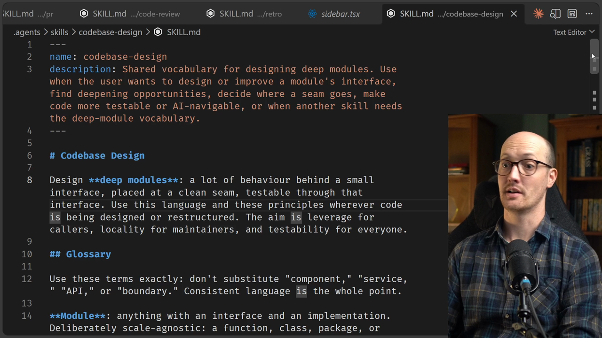
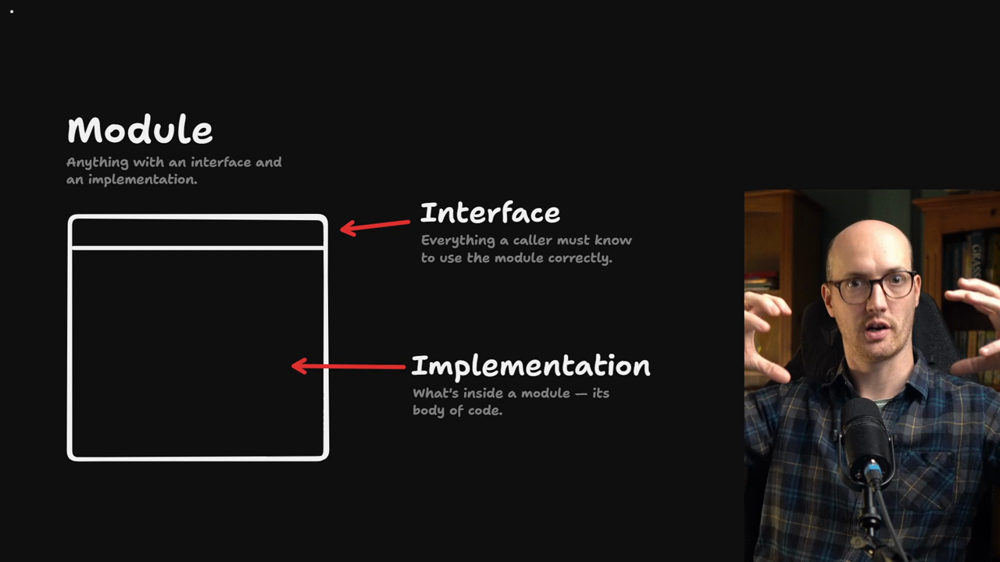
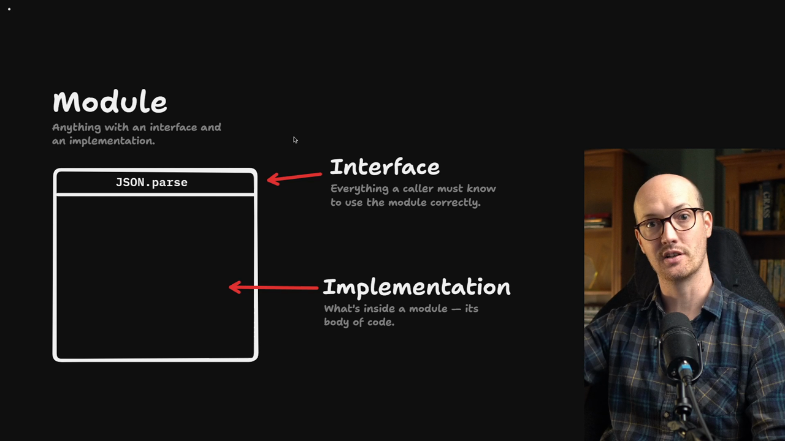
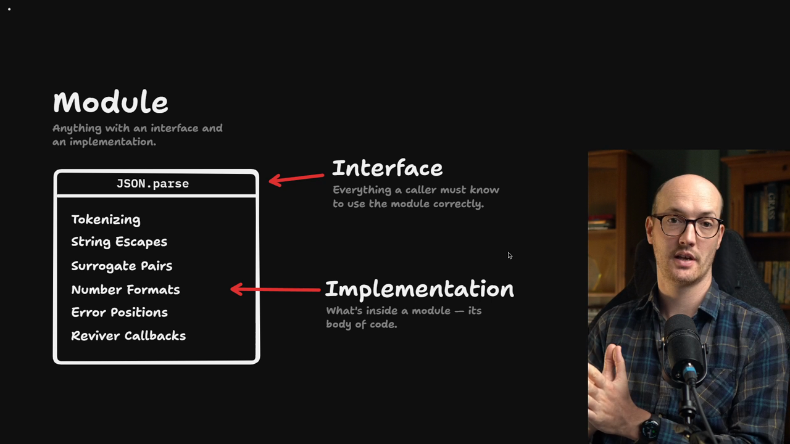
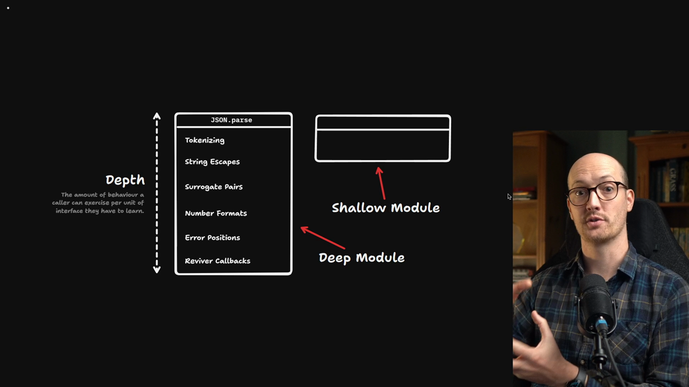
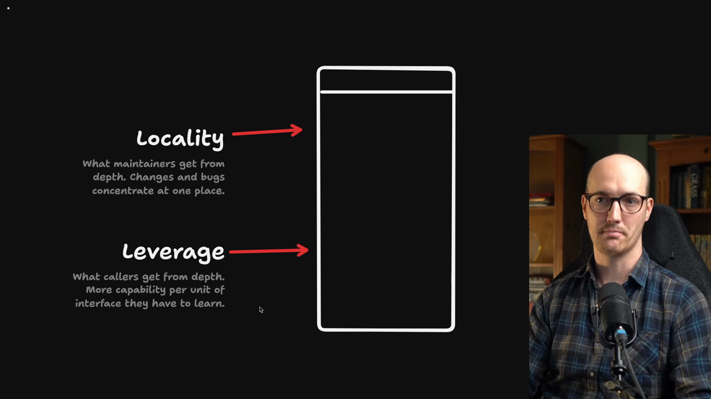
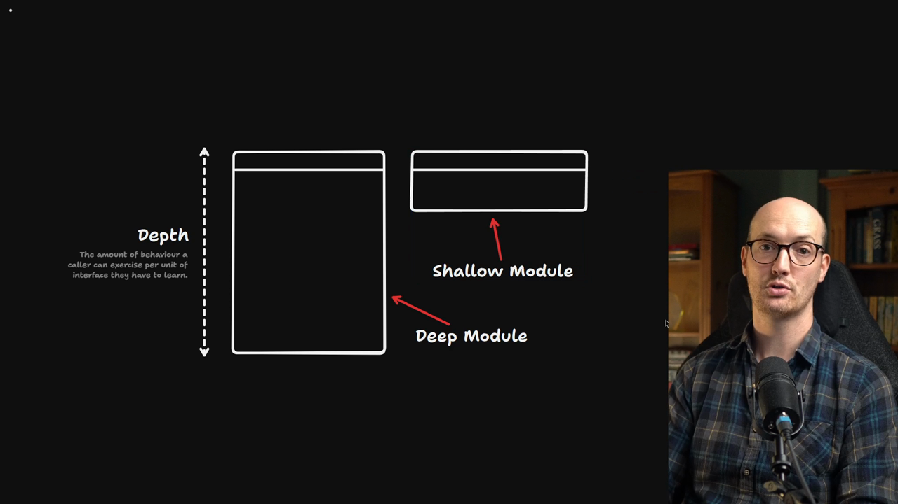

# A Language For Good Codebases

<Prerequisites title="Crash Course Prerequisites">
  <Prerequisite href="https://www.aihero.dev/workshops/ai-coding-crash-course/how-to-run-the-exercises-a0eb0474">
    How `npm run reset` jumps your repo to the lesson's starting commit.
  </Prerequisite>
  <Prerequisite href="https://www.aihero.dev/workshops/ai-coding-crash-course/models-harnesses-agents-environments-2b9a99a1">
    What an agent's environment is, the thing good codebase design improves.
  </Prerequisite>
  <Prerequisite href="https://www.aihero.dev/workshops/ai-coding-crash-course/what-are-agent-skills-20f91a4e">
    What a skill is and how you invoke one like `/codebase-design` yourself.
  </Prerequisite>
  <Prerequisite href="https://www.aihero.dev/workshops/ai-coding-crash-course/executing-your-tickets-8389d87c">
    Why tests are the agent's feedback loop, and why more coverage makes changes safer.
  </Prerequisite>
</Prerequisites>

I want to start with a slightly off the wall question: should [agents](https://www.aihero.dev/ai-coding-dictionary/agent) write tests?


I see this argument pop up a lot on X. Essentially it says agents write a lot of bad tests, so maybe we should prevent them from writing tests at all.

I see what they're saying. Agents tend to write a lot of what I call tautological tests.

## Tautological tests

A tautology is where one statement essentially repeats another. This test just repeats the implementation above it.

There is a constant, `MAX_RETRIES`, equal to three. Then a test says "retries three times" and asserts that `MAX_RETRIES` is equal to three.

```ts
import { it } from "node:test";
import assert from "node:assert";

const MAX_RETRIES = 3;

it("retries three times", () => {
  assert.equal(MAX_RETRIES, 3);
});
```

The examples from this video are in [this gist](https://gist.github.com/mattpocock/d8d7da5ba2191eb3b63fa6586900c70b).

This is a terrible test because it isn't testing any behavior. It is just asserting the shape of the code.

We can imagine `MAX_RETRIES` being used in a function that actually retries things. We're not testing that function. We're only testing whether this little piece of configuration inside it is what we think it is.

## Blame the codebase, not the agent

Who do we blame for this test? Instead of blaming the agent for writing it, I think we should blame the codebase for allowing the test to be written.

If you can design a codebase that doesn't allow bad tests to be written, you're going to get good tests.


That is one of the main benefits of improving the [environment](https://www.aihero.dev/ai-coding-dictionary/environment) your agent works in through codebase design: we make bad tests impossible for the agent to write.

## The codebase design skill

You might be wondering what magical tool I'm going to present here. Of course, there is a [skill](https://www.aihero.dev/ai-coding-dictionary/skill) for that.

I've run `npm run reset` and reset the current branch to the `add-codebase-design-skill` commit.

```bash
npm run reset add-codebase-design-skill
```

If we head to `.agents/skills/codebase-design/SKILL.md`, we will see it.



The main thing the skill provides is a glossary for talking about codebase design.

One difficulty I've found when talking about codebases with agents is that they cherry pick from a bunch of different approaches. In one [session](https://www.aihero.dev/ai-coding-dictionary/session) your agent might start talking about hexagonal architecture. In another it might start talking about hardcore DDD concepts.

The idea of this skill is that it locks you into a set of terms. I'm pretty proud of this set. They're not usually my terms, they're just nicked from other people's.

Understanding the glossary helps in two ways:

- You can interact with the `/codebase-design` skill more profitably and understand what it's telling you.
- The process of understanding the terms means you probably also understand what good codebase design is.

Once you understand what **module**, **interface**, **implementation**, **depth**, **seam**, **adapter**, **leverage** and **locality** are, you understand the whole picture. Then you'll be able to design codebases that set your agent up for success.

Let's start with the first three: module, interface and implementation.

## Module, interface and implementation

Codebases are almost always organized into chunks, individual bits inside the codebase. It's very rare to get a codebase that is one single chunk.



These chunks are what I'm going to call **modules**: things inside the codebase that usually talk to each other.

Each module is composed of two parts, the **interface** and the **implementation**.

| Term           | Meaning                                                   |
| -------------- | --------------------------------------------------------- |
| Module         | Anything with an interface and an implementation          |
| Interface      | Everything a caller must know to use the module correctly |
| Implementation | What's inside a module, its body of code                  |

### The interface, using `JSON.parse`

The interface is everything that a caller, a user of that module, needs to know in order to use it correctly.

Take `JSON.parse`. The caller needs to know that they pass it some JSON and it turns it into a JavaScript object.

They should also know that if they call it with something that isn't valid JSON, it throws an error.



### The implementation

The implementation is everything the function needs to do to fulfill its purpose: the stuff actually inside the module, its body of code.

`JSON.parse` does an awful lot in there:

- Tokenizing
- String escapes
- Surrogate pairs
- Number formats
- Error positions
- Reviver callbacks

All of that is hidden behind a relatively simple interface.



`JSON.parse` is what I'd describe as a good module. It hides a lot of implementation inside a very small interface.

## Depth

How do we define what a good or bad module is? For that we use the concept of **depth**.

`JSON.parse` is a deep module. The person calling it hardly has to learn anything, and you get all of this incredible behavior just by calling it.

The bang for your buck is immense. Or as John Ousterhout puts it, depth is the amount of behavior a caller can exercise per unit of interface they have to learn.



You hardly have to learn anything and you get loads of value.

## Shallow vs deep modules

So what does a shallow module look like, a module without a lot of depth? Let's look at some code.

Imagine we have a git module. For some reason our codebase needs to touch git, and this module exposes a bunch of functions in its interface.

It has `ensureIsGitRepo`, then `fetch`, then `merge`, all of which just call their underlying commands.

```ts
// shallow-git.ts
import { execSync } from "node:child_process";

const git = (command: string) => execSync(`git ${command}`);

export const shallowGit = {
  ensureIsGitRepo: () => git("rev-parse"),
  fetch: () => git("fetch"),
  merge: () => git("merge"),
};

// Every caller has to learn all three, in the right order:
function shallowCaller() {
  shallowGit.ensureIsGitRepo();
  shallowGit.fetch();
  shallowGit.merge();
}
```

That means the caller needs to learn all three, and needs to call them in the right order every time.

Now look at the other file, `deep-git.ts`. It has a single interface: one function called `pull`.

It checks that the repo is an actual repo, then fetches, then merges.

```ts
// deep-git.ts
import { execSync } from "node:child_process";

const git = (command: string) => execSync(`git ${command}`);

export const deepGit = {
  pull: () => {
    git("rev-parse");
    git("fetch");
    git("merge");
  },
};

// The caller only needs to remember pull:
function deepCaller() {
  deepGit.pull();
}
```

So the caller only needs to remember one function, and they just call `pull`.

## Leverage

It benefits the caller of a module to make your modules deeper. In the codebase design skill, this is called **leverage**: the caller gets more leverage by using deep modules.

With shallow modules, the caller gets almost no leverage. They're just calling shallow functions that pass straight through to the underlying implementation.

Leverage matters more the more times a module is used in the codebase.

If you have 12 shallow callers, eventually the agent is going to get the calls in the wrong order and screw things up. With a deep module, every call behaves exactly the same way.

## Locality



Leverage is the first benefit of deep modules, and it's what callers get. **Locality** is what maintainers get. Agents in the codebase like deep modules more than shallow ones.

Say you want to change the way pulls happen in this repo. You don't have to go through all the callers, modifying this one, then this one. You modify one place: the canonical function that is the implementation of how we do it.

With a deep module, the order of the calls and the behavior all live in one place. You fix it once and it is fixed for every caller. That is locality.

## You can forget the implementation

There's one more benefit. With a deep module, you can forget what's inside the implementation and just go with the interface.

Because the implementation is hidden and you get such high leverage from calling the module, you can forget all the things the module is handling for you.

Apply that to a whole codebase made of deep modules. How much of it do you need to keep in your head?

Usually it's just the interfaces you're calling. You don't have to think about the whole implementation.

If you're working inside one of those modules, then sure, keep its implementation in your head. Once you're done, go back to using the interface.

Designing your codebase this way benefits two parties:

- **Your agent**, which only has to remember the interfaces, not the implementations.
- **You**, because you hold less information in your head. You can work with the agent to design the interfaces, then delegate the implementations without thinking about them that hard.

## Back to tests

Finally, let's bring it back to tests.

With a shallow module like `shallow-git.ts`, you'd better believe the agent will write a test for every individual function on its own.

That makes sense. If we expose all these functions in our interface, we'd better make sure they all work individually.

But will the agent test that they all work together, in the way they're actually called? Maybe not. It might make sure every individual unit works, but not test the entire flow, which is what you actually want from your tests.

Maybe the way `fetch` works doesn't integrate well with the way `merge` works. There could be subtle bugs there because you haven't tested the whole flow together.

If you only have a deep module, the agent has no choice. It has to test the flows that you expose.

### Leverage works two ways

Not only do you get higher leverage in your application code that calls the module. Your tests become higher leverage too.

- Your codebase becomes organized into nice interfaces the agent can quickly understand.
- Your tests are higher leverage, so they test more of your app and catch more bugs. The codebase becomes easier to change.
- Your codebase gets higher locality, so things are easier to find. When the agent makes a change, it ripples out to more places, and more places benefit from the bug fix.

## Making bad tests impossible

In a good codebase, the `MAX_RETRIES` constant would not be available to test. It would be hidden inside a deep module behind an interface.

That's what I mean by making bad tests impossible. You hide more information inside modules, and then only good tests can be written.



Throughout this section, we're going to take the language we've established here and use it to make concrete adjustments that make our codebase better.

We're going to turn shallow modules into deep modules. We'll benefit from the extra leverage in our tests and our code, and from the locality that makes the codebase easier for our agents to navigate.

Nice work, and I'll see you in the next one.

<Quiz>
  <QuizQuestion data={{
    id: "deep-module-test-flows",
    question: "Your codebase has a git module exporting `ensureIsGitRepo`, `fetch` and `merge`, and the agent keeps writing one test per function. Which change most directly pushes it towards testing the real flow?",
    type: "multiple-choice",
    choices: [
      { answer: "a", label: "Tell the agent in your prompt to write integration tests instead" },
      { answer: "b", label: "Fold the three exports into a single `pull` function" },
      { answer: "c", label: "Stop the agent from writing tests so it can't write bad ones" },
      { answer: "d", label: "Rename the three exports so their purpose is clearer to the agent" }
    ],
    correct: "b",
    answer: "A deep module with one `pull` interface leaves the agent no choice but to test the flow you expose. A prompt instruction still leaves the individual functions available to test, so bad tests stay possible. Banning tests blames the agent rather than the codebase and loses the feedback loop. Renaming changes nothing about what is exposed."
  }} />
  <QuizQuestion data={{
    id: "leverage-vs-locality",
    question: "The order of git steps turns out to be wrong. With `pull`, you fix it in one place and every caller benefits. Which term names that benefit, and who gets it?",
    type: "multiple-choice",
    choices: [
      { answer: "a", label: "Leverage, which callers get from depth" },
      { answer: "b", label: "Depth, which the interface gets from the implementation" },
      { answer: "c", label: "Locality, which maintainers get from depth" },
      { answer: "d", label: "Seam, which tests get from adapters" }
    ],
    correct: "c",
    answer: "Locality is what maintainers get: changes and bugs concentrate in one place, so you fix it once and it is fixed for every caller. Leverage is the caller's benefit, more capability per unit of interface learned. Depth is the measure itself, not a benefit. Seam is a different term in the glossary and isn't what describes this fix."
  }} />
  <QuizQuestion data={{
    id: "tautological-test-cause",
    question: "The agent wrote a test that asserts `MAX_RETRIES` equals three. You want to stop this happening again. Where do you look first?",
    type: "multiple-choice",
    choices: [
      { answer: "a", label: "The agent, by forbidding it from writing any tests at all" },
      { answer: "b", label: "The test file, by deleting that one test by hand and moving on" },
      { answer: "c", label: "The codebase, by hiding the constant in a deep module" },
      { answer: "d", label: "The constant, by renaming it so the agent stops asserting on it" }
    ],
    correct: "c",
    answer: "The codebase allowed the test to be written because `MAX_RETRIES` was exposed. Hiding it behind a deep module's interface makes the bad test impossible. Forbidding tests removes good tests too. Deleting one test treats the symptom and the next one will appear. Renaming leaves the constant exposed."
  }} />
</Quiz>
