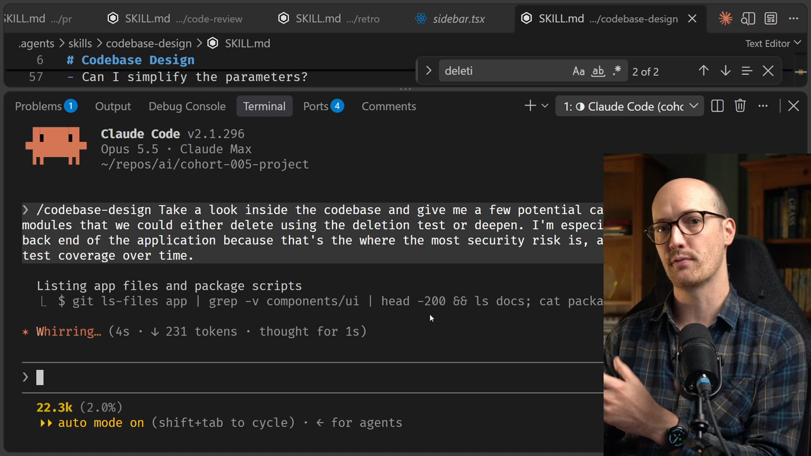
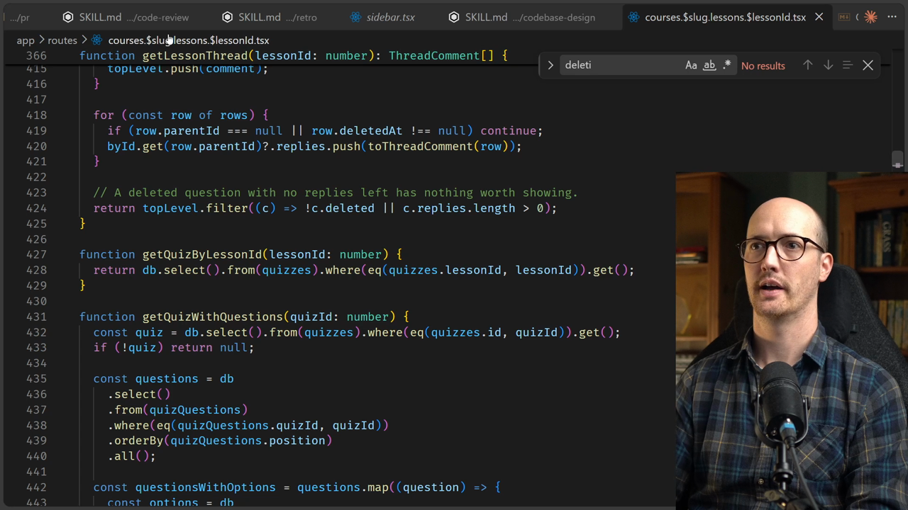
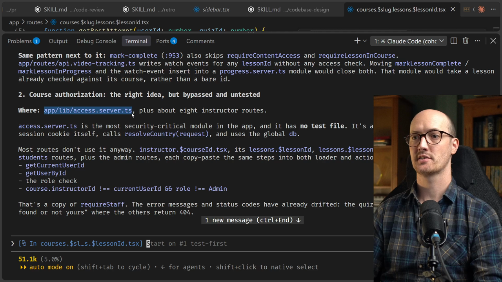
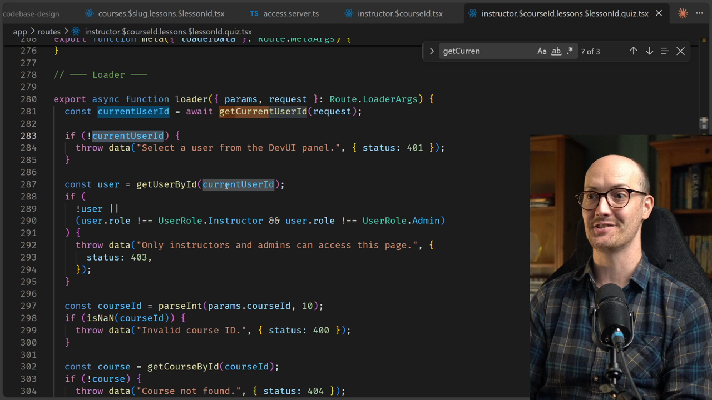
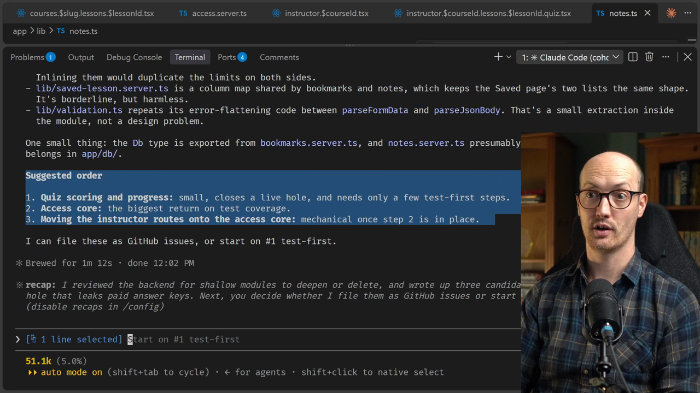
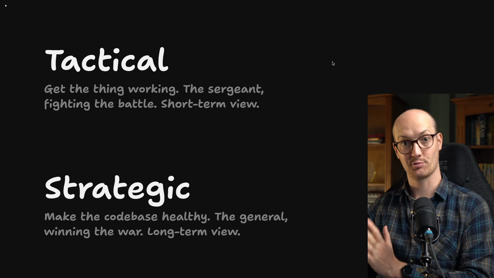

# Searching For Shallow Modules Solution

<CommitMap packageManager="npm">
  <Commit id="add-deep-modules-skills">Start the lesson: the vibe-coded app with the codebase design skills installed. This lesson changes no code.</Commit>
</CommitMap>

## Writing the prompt

So let's figure out what our prompt should be.

We want the [agent](https://www.aihero.dev/ai-coding-dictionary/agent) to take a look inside the codebase and find shallow modules. A shallow module is one we could either delete using the deletion test, or deepen.

```md
/codebase-design Take a look inside the codebase and give me a few potential candidates of shallow modules that we could either delete using the deletion test or deepen. I'm especially interested in the back end of the application because that's where the most security risk is, and I want to improve the test coverage over time.
```

I'm focusing on the back end because that's where the most security risk is, and I want to improve the test coverage over time.

You could focus it on the front end as well, but we don't have a great front end test suite inside this codebase yet. So I'm going to focus on the back end for now.



Interestingly, the agent isn't sending out a [subagent](https://www.aihero.dev/ai-coding-dictionary/subagent) here. It's just exploring on its own, and it has already come back with a list.

## Candidate 1: the mega file

Its first suggestion is a mega file, `app/routes/courses.$slug.lessons.$lessonId.tsx`.



There is a lot going on in this file, and a lot that I hate. There are plenty of `any` types, which are the agent's efforts to cheat the type system.

```ts
function computeResult(userId: any, quizId: any, selectedAnswers: any): any {
  // ...
}
```

The agent has also found some bugs. The `submit-quiz` action checks only that someone is signed in. It never checks whether they have access to the content.

```ts
if (intent === "submit-quiz") {
  const quizId = Number(formData.get("quizId"));
  if (isNaN(quizId)) {
    throw data("Invalid quiz ID", { status: 400 });
  }

  // ...collect selectedAnswers from the form...

  const result = computeResult(currentUserId, quizId, selectedAnswers);
  if (!result) {
    throw data("Failed to score quiz", { status: 500 });
  }

  return { quizResult: result };
}
```

It recommends that we deepen this into a new module with something like `submitQuizAttempt`.

The route then has only one line to write: `requireContentAccess` followed by `submitQuizAttempt`.

So in other words, this file looks basically disastrous.

## Candidate 2: `access.server.ts`

Its second recommendation is `app/lib/access.server.ts`.



It says this is the most security critical module in the app, and it has no test file. So nothing tests the most security critical thing.

It's also hard to test:

- It reads the session cookie itself.
- It calls `resolveCountry(request)`.
- It uses the global database.

```ts
export async function getAccess(
  request: Request,
  courseId: number
): Promise<Access> {
  const userId = await getCurrentUserId(request);
  if (!userId) return SIGNED_OUT;

  const user = getUserById(userId);
  // ...
  if (enrolled && !isStaff && course) {
    const purchase = findPurchase(userId, courseId);
    const currentCountry = await resolveCountry(request);
    // ...
  }
  // ...
}
```

### Most routes bypass it

In fact, most routes aren't even using it. Most of the instructor routes do the same steps themselves. They get the current user's `userId`, check the role, and then check that the user isn't an admin.

Here's an example. Inside the loader for `instructor.$courseId.tsx`, the `currentUserId` is grabbed by `getCurrentUserId`. It then does all of the authorization checks itself.

```ts
export async function loader({ params, request }: Route.LoaderArgs) {
  const currentUserId = await getCurrentUserId(request);

  if (!currentUserId) {
    throw data("Select a user from the DevUI panel to manage courses.", {
      status: 401,
    });
  }

  const user = getUserById(currentUserId);

  if (
    !user ||
    (user.role !== UserRole.Instructor && user.role !== UserRole.Admin)
  ) {
    throw data("Only instructors and admins can access this page.", {
      status: 403,
    });
  }

  // ...

  if (course.instructorId !== currentUserId && user.role !== UserRole.Admin) {
    throw data("You can only edit your own courses.", { status: 403 });
  }
```

If we look inside another route, we can see exactly the same thing. This is `instructor.$courseId.lessons.$lessonId.quiz.tsx`. It has a loader with a `currentUserId`, and it's loads of duplicated code.

```ts
export async function loader({ params, request }: Route.LoaderArgs) {
  const currentUserId = await getCurrentUserId(request);

  if (!currentUserId) {
    throw data("Select a user from the DevUI panel.", { status: 401 });
  }

  const user = getUserById(currentUserId);
  if (
    !user ||
    (user.role !== UserRole.Instructor && user.role !== UserRole.Admin)
  ) {
    throw data("Only instructors and admins can access this page.", {
      status: 403,
    });
  }

  // ...

  if (course.instructorId !== currentUserId && user.role !== UserRole.Admin) {
    throw data("You can only edit your own courses.", { status: 403 });
```



This is really bad locality. If we need to modify our rules for who can access what, we have to go into all of these different places to figure it out and fix it.

### The deletion test on the inline copies

The agent says this itself. Under the deletion test, the inline copies are what should go. Their complexity is already spread across N callers, and one missed copy means a hole.

"One missed copy means a hole" is horrendous agent speak. But what it means is that if there's a bug in this logic, we need to fix it everywhere.

So the access module definitely seems like something we should get to.

### The recommended deepening

It recommends we split `getAccess` into a thin adapter and a core function. The core function resolves access using the database, the `userId`, the `courseId` and the current country.

```ts
resolveAccess(db, userId, courseId, currentCountry)
```

## Small modules that pass the deletion test

It's given us another little list of small modules that actually do pass the deletion test.

For instance, in `lib/notes.ts` we have `MAX_NOTE_LENGTH`, which is used both on the front end and on the back end.

```ts
export const MAX_NOTE_LENGTH = 2000;
```

Deleting it would push that complexity back into the callers.

## Suggested order

It has also given us a suggested order for the fixes:

1. Start on the quiz ordering and the progress.
2. Then go for the access core, which is the biggest return on test coverage.
3. Then move the instructor routes onto the access core.



## Why this works

Hopefully this makes the terms from the previous lesson feel a bit more concrete. These are actual improvements that could massively improve our codebase for future agent runs.

The way we found them is really through language, through describing the codebase that we want. And the agent has started to find ways to improve it itself.



| | Strategic | Tactical |
| --- | --- | --- |
| Goal | Make the codebase healthy | Get the thing working |
| Role | The general, winning the war | The sergeant, fighting the battle |
| View | Long-term | Short-term |

In other words, we are starting to think strategically. Because we're thinking strategically, we're deploying our tactical agent to go around and look for improvements in the codebase.

## Over to you

I'm sure that your agent found different suggestions to mine. If you're confused about any of the language, go into the [Discord](https://www.aihero.dev/discord) and ask questions, and let's have a discussion about it.

Nice work, and I will see you in the next one.

