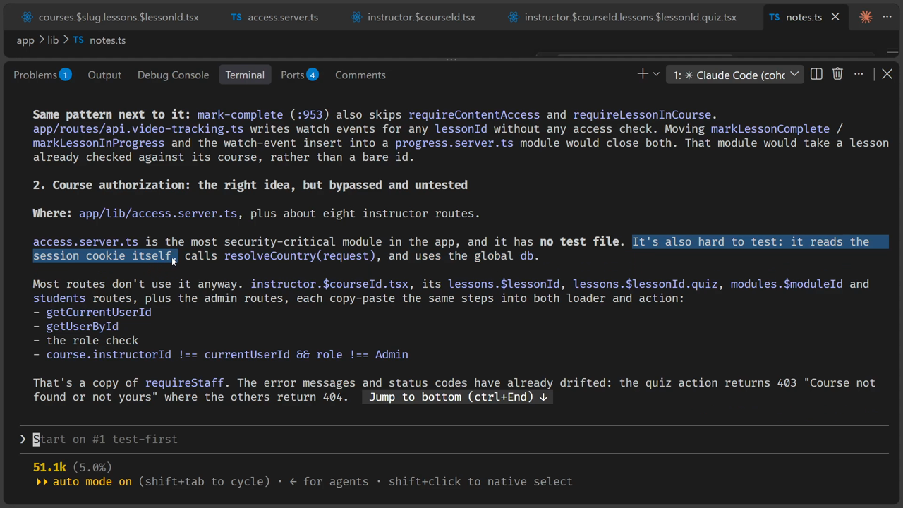
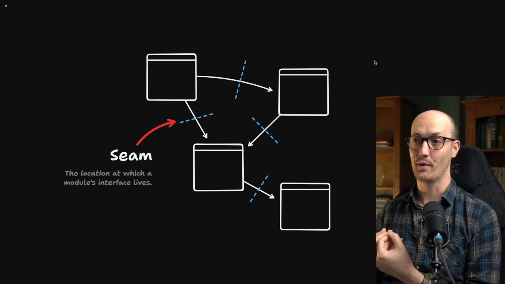
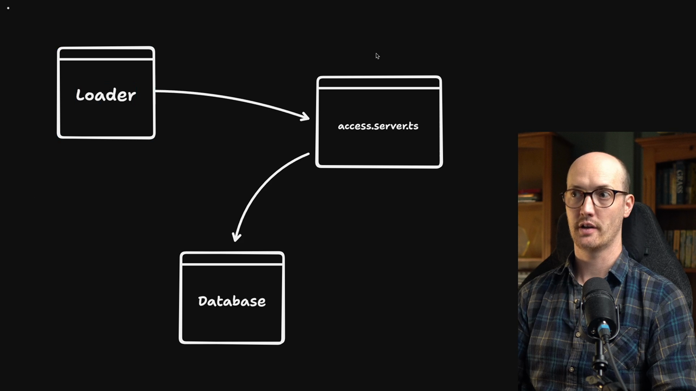
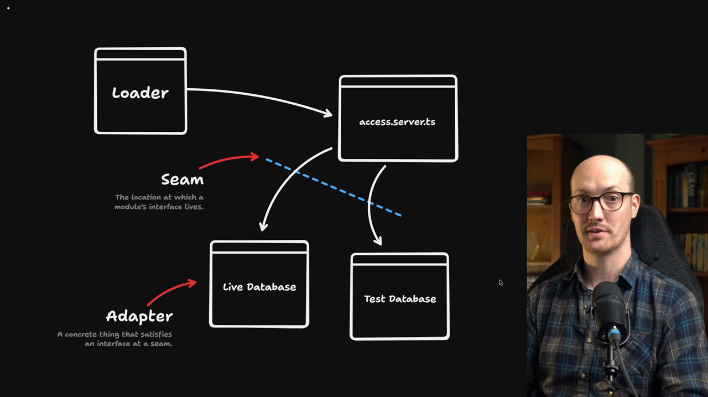
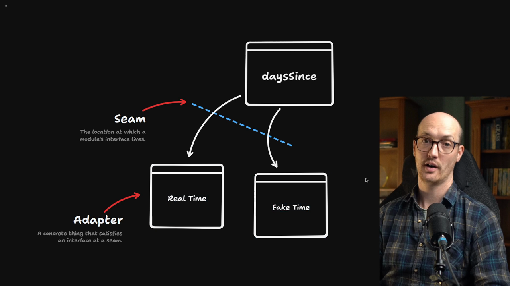

# Seams & Adapters

<Prerequisites title="Crash Course Prerequisites">
  <Prerequisite href="https://www.aihero.dev/workshops/ai-coding-crash-course/models-harnesses-agents-environments-2b9a99a1">
    The basic vocabulary of model, harness and agent that the lesson leans on.
  </Prerequisite>
  <Prerequisite href="https://www.aihero.dev/workshops/ai-coding-crash-course/build-a-feature-4e7fc274">
    What vibe-coded code looks like and why it ships bugs, which is the legacy code you're putting seams into.
  </Prerequisite>
  <Prerequisite href="https://www.aihero.dev/workshops/ai-coding-crash-course/what-are-agent-skills-20f91a4e">
    What a skill is, since the agent's proposal comes from the `/codebase-design` skill.
  </Prerequisite>
  <Prerequisite href="https://www.aihero.dev/workshops/ai-coding-crash-course/executing-your-tickets-8389d87c">
    Why tests are the agent's feedback loop, which is what a seam lets you build.
  </Prerequisite>
</Prerequisites>

Let's look at the output from the previous exercise. There's a little bit of language missing to describe what the problems in our application actually are.



Specifically, the [agent](https://www.aihero.dev/ai-coding-dictionary/agent) says there's no test file for `app/lib/access.server.ts`. It also says the module is hard to test:

> It's also hard to test: it reads the session cookie itself, calls `resolveCountry(request)`, and uses the global `db`.

But what does it mean for a module to be hard to test? Our current language has nothing to describe that.

## Seam

To talk about it, I'm going to use a word that I love but that may make you groan.

For some reason, around the Opus 4.8 to 5 era, [models](https://www.aihero.dev/ai-coding-dictionary/model) became absolutely obsessed with this word. What annoys me about that is I've been obsessed with it for much longer. It was coined by Michael Feathers in *Working Effectively with Legacy Code*.

That book and its title are relevant here, because I think of [vibe-coded](https://www.aihero.dev/ai-coding-dictionary/vibe-coding) codebases as legacy code.



Modules can depend on other modules. In other words, modules call other modules. The place where they call them is what's called a **seam**.

So the seam is the location in the code where a module's interface lives.

### Our current application has no seam

Right now, a loader calls `access.server.ts`, and `access.server.ts` calls our database.



```txt
Loader -> access.server.ts -> Database
```

This is not good. To execute `access.server.ts`, even in a test, we have to run it against the real database, which is not workable.

If you try to run tests on your production database, you are going to delete some production data.

So we need a seam between `access.server.ts` and the database, so that we can test it.

## Adapters

The useful thing about a seam is that you can replace whatever sits behind it.

In the real application, `access.server.ts` could call a live database. In tests, it could call a test database.



```txt
                                  +-> Live Database
Loader -> access.server.ts -> Seam
                                  +-> Test Database
```

These live database and test database implementations are **adapters**: the concrete implementation that satisfies an interface at a seam.

| Term | Meaning | Comes from |
| --- | --- | --- |
| Seam | The location at which a module's interface lives | Michael Feathers |
| Adapter | A concrete thing that satisfies an interface at a seam | Ports and Adapters |

I don't want to be opinionated about this language. If your team already uses terms you like, feel free to use them. But for the rest of the course, we're going to stick to these consistently.

## Finding seams in a legacy codebase

Michael Feathers says that a legacy codebase often doesn't have enough seams for you to test at.

So your first job, when you inherit a legacy codebase and need to make changes, is to find the modules you need to change and put seams around them.

For `access.server.ts`, that means figuring out a seam so we can put in either a live database adapter or a test database adapter, depending on what we need.

## What a seam looks like in code

But what do seams actually look like in code? Let's look at an example. The code is available in [this gist](https://gist.github.com/mattpocock/23c8f0a347255fded15e154300108033).

### Without a seam

Imagine a function like `daysSince`, which takes an ISO string and returns a number.

```ts
/** Whole days between an ISO timestamp and now. Negative values clamp to 0. */
export function daysSince(iso: string): number {
  const elapsed = Date.now() - new Date(iso).getTime();
  return Math.max(0, Math.floor(elapsed / 86_400_000));
}
```

It's a worthy module. We don't want this logic scattered everywhere, so putting it in a function makes sense.

But it calls `Date.now()`. It relies on the current time.

That makes it annoying to test. We have to set up fake timers in our test system, set the system time, and then reset it after each test.

```ts
import { afterEach, beforeEach, describe, expect, it, vi } from "vitest";
import { daysSince } from "./utils.js";

describe("daysSince", () => {
  beforeEach(() => {
    vi.useFakeTimers();
    vi.setSystemTime(new Date("2027-02-18T12:00:00Z"));
  });

  afterEach(() => {
    vi.useRealTimers();
  });

  it("clamps a future date to zero", () => {
    expect(daysSince("2027-03-01T00:00:00Z")).toBe(0);
  });

  it("counts whole days", () => {
    expect(daysSince("2027-02-15T11:00:00Z")).toBe(3);
  });
});
```

This works, but it would be cleaner if we could just pass the current date into `daysSince`.

### With a seam

In the other example, we pass in an ISO timestamp, and we also pass in `now`.

```ts
/** Whole days between an ISO timestamp and now. Negative values clamp to 0. */
export function daysSince(iso: string, now: Date): number {
  const elapsed = now.getTime() - new Date(iso).getTime();
  return Math.max(0, Math.floor(elapsed / 86_400_000));
}
```

The `now` parameter is the seam. It's what makes the function easier to test.

The tests show it. We just define what `now` is and pass it into the function.

```ts
import { describe, expect, it } from "vitest";
import { daysSince } from "./utils.js";

describe("daysSince", () => {
  const now = new Date("2027-02-18T12:00:00Z");

  it("clamps a future date to zero", () => {
    expect(daysSince("2027-03-01T00:00:00Z", now)).toBe(0);
  });

  it("counts whole days", () => {
    expect(daysSince("2027-02-15T11:00:00Z", now)).toBe(3);
  });
});
```



In our diagram, `daysSince` has a seam that lets us pass in either the real time or a fake time. Those are two adapters.

## Back to the agent's proposal

Now look back at the function the agent proposed. It says to split `getAccess` into a thin request adapter and a core function, where we pass the database into `resolveAccess`.

```ts
resolveAccess(db, userId, courseId, currentCountry)
```

The agent knows how to do this because it knows about seams.

## Recap

- **Seam:** the place where you can alter behavior without editing in that place. It's the location at which a module's interface lives.
- **Adapter:** the concrete thing that satisfies an interface at a seam.

That's all of the terms in the glossary, so we now understand the whole of the `/codebase-design` [skill](https://www.aihero.dev/ai-coding-dictionary/skill).

Next, we're going to apply this by trying to rescue our legacy codebase.

<Quiz>
  <QuizQuestion data={{
    id: "seam-test-database-choice",
    question: "One of your modules imports a global client for an external service and calls it directly. You want to test the module's logic without hitting the real service. What do you do first?",
    type: "multiple-choice",
    choices: [
      { answer: "a", label: "Put a seam between the module and the client, so a test adapter fits" },
      { answer: "b", label: "Run the tests against the real service but clean up the data afterwards" },
      { answer: "c", label: "Write the test file first and mock whichever code calls the module" },
      { answer: "d", label: "Rewrite the calling code so that it no longer uses the module at all" }
    ],
    correct: "a",
    answer: "The problem is the missing seam between the module and the service. With a seam, a live adapter runs in production and a test adapter runs in tests. Running tests against the real service risks damaging real data, and mocking or rewriting the caller leaves the module still tied to the real service."
  }} />
  <QuizQuestion data={{
    id: "dayssince-now-parameter-seam",
    question: "A function reads the current time itself, so its tests need fake timers. How do you make it easier to test?",
    type: "multiple-choice",
    choices: [
      { answer: "a", label: "Add a parameter for the current time that the test passes in" },
      { answer: "b", label: "Keep reading the clock and move the fake timer setup into a shared helper" },
      { answer: "c", label: "Wrap the clock call in a second function inside the same file" },
      { answer: "d", label: "Delete the function and inline the logic at each call site" }
    ],
    correct: "a",
    answer: "The parameter is the seam: the real clock is one adapter and a fixed date in a test is another. A shared helper still patches the global clock, a wrapper in the same file offers no place to substitute, and inlining spreads the logic everywhere."
  }} />
</Quiz>
