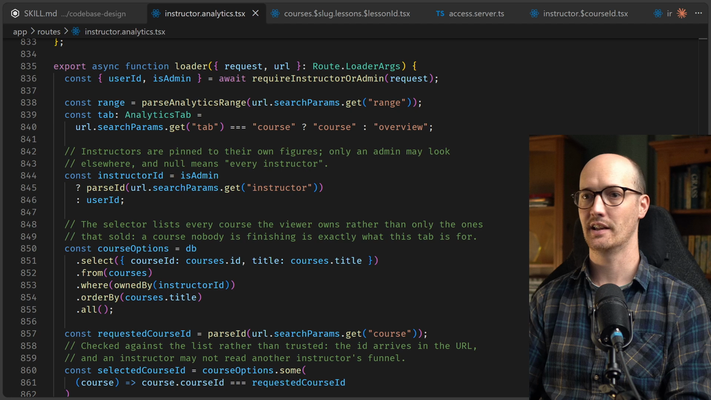
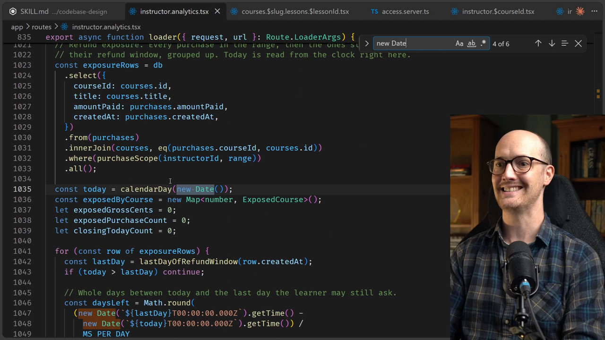

# Making Legacy Code Testable

<CommitMap packageManager="npm">
  <Commit id="untestable-date-dependency">Start the lesson: the untested Instructor Analytics loader</Commit>
  <Commit id="extract-a-module-from-a-loader">See my solution: the loader logic extracted into its own module</Commit>
</CommitMap>

<Prerequisites title="Crash Course Prerequisites">
  <Prerequisite href="https://www.aihero.dev/workshops/ai-coding-crash-course/how-to-run-the-exercises-a0eb0474">
    How to check out a lesson's reset point, the first step here.
  </Prerequisite>
  <Prerequisite href="https://www.aihero.dev/workshops/ai-coding-crash-course/build-a-feature-4e7fc274">
    What vibe-coded code looks like and why it ships bugs, which is the codebase you're rescuing.
  </Prerequisite>
  <Prerequisite href="https://www.aihero.dev/workshops/ai-coding-crash-course/what-are-agent-skills-20f91a4e">
    What a skill is and how you invoke one like `/codebase-design` yourself.
  </Prerequisite>
  <Prerequisite href="https://www.aihero.dev/workshops/ai-coding-crash-course/executing-your-tickets-8389d87c">
    Why tests are the agent's feedback loop, and why more coverage makes changes safer.
  </Prerequisite>
</Prerequisites>

Before we fix the auth issues, we need practice on something smaller. The Instructor Analytics page has a 300-line loader with no tests, and it is very hard to test.

It calls the database directly, reads the current date itself, and inlines almost everything. Your job is to put seams into it so you can inject a test database and a date.



## Why This Loader Is Hard To Test

The route lives in `app/routes/instructor.analytics.tsx`, a file of roughly 2,000 lines. The `loader` alone is around 300 lines, and almost none of it is split into other functions.

You could test the `loader` directly. It takes two parameters, a `request` and a `url`. But that gives you no way to inject the things a test really needs:

| Dependency | Problem |
| --- | --- |
| Database | The route imports the global `db` and queries it inline |
| Current date | The loader calls `calendarDay(new Date())` itself, with more clock reads further down |

This is the same shape of problem as the date dependency in the previous example.



## The Direction To Aim For

The preferred approach is to make the `loader` very small and have it hand its work to a different module.

Picture a function along the lines of `getInstructorAnalytics`. It would take the database, the instructor ID, the range, the tab, the selected course ID and whether the viewer is an admin.

That is pseudocode. Nobody has checked it against everything the loader needs, so treat it as a direction, not a [spec](https://www.aihero.dev/ai-coding-dictionary/spec).

This time you are going to edit the code. The goal is to increase test coverage in this area so later changes are safer. It is exactly what you would do if handed a [vibe-coded](https://www.aihero.dev/ai-coding-dictionary/vibe-coding) codebase.

## Steps To Complete

### Get Set Up

- [ ] Check out the reset point

Start from the `untestable-date-dependency` commit shown in the commit map above, so your code matches the lesson.

- [ ] Open `app/routes/instructor.analytics.tsx` and read the `loader`

Note what it does inline: the direct `db` queries and the places it reads the current date. These are the things you want to be able to replace in a test.

### Make It Testable

- [ ] Open your [agent](https://www.aihero.dev/ai-coding-dictionary/agent) and ask it to look at `instructor.analytics.tsx` using the `/codebase-design` [skill](https://www.aihero.dev/ai-coding-dictionary/skill)

Focus on the `loader` specifically. Here is an example prompt you can adapt:

```
/codebase-design Look at app/routes/instructor.analytics.tsx. The loader is very hard to test because it calls the database directly and reads the current date itself. I want to add seams so I can inject a test database and the current date. Propose the interface before changing any code.
```

- [ ] Make sure the design puts seams where the dependencies enter

You want to be able to pass in a test database, and you probably want to pass in the current date too.

- [ ] Shrink the `loader`

Aim for a `loader` that stays small and delegates its real work to a separate module, which is where the injected dependencies go.

- [ ] Edit the code to implement the design

Unlike the previous example, this time you are changing the code, not just planning.

### Verify

- [ ] Write tests against the new module

Pass in a test database and a date of your choosing. The aim is more test coverage on an area that had none.

- [ ] Run your tests and typecheck

Confirm the tests pass and the route still compiles with the smaller `loader`.

When you are done, compare your result with the solution commit, `extract-a-module-from-a-loader`.