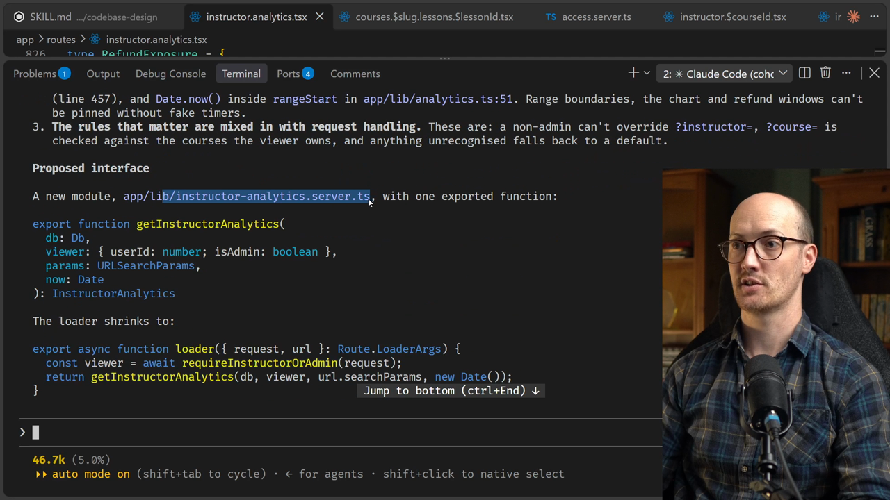
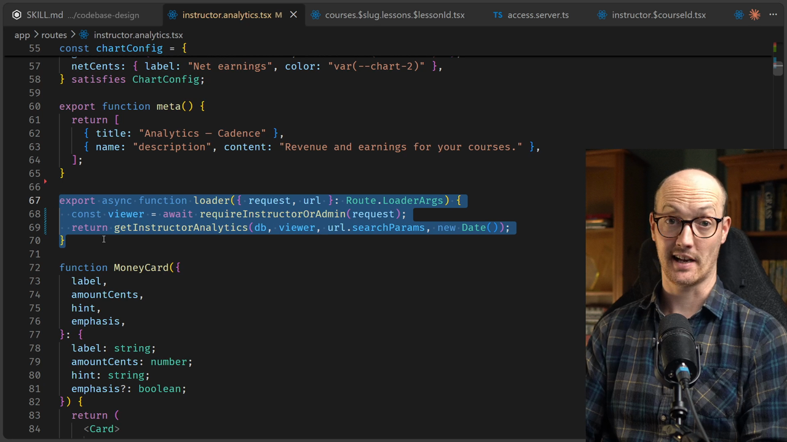
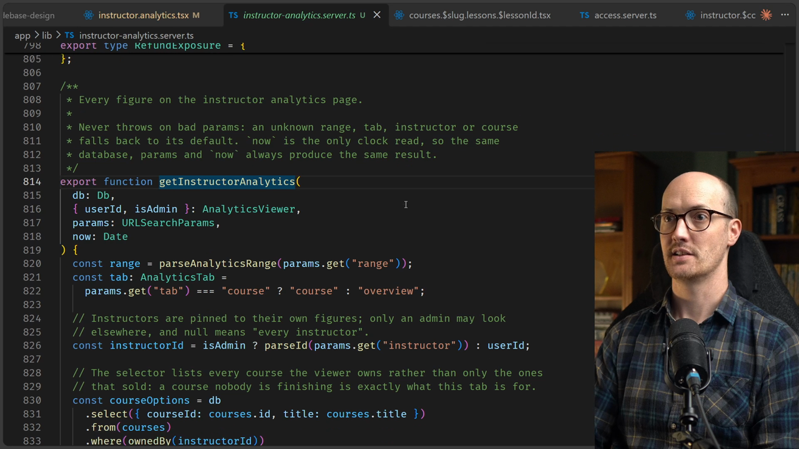
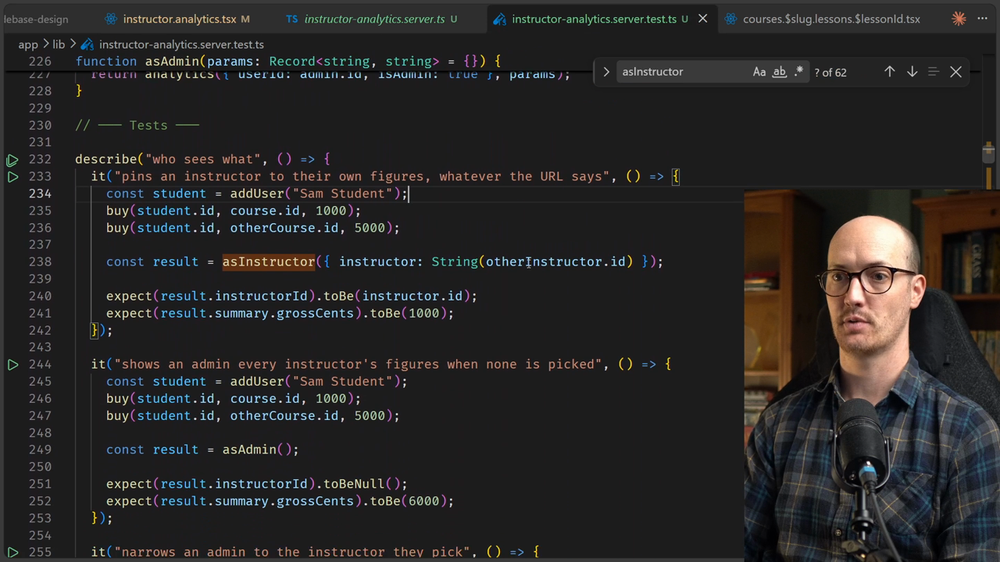
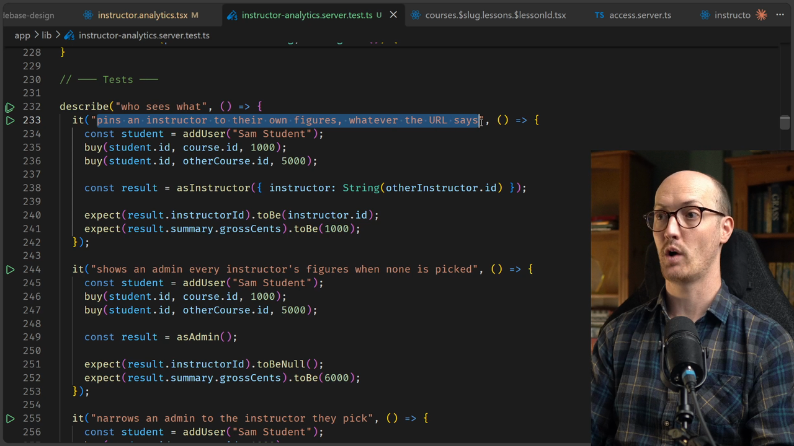
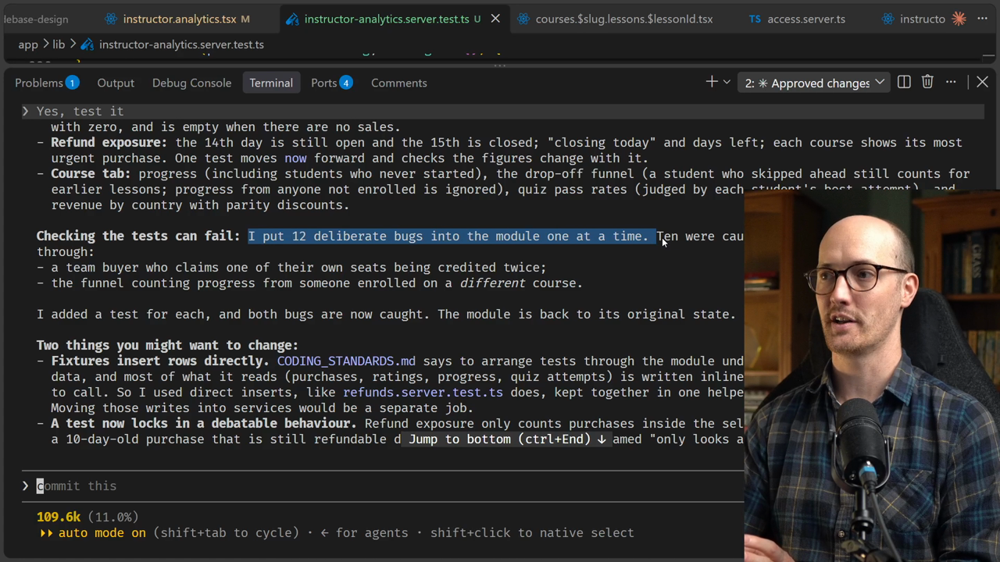

# Making Legacy Code Testable Solution

<CommitMap packageManager="npm">
  <Commit id="untestable-date-dependency">Start the lesson: the untested Instructor Analytics loader with the global `db`, inline queries and clock reads</Commit>
  <Commit id="extract-a-module-from-a-loader">See my solution: the loader body moved into `getInstructorAnalytics`, with a test file next to it</Commit>
</CommitMap>

## Writing the prompt

Let's put together a prompt. In the Instructor Analytics route there is a loader that is very difficult to test, and I want to test the wazoo out of it.

To do that, we need to insert some seams, because currently all the logic is inline in the loader. I also ask the [agent](https://www.aihero.dev/ai-coding-dictionary/agent) to run the design of the interface by me before it continues.

```md
/codebase-design

In the instructor analytics route, there is a loader that is very difficult to test, and I want to test the wazoo out of it. To do that, we're going to need to insert some seams into there because currently all the logic is inline in the loader. Run the design of the interface by me before you continue.
```

I think the phrase is "test it out the wazoo", but hopefully the agent will understand.

## The proposed interface

The agent has read the loader and proposed an interface.



The current loader is about 290 lines, and about 600 more lines of helpers sit above it. Three things stop it from being tested:

- It uses the global database.
- It reads the clock in three places.
- The rules that matter are mixed in with request handling.

So it proposes a new module, `app/lib/instructor-analytics.server.ts`, with a single exported function. This is kind of like what we proposed earlier. It takes the database, the viewer, the params, and the `now`.

```ts
export function getInstructorAnalytics(
  db: Db,
  viewer: { userId: number; isAdmin: boolean },
  params: URLSearchParams,
  now: Date
): InstructorAnalytics
```

That means the loader shrinks to about four lines. We require the user to be an instructor or an admin, and then we pass everything into `getInstructorAnalytics`.

```ts
export async function loader({ request, url }: Route.LoaderArgs) {
  const viewer = await requireInstructorOrAdmin(request);
  return getInstructorAnalytics(db, viewer, url.searchParams, new Date());
}
```

It also tells us what the function promises callers, and then talks through some of the existing implementation decisions that it would continue to uphold.

## Confirming the design choices

Then it asks me to confirm some choices.

**Raw `URLSearchParams`, not already-parsed values.** It wants to do this because it makes the security rules, like instructor pinning and the course ownership check, part of what the tests can reach.

This is fantastic. It's trying to take in more functionality, hide more secrets and pull in more implementation, so the module can be deeper. I love it.

**One function, not one per panel.** In my book, that is correct. If we have multiple functions, we get less locality, because all of those functions are going to be spread in different places.

**No fake database.** That's correct too. We've already got an in-memory database used elsewhere, so we're going to continue to use that.

It also looks like there's some duplication it wants to remove. It wants to pull the date injection down into another module as well, which is again fine by me.

This looks like a dream, nice work. I tell it to go ahead and make the changes, running the tests as it does.

```md
This looks like a dream. Nice work. Go ahead and make the changes. Running the tests as you do.
```

I don't know why I feel the need to compliment my agents, but I do. It's nice to be nice.

I'm going to let it cook for a minute. Hopefully I'll come back to green tests and some nicer looking code.

## The result: a thin loader

Some progress has been made. The loader is now exactly as the agent said it was going to be.



The file was around 2,000 lines. It's still pretty big at about 1,000 lines, but all of those lines appear to be essentially just JSX.

So all of it is front end, and almost none of it is back end. The back end has moved into `getInstructorAnalytics`.

## The deep module

This is now our deep module. It holds all of the logic that was previously in the loader, unchanged, moved to a different function.



Crucially, it is now testable. We have a new test file right next to it with a bunch of tests, and a set of test fixtures added at the top.



It seeds some base data at the top, which is a standard test setup:

- an instructor and a course
- another instructor and another course
- an admin

```ts
beforeEach(() => {
  db = createTestDb();
  const base = seedBaseData(db);
  instructor = base.instructor;
  categoryId = base.category.id;
  course = base.course;
  otherInstructor = addUser("Olive Other", UserRole.Instructor);
  admin = addUser("Pat Admin", UserRole.Admin);
  otherCourse = addCourse(otherInstructor.id, "Other Course");
});
```

Rather than zooming down, we can look at the `analytics` helper. It gives us a function we can run as an instructor or run as an admin.

```ts
function analytics(
  viewer: AnalyticsViewer,
  params: Record<string, string> = {}
) {
  return getInstructorAnalytics(db, viewer, new URLSearchParams(params), NOW);
}

function asInstructor(params: Record<string, string> = {}) {
  return analytics({ userId: instructor.id, isAdmin: false }, params);
}

function asAdmin(params: Record<string, string> = {}) {
  return analytics({ userId: admin.id, isAdmin: true }, params);
}
```

Each test exercises a little bit of the behavior. We can see how short these tests are, because our test setup is so good and because our module is easy to test.

## Reading a test

We add a user called Sam Student. They buy a course and pay 1,000, and then they buy another course and pay 5,000.

This test says that it pins an instructor to their own figures, whatever the URL says. Even if we try to access it with the other instructor, we only see the instructor we're logged in as. So we only see the 1,000 figure, not the 5,000 figure that came from the other instructor.



```ts
describe("who sees what", () => {
  it("pins an instructor to their own figures, whatever the URL says", () => {
    const student = addUser("Sam Student");
    buy(student.id, course.id, 1000);
    buy(student.id, otherCourse.id, 5000);

    const result = asInstructor({ instructor: String(otherInstructor.id) });

    expect(result.instructorId).toBe(instructor.id);
    expect(result.summary.grossCents).toBe(1000);
  });
```

## Checking the tests can fail

The agent has been pretty good at verifying its own work. It noticed that the tests were all passing, so it put 12 deliberate bugs into the module, one at a time.

Ten were caught straight away. Two got through, and it added a test for each.



## Why this is a win

These tests are really clean to write, and they exercise a huge chunk of real code. So I have a lot of confidence in them.

It means future updates to the analytics page, inside this big old function, are going to be pretty easy to make. We've got great test coverage inside a deep module.

To me this feels like a big win. We are one step closer to a nice healthy codebase.

