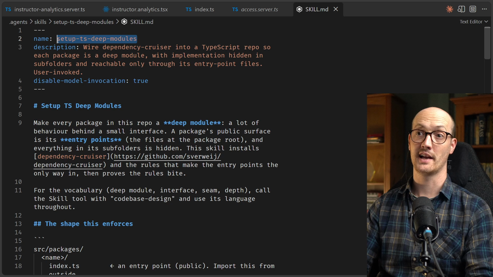

# Enforcing Module Boundaries

<CommitMap packageManager="npm">
  <Commit id="extract-a-module-from-a-loader">Start the lesson: `getInstructorAnalytics` extracted into `app/lib`, but nothing enforces a boundary</Commit>
  <Commit id="wire-deep-module-boundary">See my solution: dependency-cruiser wired in, module moved to `app/modules/instructor-analytics/`</Commit>
</CommitMap>

<Prerequisites title="Crash Course Prerequisites">
  <Prerequisite href="https://www.aihero.dev/workshops/ai-coding-crash-course/non-determinism-c31d9cdd">
    Why an agent reviewing diffs won't behave the same way twice, so you want a deterministic check.
  </Prerequisite>
  <Prerequisite href="https://www.aihero.dev/workshops/ai-coding-crash-course/statelessness-1fdb45c1">
    Why the next agent along repeats old mistakes unless the codebase stops it.
  </Prerequisite>
  <Prerequisite href="https://www.aihero.dev/workshops/ai-coding-crash-course/what-are-agent-skills-20f91a4e">
    The difference between skills the agent picks up and ones only you can invoke.
  </Prerequisite>
  <Prerequisite href="https://www.aihero.dev/workshops/ai-coding-crash-course/enforcing-your-coding-standards-f1656d67">
    The three levels of checks, and why you push rules down into automated checks.
  </Prerequisite>
</Prerequisites>

Our loader now calls a deep module, and the code that ships is close to the code under test. The problem is keeping it that way. The next [agent](https://www.aihero.dev/ai-coding-dictionary/agent) along will happily repeat the old mistakes.

Nothing stops the route querying the database directly, or the module going shallow again. [Human review](https://www.aihero.dev/ai-coding-dictionary/human-review) is onerous, and an agent reviewing diffs still isn't deterministic. We want an [automated check](https://www.aihero.dev/ai-coding-dictionary/automated-check) that works the same way every time.

## Steps To Complete

### Set Up The Boundary

- [ ] Look at the [skill](https://www.aihero.dev/ai-coding-dictionary/skill) that has been in the repo all along

The skill lives at `.agents/skills/setup-ts-deep-modules/SKILL.md`. It is experimental and only you can invoke it. Read it to see the shape it enforces: entry point files at the root of each module, `lib/` for hidden implementation, and co-located tests.



- [ ] Run the skill in your agent, pointing it at `app/modules`

Ask it to move the instructor analytics module in and stop the route from querying the database itself.

```
/setup-ts-deep-modules Use the directory app/modules. Move in the instructor analytics module we just pulled out of the analytics route, and stop that route from querying the database itself
```

- [ ] Check that dependency-cruiser has been installed and configured

You should see the package in your dependencies and a `.dependency-cruiser.cjs` config containing the rules.

### Review The Module Shape

- [ ] Confirm the module has moved into `app/modules/instructor-analytics/`

It should follow this shape. Only the root files are public.

```txt
app/modules/instructor-analytics/
  index.server.ts  <- entry point, import this from outside
  lib/             <- implementation, hidden from outside the module
  tests/           <- co-located tests and fixtures
```

- [ ] Confirm the route has a rule of its own

`app/routes/instructor.analytics.tsx` should no longer be able to import `db`. Any new figure on that page has to go into the module, where its tests live.

### Prove The Check Works

- [ ] Try breaking the boundary on purpose

Import something from inside `lib/` in a file outside the module, such as the route. Then run the boundary check.

```bash
npm run lint:boundaries
```

- [ ] Confirm it fails, then undo your change

You should see an error naming the rule you broke. Try the same with an import of `~/db` in the route.

- [ ] Check that `lint:boundaries` is part of `npm run check` and the coding standards

This keeps the rule enforced for every future agent, and gets it in front of them before they write code.

```bash
npm run check
```
