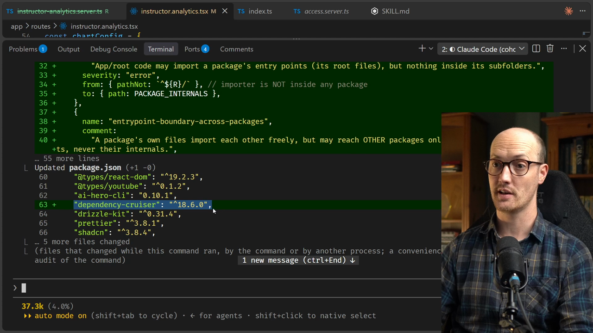
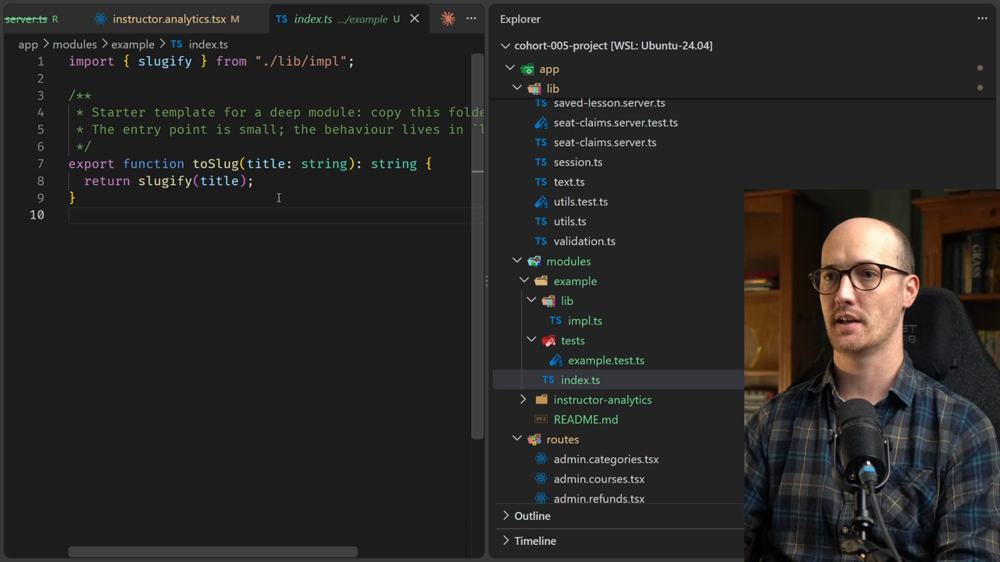
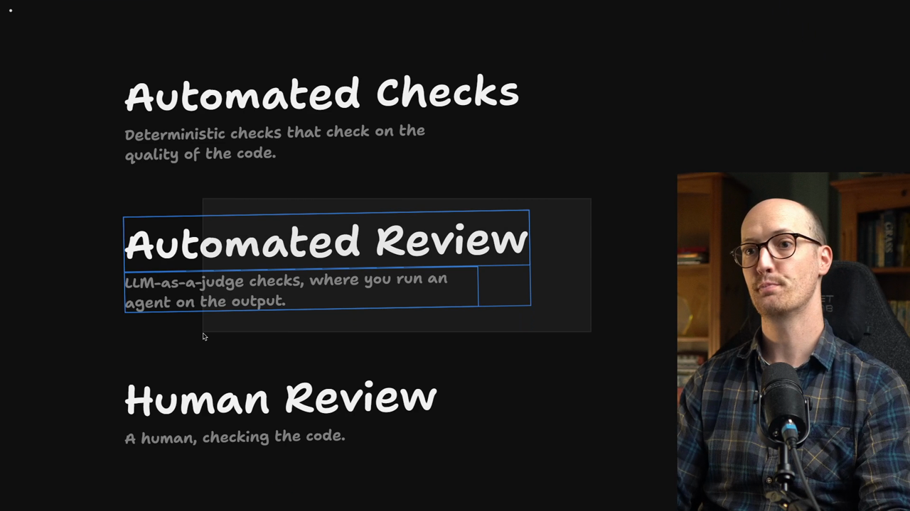

# Enforcing Module Boundaries Solution

<CommitMap packageManager="npm">
  <Commit id="extract-a-module-from-a-loader">Start the lesson: the instructor analytics logic lives in `app/lib/instructor-analytics.server.ts`, the route still imports `db`, and there is no boundary tooling</Commit>
  <Commit id="wire-deep-module-boundary">See my solution: dependency-cruiser wired up, the `app/modules/instructor-analytics/` module, the `instructor-analytics-route-no-db` rule, and the `AGENTS.md` and `CODING_STANDARDS.md` updates</Commit>
</CommitMap>

## Running the setup skill

The prompt goes to the [agent](https://www.aihero.dev/ai-coding-dictionary/agent), using the `/setup-ts-deep-modules` [skill](https://www.aihero.dev/ai-coding-dictionary/skill):

```
/setup-ts-deep-modules Use the directory app/modules. Move in the instructor analytics module we just pulled out of the analytics route, and stop that route from querying the database itself
```

Once it has run, it has created a new config file, `.dependency-cruiser.cjs`. It has also installed `dependency-cruiser` inside `package.json`.



## The example module

The skill also created an example module. I find this quite useful for agents. It gives them a working template of what a deep module looks like.

```
app/modules/example/
  index.ts
  lib/impl.ts
  tests/example.test.ts
```

Here are our modules. Inside `lib` we have `impl.ts`, which holds the `slugify` function. We have some tests, which test `slugify` through `example.test.ts`. Then we have an `index.ts`.

`index.ts` is the entry point for this deep module. The only thing we can import here is `toSlug`.

```ts
import { slugify } from "./lib/impl";

/**
 * Starter template for a deep module: copy this folder or delete it.
 * The entry point is small; the behaviour lives in `lib/`.
 */
export function toSlug(title: string): string {
  return slugify(title);
}
```



## The instructor analytics module

It looks like the agent has already finished moving the logic into the instructor analytics module. We can see `modules`, `instructor-analytics`, and an `index.server.ts`.

```
app/modules/instructor-analytics/
  index.server.ts
  lib/instructor-analytics.ts
  tests/instructor-analytics.test.ts
```

Inside the entry point, we export a bunch of types, which is nice. Then we have our `createInstructorAnalytics` function. It takes in a database, and it has a `get` function to get the instructor analytics.

```ts
export function createInstructorAnalytics(database: Db) {
  return {
    get(viewer: AnalyticsViewer, params: URLSearchParams, now: Date) {
      return getInstructorAnalytics(database, viewer, params, now);
    },
  };
}

// Pure so a route importing this only for its loader doesn't pull the
// database into the client bundle (see `~/db`).
export const instructorAnalytics =
  /* @__PURE__ */ createInstructorAnalytics(db);
```

It has even designed it so that its loader doesn't pull the database into the client bundle.

## The route no longer touches the database

Now look at the route. We are no longer able to import `db` from here. Instead, the loader calls `instructorAnalytics.get(viewer, url.searchParams, new Date())`.

```tsx
export async function loader({ request, url }: Route.LoaderArgs) {
  const viewer = await requireInstructorOrAdmin(request);
  return instructorAnalytics.get(viewer, url.searchParams, new Date());
}
```

## How the boundaries are enforced

How is it actually enforcing this? How do we give it a go?

We can take a look inside `package.json`. There is a new `lint:boundaries` script that runs `depcruise app`.

```json
"lint:boundaries": "depcruise app"
```

We can check this by running it in a terminal:

```bash
npm run lint:boundaries
```

```txt
✔ no dependency violations found (143 modules, 716 dependencies cruised)
```

No dependency violations are found.

## Trying to break it: a deep import from the route

Let's see if we can trigger an error. In the private `lib` of the instructor analytics module, I export the `parseId` function.

```ts
/** A search param that should be a row id, or null if it isn't one. */
export function parseId(value: string | null): number | null {
  const id = Number(value);
  return value !== null && Number.isInteger(id) && id > 0 ? id : null;
}
```

Then I go to the route itself and try to call it from there. I call `parseId` with `"foobar"`.

```tsx
export async function loader({ request, url }: Route.LoaderArgs) {
  parseId("foobar");
  const viewer = await requireInstructorOrAdmin(request);
  return instructorAnalytics.get(viewer, url.searchParams, new Date());
}
```

`parseId` is available here. If we check where the import is coming from, it comes from `modules/instructor-analytics/lib/instructor-analytics`. That is supposed to be private.

Now if I run `npm run lint:boundaries` again, we get an error.

```txt
error entrypoint-boundary-from-app: app/routes/instructor.analytics.tsx → app/modules/instructor-analytics/lib/instructor-analytics.ts
```

In other words, the app at large is not supposed to be able to reach in there and grab it.

## Should a module's own tests be allowed to reach in?

What about inside the module's own test suite? Should that be allowed? Let's say I import `parseId` inside `instructor-analytics.test.ts`.

We are inside the instructor analytics module, after all. We are just in its tests. Are we allowed to import from `lib`, or do we need to go through the index?

Let's try it out by running `npm run lint:boundaries`. There are now two dependency violations.

| Violation | Rule |
| --- | --- |
| The route importing from `lib` | `entrypoint-boundary-from-app` |
| The test file importing from `lib` | `tests-through-entrypoints` |

In other words, you have to run these tests through the entry points. You cannot pull out an implementation detail from behind the interface and play with it and test it.

## Closing the loop on bad tests

This closes a loop that we've had open this whole section: how do you stop the agent from writing bad tests? This is how you do it.

The only thing the tests can import now is the `createInstructorAnalytics` function.

```ts
import {
  createInstructorAnalytics,
  type AnalyticsViewer,
} from "../index.server";
```

It was so satisfying when I discovered this. I realized I had made an entire category of classic agent errors a lot harder for the agent to make.

## A gap: the route can still import `db`

Our job is not quite done, though. Inside the instructor analytics route, I can still import `db` from wherever it lives.

```tsx
import { db } from "~/db";
```

Even with that bad import in place, I don't get any errors. I've cleaned up all the other dependency violations, so the lint now passes. It doesn't warn me that I've imported `db` from the wrong zone.

This should be an error. If we prevent it, the module has a much harder time becoming shallow again.

So I bring up the agent and say:

```
You haven't made a dependency cruiser rule preventing instructor analytics from importing db. Fix that.
```

## What the config looks like

This is what the config looks like. Each rule has a name, here `instructor-analytics-route-no-db`. The comment explains that the route gets its data from the instructor analytics module, never by querying the database itself.

Then it has a regex for the path it is `from`, and the path it is `to`.

```js
{
  name: "instructor-analytics-route-no-db",
  comment:
    "The instructor analytics route gets its data from the instructor-analytics module, never by querying the database itself.",
  severity: "error",
  from: { path: "^app/routes/instructor\\.analytics\\.tsx$" },
  to: { path: ["^app/db/", "^node_modules/(drizzle-orm|better-sqlite3)/"] },
},
```

We've been conservative here and restricted it to the instructor analytics route. You can imagine widening it so that all routes could only import from deep modules.

We won't do that now, because it would be a hell of a refactor to take all of this code and put it in deep modules.

But you start to see how powerful this is with just a relatively few rules. You could get a very locked down file structure, where your tests always import from the right place and your loaders handle things nicely too.

## Checking the new rule

Now the agent has added that rule. My deliberate failure is still in place in the route, so running `npm run lint:boundaries` should show a violation.

```txt
error instructor-analytics-route-no-db: app/routes/instructor.analytics.tsx → app/db/index.ts
x 1 dependency violations (1 errors, 0 warnings). 142 modules, 716 dependencies cruised.
```

When I remove the import and rerun it, we're good to go.

## Part of the standard checks

As part of this, the agent has also added `lint:boundaries` to `AGENTS.md`. It has added it to `npm run check` too.

```json
"check": "npm run typecheck && npm run lint:boundaries && npm run test"
```

This becomes part of the standard set of checks the agent runs every time it commits a change.

## A second line of defense

Finally, it makes sense to loop [automated review](https://www.aihero.dev/ai-coding-dictionary/automated-review) into this as well.



| Kind | What it is |
| --- | --- |
| [Automated checks](https://www.aihero.dev/ai-coding-dictionary/automated-check) | Deterministic checks on the quality of the code |
| Automated review | LLM-as-a-judge: you run an agent on the output |
| [Human review](https://www.aihero.dev/ai-coding-dictionary/human-review) | A human checking the code |

It's very easy for agents to cheat automated checks. The agent could simply go into the config file and comment out something it didn't want to work around.

So we probably need a second line of defense to make sure our modules stay deep. I go into my agent again and say:

```
Could you also add some information about this into coding standards to make sure we have a second line of defense?
```

That way all of our checks and all of our review work together.

With that, we have some extra lines at the bottom of `CODING_STANDARDS.md`:

```md
## Import a module only through its entry points

A module in `app/modules/` exposes its root files and hides everything in
its subfolders. Import `~/modules/<name>/index.server`, never
`~/modules/<name>/lib/...`, and have the module's own tests do the same.

## A route does not query data a module owns

Once a module owns a feature's data, the route asks the module for it and
does not import `~/db` or `drizzle-orm` itself.
```

## Wrapping up

So there we go. We have figured out a way to enforce deep modules in our codebase.

When we refactor into a deep module, or create a new feature as a deep module, the agent is going to have a hard time reverting or cheating it.

Nice work, and I'll see you in the next one.

