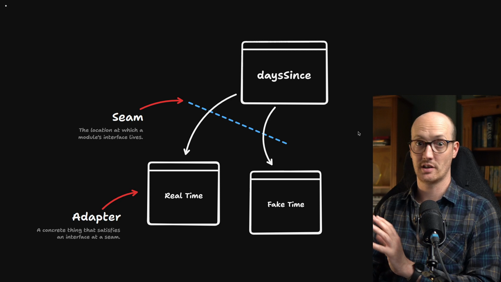
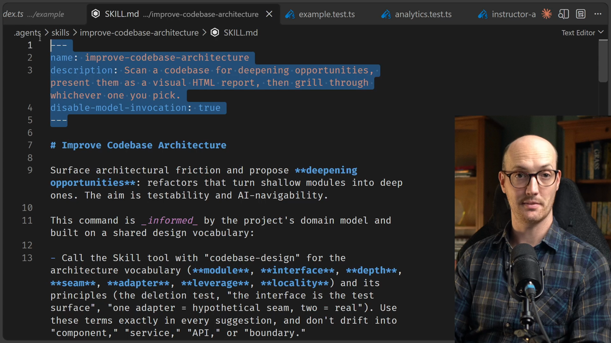

# The /improve-codebase-architecture Skill

<CommitMap packageManager="npm">
  <Commit id="wire-deep-module-boundary">Start the lesson: with dependency-cruiser and the `instructor-analytics` module boundary in place</Commit>
</CommitMap>

<Prerequisites title="Crash Course Prerequisites">
  <Prerequisite href="https://www.aihero.dev/workshops/ai-coding-crash-course/models-harnesses-agents-environments-2b9a99a1">
    What a tool call is, since this skill works by calling the skill tool.
  </Prerequisite>
  <Prerequisite href="https://www.aihero.dev/workshops/ai-coding-crash-course/codebase-exploration-205910ac">
    How an agent explores a codebase from scratch, which this skill does before reporting.
  </Prerequisite>
  <Prerequisite href="https://www.aihero.dev/workshops/ai-coding-crash-course/the-grill-execute-clear-loop-fac85414">
    What a grilling session is, which this skill hands you into.
  </Prerequisite>
  <Prerequisite href="https://www.aihero.dev/workshops/ai-coding-crash-course/what-are-agent-skills-20f91a4e">
    How skills load on demand and call each other, and what a user-invoked skill is.
  </Prerequisite>
</Prerequisites>

Codebase design has one annoying problem: it's hard to see whether the changes you're making will actually improve things. Our explanations have been visual, but when we write code or read [agent](https://www.aihero.dev/ai-coding-dictionary/agent) output, we only get raw text.

The `/improve-codebase-architecture` [skill](https://www.aihero.dev/ai-coding-dictionary/skill) fixes that. It scans for shallow modules and presents deepening opportunities as a visual report.

In this exercise, you'll point it at one module and explore what it suggests, without changing any code.



## How the skill works

`/improve-codebase-architecture` is a user-invoked skill. It surfaces architectural friction and proposes refactors that turn shallow modules into deep ones. It's been in the repo since earlier in the course, in `SKILL.md`.



Here's what it does, in order:

1. It calls the skill [tool](https://www.aihero.dev/ai-coding-dictionary/tool) with `/codebase-design`, so it uses the same terminology you've learned so far.
2. It explores the codebase. It scopes before it scans, looking for hotspots, and it reads the project's domain glossary.
3. It presents candidates as an HTML report, so you can see the changes visually before choosing one.
4. It starts a [grilling](https://www.aihero.dev/ai-coding-dictionary/grilling) session using the `/grilling` skill.
5. It calls the `/domain-modeling` skill, because merging modules into deep ones often means deciding what to name them.

That last step is where you can feed the glossary.

## Steps To Complete

### Run the skill on a specific module

- [ ] Run `/improve-codebase-architecture`, targeted at `app/lib/access.server.ts`

We already have an idea of what needs doing, so don't let the skill roam the whole codebase. Point it at one module.

```
/improve-codebase-architecture I think our access.server.ts file is getting a little bit out of control and is a good candidate for deepening.
```

- [ ] Open the HTML report it produces

Make no code changes yet. All you're doing is looking at the options it gives you.

- [ ] Review the candidates and consider which one you'd go for

### Grill and model the domain

- [ ] Go through a short grilling session on the candidate you prefer

The skill hands off to `/grilling` to work out what you want to build.

- [ ] Work through the `/domain-modeling` step

Use it to settle on names for the deep modules you'd create.

- [ ] Commit any glossary changes that come out of it

If the [session](https://www.aihero.dev/ai-coding-dictionary/session) surfaces terms worth adding to the glossary, commit them. They're always useful.

### Keep the boundary in mind

- [ ] Check that any deep module the skill proposes would live in `app/modules/`

Now that we've set up deep modules there, we want to move a lot of our folders into it. That way the boundaries get respected and dependency-cruiser does its job.
